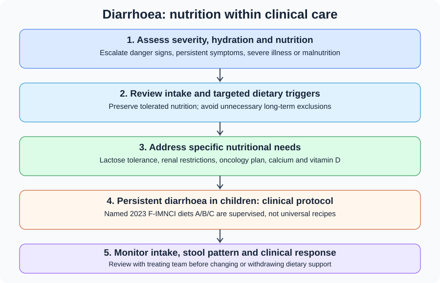

# Diarrhoea dietary care

**Status:** Isolated PR35 study candidate, unattempted. Not approved for clinical practice or publication. The named Indian F-IMNCI 2023 recommendations are source-dated. Severe illness, dehydration, persistent diarrhoea, malnutrition and cancer-treatment diarrhoea require appropriate clinical assessment. Do not apply specialist diets as household recipes.

[20 original practice MCQs](../MCQs/10C-Diarrhoea-Dietary-Care-20-MCQs.md)

## Adult diet: symptoms and nutrient adequacy

Diarrhoea mein food and fluid losses ke saath actual intake bhi kam ho sakti hai. Hydration assess karo aur prescribed rehydration plan follow karo. Patient ke symptoms worsen karne wale foods identify karo. Caffeine, alcohol, excessive simple sugars aur greasy foods kuch patients mein problem badha sakte hain. Same tolerated protein food ko less greasy cooking method mein offer karna targeted approach ho sakta hai. Ordinary diet ko unnecessary prolonged restricted diet mein convert mat karo. Traditional BRAT pattern ki universal superiority established nahi hai.

## Lactose restriction ka specific meaning

Lactose milk sugar hai, milk protein nahi. Lactose-free cow's milk mein protein usually present rehta hai, so milk allergy mein safe assume nahi karna chahiye. Ingredient list mein dry milk solids aur whey jaise terms relevant hain. Individual tolerance differ karti hai. Complete dairy exclusion mein calcium aur vitamin D adequacy review karo. Suitable alternatives dietitian ke saath select karo. Renal disease mein diarrhoeal losses ke bawajood potassium-rich food recommendation ko existing restriction aur current electrolytes ke against review karna hota hai.

## Special clinical contexts

Cancer treatment ke dauran diarrhoea ko oncology team ko report karo. Temporary lower-fibre food choices, e.g. white toast, selected cases mein symptom-directed plan ka part ho sakti hain. Severe ya worsening symptoms ko sirf diet se manage karna unsafe ho sakta hai. Microscopic colitis alone lifelong gluten-free diet ka automatic indication nahi hai. Coexisting coeliac disease aur lactose intolerance ke specific dietary requirements alag hain.

Food and symptom diary temporal association dikhati hai, cause establish nahi karti. Medication changes aur other disease factors review karo. Prescribed medicines independently stop mat karo.

## Indian F-IMNCI 2023: persistent diarrhoea

Chart 6.4 persistent diarrhoea of 14 days or more mein risk factors assess karti hai. No-risk pathway mein suitable age-appropriate feeding, breastfeeding support aur non-breast milk modification ke options hain. Selected older infant/child mein tolerated fermented milk such as curd option ho sakti hai. Risk factors, dehydration or failure of outpatient care require appropriate facility assessment. Named facility diet sequence medically supervised hai. Severe malnutrition aur very young infants ke separate clinical protocols apply ho sakte hain.

| Named diet | Teaching distinction |
|---|---|
| A | Reduced lactose, initial diet for suitable hospitalized children under the 2023 protocol |
| B | Lactose-free with reduced starch, escalation after specified Diet A failure criteria |
| C | Monosaccharide-based carbohydrate with protein source and added fat, for selected persistent intolerance under specialist review |

Chart 6.4 ke footnote mein Diet A par >10 diarrhoeal stools/day for >72 hours **or** no weight gain after seven days par Diet B transition described hai. Worsening condition ko threshold complete hone ka wait kiye bina review karo. Sustained improvement after 1–2 weeks par Diet B se Diet A aur phir normal diet transition described hai. Qualified clinical team hydration, infection, intake and tolerance reassess kare.

## Hypothetical worked calculations

**Weight response:** 8 kg starting weight, 150 g gain over 3 days: 150 ÷ (8 × 3) = 6.25 g/kg/day. Comparable hydration and other improvements are necessary. Box 6.6 response marker >5 g/kg/day is one part of assessment, not a standalone discharge rule.

**Energy reconciliation:** Named 2023 module's Diet A minimum for suitable children aged six months or older is 110 kcal/kg/day. For the medically assessed 9-kg example, target 990 kcal/day. Actual 810 kcal. Gap 180 kcal. Report for clinical review rather than changing feed orders independently.

## Sources and review limits

- [NIDDK, Eating, Diet & Nutrition for Diarrhea (2024)](https://www.niddk.nih.gov/health-information/digestive-diseases/diarrhea/eating-diet-nutrition)
- [NIDDK, Eating, Diet & Nutrition for Lactose Intolerance](https://www.niddk.nih.gov/health-information/digestive-diseases/lactose-intolerance/eating-diet-nutrition)
- [MedlinePlus, When you have diarrhea](https://medlineplus.gov/ency/patientinstructions/000121.htm)
- [MoHFW, F-IMNCI Participant Module 2023, section 6.9 and boxes 6.6–6.7, printed pp. 119–123](https://nhm.gov.in/images/pdf/programmes/child-health/guidelines/Revised-F-IMNCI-Modules-2023/FIMNCI-Participant-Module-2023.pdf)
- [MoHFW, F-IMNCI Chart Booklet 2023, Chart 6.4](https://www.nhm.gov.in/images/pdf/programmes/child-health/guidelines/Revised-F-IMNCI-Modules-2023/FIMNCI-Chart-Booklet-2023.pdf)
- [IDSA 2017 infectious diarrhoea guideline, recommendations 44–45 and evidence summary](https://www.idsociety.org/practice-guideline/infectious-diarrhea)
- [NCI, Diarrhea and Cancer (2025)](https://www.cancer.gov/about-cancer/treatment/side-effects/diarrhea)
- [NIDDK, Eating, Diet & Nutrition for Microscopic Colitis](https://www.niddk.nih.gov/health-information/digestive-diseases/microscopic-colitis/eating-diet-nutrition)

Text retrieved from these source pages during local preparation, including the 2023 Indian chart/module. PDF screenshot attempt unavailable. NIDDK diarrhoea page retrieved again during transfer, F-IMNCI module repeat retrieval timed out. No claim of current full regulatory or clinical certification. Full AMB 2026 guideline retrieval remains unresolved. No AMB content inferred. Independent clinical and semantic approval, current local protocol review and item-level videos remain pending.
