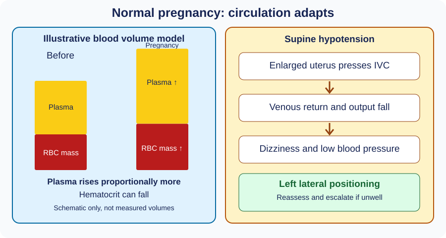

# Physiological Changes During Pregnancy

[Chapter index](../README.md) | [20 original MCQs](../MCQs/03-Physiological-Changes-During-Pregnancy-20-MCQs.md) | [Reported exam practice](../Previous-Year-Questions/03-Physiological-Changes-Reported-Exam-Practice.md)

## 1. Cardiovascular and hematological changes

Pregnancy mein mother's body ko apne organs ke saath growing fetus aur placenta ki needs bhi poori karni hoti hain. Isliye blood circulation mein kaafi changes aate hain. Heart har minute pehle se zyada blood pump karta hai. Cardiac output ka matlab hai ek minute mein heart se nikalne wala blood. Isko heart rate aur stroke volume multiply karke nikalte hain. Stroke volume ka matlab hai ek heartbeat mein pump hua blood. Pregnancy mein cardiac output aam taur par lagbhag 30–50% badhta hai, lekin exact amount har woman aur gestational stage mein alag ho sakta hai.

Blood vessels relax hoti hain aur systemic vascular resistance kam ho jata hai. Iska matlab hai heart ko blood aage bhejne mein pehle se kam resistance milta hai. Isi wajah se cardiac output badhne ke bawajood mid-pregnancy mein blood pressure thoda kam ho sakta hai. Lekin symptomatic hypotension ko normal kehkar ignore nahi karna chahiye.

### Physiological hemodilution

Plasma blood ka liquid portion hai. Pregnancy mein plasma volume aur red blood cell mass dono badhte hain, lekin plasma proportionately zyada badhta hai. Isliye hemoglobin concentration aur hematocrit kam dikh sakte hain. Is change ko physiological hemodilution kehte hain. Iska matlab yeh nahi hai ki har low hemoglobin reading normal hai. Iron deficiency aur doosri causes ko bhi assess karna hota hai.

WHO 2024 guideline ke mutabik anemia ki hemoglobin cutoff first aur third trimester mein 11 g/dL se kam aur second trimester mein 10.5 g/dL se kam hai. Clinical interpretation mein local antenatal programme ki guideline, symptoms aur iron status bhi check karein.

### Supine hypotension

Late pregnancy mein jab woman seedhi peeth ke bal let ti hai, enlarged uterus inferior vena cava ko compress kar sakta hai. Isse heart mein blood ki wapsi yani venous return kam hoti hai. Cardiac output gir sakta hai aur dizziness, pallor ya hypotension ho sakta hai. Pulse present ho aur trauma ka concern na ho toh woman ko left lateral position mein lita kar vital signs aur airway, breathing, circulation assess karein. Symptoms persist karein ya patient unstable ho toh emergency help bulayein. Har hypotensive episode ko sirf uterus compression na samjhein.

### Clotting and platelets

Pregnancy mein kuch clotting factors aur fibrinogen badhte hain. Isse delivery ke waqt bleeding control mein madad milti hai, lekin venous thromboembolism ka risk bhi badhta hai. Venous stasis ka matlab hai veins mein blood flow slow hona. Ek leg mein achanak swelling, warmth aur pain ko normal pregnancy edema samajhkar massage nahi karna chahiye. Urgent evaluation zaroori hai. Chest pain ya sudden breathlessness emergency ho sakti hai.

Platelet count mein mild fall ho sakta hai. Lekin significant thrombocytopenia, jaise 78 × 10⁹/L, ko physiological change maan kar ignore nahi karna chahiye. Preeclampsia, HELLP syndrome aur doosri causes ki assessment zaroori hai.

## 2. Respiratory changes

Progesterone respiratory centre ko stimulate karta hai. Woman har saans mein zyada air andar le sakti hai. Is amount ko tidal volume kehte hain. Respiratory rate zaroori nahi ki bahut badhe. Minute ventilation ka matlab hai ek minute mein ventilated air. Formula hai tidal volume × respiratory rate.

Zyada ventilation se carbon dioxide level kam hota hai. Kidneys compensation ke liye bicarbonate kam retain karti hain. Isliye normal pregnancy mein mild compensated respiratory alkalosis mil sakti hai. PaCO₂ lagbhag 30 mmHg aur bicarbonate lagbhag 20 mmol/L ho sakta hai. ABG ko clinical condition ke saath interpret karein.

Growing uterus diaphragm ko upar push karta hai aur functional residual capacity kam ho sakti hai. Functional residual capacity woh air hai jo normal expiration ke baad lungs mein bachi rehti hai. Oxygen demand badhne aur oxygen reserve kam hone ki wajah se apnea ke dauran saturation jaldi gir sakti hai.

Mild nasal stuffiness hormonal changes aur nasal mucosal blood flow badhne se ho sakti hai. Lekin sudden severe dyspnea, chest pain, hypoxia aur fainting ko normal pregnancy changes nahi maana jata.

## 3. Renal and gastrointestinal changes

Pregnancy mein renal blood flow aur glomerular filtration rate badhte hain. GFR ka matlab hai kidneys ek specific time mein kitna plasma filter karti hain. Isliye serum creatinine nonpregnant baseline se kam ho sakta hai. Pregnancy mein creatinine ka rising trend, chahe general adult range mein dikhe, clinical review maang sakta hai.

Progesterone ureter ki smooth muscles ko relax karta hai aur uterus urinary tract par pressure daal sakta hai. Urine drainage slow ho sakti hai, jisse urinary stasis aur infection ka risk badhta hai. Fever, dysuria ya flank pain report karna zaroori hai.

GFR badhne aur tubular glucose handling mein changes ke karan urine mein glucose aa sakta hai. Lekin urine glucose se gestational diabetes ko confirm ya exclude nahi kar sakte. Local protocol ke hisab se appropriate blood glucose screening karayein.

Progesterone lower esophageal sphincter ko relax kar sakta hai. Growing uterus stomach par pressure bhi daalta hai. Isse gastric acid food pipe mein wapas aa sakta hai, jise reflux kehte hain. Small frequent meals, meal ke baad upright rehna aur bedtime se pehle heavy meal avoid karna helpful ho sakta hai. Persistent severe symptoms mein assessment karein.

Intestinal motility slow hone se constipation ho sakta hai. Adequate fluids, suitable dietary fibre aur tolerated activity helpful hote hain. Severe abdominal pain, vomiting ya bleeding ko routine constipation kehkar ignore na karein.

## 4. Endocrine, breast, skin and musculoskeletal changes

Human placental lactogen (hPL) aur doosre placental hormones later pregnancy mein insulin resistance badhane mein contribute karte hain. Iska matlab hai maternal tissues insulin ko pehle jaisa respond nahi karte. Is adaptation se fetus ke liye glucose available rehta hai, lekin susceptible women mein gestational diabetes develop ho sakti hai.

Breasts pregnancy mein lactation ki preparation karti hain. Prolactin milk synthesis ke liye important hai. Pregnancy mein high estrogen aur progesterone copious milk secretion ko restrain karte hain. Placenta delivery ke baad in hormones ka level girne se abundant milk secretion start hone mein madad milti hai. Colostrum delivery se pehle bhi present ho sakta hai.

Growing abdomen se centre of gravity aage shift hota hai. Balance maintain karne ke liye lumbar lordosis, yani lower back ki inward curvature, badh sakti hai. Proper posture, supported sitting aur safe body mechanics discomfort kam kar sakte hain. Severe pain ya neurological symptoms ko assess karein.

Hormonal changes se skin pigmentation badh sakti hai. Linea nigra abdomen ki dark midline hai aur melasma face par pigmentation hoti hai. Striae skin stretching ke saath develop ho sakti hain. Lekin intense itching, especially palms aur soles par bina primary rash ke, intrahepatic cholestasis of pregnancy ki possibility ho sakti hai. Prompt maternity assessment zaroori hai.

## Clinical sources and learning resources

- [OpenStax Maternal-Newborn Nursing: Physiologic Changes Due to Pregnancy](https://openstax.org/books/maternal-newborn-nursing/pages/10-1-physiologic-changes-due-to-pregnancy) — clinical teaching reference, retrieved.
- [NCBI Bookshelf: Physiology, Maternal Changes](https://www.ncbi.nlm.nih.gov/books/NBK539766/) — cardiovascular, respiratory, renal and endocrine adaptations, retrieved.
- [WHO 2024 hemoglobin cutoffs, Table 1](https://www.ncbi.nlm.nih.gov/books/NBK602183/table/fm-ch1.tab1/) — retrieved.
- [NCBI: Aortocaval Compression Syndrome](https://www.ncbi.nlm.nih.gov/sites/books/NBK430759/) — retrieved.
- [CDC maternal warning signs](https://www.cdc.gov/hearher/hcp/overview/other.html), [NICE diabetes in pregnancy](https://www.nice.org.uk/guidance/ng3/chapter/Recommendations), [RCOG cholestasis information](https://www.rcog.org.uk/for-the-public/browse-our-patient-information/intrahepatic-cholestasis-of-pregnancy) — indexed clinical guidance, full-text access not independently confirmed in this run.
- [Nursing Wallah by PW — physiological changes teaching resource](https://www.youtube.com/watch?v=1rUuZ7EtVFE) — indexed learning resource, playback and full chapter coverage pending.
- [Nursing Wallah by PW — Aarogyam Infinity MCQ Series Part 9](https://www.youtube.com/watch?v=4zMLG0EremE&t=1471s) — published topic marker for respiratory changes at 24:31. Topic-level MCQ resource for respiratory physiology, exact questions and playback not verified. Other systems require more targeted practice links.

[Practice 20 original questions](../MCQs/03-Physiological-Changes-During-Pregnancy-20-MCQs.md) | [Chapter index](../README.md)
