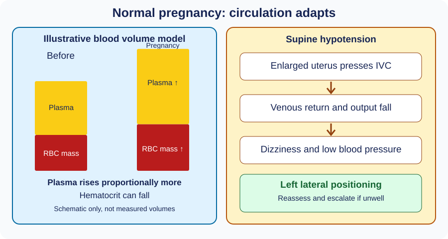
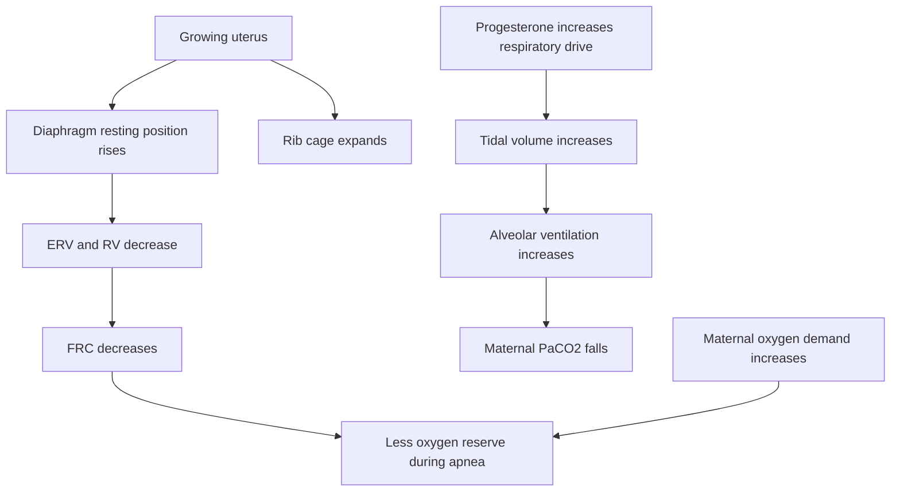

# Maternal Cardiovascular, Hematological and Respiratory Adaptations

**Study-ready, not studied.** Is guide mein normal pregnancy ke changes ko nursing assessment aur clinical reasoning ke saath samjhenge.

[Chapter](../README.md) · [Pregnancy physiology overview](03-Physiological-Changes-During-Pregnancy.md) · [30 clinical MCQs](../MCQs/03A-Maternal-Cardiovascular-and-Hematological-Changes-30-MCQs.md) · [19 additional MCQs](../MCQs/03B-Maternal-Cardiorespiratory-and-Hematological-19-MCQs.md) · [Reported exam evidence](../Previous-Year-Questions/03B-Maternal-Respiratory-Exam-Evidence.md)

## Cardiovascular changes

### Heart ki position, blood pressure aur circulation

Socho uterus gradually bada ho raha hai. Yeh diaphragm ko upar push karta hai. Diaphragm chest aur abdomen ke beech ki breathing muscle hai. Iske upar heart bhi thoda upar aur left ki taraf shift ho sakta hai. Isliye nurse ko apical impulse aur heart sounds sunte waqt actual position check karni pad sakti hai. Sirf position mein mild change se heart disease diagnose nahi karte. New chest pain, breathlessness, persistent palpitations ya abnormal murmur ko separately assess karna hota hai.

Pregnancy ke early weeks mein hormones aur blood vessel lining ke signals vessels ko relax karte hain. Systemic vascular resistance ka matlab hai body ki vessels blood flow ko kitna oppose karti hain. Jab resistance kam hota hai, toh heart se zyada blood pump hone ke bawajood blood pressure mid-pregnancy mein thoda kam ho sakta hai. Near term pressure baseline ke kareeb laut sakta hai. Har woman ka exact trend alag hota hai, isliye antenatal visits mein blood pressure compare karna important hai. High blood pressure ko normal late-pregnancy rebound kehkar ignore mat karo.

Cardiac output ka formula heart rate × stroke volume hai. Early pregnancy mein stroke volume increase important hota hai. Later pregnancy mein heart rate ka contribution bhi important ho sakta hai. Uterus, placenta, kidneys aur skin ki blood supply badhti hai. Skin ki blood supply badhne se kuch women ko zyada warmth feel ho sakti hai. Labour ke contractions aur delivery ke baad uterus se blood maternal circulation ki taraf return hota hai. Significant heart disease mein yeh fluid shift dangerous ho sakta hai, isliye symptoms aur observations close monitoring maangte hain.

**Exam clue:** Cardiac output badh sakta hai aur systemic resistance kam ho sakta hai. Dono changes ek doosre se contradictory nahi hain. New diastolic murmur, significant hypotension ya breathlessness at rest ko automatically normal nahi kehte.

## Hematological changes

### Plasma, red cells aur laboratory interpretation

Blood ke liquid part ko plasma kehte hain. Pregnancy mein plasma aur red cell mass dono badhte hain. Plasma proportionately zyada badhta hai, isliye red cells ki measured concentration kam ho sakti hai. Isko physiological hemodilution kehte hain. Dilution aur true iron deficiency ek saath bhi ho sakte hain. Isliye low hemoglobin mein trimester, local programme, symptoms, CBC indices aur iron stores ka assessment important hai. Ferritin iron storage ko reflect karta hai, lekin inflammation ke dauran ferritin interpretation bhi careful hoti hai.

ESR ka full form erythrocyte sedimentation rate hai. Is test mein dekha jata hai ki red cells ek fixed time mein kitni distance settle karte hain. Pregnancy mein fibrinogen jaise plasma proteins aur hematocrit ke changes se ESR increase ho sakta hai. Isliye ESR se akela infection prove nahi hota. Fever, clinical symptoms aur relevant investigations ko saath mein interpret karna chahiye.

Pregnancy mein clotting factors aur fibrinogen badhte hain aur natural anticoagulant protein S activity kam ho sakti hai. Yeh delivery ke waqt bleeding control mein help karta hai, lekin clot banne ka risk bhi badhata hai. Isliye new one-sided leg swelling, chest pain aur sudden breathlessness par urgent assessment zaroori hai. Routine PT aur aPTT normal hone se VTE risk zero nahi hota. Severe platelet reduction ya ongoing bleeding ko physiological change nahi kehte.

## Respiratory changes

### Hormonal drive aur chest mechanics

Normal pregnancy mein breathing ke do major changes samjho. Pehla hormonal hai aur doosra mechanical hai. Progesterone respiratory drive ko early pregnancy se stimulate karta hai. Tidal volume, yani ek normal breath mein andar ya bahar jaane wali air, badh sakti hai. Resting respiratory rate aam taur par substantially nahi badhti. Isliye new persistent tachypnea ko pregnancy ka routine effect samajhkar ignore mat karo.

Mechanical change later pregnancy mein zyada noticeable hota hai. Uterus diaphragm ki resting position ko upar push karta hai. Rib cage thoda widen ho sakta hai. Normal expiration ke baad lungs mein bachi hui air ko functional residual capacity (FRC) kehte hain. Yeh expiratory reserve volume (ERV) aur residual volume (RV) ka sum hai. Pregnancy mein FRC kam hoti hai. Inspiratory capacity compensate kar sakti hai, isliye vital capacity generally stable rehti hai aur total lung capacity stable ya slightly lower ho sakti hai.

Ye original schematic hai. Ismein arrows direction of physiological change show karte hain, exact measurement nahi.

### Calculations aur ABG

Agar ERV 0.7 L aur RV 0.9 L hain, toh FRC = 0.7 + 0.9 = 1.6 L. Inspiratory capacity normal expiration se maximum inspiration tak ki volume hai. Vital capacity = inspiratory capacity + ERV. Total lung capacity = vital capacity + residual volume.

Minute ventilation mein dead-space air bhi include hoti hai. Alveolar ventilation ka simplified formula (tidal volume − dead space) × respiratory rate hai. Agar tidal volume 600 mL, dead space 150 mL aur rate 16/min hai, toh alveolar ventilation = 450 × 16 = 7200 mL/min, yani 7.2 L/min. Total minute ventilation 9.6 L/min hai. Actual physiological dead space patient ke hisab se change ho sakta hai.

Jab alveolar ventilation badhti hai, toh maternal PaCO₂ aam taur par lagbhag 30 mmHg tak kam ho sakta hai. Kidneys bicarbonate excrete karke pH ko compensate karti hain. Bicarbonate roughly 18–22 mmol/L ho sakta hai. PaO₂ modestly rise kar sakta hai, lekin posture aur altitude se values change hoti hain. Fetal CO₂ placenta se maternal blood mein transfer hota hai aur maternal lungs se bahar nikalta hai. Lower maternal PaCO₂ is transfer ke gradient ko support karta hai.

Agar severely breathless pregnant woman ka PaCO₂ 40 mmHg hai, toh nonpregnant range dekhkar reassurance dena galat ho sakta hai. Pregnancy ki lower baseline se yeh relative hypoventilation suggest kar sakta hai. Nurse urgent ABC assessment aur respiratory/obstetric escalation kare. Ek ABG value se akela diagnosis confirm nahi hota.

### Nursing assessment aur safety

Healthy pregnancy mein FEV1, FVC aur peak flow generally preserved rehte hain. FEV1 pehle second mein forcefully nikali air hai aur FVC maximum forced expiration ki total measured air hai. FEV1/FVC ratio ka substantial fall airflow obstruction suggest kar sakta hai. Asthma wali pregnant woman ka home peak flow apne baseline se gir raha ho toh uska individualized action plan follow karwayein aur clinical assessment coordinate karein. Prescribed therapy ko bina clinician advice stop nahi karna chahiye.

Pregnancy mein nasal aur upper airway tissues vascular aur swollen ho sakte hain. Mild nasal congestion common ho sakti hai. Stable anterior nosebleed mein woman upright baithkar forward lean kare aur nose ka soft part lagatar 10–15 minutes pinch kare. Heavy bleeding, continued bleeding, dizziness ya breathing difficulty ho toh urgent help lein. Pregnancy airway swelling anesthesia ko difficult bana sakti hai, isliye concerning findings anesthesia team ko communicate karna important hai.

Labour ke waqt uterus muscular work karta hai aur oxygen demand badh sakti hai. Pain ke saath uncontrolled rapid breathing se CO₂ excessively kam ho sakta hai aur mouth ke aas paas tingling ho sakti hai. Patient ko assess karke comfortable controlled breathing mein support karein aur pain management team ke saath coordinate karein. Paper bag rebreathing ko bina assessment use na karein. Persistent symptoms aur abnormal vital signs escalate karein.

Obstructive sleep apnea mein sleep ke dauran airway repeatedly narrow ya obstruct hota hai. New loud snoring, witnessed pauses aur daytime sleepiness, especially chronic hypertension jaise risk factors ke saath, targeted assessment maangte hain. Ek normal daytime saturation OSA exclude nahi karti. Isko normal pregnancy symptom samajhkar ignore mat karein. Sudden severe dyspnea, chest pain, syncope, cyanosis aur respiratory distress urgent warning signs hain.

## Research and practice resources

| Topic | Teaching resource | Dedicated MCQ practice |
|---|---|---|
| Cardiovascular | [NORCET 10 Countdown physiology session](https://www.youtube.com/watch?v=1rUuZ7EtVFE) | [Nursing Exam Success, physiology MCQs, 01:48 BP](https://www.youtube.com/watch?v=1ZTmqJVWtQk&t=108s) |
| Hematology | [Same overview teaching session](https://www.youtube.com/watch?v=1rUuZ7EtVFE) | [Nursing Exam Success, 01:24 physiological anemia](https://www.youtube.com/watch?v=1ZTmqJVWtQk&t=84s) |
| Respiratory | [Same overview teaching session](https://www.youtube.com/watch?v=1rUuZ7EtVFE) | [Nursing Exam Success, 03:00 onward breathing adaptations](https://www.youtube.com/watch?v=1ZTmqJVWtQk&t=180s) |

Published descriptions and topic markers were checked where available on 28 November 2026. Exact video content, playback and specific question matches remain pending. The MCQ session is NCLEX-oriented practice, not proof of Indian exam appearance.

Clinical sources: [OpenStax Maternal Newborn Nursing](https://openstax.org/books/maternal-newborn-nursing/pages/10-1-physiologic-changes-due-to-pregnancy) and [NCBI maternal changes](https://www.ncbi.nlm.nih.gov/books/NBK539766/) directly retrieved. [ERS respiratory physiology](https://pmc.ncbi.nlm.nih.gov/articles/PMC4818213/), [2025 respiratory review](https://pubmed.ncbi.nlm.nih.gov/40614834/), [2026 respiratory failure review](https://www.mdpi.com/2077-0383/15/9/3449), [ESR pregnancy study](https://pubmed.ncbi.nlm.nih.gov/11762656/), [Indian difficult airway 2025 guidance](https://pmc.ncbi.nlm.nih.gov/articles/PMC12643153/), [NHS nosebleeds](https://www.nhs.uk/conditions/nosebleed/), [CDC warning signs](https://www.cdc.gov/hearher/hcp/overview/other.html), [2023 OSA pregnancy consensus](https://pmc.ncbi.nlm.nih.gov/articles/PMC10351908/) and [CHEST 2026 OSA guideline](https://pubmed.ncbi.nlm.nih.gov/42480820/) consulted at indexed excerpt level. Full text access to some sources was unavailable. The WHO/FIGO anemia distinction is retained in the prior bank.

[Practice MCQs](../MCQs/03B-Maternal-Cardiorespiratory-and-Hematological-19-MCQs.md) · [Chapter](../README.md)
