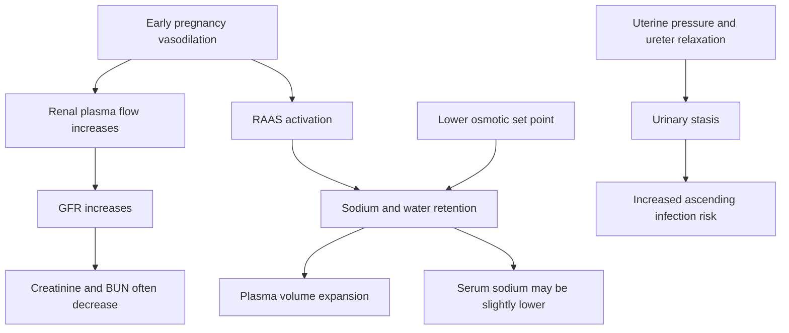
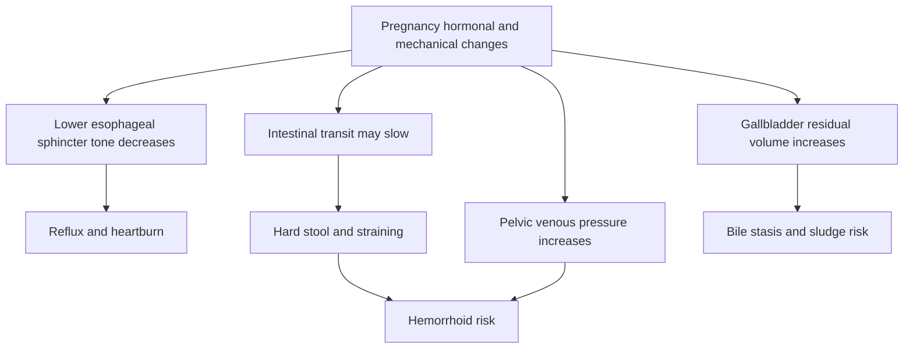

# Maternal Renal and Gastrointestinal Adaptations

**Study-ready, not studied.** Is guide mein pregnancy ke normal adaptations aur abnormal findings ke beech difference samjhenge.

[Chapter](../README.md) · [Overview](03-Physiological-Changes-During-Pregnancy.md) · [17 renal MCQs](../MCQs/03C-Maternal-Renal-Adaptations-17-MCQs.md) · [18 gastrointestinal MCQs](../MCQs/03D-Maternal-Gastrointestinal-Adaptations-18-MCQs.md) · [Exam evidence](../Previous-Year-Questions/03C-Maternal-Renal-GI-Exam-Evidence.md)

## Renal adaptations

### Blood flow aur filtration

Kidney ka main kaam blood se waste filter karna aur water, electrolytes aur acid-base balance regulate karna hai. Pregnancy mein maternal organs aur fetus ki needs change hoti hain. Early pregnancy mein renal vessels relax hoti hain aur kidney tak plasma ka flow badhta hai. Is wajah se glomerular filtration rate (GFR), yani kidney ek minute mein kitna plasma filter karti hai, baseline se roughly 40–50% ya kuch studies mein isse alag proportion mein badh sakta hai. Exact change gestation aur measurement method par depend karta hai.

Agar kisi example mein prepregnancy GFR 100 mL/min ho aur 45% increase diya ho, toh new GFR 145 mL/min hoga. Is example ko har patient ka expected measured GFR mat samjho. Creatinine aur urea jaise waste products ki blood concentration generally kam ho sakti hai. Isliye nonpregnant lab interval mein aane wala creatinine bhi pregnancy mein concerning ho sakta hai, especially jab baseline se rise ho. Routine CKD-EPI aur MDRD estimated GFR equations pregnancy mein validated nahi hain. Nurse serum creatinine trend, BP, urine findings aur symptoms review karke team ko report kare.

### Water, sodium aur hormones

RAAS ka full form renin–angiotensin–aldosterone system hai. Yeh hormone system body ko sodium aur circulating volume regulate karne mein help karta hai. Pregnancy mein systemic vasodilation ke saath RAAS activity increase ho sakti hai. Body sodium aur water retain karti hai aur plasma volume expand hota hai. Phir bhi serum sodium concentration thodi kam ho sakti hai, kyunki water retention proportionately zyada ho sakti hai. Thirst aur vasopressin release ka osmotic set point lower ho jata hai. Vasopressin ko ADH bhi kehte hain. Yeh kidney ko water conserve karne ka signal deta hai.

Total body sodium aur serum sodium concentration ko same mat samjho. Ek expanded tank mein salt ki total quantity zyada hote hue bhi concentration kam ho sakti hai, agar water usse zyada proportion mein badhe. Yeh analogy sirf concentration samjhati hai. Significant hyponatremia, hypernatremia ya symptoms ko normal adaptation mat bolo.

Early pregnancy mein uric acid clearance badhne se blood uric acid kam ho sakta hai. Later pregnancy mein level phir rise kar sakta hai. Ek uric acid reading se preeclampsia diagnose nahi karte. Rarely placenta ka vasopressinase enzyme ADH breakdown badha sakta hai aur gestational diabetes insipidus develop ho sakti hai. Marked thirst, large-volume dilute urine aur rising sodium mein prompt assessment chahiye. Yeh normal urinary frequency se alag hai.

Ye original schematic direction of change show karta hai. Yeh kisi individual patient ka diagnostic result nahi hai.

### Urinary tract aur clinical findings

Pregnancy mein kidneys ka size thoda badh sakta hai aur renal pelvis, calyces aur ureters dilate ho sakte hain. Right side par collecting-system dilation common hai. Uterus aur nearby anatomy ke pressure aur smooth muscle relaxation se urine drainage slow ho sakti hai. Lekin fever, flank pain, vomiting, dysuria ya severe pain ko physiological hydronephrosis kehkar reassure nahi karna chahiye. Clinical evaluation zaroori hai.

Early pregnancy se frequency develop ho sakti hai aur later pregnancy mein bladder par mechanical pressure badh sakta hai. Frequency ka matlab baar baar void karna hai, jabki polyuria ka matlab total urine volume zyada hona hai. Cough ke waqt thoda urine leak hona pelvic floor load aur stress incontinence se related ho sakta hai. Agar clear watery fluid continuously leak ho raha ho ya source uncertain ho, toh maternity assessment zaroori hai.

Asymptomatic bacteriuria mein urine mein significant bacteria hote hain, lekin patient ko typical urinary symptoms nahi hote. Antenatal screening mein applicable protocol ke according urine culture se ise identify karna important hai. Indicated treatment ascending infection ka risk reduce kar sakta hai. Nurse culture aur prescribed treatment coordinate kare, bina indication antibiotics na de.

Healthy pregnancy mein urine protein excretion modestly rise ho sakti hai. Usual significant proteinuria threshold 300 mg/24 hours ya applicable spot protein-creatinine ratio threshold ke around hai. Significant proteinuria ko routine dilution ya increased filtration kehkar ignore nahi karte. Agar 20 weeks se pehle persistent significant proteinuria ho, toh underlying kidney disease ka assessment important hai. Later pregnancy mein BP, preeclampsia features aur kidney disease dono consider karte hain. Proteinuria ke bina bhi preeclampsia possible hai.

Kuch renally eliminated medicines pregnancy mein faster clear ho sakti hain. Lekin har drug ka dose automatic increase nahi karte. Drug-specific properties, clinical response aur prescribing team ke plan ko follow karte hain.

## Gastrointestinal adaptations

### Reflux aur gastric emptying

Food pipe ke lower end par lower esophageal sphincter naam ka muscular barrier hota hai. Progesterone-related smooth muscle relaxation se iska tone kam ho sakta hai. Growing uterus stomach par pressure bhi badhata hai. Isliye acid food pipe mein wapas aa sakta hai aur heartburn ho sakti hai. Smaller meals aur upright posture helpful ho sakte hain. Persistent severe pain, swallowing difficulty ya bleeding mein review chahiye.

Intestinal transit slow ho sakta hai, lekin healthy uncomplicated pregnancy mein gastric emptying har trimester mein uniformly delayed hai, aisa evidence consistent nahi hai. Labour, opioid analgesia aur anesthesia-related conditions gastric emptying ko affect kar sakti hain. Nurse last oral intake aur medicines anesthesia team ko communicate kare. Fasting plan clinical team ke instructions se follow kare.

Antacid oral iron ki absorption affect kar sakta hai. Dono ke timing ko prescribed product instructions aur clinician ke plan ke hisab se separate karna useful ho sakta hai. Khud se iron stop ya dose double na karein.

### Constipation aur hemorrhoids

Bowel ka transit slow hone se stool intestine mein zyada samay reh sakta hai. Water absorb hota rehta hai aur stool hard ho sakta hai. Oral iron aur other supplements bhi constipation contribute kar sakte hain. Suitable fluids, dietary fibre aur tolerated physical activity help karte hain. Agar medicines ka side effect suspected ho, toh prescription review karwayein rather than independently discontinuing needed supplementation.

Bulk-forming fibre water retain karke stool ko bulky aur softer banane mein help karta hai. Product instructions aur adequate water important hain. Severe pain, vomiting, distension ya obstruction suspicion ho toh routine laxative advice se pehle assessment chahiye. Growing uterus pelvic venous pressure badha sakta hai. Constipation aur straining ke saath hemorrhoids ka risk badhta hai. Fresh rectal bleeding mein source aur severity assess karein.

### Gallbladder aur liver tests

Gallbladder bile ko store karta hai. Pregnancy mein gallbladder ka residual volume increase aur fractional emptying slow ho sakti hai. Bile stasis aur cholesterol saturation ke changes sludge ya cholesterol gallstone formation mein contribute kar sakte hain. Severe upper abdominal pain, fever ya jaundice ko ordinary pregnancy discomfort na samjhein.

Placenta alkaline phosphatase (ALP) produce karta hai, isliye late pregnancy mein ALP rise physiological ho sakta hai. Plasma dilution ki wajah se serum albumin kam ho sakta hai. Lekin AST, ALT aur bilirubin ka substantial elevation normal pregnancy adaptation nahi maana jata. Right upper quadrant pain aur elevated ALT urgent obstetric assessment maangte hain, kyunki liver disease ya hypertensive complication possible hai.

### Nausea, vomiting aur oral care

Early pregnancy mein nausea common hai aur multifactorial mechanisms se related ho sakti hai. Agar patient tolerate kar sakti hai toh small meals aur frequent sips se intake maintain ho sakta hai. Ptyalism ka matlab excessive saliva hai aur nausea ke saath ho sakta hai. Severe vomiting, food ya fluid retain na kar paana, dizziness, weight loss ya reduced urine output mein prompt assessment chahiye.

RCOG 2024 guidance mein urine ketones ko dehydration severity ka reliable marker nahi maana gaya hai. Negative ketones ke bawajood clinically important illness possible hai. Prolonged vomiting aur severely reduced intake mein thiamine deficiency ho sakti hai. Prescribed thiamine supplementation ka plan especially dextrose se pehle verify karein, lekin emergency treatment ko unnecessarily delay na karein. Thiamine vitamin B1 hai aur nervous system ke energy metabolism ke liye important hai.

Hormonal changes gums ki inflammation tendency badha sakte hain. Gentle brushing aur dental assessment appropriate hain. Significant bleeding, pain ya swelling ko normal maan kar oral hygiene stop nahi karna chahiye.

## Clinical sources and videos

- [Kidney physiology in pregnancy, 2021 review](https://pubmed.ncbi.nlm.nih.gov/33328060/) and [renal physiology review](https://pmc.ncbi.nlm.nih.gov/articles/PMC4089195/).
- [Pregnancy and renal disease guideline](https://pmc.ncbi.nlm.nih.gov/articles/PMC6822421/), [proteinuria in pregnancy review](https://pmc.ncbi.nlm.nih.gov/articles/PMC11782809/), and [ACOG urinary tract infections consensus](https://www.acog.org/clinical/clinical-guidance/clinical-consensus/articles/2023/08/urinary-tract-infections-in-pregnant-individuals).
- [OpenStax maternal physiology](https://openstax.org/books/maternal-newborn-nursing/pages/10-1-physiologic-changes-due-to-pregnancy), [GI disorders in pregnancy review](https://pmc.ncbi.nlm.nih.gov/articles/11037196), [nutrient intake physiology review](https://journals.physiology.org/doi/full/10.1152/advan.00251.2025), and [ACOG digestive problems](https://www.acog.org/womens-health/faqs/problems-of-the-digestive-system).
- [RCOG 2024 Green-top 69](https://doi.org/10.1111/1471-0528.17739), [FIGO liver guideline](https://obgyn.onlinelibrary.wiley.com/doi/full/10.1002/ijgo.70161), and [INASL–FOGSI position statement](https://pmc.ncbi.nlm.nih.gov/articles/PMC6637074/).
- Teaching lead: [NORCET 10 Countdown physiological changes](https://www.youtube.com/watch?v=1rUuZ7EtVFE). Published overview description inspected. Specific renal and GI teaching coverage and playback pending.
- Dedicated practice lead: [50 NCLEX pregnancy physiological changes MCQs](https://www.youtube.com/watch?v=1ZTmqJVWtQk). Published description identifies renal and GI systems. Exact question and timestamp coverage pending for all 35 new items. This is not Indian historical exam proof.

Research checked 28 November 2026 using indexed clinical excerpts. Direct PMC retrieval for the renal and GI reviews returned a browser-verification screen. No claim of full-text or video playback review is made. Full independent clinical, historical and semantic validation remains pending.

[Chapter](../README.md) · [Renal practice](../MCQs/03C-Maternal-Renal-Adaptations-17-MCQs.md) · [GI practice](../MCQs/03D-Maternal-Gastrointestinal-Adaptations-18-MCQs.md)
