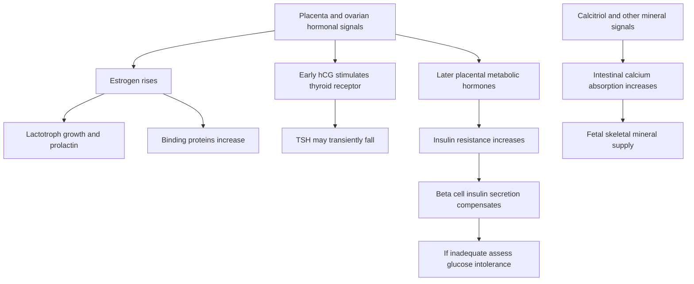

# Maternal Endocrine Adaptations

**Study-ready, not studied.** Is guide mein pregnancy ke hormonal changes aur unke clinical meaning ko basic se samjhenge.

[Chapter](../README.md) · [Overview](03-Physiological-Changes-During-Pregnancy.md) · [19 additional MCQs](../MCQs/03E-Maternal-Endocrine-Adaptations-19-MCQs.md) · [Reported exam practice](../Previous-Year-Questions/03E-Maternal-Endocrine-Exam-Evidence.md)

## 1. Placenta aur ovarian hormones

Endocrine gland aise organ ko kehte hain jo blood mein hormones release karta hai. Pregnancy mein placenta sirf oxygen aur nutrients exchange nahi karta. Yeh temporary endocrine organ bhi hai. Early pregnancy mein developing trophoblast hCG release karta hai. hCG corpus luteum ko progesterone produce karte rehne ka signal deta hai. Corpus luteum ovulation ke baad ovary mein banne wali temporary hormone-producing structure hai. Progesterone uterus ki lining ko pregnancy support karne mein help karta hai. First trimester mein gradually placenta progesterone production ka main source ban jata hai. Is transition ko luteal–placental shift kehte hain. Yeh ek exact din par switch on/off nahi hota.

Estrogen uterus ki growth, blood supply aur breast development mein contribute karta hai. Estrogen aur progesterone ka sustained feedback FSH aur LH ko suppress karta hai. Isliye normal menstrual cycle aur ovulation pregnancy mein usually resume nahi hote. hCG ka pregnancy test mein role aur corpus luteum support pehle [pregnancy diagnosis bank](../MCQs/02-Pregnancy-Diagnosis-20-MCQs.md) mein cover hua hai, isliye woh questions dobara original count mein nahi jode gaye.

## 2. Thyroid changes aur iodine

Thyroid gland T4 aur T3 banata hai. T4 ko thyroxine kehte hain. Yeh hormones energy metabolism aur nervous system ke development mein important hain. Early pregnancy mein hCG thyroid ke TSH receptor ko mildly stimulate kar sakta hai. Is stimulation ke response mein pituitary TSH temporarily kam ho sakta hai. Mildly lower TSH ko symptoms, gestational week aur relevant reference interval ke saath interpret karna chahiye.

Estrogen liver mein thyroid-binding globulin (TBG) ki quantity badha sakta hai. TBG hormone ko blood mein bind karne wala protein hai. Jab binding capacity badhti hai, measured total T4 increase ho sakta hai. Free T4 measurement par assay aur pregnancy-related binding changes ka effect ho sakta hai. Isliye 2026 American Thyroid Association guideline laboratory aur trimester-specific reference ranges ko prefer karti hai. Har laboratory ka free T4 result doosri assay ke interval se compare nahi karna chahiye.

Agar suitable free T4 reference available nahi hai, clinician guideline ke alternative methods use kar sakta hai. Ek method mein total T4 reference limits week 7 se gradually adjust hote hain aur week 16 se 50% above nonpregnant limits par plateau karte hain. Example mein nonpregnant upper limit 12 µg/dL hai. Week 20 mein adjusted upper limit 12 + 6 = 18 µg/dL hogi. Yeh reference limit ka example hai, drug treatment target nahi.

Iodine thyroid hormone banane ke liye raw material ki tarah kaam karta hai. Pregnancy mein maternal requirement, kidney se iodine loss aur fetal demand badh sakte hain. Early fetal brain development maternal T4 availability par depend karta hai, especially jab fetal thyroid fully functional nahi hoti. Nurse known thyroid disorder aur prescribed treatment ki timely review coordinate kare. Iodine intake assess karein aur local guidance follow karein. High-dose iodine supplements bina clinical guidance avoid karein.

Ek spot urinary iodine test recent intake aur hydration se change ho sakta hai. Population mein median urinary iodine useful hai, lekin ek person ki long-term iodine sufficiency establish nahi karta.

## 3. Pituitary aur adrenal changes

Anterior pituitary brain ke base par hormone-producing gland ka front part hai. Iske lactotroph cells prolactin banate hain. Estrogen ki stimulation se pregnancy mein ye cells grow aur multiply kar sakti hain, jis wajah se gland ka size badhta hai. Prolactin breast ko milk production ke liye prepare karta hai. Lekin known pituitary mass ke saath new peripheral visual loss ko normal enlargement mat samjho. Optic chiasm vision pathways ka crossing region hai jo pituitary ke paas hota hai. Compression ki possibility mein urgent specialist assessment zaroori hai.

Adrenal gland cortisol banata hai, jo stress response aur metabolism mein important hai. Pregnancy mein estrogen cortisol-binding globulin badhata hai aur placental hormonal signals cortisol production ko bhi affect karte hain. Isliye total aur free cortisol dono rise kar sakte hain. Single elevated cortisol ko nonpregnant interval se compare karke Cushing syndrome diagnose nahi karna chahiye. Placenta corticotropin-releasing hormone (CRH) bhi release karta hai. Yeh maternal–fetal hormonal communication ka part hai.

Estrogen sex hormone-binding globulin (SHBG) bhi badha sakta hai. Yeh androgen aur estrogen jaise hormones ko bind karta hai. Isliye total androgen aur free fraction mein changes ek jaise nahi hote. New virilization jaise unusual signs assessment maangte hain.

## 4. Glucose aur calcium balance

Fetus ko growth ke liye glucose chahiye. Early pregnancy mein body energy stores build kar sakti hai. Later pregnancy mein placental hormones maternal insulin resistance badhate hain. Insulin ko ek chaabi samjho jo glucose ko cells ke andar jaane mein help karti hai. Jab cells insulin ko kam respond karte hain, toh pancreas ki beta cells extra insulin release karke compensate kar sakti hain. Agar yeh compensation inadequate ho, toh glucose intolerance ya gestational diabetes develop ho sakti hai.

Maternal fasting glucose prepregnancy se somewhat lower ho sakta hai aur meal ke baad rise greater ho sakta hai. Late pregnancy mein stored fat ka breakdown, jise lipolysis kehte hain, bhi increase ho sakta hai. Mother fatty acids use karke glucose fetoplacental unit ke liye spare kar sakti hai. Prolonged fasting, illness ya severe vomiting mein ketosis ka risk ho sakta hai. Nurse routine nutrition aur glucose screening guidance follow kare. Normal fasting value se har glucose disorder exclude nahi hota.

Placenta growth hormone ka variant bhi produce karta hai. Advancing gestation mein yeh maternal circulating growth hormone activity aur metabolism mein contribute karta hai.

Calcium fetal skeleton banane ke liye important hai. Pregnancy mein calcitriol, yani active vitamin D, aur intestinal calcium absorption increase ho sakte hain. Total calcium albumin concentration kam hone par lower dikh sakta hai. Ionized calcium free biologically active calcium hai aur normally preserved reh sakta hai. Suspected calcium disorder mein active calcium ka assessment important hai. Adequate calcium intake wali women mein intact PTH early pregnancy mein low-normal ho sakta hai. Low dietary calcium mein pattern alag ho sakta hai, isliye PTH ko universal fixed pattern mat samjho.

Ye original schematic different hormonal adaptations ko connect karta hai. Yeh individual test result ka prediction nahi hai.

## References and learning resources

- [Endotext: Endocrinology of Pregnancy](https://www.ncbi.nlm.nih.gov/sites/books/NBK278962/) — retrieved relevant sections.
- [ATA 2026 pregnancy thyroid guideline](https://journals.sagepub.com/doi/full/10.1177/10507256261445624) — retrieved thyroid test interpretation, reference adjustment and iodine sections.
- [Endotext: Calcium and Phosphate Metabolism During Pregnancy and Lactation](https://www.ncbi.nlm.nih.gov/sites/books/NBK279173/) — retrieved mineral physiology sections.
- [Pituitary and Adrenal Disorders of Pregnancy](https://www.ncbi.nlm.nih.gov/sites/books/NBK279043/) — indexed clinical lead, direct full text retrieval failed.
- [Clinical Update on Gestational Diabetes](https://academic.oup.com/edrv/article/43/5/763/6511028), [maternal physiology review](https://pmc.ncbi.nlm.nih.gov/articles/PMC4928162/) and [placental regulation of energy homeostasis](https://academic.oup.com/endo/article/161/7/bqaa076/5838263/) — indexed relevant excerpts.
- Teaching: [NORCET 10 Countdown pregnancy physiology](https://www.youtube.com/watch?v=1rUuZ7EtVFE). Indexed overview, exact endocrine coverage pending.
- MCQ practice: [50 NCLEX physiological changes questions](https://www.youtube.com/watch?v=1ZTmqJVWtQk). Published description includes hormonal topics and hCG marker at 08:12. No exact match to the 19 new questions authenticated. [Aarogyam Infinity MCQ series](https://www.youtube.com/watch?v=4zMLG0EremE) includes hormone-related respiratory question at 02:22, related practice only.

[Practice questions](../MCQs/03E-Maternal-Endocrine-Adaptations-19-MCQs.md) · [Exam evidence](../Previous-Year-Questions/03E-Maternal-Endocrine-Exam-Evidence.md)
