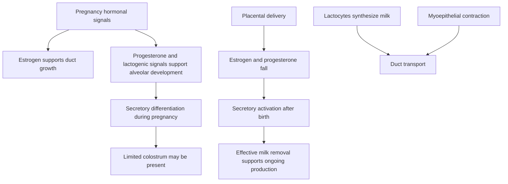

# Maternal Breast Adaptations During Pregnancy

**Study-ready, not studied.** Is guide mein breast ke normal pregnancy changes aur abnormal findings ka difference samjhenge.

[Chapter](../README.md) · [Overview](03-Physiological-Changes-During-Pregnancy.md) · [19 original MCQs](../MCQs/03F-Maternal-Breast-Adaptations-19-MCQs.md) · [Reported exam evidence](../Previous-Year-Questions/03F-Maternal-Breast-Exam-Evidence.md)

## 1. Breast growth aur hormonal preparation

Breast ke andar fat, supporting tissue aur milk-producing glandular tissue hota hai. Glandular tissue mein lobules hote hain aur har lobule mein chhote secretory units develop hote hain, jinhe alveoli kehte hain. Alveoli ki lining mein lactocytes hoti hain jo milk components banati hain. Inke around contractile myoepithelial cells hoti hain, jo milk ko ducts ki taraf move karne mein help karti hain. Ducts milk ko nipple ki taraf transport karte hain.

Pregnancy mein estrogen ductal branching aur growth mein contribute karta hai. Progesterone aur prolactin ke saath doosre hormonal signals lobuloalveolar development ko support karte hain. Is tissue development ko mammogenesis kehte hain. Breast ki blood supply bhi badhti hai, isliye surface veins zyada visible ho sakti hain. Size increase aur bilateral tenderness ho sakti hai. Har woman mein growth ka amount same nahi hota.

Mid-pregnancy ke aas paas mammary epithelial cells secretory differentiation karti hain. Isko lactogenesis I bhi kehte hain. Is stage mein limited colostrum ban sakta hai. Colostrum first milk hai jo newborn ke liye valuable immune aur nutritional components provide karta hai. Placental delivery ke baad estrogen aur progesterone ka level girta hai aur abundant milk secretion ki stage, yani secretory activation, develop ho sakti hai. Is transition ko overview Q18 mein already test kiya gaya hai.

Ye original schematic development aur milk production ke related steps ko explain karta hai. Yeh exact timing ya individual milk volume ka prediction nahi karta.

## 2. Nipple, areola aur everyday comfort

Areola nipple ke around pigmented skin area hai. Pregnancy mein iska size aur color change ho sakta hai. Montgomery glands areola mein small glands hain jo zyada prominent ho sakti hain. Ye glands protective lubricating secretion release karti hain. Inko squeeze, scrub ya alcohol se clean karna necessary nahi hai.

Breast tenderness ke liye comfortable properly fitted supportive bra useful ho sakti hai. Agar colostrum ki few drops leak hoti hain, toh clean absorbent pads use karke damp hone par change kar sakte hain. Routine nipple toughening, rough towel se rubbing aur excessive traction unnecessary hain aur skin injury kar sakte hain. Longstanding flat ya inverted nipple breastfeeding impossible hone ka proof nahi hai. Birth ke baad skilled positioning aur attachment support useful hota hai.

External breast size se milk supply ka exact prediction nahi hota. Pregnancy mein visible colostrum na milna bhi future milk production failure establish nahi karta. Previous breast surgery, trauma ya developmental concerns ho toh history lekar individualized lactation support plan karein. Newborn ka weight, output aur effective milk transfer birth ke baad assess karna important hai.

Agar woman already older child ko breastfeed kar rahi hai aur dobara pregnant hoti hai, toh milk supply aur breast sensitivity change ho sakti hai. Uncomplicated pregnancy mein automatically abrupt weaning zaroori nahi hai. Maternal nutrition, older child's intake, obstetric risk aur woman ki preference review karein.

## 3. Antenatal colostrum expression aur safety

DAME trial ne selected low-risk women with diabetes in pregnancy mein 36 weeks se expression advice assess ki thi. Is study mein harm increase nahi mila. Iska matlab yeh nahi hai ki har pregnancy mein ya early gestation se routine expression safe prove ho gayi. Local maternity protocol aur individual risk assessment important hain. Woman ko choice deni chahiye.

Agar threatened preterm labour, placental bleeding risk ya another contraindication concern hai, toh routine antenatal expression start karne se pehle obstetric team ka review chahiye. Contractions, bleeding ya reduced fetal movements ko promptly report karein. Expressed colostrum milne ya na milne se neonatal glucose monitoring ki need decide nahi hoti. Feeding aur glucose monitoring clinical indications ke hisab se honi chahiye.

## 4. Normal changes aur warning signs

Gradual symmetrical breast enlargement, visible veins aur mild tenderness physiological changes ke saath compatible ho sakte hain. Lekin new persistent focal lump, suspicious nipple discharge, skin distortion, significant pain ya fever ko routine pregnancy adaptation samajhkar delay nahi karte.

Pregnancy mein glandular tissue ki vascularity badhne se kabhi blood-stained secretion ho sakta hai. Persistent unilateral ya single-duct bloody discharge assessment maangta hai. Targeted breast ultrasound pregnancy mein focal mass evaluate karne ka useful initial test hai. Further diagnostic mammography ya biopsy specialist clinically indicated hone par arrange kar sakta hai. Dense glandular tissue mammographic interpretation ko difficult bana sakta hai, isliye symptoms aur imaging findings ko correlate karna important hai.

## Sources and study resources

- [NCBI breast milk physiology](https://www.ncbi.nlm.nih.gov/sites/books/NBK539790/) and [WHO/UNICEF antenatal breastfeeding preparation](https://www.ncbi.nlm.nih.gov/books/NBK153456/) — relevant sections directly retrieved. Older unrelated clinical recommendations in the WHO manual are not adopted without current validation.
- [Mammary gland histology](https://www.ncbi.nlm.nih.gov/sites/books/NBK547732/), [pregnancy breast imaging review](https://pmc.ncbi.nlm.nih.gov/articles/PMC10560982/) and [pregnancy-lactation imaging review](https://pmc.ncbi.nlm.nih.gov/articles/PMC7720671/) — indexed relevant excerpts.
- [ACR 2025 breast imaging during pregnancy](https://pubmed.ncbi.nlm.nih.gov/41193040/) — indexed guidance. Full ACR narrative retrieval returned 403.
- [DAME randomized trial](https://pubmed.ncbi.nlm.nih.gov/28589894/), [Cambridge NHS antenatal expression](https://www.cuh.nhs.uk/patient-information/antenatal-hand-expression-of-breast-milk-guidance/), [East Kent NHS colostrum guidance](https://leaflets.ekhuft.nhs.uk/expressing-colostrum-during-pregnancy/html/) and [CDC breast surgery and breastfeeding](https://www.cdc.gov/breastfeeding-special-circumstances/hcp/illnesses-conditions/breast-surgery.html) — indexed clinical evidence.
- Teaching lead: [NORCET 10 physiological changes, breast and Montgomery tubercles marker at 01:37:45](https://www.youtube.com/watch?v=1rUuZ7EtVFE&t=5865s). Published chapter marker checked. Exact playback and specific teaching quality verification pending.
- Dedicated practice lead: [50 pregnancy physiology NCLEX questions](https://www.youtube.com/watch?v=1ZTmqJVWtQk). Published description includes breast changes. Direct video retrieval failed and no exact item playback has been verified. This is not Indian historical exam evidence.

[Practice questions](../MCQs/03F-Maternal-Breast-Adaptations-19-MCQs.md) · [Chapter](../README.md)
