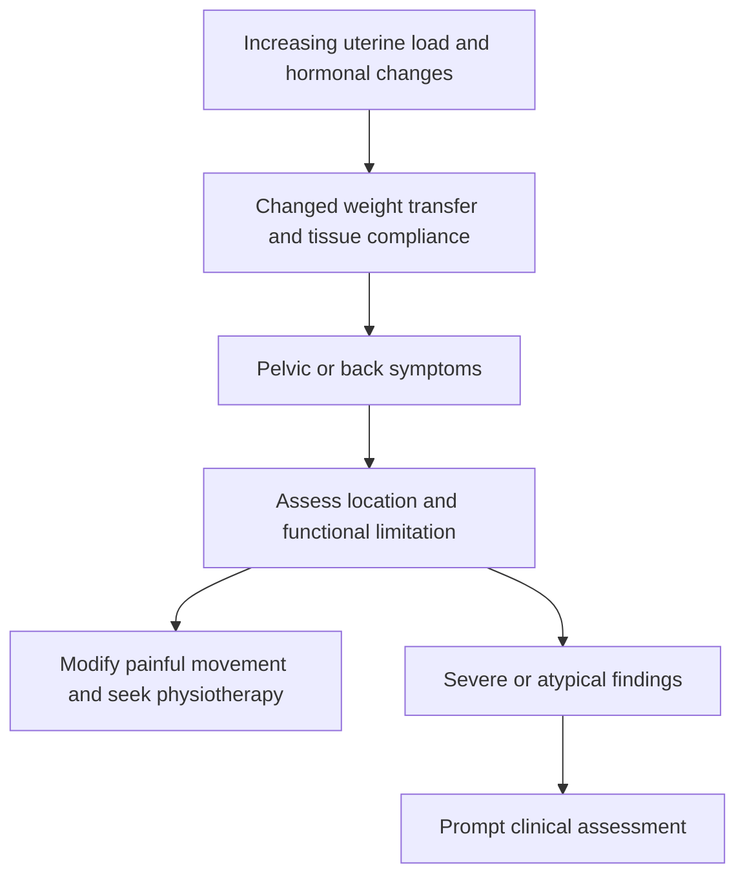
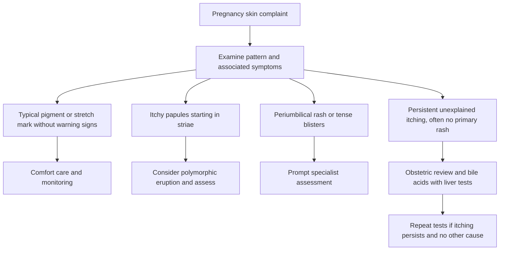

# Maternal Musculoskeletal and Skin Adaptations

**Study-ready, not attempted.** [Chapter](../README.md) · [Overview](03-Physiological-Changes-During-Pregnancy.md) · [Musculoskeletal MCQs](../MCQs/03G-Maternal-Musculoskeletal-Adaptations-19-MCQs.md) · [Skin MCQs](../MCQs/03H-Maternal-Skin-Adaptations-19-MCQs.md) · [Exam evidence](../Previous-Year-Questions/03G-Maternal-Musculoskeletal-Skin-Exam-Evidence.md)

## 1. Musculoskeletal adaptations — body ka changing load

Pregnancy mein uterus aur body mass badhne se weight distribution change hota hai. Centre of gravity aage shift ho sakta hai aur lumbar curve increase ho sakti hai. Hormonal influences connective tissues ki compliance ko bhi affect karte hain. Relaxin ek contributor hai, par serum relaxin level se pelvic girdle pain diagnose nahi karte. Muscle control, previous injury, joint movement aur load bhi matter karte hain.

### Pelvic girdle pain (PGP)

Pelvis body weight ko spine se legs tak transfer karta hai. Sacroiliac joints posterior pelvis mein aur pubic symphysis anterior pelvis mein load transfer karte hain. PGP mein walking, stairs, single-leg stance aur bed turning pain provoke kar sakte hain. Pain ko dismiss na karein. History, function aur physical assessment se other causes rule out karne mein help milti hai.

- Dressing baithkar karein, bed turning mein knees together rakhein aur painful twisting avoid karein.
- Comfortable activity continue karein, heavy asymmetrical loading aur prolonged single-leg stance modify karein.
- Physiotherapy referral aur individually fitted support belt selected cases mein useful ho sakte hain.
- Severe mobility restriction mein maternity team se VTE risk review karwayein. Anticoagulants self-start nahi karne hain.
- PGP akela caesarean ka routine indication nahi hai. Labour plan mein pain-free hip movement, leg support aur position preferences discuss karein.

### Peripheral nerves, feet and abdominal wall

Fluid retention wrist ke narrow carpal tunnel mein median nerve pressure badha sakti hai. Thumb, index aur middle finger tingling especially night mein ho sakti hai. Neutral-position wrist splint assessment ke baad useful ho sakta hai. Progressive weakness ko ignore nahi karein.

Growing abdomen, tissue pressure aur posture lateral femoral cutaneous nerve ko compress kar sakte hain. Outer thigh burning ya numbness with preserved motor power meralgia paresthetica se compatible hai. Motor weakness ya atypical symptoms further assessment maangte hain.

Foot arch height kuch women mein reduce ho sakti hai, foot length increase ho sakti hai aur gait base wider ho sakta hai. Comfortable footwear, stable footing aur low-impact exercise choose karein. Pattern har woman mein same nahi hota.

Diastasis recti mein rectus abdominis muscles ke beech linea alba widen hoti hai. Yeh automatic muscle rupture nahi hai. Exercise mein doming ho toh provoking load modify karein aur individualized physiotherapy advice lein. Normal activity ko blanket prohibit nahi karna hai.

### Nursing red flags and exercise

Simple transient calf cramp mein gentle stretch aur ankle dorsiflexion help kar sakte hain. Persistent unilateral calf swelling, pain ya breathlessness ko cramp samajhkar massage na karein. Severe groin pain with inability to bear weight hip pathology ka warning sign ho sakta hai. New saddle numbness, new bladder/bowel control loss or progressive weakness urgent assessment maangte hain.

Uncomplicated pregnancy mein moderate low-impact activity generally beneficial hai. Exercise contraindications aur warning symptoms check karein. Bleeding, dizziness, chest pain ya concerning symptoms mein stop karke clinical advice lein.

## 2. Skin adaptations — pigment, blood vessels and connective tissue

Pregnancy mein hormonal, vascular aur mechanical changes skin appearance ko affect karte hain. Normal adaptation aur disease ke beech difference samajhna exam aur clinical care dono ke liye important hai.

| Finding | Mechanism / appearance | Nursing point |
|---|---|---|
| Melasma / chloasma | Symmetrical facial brown patches, hormonal pigmentation and sunlight | Broad-spectrum SPF 30+ sunscreen, shade, clothing |
| Linea nigra | Abdominal linea alba ki increased pigmentation | Reassure if typical, pigmentation often fades |
| Striae gravidarum | Stretching, hormonal and dermal connective-tissue changes | Often fade but may persist, moisturizers comfort de sakte hain |
| Palmar erythema | Superficial vascular dilation, hormonal influence | Other systemic symptoms assess karein |
| Spider angioma | Central red vessel and radiating branches, blanching | Typical lesions often improve after birth |
| Varicosities | Venous pressure and dilation | New unilateral swelling/pain ko physiological label na dein |
| Skin tags | Soft small growths in folds | Atypical or changing growth assess karein |
| Hair/nails | Changed hair cycle, possible faster nail growth and brittleness | Persistent or severe abnormal changes review karein |

Pregnancy-related pigmentation multifactorial hai. Estrogen, progesterone aur melanocyte-stimulating hormone pathways contribute kar sakte hain. Ek hormone ko every case ka exclusive cause nahi bolna chahiye. Striae prevention ke liye oils ya cocoa butter ki guaranteed efficacy established nahi hai. Moisturizer dryness aur comfort mein help kar sakta hai.

Pregnancy mein more hairs growth phase mein reh sakte hain. Delivery ke kuch mahine baad telogen phase mein synchronized shift se diffuse shedding ho sakti hai. Persistent ya marked shedding mein nutritional, thyroid aur other causes consider karein.

Sweat gland activity aur metabolic heat production changes se sweating increase ho sakti hai. Acne change ho sakta hai. Retinoid products, including topical tretinoin and oral isotretinoin, pregnancy mein avoid karein aur safer treatment clinician se discuss karein. Suspicious changing mole ya bleeding skin nodule ko pregnancy ke naam par ignore na karein.

### Itching and rash — assessment distinction

Polymorphic eruption often abdominal striae mein start hota hai aur umbilicus relatively spare karta hai. Pemphigoid gestationis mein periumbilical rash aur tense blisters concerning hain. Intrahepatic cholestasis of pregnancy (ICP) mein primary rash absent ho sakta hai. Initial normal bile acids persistent itching ko permanently exclude nahi karte. Maternity team ke advice par repeat testing karein. Yeh diagram triage learning aid hai, diagnostic algorithm ka replacement nahi.

## 3. Clinical references and video evidence

- [RCOG pelvic girdle pain](https://www.rcog.org.uk/for-the-public/browse-our-patient-information/pelvic-girdle-pain-and-pregnancy/) · [NHS pregnancy back pain](https://www.nhs.uk/pregnancy/common-symptoms/back-pain/) · [2025 neuromusculoskeletal review](https://pmc.ncbi.nlm.nih.gov/articles/PMC12456335/) · [Pregnancy hip and pelvis review](https://pmc.ncbi.nlm.nih.gov/articles/PMC12446167/)
- [NHS Fife pregnancy carpal tunnel](https://www.nhsfife.org/services/all-services/patient-advice/managing-carpal-tunnel-syndrome-during-pregnancy/) · [Foot arch study](https://pubmed.ncbi.nlm.nih.gov/23117270/) · [Gait review](https://pubmed.ncbi.nlm.nih.gov/29396468/) · [ACOG exercise guidance](https://www.acog.org/clinical/clinical-guidance/committee-opinion/articles/2020/04/physical-activity-and-exercise-during-pregnancy-and-the-postpartum-period)
- [ACOG skin conditions](https://www.acog.org/womens-health/faqs/skin-conditions-during-pregnancy) · [AAD pregnancy skincare](https://www.aad.org/public/everyday-care/skin-care-secrets/routine/pregnancy-skin-care) · [2025 dermatoses review](https://pmc.ncbi.nlm.nih.gov/articles/PMC12148579/) · [IADVL pregnancy skin care](https://public.iadvl.org/pregnancy-and-your-skin) · [RCOG ICP](https://www.rcog.org.uk/for-the-public/browse-our-patient-information/intrahepatic-cholestasis-of-pregnancy/)
- Teaching lead: [Hindi pregnancy skin lecture](https://www.youtube.com/watch?v=denKSMPV8Bg). Indexed description lists skin changes. Exact playback not verified.
- MCQ practice lead: [Pregnancy physiological changes NCLEX question session](https://www.youtube.com/watch?v=1ZTmqJVWtQk). Indexed skin pigmentation timestamp 12:36. Musculoskeletal and individual skin question coverage remain unverified. Do not treat the video as PYQ evidence.

[Musculoskeletal practice](../MCQs/03G-Maternal-Musculoskeletal-Adaptations-19-MCQs.md) · [Skin practice](../MCQs/03H-Maternal-Skin-Adaptations-19-MCQs.md)
