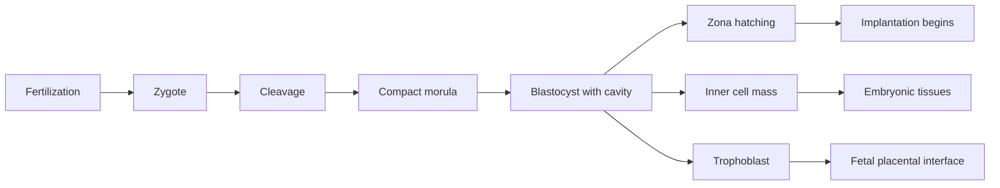
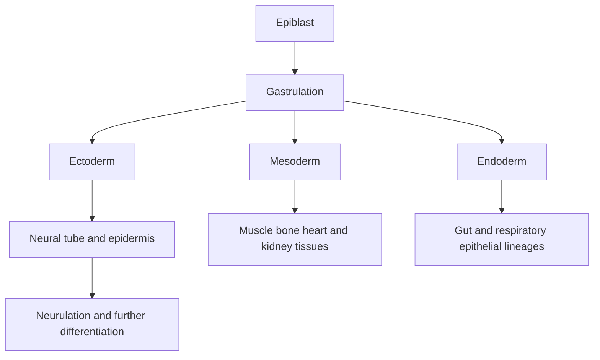
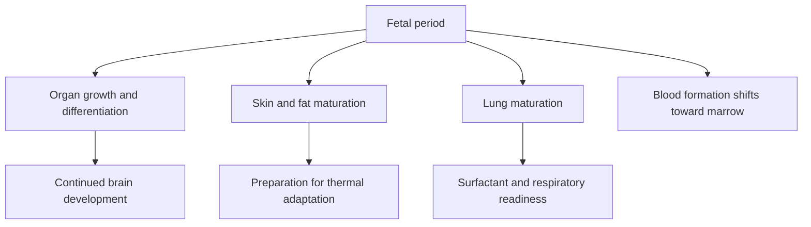

# Embryonic and Fetal Development

**Study-ready, not studied.** Is guide mein fertilization ke baad baby ki development ko basic se exam level tak samjhenge. Ye advance-preparation notes hain, aapki personal study completion ka record nahi hain.

[Chapter](../README.md) · [Embryonic MCQs](../MCQs/04A-Embryonic-Development-20-MCQs.md) · [Fetal growth MCQs](../MCQs/04B-Fetal-Growth-and-Maturation-20-MCQs.md) · [Reported exam evidence](../Previous-Year-Questions/04-Embryonic-and-Fetal-Development-Reported-Evidence.md)

## 1. Development ki do clocks samjho

Dekho, jab doctor gestational age bolta hai, toh usually last menstrual period (LMP) ke first day se weeks count karta hai. Actual fertilization typical 28-day cycle mein approximately 14 din baad ho sakti hai. Isliye fertilization-based age aur obstetric gestational age mein approximately 2 weeks ka difference hota hai. Irregular cycle ya assisted reproduction mein exact dating ka approach alag ho sakta hai.

| Developmental phase | Approximate postfertilization age | Approximate LMP-based age |
|---|---|---|
| Germinal / pre-embryonic | First 2 weeks | 2–4 completed weeks |
| Main embryonic organogenesis | Third through eighth developmental weeks | Approx. 4–10 completed weeks |
| Fetal period | After 8 completed postfertilization weeks | After approx. 10 completed gestational weeks |
| Expected due date | Approx. 38 completed weeks | Approx. 40 completed weeks |

Ye table completed age boundaries aur ordinal week names ka difference dikhata hai. Jaise 8 completed postfertilization weeks ke baad ninth developmental week shuru hoti hai. Us waqt typical obstetric gestational age 10 completed weeks hogi, yani eleventh gestational week shuru hai.

**Worked example:** Fertilization ke 6 completed weeks ho chuke hain. Typical cycle mein LMP-based age = 6 + 2 = approximately 8 completed weeks. Actual clinical dating reliable history aur early ultrasound ke hisab se hoti hai. Pehle [pregnancy diagnosis MCQs](../MCQs/02-Pregnancy-Diagnosis-20-MCQs.md) mein dating methods cover hue hain, unko yahan dobara original count mein nahi joda gaya hai.

## 2. Fertilization se implantation tak

Ovulation mein ovary se secondary oocyte release hoti hai. Fertilization usually uterine tube ke ampullary region mein hoti hai. Sperm aur oocyte ke genetic material se zygote develop hota hai. Zygote first diploid cell hai, jisme normally 46 chromosomes hote hain. Sperm-oocyte fusion ke baad oocyte activate hoti hai. Cortical granules release hokar zona pellucida ki properties modify karte hain, jisse additional sperm entry limit hoti hai. Ek se zyada sperm ka entry abnormal chromosome number ka cause ban sakta hai.

Zona pellucida oocyte aur early embryo ke around protective layer hoti hai. Jab zygote repeatedly mitosis karta hai, toh chhoti daughter cells banti hain jinhe blastomeres kehte hain. Is process ko cleavage kehte hain. Cell number badhta hai, lekin initial total size proportionately nahi badhta, kyunki original cytoplasm divide ho raha hota hai.

Cleavage ke baad compact solid cell cluster develop hota hai, jise morula kehte hain. Classic exam books approximately 16-cell stage ko morula ke saath associate karti hain, lekin exact cell count fixed universal definition nahi hai. Fluid cavity develop hone par blastocyst banta hai. Is cavity ko blastocoel kehte hain. Blastocyst mein inner cell mass aur outer trophoblast distinguish hote hain.

Inner cell mass embryonic tissues ka source hai. Trophoblast implantation aur fetal placental interface mein contribute karta hai. Blastocyst ko zona se hatch hona padta hai, jisse trophoblast uterine lining ke saath contact kar sake. Tubal cilia aur smooth muscle contractions conceptus ko uterus ki taraf le jaate hain.

Implantation usually fertilization ke approximately 6–7 days baad start ho sakti hai aur subsequent days mein deepen hoti hai. Timing person aur developmental conditions ke hisab se vary karti hai. Trophoblast ki proliferating individual cells ko cytotrophoblast aur fused multinucleated invasive layer ko syncytiotrophoblast kehte hain. Syncytiotrophoblast implantation aur early endocrine support mein contribute karta hai. Maternal uterine lining pregnancy mein decidual changes karti hai.

Ye original diagram sequence samjhata hai. Har step ka exact duration fixed nahi hota.

## 3. Germ layers, organogenesis aur critical periods

Early embryonic disc mein cell organization hoti hai. Gastrulation ke dauran epiblast cells primitive streak ke through migrate karti hain aur three primary germ layers establish hoti hain. Iska matlab hai ki cells different developmental roles lena start karti hain. Ectoderm, mesoderm aur endoderm ke specific contributions hote hain.

| Germ layer | High-yield derivatives |
|---|---|
| Ectoderm | Epidermis, brain aur spinal cord ke major neural tissues |
| Mesoderm | Skeletal muscle, bone, cardiovascular tissues aur kidney ke major structures |
| Endoderm | Most gastrointestinal aur respiratory epithelial lining, liver aur pancreas ki epithelial lineages |

Ek complete organ mein different germ layers se aayi tissues bhi hoti hain. Jaise gut epithelium endoderm se aur intestinal muscular wall largely mesoderm se aati hai.

Neurulation mein neural plate fold hokar neural tube form karti hai. Neural tube se brain aur spinal cord develop hote hain. Agar closure incomplete ho, toh neural tube defect develop ho sakta hai. Folic acid ka preventive role already ANC bank mein covered hai. Early body folding flat embryonic disc ko three-dimensional body plan mein organize karti hai aur primitive gut formation mein contribute karti hai.

Embryonic heart tube approximately postfertilization day 21–23 ke around rhythmic activity aur pumping start kar sakti hai. Ultrasound par activity detect hone ka time aur heart tube ke first biological contractions ka time ek hi measurement nahi hain. Gestational clock specify kiye bina single-week questions misleading ho sakte hain.

Organogenesis ka matlab organs ki initial formation hai. Major structural formation ke liye third se eighth postfertilization weeks important hoti hain. Teratogen aisa exposure hai jo development ko harm kar sakta hai. Risk medicine ya agent, dose, timing aur individual susceptibility par depend karta hai. Very early two weeks postfertilization ko often all-or-none period kehte hain. Severe damage pregnancy loss cause kar sakta hai aur surviving development unaffected ho sakti hai, lekin exceptions possible hain. Nurse ko individual exposure details document karke clinician ya teratology service se review coordinate karna chahiye. Har exposure se defect guaranteed nahi hota aur surviving pregnancy se every risk exclude bhi nahi hota.

Monozygotic twins ek fertilized oocyte se develop hote hain. Division ki timing aur developmental pattern placenta aur membrane sharing ko influence kar sakte hain. Actual chorionicity aur amnionicity ultrasound se assess karna important hai. Fixed day-splitting tables ko absolute prediction mat samjho.

## 4. Fetal growth aur functional maturation

Fetal period mein organs jo earlier form hone lage the, ab size mein grow aur functional maturity ki taraf develop hote hain. Ultrasound par kisi organ ka visible hona aur us organ ka birth ke baad independently function kar paana alag cheezein hain.

### Skin, hair, fat aur temperature

Fetal skin par fine hair develop ho sakti hai jise lanugo kehte hain. Vernix caseosa waxy protective coating hai jo skin ko amniotic environment mein protect karne mein help karti hai. Lanugo vernix ko skin par retain karne mein contribute kar sakti hai. Later gestation mein skin barrier aur subcutaneous fat mature hote hain. Isi wajah se very preterm infant ki skin relatively thin aur translucent ho sakti hai.

Brown adipose tissue special fat hai jo birth ke baad heat produce karne mein contribute karta hai. Isko nonshivering thermogenesis kehte hain, yani shivering ke bina heat banana. Preterm infants mein thermal protection especially important hoti hai.

### Lungs aur fetal breathing movements

Fetal lungs fluid-filled hote hain. Fetus oxygen placenta se receive karta hai, air breathe karke nahi. Fetal breathing movements respiratory muscles aur lung growth mein contribute karte hain. Ye postnatal air breathing ka proof nahi hain. Surfactant lung ke small air spaces ki surface tension reduce karne mein help karta hai. Isse birth ke baad alveoli ko open maintain karne mein support milta hai. Prematurity mein lung structure aur surfactant-related readiness incomplete ho sakti hai.

Agar preterm delivery likely ho, toh indicated antenatal corticosteroids lung maturation accelerate kar sakte hain aur newborn respiratory complications reduce kar sakte hain. Nurse prescribed treatment aur local protocol follow kare. Is treatment ke baad bhi newborn ko respiratory support ki need ho sakti hai.

### Blood, brain aur body proportions

Hematopoiesis blood cells banne ka process hai. Early yolk sac primitive blood formation mein role play karta hai. Fetal liver later major production site banta hai aur bone marrow gradually important ho jata hai. Ye sites kuch time overlap bhi karti hain.

Fetal hemoglobin HbF ki globin chains alpha2 gamma2 hoti hain. Adult HbA alpha2 beta2 hota hai. HbF ki oxygen affinity higher hoti hai, partly kyunki yeh 2,3-BPG ko less strongly bind karta hai. Is property se placental oxygen transfer facilitate ho sakta hai. Hemoglobin oxygen banata nahi hai, oxygen carry karta hai.

Early development mein head proportionately large ho sakta hai. Fetal body aur limbs grow karte hue proportions change karte hain. Brain development fetal period aur birth ke baad bhi continue hota hai. Late pregnancy nutrition, oxygen supply aur harmful exposures ka clinical relevance rehta hai.

Fetal urine first trimester ke end ke aas paas develop hona start kar sakti hai. Sources onset aur detection ka time somewhat differently report karti hain. Later pregnancy mein urine amniotic fluid balance ka major contributor ban jati hai. Fetus fluid swallow bhi karta hai. Intestine mein mucus, shed cells aur bile-related material accumulate hokar meconium form karte hain, jo first newborn stool ho sakta hai.

### Gestational maturity aur clinical decisions

| Clinical category | Gestational age |
|---|---|
| Late preterm | 34+0 to 36+6 weeks |
| Early term | 37+0 to 38+6 weeks |
| Full term | 39+0 to 40+6 weeks |
| Late term | 41+0 to 41+6 weeks |
| Postterm | 42+0 weeks onward |

37 weeks se term range start hoti hai, lekin full term 39 weeks par start hota hai. Nonmedically indicated early-term birth generally avoid ki jati hai, kyunki early-term infants mein neonatal morbidity greater ho sakti hai. Medical indication ho toh individualized earlier delivery appropriate ho sakti hai.

Very early preterm birth mein survival ko ek fixed gestational week se guarantee nahi karte. Gestational age ke saath weight, fetal condition, antenatal treatment aur available neonatal resources matter karte hain. Maternity aur neonatal specialists individualized counselling provide karte hain.

SMFM fetal growth restriction (FGR) ke liye estimated fetal weight (EFW) ya abdominal circumference (AC) below 10th percentile threshold use karta hai. Ye clinical evaluation ka trigger hai, single result cause establish nahi karta. Serial growth, Doppler aur other assessment later dedicated fetal assessment package mein expand honge.

## 5. Teaching and MCQ practice

| Topic | Teaching video | Dedicated question practice |
|---|---|---|
| Fertilization, cleavage and implantation | [Nursing Lecture, Embryonic development in Hindi](https://www.youtube.com/watch?v=sgEBmu3xdWE) | [Nursing Wallah by PW, Aarogyam Infinity Part 5](https://www.youtube.com/watch?v=6TCntLiSXNo) |
| Germ layers and critical periods | Specific teaching coverage verification pending | Specific MCQ coverage verification pending |
| Fetal growth and maturation | [GS Medical Academy, fetal development week by week in Hindi](https://www.youtube.com/watch?v=PyRawn0jD4Q) | [Aarogyam Infinity Part 5, fetal development](https://www.youtube.com/watch?v=6TCntLiSXNo), broad lead only |

28 November 2026 ko titles aur indexed descriptions inspect kiye gaye. Part 5 description specifically fertilization aur implantation timeline cover karti hai. Direct YouTube retrieval failed, isliye full playback, exact question aur video quality authenticate nahi hui hai. Germ-layer aur fetal-maturation specific practice ke gaps abhi open hain.

## Clinical references and exam recap

- [OpenStax embryonic development](https://openstax.org/books/anatomy-and-physiology-2e/pages/28-2-embryonic-development), [OpenStax fetal development](https://openstax.org/books/anatomy-and-physiology-2e/pages/28-3-fetal-development) and [MedlinePlus fetal development](https://medlineplus.gov/ency/article/002398.htm) directly retrieved.
- [NCBI fertilization](https://www.ncbi.nlm.nih.gov/books/NBK542186/) retrieved, with timing and terminology cross-checked against other sources. Do not apply ambiguous statements about gestational dating literally.
- [MotherToBaby critical periods](https://www.ncbi.nlm.nih.gov/books/NBK582659/), [UNSW embryonic heart development](https://embryology.med.unsw.edu.au/embryology/index.php/Cardiovascular_System_-_Heart_Development), [renal development](https://pmc.ncbi.nlm.nih.gov/articles/PMC5387761/), [fetal hemoglobin](https://www.ncbi.nlm.nih.gov/books/NBK500011/), [hematopoiesis review](https://pmc.ncbi.nlm.nih.gov/articles/PMC11121135/) indexed and cross-checked.
- [ACOG term classification](https://www.acog.org/clinical/clinical-guidance/committee-opinion/articles/2013/11/definition-of-term-pregnancy), [ACOG periviable birth](https://www.acog.org/clinical/clinical-guidance/obstetric-care-consensus/articles/2017/10/periviable-birth), [ACOG antenatal corticosteroids](https://www.acog.org/clinical/clinical-guidance/committee-opinion/articles/2017/08/antenatal-corticosteroid-therapy-for-fetal-maturation), [SMFM FGR](https://publications.smfm.org/publications/289-society-for-maternal-fetal-medicine-consult-series-52/) indexed guideline excerpts.
- [OpenStax maternal newborn nursing fetal growth](https://openstax.org/books/maternal-newborn-nursing/pages/10-4-fetal-growth-and-development) retrieved, but its week 9 fetal-stage and week 37 full-term labels are not used here because they conflict with explicit LMP-based dating and ACOG term subcategories.

**Dhyan de:** Fertilization age aur LMP age ko mix mat karo. Morula solid hoti hai, blastocyst mein cavity hoti hai. Embryonic period mein major organs form hote hain aur fetal period mein growth aur maturation continue hoti hai. Early term aur full term ko separate yaad rakho.

[20 embryonic MCQs](../MCQs/04A-Embryonic-Development-20-MCQs.md) · [20 fetal MCQs](../MCQs/04B-Fetal-Growth-and-Maturation-20-MCQs.md) · [Reported exam evidence](../Previous-Year-Questions/04-Embryonic-and-Fetal-Development-Reported-Evidence.md) · [Chapter](../README.md)
