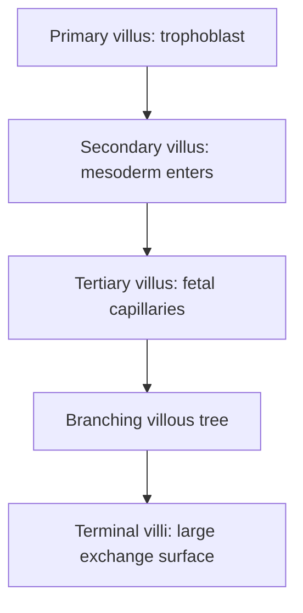
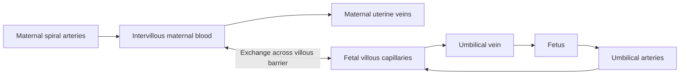

# Placental Structure and Function

[Chapter](../README.md) · [20 original MCQs](../MCQs/05A-Placental-Structure-and-Function-20-MCQs.md) · [Reported exam practice](../Previous-Year-Questions/05A-Placenta-Reported-Exam-Evidence.md)

## Placenta kya hai?

Placenta pregnancy ke dauran develop hone wala temporary fetomaternal organ hai. Yeh oxygen, nutrients, waste exchange, hormone production aur selected immune protection mein help karta hai. Maternal aur fetal blood normally alag circulations mein rehte hain; limited cellular transfer possible hai. Placenta complete protective wall nahi hai.

- Fetal component: chorion frondosum, yani implantation site par villi-rich chorion.
- Maternal component: decidua basalis, yani implantation ke neeche modified maternal endometrium.
- Chorionic plate fetal side par hoti hai; basal plate maternal interface par hoti hai.
- Delivered placenta ka fetal surface amnion se covered, smooth aur shiny dikhta hai. Cord se branching fetal vessels dikh sakte hain.
- Maternal surface dark red, rough aur cotyledons mein divided hota hai. Lobes ki exact sankhya variable hai.

Term placenta generally discoid hota hai; approximately 500–600 g, 15–25 cm diameter aur 2–3 cm thickness commonly described hain. Weight trimming, membranes, cord, gestation aur measurement method par depend karta hai. Ek number ko disease cutoff mat samajhna.

## Villous development

Primary villus mein cytotrophoblast core aur outer syncytiotrophoblast hota hai. Secondary villus mein extraembryonic mesoderm enter karta hai. Tertiary villus mein fetal capillaries develop ho jati hain. Terminal villi large exchange surface provide karti hain. Pregnancy progress ke saath exchange distance generally kam hoti hai.

## Do separate blood circuits

Maternal spiral arteries intervillous space mein maternal blood deliver karti hain. Blood villi ke outside surface ko bathe karta hai aur uterine veins se return karta hai. Fetal blood umbilical arteries se placenta ke fetal vessels aur villous capillaries mein aata hai, phir umbilical vein se fetus ko return hota hai. Human placenta hemochorial hai because maternal blood directly trophoblast surface ke contact mein hota hai, fetal blood ke direct contact mein nahi.

*Diagram mein arrow exchange dikhata hai, blood mixing nahi.*

Extravillous trophoblast spiral arteries ko remodel karne mein contribute karta hai. Isse wide, low-resistance maternal supply establish hoti hai. Incomplete remodeling placental malperfusion, fetal growth restriction aur preeclampsia se associated ho sakta hai; yeh association hai, single finding se diagnosis nahi hota.

## Exchange aur endocrine function

| Substance | Main mechanism / implication |
|---|---|
| Oxygen and carbon dioxide | Partial-pressure gradient ke according diffusion |
| Glucose | Carrier-mediated facilitated diffusion |
| Many amino acids | Energy-dependent transporter systems and concentration gradients |
| Maternal IgG | Receptor-mediated transfer, particularly later gestation |
| Urea and fetal waste | Maternal circulation ki taraf transfer, maternal organs eliminate karte hain |

Placenta hCG, progesterone, estrogens aur human placental lactogen produce karta hai. Hormonal roles pehle endocrine bank mein covered hain. IgG passive immunity provide karta hai; preterm birth mein late-gestation transfer ka time kam ho sakta hai. IgM generally placenta cross nahi karta. Some drugs, alcohol, pathogens aur antibodies cross kar sakte hain. Pregnancy medicine decisions prescriber aur clinical guidance ke saath honi chahiye.

## Post-delivery assessment and clinical reasoning

Maternal surface systematically inspect karo; missing cotyledon ya incomplete membranes retained tissue ka suspicion raise karte hain. Qualified maternity team ko promptly inform karo, bleeding aur uterine tone assess karo, local postpartum hemorrhage protocol follow karo. Appearance alone se retained tissue confirm nahi hota.

- Succenturiate placenta: separate accessory placental lobe; connecting vessels aur retained lobe ka concern.
- Circumvallate placenta: raised folded membrane ring fetal surface par; ultrasound appearance alone definitive diagnosis nahi.
- Calcification: gestation ke saath ho sakti hai. Isolated calcification ko automatically fetal compromise mat label karo; clinical context, growth aur indicated surveillance important hain.
- Placental dysfunction oxygen/nutrient delivery ko restrict kar sakta hai; fetal growth, Doppler aur clinical findings together interpret kiye jate hain.

Worked example: newborn 3000 g aur trimmed placenta 500 g. Fetal-to-placental weight ratio = 3000 ÷ 500 = 6:1. Yeh arithmetic example hai, universal diagnostic threshold nahi.

## Source and video verification

- [2026 placental anatomy and physiology review](https://link.springer.com/article/10.1007/s00404-026-08382-7) — retrieved review; structure, dimensions and circulation.
- [Placental examination, AAFP](https://www.aafp.org/afp/1998/0301/p1045) — retrieved older clinical article; gross anatomy and completeness, not used as current invasive treatment guidance.
- [Placental transport review](https://pmc.ncbi.nlm.nih.gov/articles/PMC10288517/) — indexed source for transport mechanisms.
- [Maternal IgG transfer review](https://pubmed.ncbi.nlm.nih.gov/22235228/) — indexed immunology source.
- Teaching lead: [Nursing Lecture — placental structure](https://www.youtube.com/watch?v=dIOC3TgCAhY). Indexed description includes plates and villi. Playback not verified.
- Dedicated MCQ practice leads: [Nursing Wallah Aarogyam Infinity Part 5](https://www.youtube.com/watch?v=6TCntLiSXNo) and [Part 6](https://www.youtube.com/watch?v=jRqFUX0xdCM). Description-level relevance only; exact item coverage and playback not verified.

Clinical sources were researched for this bank; independent item-by-item clinical audit and Mermaid rendering remain pending.
