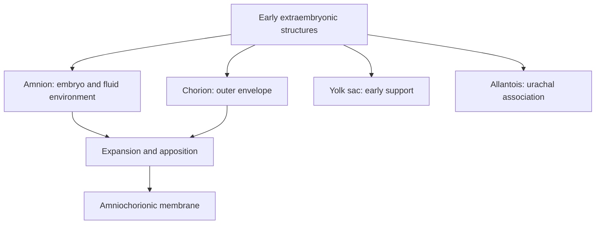
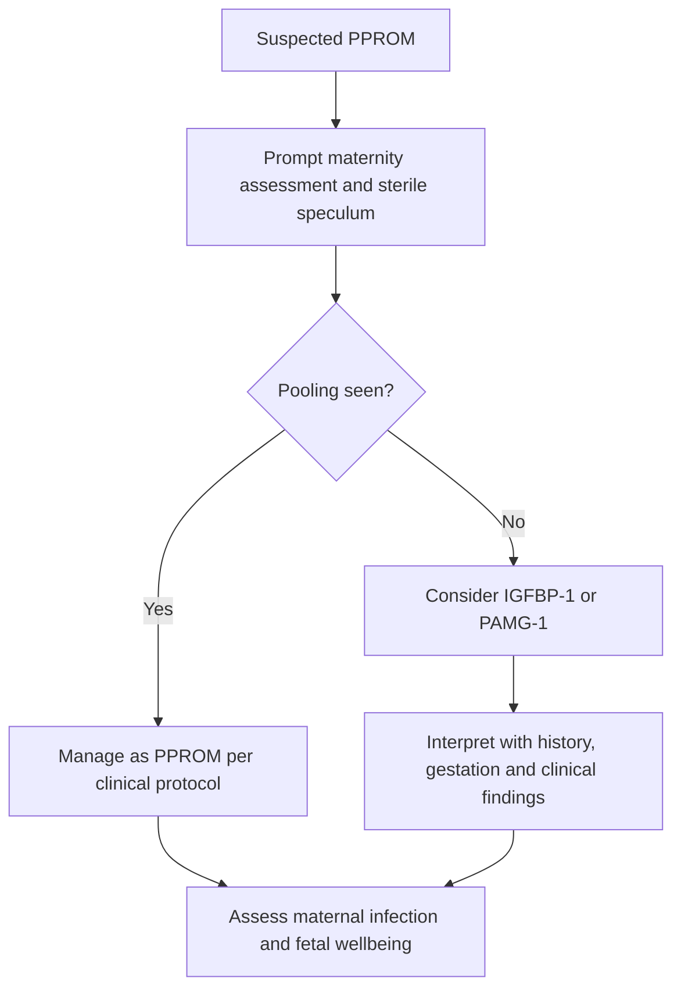

# Fetal Membranes — Detailed Concepts

[Chapter](../README.md) · [20 original MCQs](../MCQs/05B-Fetal-Membranes-20-MCQs.md) · [Reported exam evidence](../Previous-Year-Questions/05B-Fetal-Membranes-Reported-Evidence.md)

## Four extraembryonic membranes

Embryo ko develop hone ke liye surrounding support structures chahiye. Classical embryology mein amnion, chorion, yolk sac aur allantois four extraembryonic membranes kehlate hain. Clinical obstetrics mein "fetal membranes" frequently amnion aur chorion ki bilayer sac ko refer karta hai.

| Structure | Origin / relationship | Main significance |
|---|---|---|
| Amnion | Epiblast-associated epithelium and extraembryonic mesoderm | Fluid-filled cavity surrounds embryo; mechanical protection |
| Chorion | Trophoblast and extraembryonic somatic mesoderm | Outer extraembryonic envelope; villous region contributes to placenta |
| Yolk sac | Early lining derived from hypoblast | Early nutritional support, hematopoiesis and association with primordial germ cells |
| Allantois | Early endodermal outgrowth into connecting stalk | Associated with urachal development |

Yolk sac human pregnancy mein actual stored yolk contain nahi karta. Amnion normally avascular hai, meaning intrinsic blood vessels absent hain. Collagen-rich connective tissue membrane strength provide karta hai. Chorion aur amnion fetal tissues hain; decidua modified maternal endometrium hai, fetal membrane nahi.

Early development mein chorionic cavity, ya extraembryonic coelom, amniotic sac aur yolk sac ke outside but chorion ke inside hoti hai. Amnion expand karke chorion ke saath appose/fuse hota hai, generally late first to early second trimester ke around. Exact timing variable hai; isolated scan finding ko specialist context mein interpret karna chahiye.

## Developmental remnants

Urachus developing bladder dome ko umbilical region se connect karne wale developmental pathway se associated hai. Normally involute hokar median umbilical ligament banta hai. Median aur medial umbilical ligaments confuse mat karo: paired medial ligaments distal umbilical arteries ke remnants hain. Patent urachus mein bladder–umbilicus communication persist kar sakta hai, causing urine-like drainage; newborn ko pediatric assessment chahiye.

Vitelline duct midgut aur yolk sac ka embryonic connection hai. Incomplete involution ileal Meckel diverticulum ya other vitelline remnants cause kar sakti hai. Umbilical discharge ko sirf normal cord drying assume nahi karna chahiye.

Amniotic band sequence mein thin bands fetal limb ya other structures ko constrict kar sakte hain. Early membrane disruption proposed mechanism hai, but all cases ka mechanism identical nahi. Limb constriction, distal edema ya abnormal scan findings fetal medicine assessment require karte hain.

## Rupture of membranes — clinical distinction

PROM means prelabor rupture of membranes, i.e. labor onset se pehle waters break hona. Term PROM occurs at 37 completed weeks or later. PPROM occurs before 37 completed weeks and before labor. Rupture during established labor is not prelabor rupture. Artificial rupture is clinician-performed amniotomy, not spontaneous rupture.

Suspected leakage mein time, amount, color, odor, fever, pain, bleeding, contractions aur fetal movements record karo. Prompt maternity assessment arrange karo. Repeated unnecessary digital vaginal examinations avoid karo, particularly suspected PPROM. Management gestation, infection, fetal condition, GBS status and local protocols ke according individualized hoti hai.

NICE NG25 specifically advises against nitrazine for PPROM diagnosis. Positive biomarker alone management decide nahi karta. Clinical assessment, CRP, white cell count aur fetal heart rate ko together interpret karo. No single normal result infection exclude karta hai. New fetal bradycardia after rupture cord prolapse ka concern raise karti hai; urgent obstetric escalation required hai.

## References and video leads

- [OpenStax embryonic development](https://openstax.org/books/anatomy-and-physiology/pages/28-2-embryonic-development) — indexed embryology.
- [NCBI yolk sac](https://www.ncbi.nlm.nih.gov/sites/books/NBK555965/) — retrieved; use alongside embryology references, not as sole source for timing and chorion origin.
- [Fetal membrane nomenclature review](https://pmc.ncbi.nlm.nih.gov/articles/PMC12993173/) — indexed bilayer and avascular structure evidence.
- [Patent urachus](https://www.ncbi.nlm.nih.gov/sites/books/NBK557723/) and [midgut embryology](https://www.ncbi.nlm.nih.gov/sites/books/NBK553156/) — indexed developmental remnants.
- [Amniotic band syndrome](https://www.ncbi.nlm.nih.gov/sites/books/NBK545283/) — indexed clinical reference.
- [NICE NG25](https://www.nice.org.uk/guidance/ng25/chapter/Recommendations) and [RCOG PPROM guidance](https://www.rcog.org.uk/guidance/browse-all-guidance/green-top-guidelines/care-of-women-presenting-with-suspected-preterm-prelabour-rupture-of-membranes-from-24plus0-weeks-of-gestation-green-top-guideline-no-73/) — indexed current clinical recommendations; direct NICE page retrieval returned 403.
- Teaching lead: [Fetal membranes and amniotic fluid — OBG Nursing](https://www.youtube.com/watch?v=2hulI-2pRbg). Topic title indexed, playback not verified.
- MCQ practice lead: [Chorion teaching with interactive questions](https://www.youtube.com/watch?v=oPA1pIwPq3M). Indexed description mentions MCQs, language/Indian nursing exam suitability and exact question coverage not verified. No dedicated membrane bank item-level video verified.

Independent clinical and comprehensive semantic audits, exact video playback and diagram rendering remain pending.
