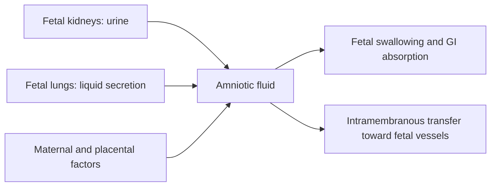
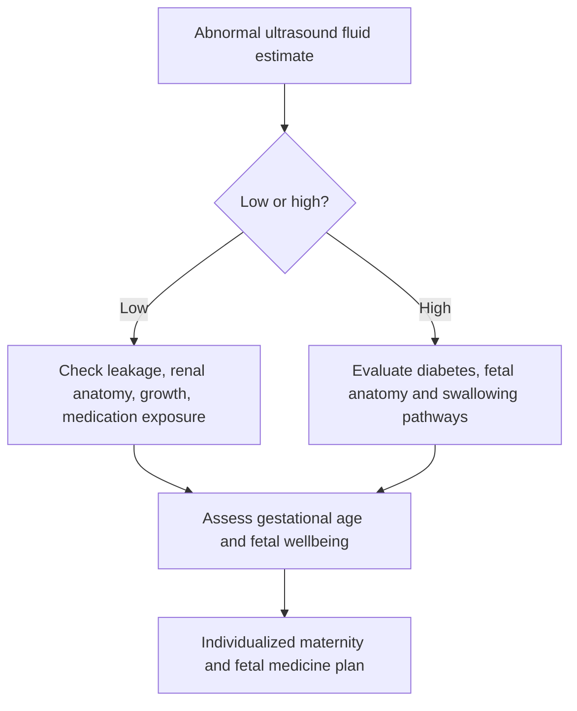

# Amniotic Fluid — Detailed Concepts

[Chapter](../README.md) · [20 original MCQs](../MCQs/05C-Amniotic-Fluid-20-MCQs.md) · [Reported exam evidence](../Previous-Year-Questions/05C-Amniotic-Fluid-Reported-Evidence.md)

## Meaning and functions

Amniotic fluid, ya liquor amnii, amniotic cavity ke andar fetus ko surround karta hai. Yeh mechanical cushioning, relatively stable temperature, fetal movement, musculoskeletal development, lung development aur cord compression se kuch protection provide karta hai. Fetus ka main oxygen/nutrient exchange placenta se hota hai, amniotic fluid se directly nahi.

Fluid amount gestational age ke saath change hota hai. Early gestation mein maternal/membrane-related transfer aur fetal contributions involved hain. Later pregnancy mein fetal urine major input hota hai, fetal lung liquid bhi contribute karta hai. Fetal swallowing aur intramembranous absorption important clearance pathways hain.

Balance dynamic hai; production ya clearance change hone par volume abnormal ho sakta hai. Early developmental period mein exact urine onset ke different exam conventions already fetal development evidence file mein separately explained hain.

## Ultrasound fluid assessment

AFI (amniotic fluid index) uterus ke four quadrants ki suitable vertical fluid pockets ka sum hai. DVP/SDP (deepest/single deepest vertical pocket) largest suitable pocket ki vertical depth hai. Measurements cord aur fetal parts se free honi chahiye, proper sonographic technique ke saath. Dono semiquantitative estimates hain, actual liters ka direct measurement nahi.

Worked example: four depths 1.2, 1.4, 0.9 and 1.0 cm. AFI = 4.5 cm. Largest listed depth = 1.4 cm; actual DVP complete scan se establish hota hai. Low measurements require clinical interpretation, not independent diagnosis or delivery decision.

| Finding in singleton pregnancy | Common ultrasound criterion |
|---|---|
| Oligohydramnios | DVP less than 2 cm; AFI 5 cm or less also used |
| Polyhydramnios | SMFM Consult #46: DVP at least 8 cm OR AFI at least 24 cm |

Guidelines/older texts may differ at boundaries (24 vs 25 cm, etc.). Exam question mein named guideline ko follow karo. AFI low-fluid diagnosis ko DVP ke comparison mein more frequently classify kar sakta hai. Multiple gestations mein sac-specific assessment and separate protocols required hain.

## Oligohydramnios

Possible causes: membrane leakage, reduced fetal urine due to renal anomaly or urinary obstruction, placental insufficiency with reduced renal perfusion, and some medication exposures. Prolonged severe low fluid early in pregnancy pulmonary hypoplasia se associated ho sakta hai. Cord compression risk bhi relevant hai. Low fluid alone se renal agenesis, rupture, fetal distress ya delivery indication prove nahi hota.

NSAIDs around 20 weeks or later fetal renal dysfunction aur low fluid cause kar sakte hain. Medication list promptly prescriber ke saath review karo. Prescribed low-dose aspirin for specific indications FDA warning ka exception ho sakta hai; independently discontinue na karo.

## Polyhydramnios

Maternal diabetes fetal hyperglycemia aur osmotic diuresis ke through fluid production badha sakta hai. Fetal swallowing ya GI transit impairment, jaise esophageal atresia, clearance reduce kar sakta hai. Some cases idiopathic hote hain. Excess fluid ka cause assessment important hai, single scan diagnosis etiology establish nahi karta.

Severe fluid excess maternal discomfort, dyspnea, uterine overdistension, malpresentation aur cord prolapse risk se associated ho sakta hai. High presenting part ke saath rupture ke time cord descent ka concern hota hai. Fetal heart rate assess karo, abnormality promptly escalate karo.

SMFM guidance: severe symptomatic polyhydramnios mein specialist amnioreduction consider kar sakta hai; indomethacin solely fluid decrease ke liye use nahi karna chahiye. Mild idiopathic cases mein routine early delivery solely fluid finding ke basis par indicated nahi. Individual obstetric indications and local protocol follow karo.

## Nursing observations

Watery leakage, abnormal fetal movements, bleeding, maternal fever or dyspnea ko promptly assess/escalate karo. Green or brown meconium-stained fluid fetal risk assessment ka part hai, but fetal acidemia alone prove nahi karta. NICE guidance meconium character, intrapartum risks and fetal heart assessment integrate karti hai. Older fixed fluid-volume exam conventions (e.g. two liters) historical recognition ke liye useful ho sakte hain; current sonographic practice ke substitutes nahi.

## References and videos

- [NCBI amniotic fluid physiology](https://www.ncbi.nlm.nih.gov/books/NBK541089/) and [sonographic fluid evaluation](https://www.ncbi.nlm.nih.gov/sites/books/NBK570623/) — indexed clinical references.
- [NCBI oligohydramnios](https://www.ncbi.nlm.nih.gov/books/NBK562326/) and [polyhydramnios](https://www.ncbi.nlm.nih.gov/sites/books/NBK562140/) — indexed etiology and assessment.
- [SMFM Consult #46](https://publications.smfm.org/publications/263-society-for-maternal-fetal-medicine-consult-series-46/) — retrieved primary professional guidance, explicit ultrasound thresholds and treatment recommendations.
- [FDA pregnancy NSAID safety](https://www.fda.gov/drugs/drug-safety-and-availability/fda-recommends-avoiding-use-nsaids-pregnancy-20-weeks-or-later-because-they-can-result-low-amniotic) — indexed official safety communication.
- [NICE NG229](https://www.nice.org.uk/guidance/ng229/chapter/recommendations) — indexed meconium and fetal monitoring guidance.
- Teaching leads: [Nursing Lecture Hindi polyhydramnios management](https://www.youtube.com/watch?v=D1A6JCElxH0); [Amniotic Fluid One Shot NORCET 2026](https://www.youtube.com/watch?v=JOZHTFSqzQk).
- Dedicated MCQ lead: [Jagrati Acquire Knowledge — placenta, amniotic fluid, fetal circulation MCQs](https://www.youtube.com/watch?v=Z8h1N-0CY_E). Indexed topic/title relevance, playback and exact item coverage not verified.

Independent clinical audit, comprehensive semantic audit, diagram rendering and question-level video coverage remain pending.
