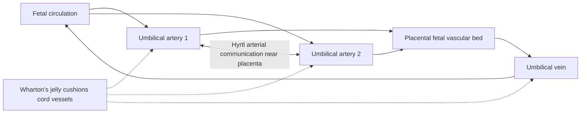
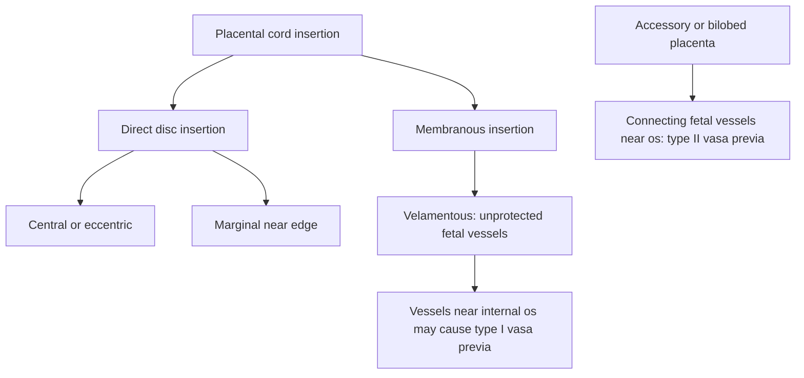
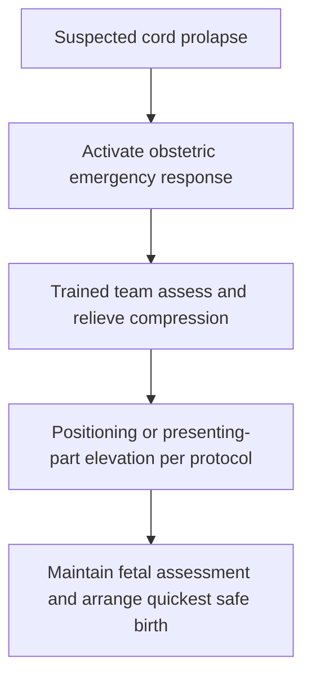

# Umbilical Cord — Detailed Concepts

[Chapter](../README.md) · [20 original MCQs](../MCQs/05D-Umbilical-Cord-20-MCQs.md) · [Reported exam evidence](../Previous-Year-Questions/05D-Umbilical-Cord-Reported-Evidence.md)

## Normal structure and circulation

Umbilical cord fetus ko placenta se connect karta hai. Typically two umbilical arteries aur one umbilical vein hoti hain. Arteries relatively deoxygenated fetal blood placenta tak le jaati hain; vein oxygenated, nutrient-rich blood fetus ki taraf return karti hai. Artery/vein ka naam direction par based hai, oxygenation par nahi. Direct maternal blood mixing normal mechanism nahi hai.

Wharton's jelly hydrated gelatinous connective tissue hai, rich in glycosaminoglycans. Yeh vessels ko bending aur external pressure se cushion karne mein help karti hai. Vein usually larger lumen rakhti hai; arteries comparatively muscular walls rakhti hain. Cord surface amnion se covered hoti hai. Normal cord coiling variable hoti hai. Hyrtl's anastomosis commonly placental insertion ke near two arteries ke beech communication hai. Exact term cord length bhi variable hai; one number ko universal normal cutoff na samjho.

Embryological remnants true cord cysts mein contribute kar sakte hain. Pseudocyst Wharton jelly degeneration se form ho sakti hai and lacks a true epithelial lining. Imaging alone se all lesions ka exact histology establish nahi hota.

## Cord insertion and vessel anomalies

| Finding | Meaning and clinical concern |
|---|---|
| Central/eccentric | Cord inserts directly into placental disc |
| Marginal (battledore) | Direct disc insertion close to edge |
| Velamentous | Cord inserts into free membranes, exposed vessels cross membranes before reaching disc |
| Single umbilical artery (SUA) | One artery instead of two; detailed anatomy and growth assessment context important |

Velamentous vessel segment normally Wharton jelly se protected nahi hota, isliye compression/rupture concern. All marginal insertions velamentous nahi hoti. Isolated SUA diagnosis detailed scan ke baad establish karo. SMFM Consult #57 recommends no additional aneuploidy evaluation solely for isolated SUA; growth assessment and other indications remain separate. Associated abnormalities present hon toh case isolated nahi hai.

Vasa previa mein unprotected fetal vessels cervical os ke over/near course karte hain. Type I commonly velamentous insertion associated; type II mein accessory/bilobed placental lobes ke connecting vessels lower segment cross karte hain. Targeted ultrasound with color Doppler specialist evaluation important hai. Rupture ke time bleeding plus acute fetal heart abnormality fetal hemorrhage ka warning ho sakta hai; urgent obstetric response required. Antenatally confirmed cases ka delivery plan specialist individualized karta hai.

## Knots and cord presentation

True knot actual looped knot hai; tighten hone par fetal flow compromise possible hai. False knot vessel redundancy or local jelly bulge ka knot-like appearance hai. Nuchal cord fetal neck ke around loop hai. Single loop with reassuring assessment alone hypoxia ya mandatory cesarean prove nahi karta. True knots and multiple loops ka risk clinical context mein assess karo.

Cord presentation means cord presenting part aur cervix ke between hai, with or without ruptured membranes. Cord prolapse means ruptured membranes ke presence mein cord through cervix descends, alongside presenting part (occult) or past it (overt). Externally visible cord absent hone se occult prolapse exclude nahi hota.

High/mobile presenting part, malpresentation, excess fluid aur prematurity cord prolapse risk se associated ho sakte hain. High mobile presenting part mein routine amniotomy avoid karo unless specialist-controlled plan indicated. Sudden fetal bradycardia after membrane rupture urgently assess karo.

Clinical team pressure relief ke liye presenting part manually elevate kar sakti hai. Knee–chest or appropriate head-down left lateral position use ho sakti hai; transfer and maternal safety consider karo. Routine cord pushing back, traction or unnecessary handling avoid karo. Definitive birth mode/urgency fetal condition, gestation and imminent vaginal delivery possibility par depend karti hai. These are trained maternity-team actions, not self-treatment instructions.

## Birth transition and cord blood

WHO stable newborns ke liye delayed cord clamping not earlier than one minute recommend karta hai, commonly 1–3 minutes. ACOG vigorous term/preterm infants ke liye at least 30–60 seconds recommendation describe karta hai. Named guideline ko exam mein distinguish karo; emergencies, placental circulation disruption and need for resuscitation individual plan require karte hain. Drying, warmth and breathing assessment continue karo. Delayed placental transfusion iron stores improve kar sakti hai; neonatal jaundice monitor and treat karne ke systems important hain.

When indicated, paired umbilical arterial and venous blood gases fetal acid–base condition evaluate karne mein help karte hain. Arterial sample fetal status better reflects; venous sample placental return and pair validation support karta hai. Single pH value ko neonatal examination and clinical context ke bina cause of encephalopathy na samjho.

## References and video leads

- [NCBI cord anatomy](https://www.ncbi.nlm.nih.gov/books/NBK557389/) and [cord embryology](https://www.ncbi.nlm.nih.gov/books/NBK557490/) — indexed references.
- [EAPM congenital cord anomalies position statement](https://www.ejog.org/article/S0301211524002197/pdf) — indexed insertion distinctions.
- [SMFM Consult #37, reaffirmed 2024](https://publications.smfm.org/publications/215-society-for-maternal-fetal-medicine-consult-series-37/) and [Consult #57](https://publications.smfm.org/publications/394-society-for-maternal-fetal-medicine-consult-series-57/) — retrieved vasa previa and isolated SUA guidance.
- [RCOG cord prolapse guidance](https://www.rcog.org.uk/guidance/browse-all-guidance/green-top-guidelines/umbilical-cord-prolapse-green-top-guideline-no-50) and [guideline PDF](https://www.rcog.org.uk/media/3wykswng/gtg-50-umbilicalcordprolapse-2014.pdf) — indexed emergency recommendations.
- [Cord characteristics systematic review](https://pmc.ncbi.nlm.nih.gov/articles/PMC7514048/) — indexed knot and nuchal loop evidence.
- [WHO cord clamping](https://www.who.int/tools/elena/interventions/cord-clamping), [ACOG delayed clamping](https://www.acog.org/clinical/clinical-guidance/committee-opinion/articles/2020/12/delayed-umbilical-cord-clamping-after-birth), [cord gas interpretation](https://pmc.ncbi.nlm.nih.gov/articles/PMC2675384/) — indexed references.
- Dedicated MCQ lead: [Nursing Wallah Aarogyam Infinity Part 7](https://www.youtube.com/watch?v=kHJ7BDye4kg) indexed description explicitly includes cord and placenta/fluid. [Part 27, 28:55 SUA and associated anomalies](https://www.youtube.com/watch?v=-YUzQnkoNOw&t=1735s) provisional topic timestamp from indexed description, not independently played. Exact question/answer coverage not established.

Independent clinical and comprehensive semantic review, exact playback and diagram rendering remain pending.
