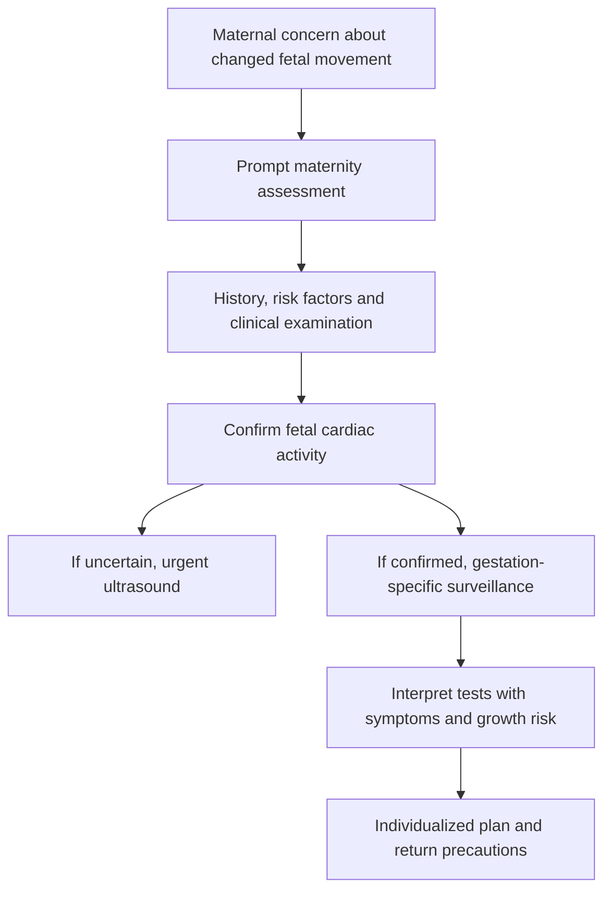

# Fetal Movements and Reduced Movements

**Study-ready, not studied.** Is lesson mein aap samjhenge ki baby ki normal movement ka pattern kya hota hai, kab change concerning ho sakta hai aur nurse ko assessment mein kya karna chahiye.

[Chapter](../README.md) · [20 original MCQs](../MCQs/06A-Fetal-Movements-and-Reduced-Movements-20-MCQs.md) · [Reported exam evidence](../Previous-Year-Questions/06A-Fetal-Movements-Reported-Evidence.md)

## 1. Quickening aur normal movement

Quickening ka matlab hai jab pregnant woman pehli baar baby ki movement ko feel aur recognize karti hai. Baby uterus mein isse pehle bhi move kar sakta hai. Mother ko movement feel hone ka time baby ki biological first movement se different hai. NHS ke hisab se movement usually 16 se 24 weeks mein feel hone lagti hai. First pregnancy mein 20 weeks ke baad bhi pehli movement recognize ho sakti hai. Older exam books frequently 16–20 ya 18–20 weeks ka conventional range use karti hain. In numbers ko universal deadline mat samjho.

Agar 24 weeks tak woman ne kabhi movement feel nahi ki, toh maternity team ko batana important hai. Clinician fetal cardiac activity assess karta hai aur zarurat par ultrasound ya specialist review arrange kar sakta hai.

Movement ka sensation flutter, kick, roll ya stretch jaisa ho sakta hai. Anterior placenta uterus ki front wall par hota hai aur kuch movements ko cushion kar sakta hai. Is wajah se perception less noticeable ho sakti hai, lekin established pattern mein change ko is explanation se dismiss nahi karna chahiye.

Baby ke active aur quiet periods hote hain. Late pregnancy mein movements ka character badal sakta hai, lekin pregnancy end ke paas movement ka sustained reduction automatically normal nahi hai. Woman ko labor tak movement feel ho sakti hai.

## 2. Counting aur individual pattern

Historical Cardiff count-to-ten method mein twelve-hour observation window aur ten movements ka reference milta hai. Other methods ke time windows aur thresholds different hain. Ek old exam question ka numeric answer har clinical situation ka universal rule nahi hai.

WHO routine formal daily kick charts ko rigorous research setting tak recommend karta hai. 2026 RCOG ke hisab se bhi fixed numerical formal counting recommend karne ke liye evidence insufficient hai. Iska matlab yeh hai ki patient ko usual pattern samajhne aur change report karne ki teaching dein. Iska matlab movement awareness avoid karna nahi hai.

Agar baby usual se less move kare, movement absent ho ya usual pattern change ho, toh woman ko immediately maternity provider se contact karna chahiye. Agle din, fixed count complete hone ya home Doppler ka result aane ka wait nahi karna chahiye. Individualized local monitoring advice ko follow karein, lekin concerning change ki professional assessment delay na karein.

## 3. Nurse reduced fetal movements ko kaise assess kare?

Reduced fetal movements (RFM) khud ek symptom hai, definitive diagnosis nahi. Kuch medicines ya fetal quiet periods activity affect kar sakte hain, lekin symptom ka cause assume nahi karna chahiye. Placental insufficiency ka matlab placenta fetal needs meet karne ke liye adequately function nahi kar raha ho sakta hai. Iske saath fetal growth restriction (FGR) ka risk ho sakta hai. Isliye history mein previous FGR, stillbirth, current hypertension, diabetes aur known growth problems relevant hain.

Nurse woman ka usual pattern, change ki onset, strength aur frequency, associated pain, bleeding, fluid leakage aur medicine exposure document kare. Agar serial growth scans nahi ho rahe hain, toh appropriate clinical assessment mein symphysis-fundal height include ho sakti hai. Blood pressure aur urinalysis hypertensive disorder ke clues provide kar sakte hain.

Trained clinician handheld Doppler se fetal heartbeat confirm karne ki koshish karta hai. Agar heartbeat confidently detect nahi ho, toh urgent ultrasound assessment arrange ki jati hai. Failed auscultation alone fetal death ka definitive diagnosis nahi hai. Home Doppler reliable wellbeing test nahi hai.

## 4. Updated RCOG 2026 assessment pathway

2026 RCOG update mein viability confirm hone ke baad RFM assessment ke liye 26+0 weeks ya later computerized cardiotocography (cCTG) arrange karne ki recommendation hai. cCTG fetal heart pattern ka computerized analysis provide karta hai. Yeh recommendation older 28-week monitoring references se different hai. Local resources aur maternity protocols follow kiye jate hain.

28 weeks ke baad agar movements reduced hi feel ho rahi hain despite normal CTG, additional FGR/stillbirth risk factors hain, aur recent ultrasound available nahi hai, toh guideline ki detailed pathway ke hisab se ultrasound consider ya arrange karna important hai. Normal CTG short-term heart pattern ke baare mein information deta hai. Yeh growth aur placental function ke sab concerns exclude nahi karta.

| Situation | Clinical reasoning |
|---|---|
| Abnormal antenatal CTG | Senior obstetrician gestation, abnormality ki severity aur clinical condition review karta hai. |
| Recurrent movement reduction | Previous normal assessment current episode ko exclude nahi karta, isliye fresh assessment aur predisposing causes ka review chahiye. |
| Reassuring investigations without objective compromise | Automatic preterm birth ka indication establish nahi hota. Individualized follow-up aur return precautions discuss karein. |
| Presentation at or after 39+0 weeks | Woman aur obstetric team birth timing ke benefits aur risks individual basis par discuss karte hain. |
| Multiple pregnancy | Har fetus ki cardiac activity, growth, fluid aur indicated Doppler findings separately identify karna important hai. |

Example: Ek woman 30 weeks par aati hai aur CTG reassuring hai. Lekin woh abhi bhi baby ki usual movement se clear difference feel kar rahi hai. Uska recent growth scan bhi nahi hua hai. Nurse normal CTG ko final answer nahi maanti. Maternity team ko persistent symptom batakar ultrasound assessment ki planning mein help karti hai.

## 5. Exam traps and revision

- First perceived movement aur ultrasound par first observed movement ek hi event nahi hain.
- Cardiff ka historical number current universal action threshold nahi hai.
- Anterior placenta, fetal sleep aur sedative exposure possible contributors hain, lekin concerning new pattern ko harmless prove nahi karte.
- Home Doppler professional fetal wellbeing assessment replace nahi karta.
- RCOG 2026 ka named cCTG threshold 26+0 weeks hai. Older textbooks aur guidance mein different thresholds ho sakte hain.

## 6. References and video evidence

- [NHS fetal movements](https://www.nhs.uk/pregnancy/keeping-well/your-babys-movements/) and [RCOG patient information](https://www.rcog.org.uk/for-the-public/browse-our-patient-information/your-babys-movements-in-pregnancy/) directly retrieved.
- [RCOG Green-top 57, second edition 2026](https://www.rcog.org.uk/guidance/browse-all-guidance/green-top-guidelines/reduced-fetal-movements-green-top-guideline-no-57/) official landing page retrieved. The Wiley full text returned 403. [2026 published recommendation summary](https://opqic.org/bjog-reduced-fetal-movements-green-top-guideline-no-57/) was directly retrieved for the specific clinical recommendations.
- [WHO formal fetal movement counting recommendation](https://www.ncbi.nlm.nih.gov/books/NBK615641/table/part1.tab14/) indexed guideline table. [NHS England Saving Babies' Lives](https://www.england.nhs.uk/long-read/saving-babies-lives-version-3-2/) and [HSE clinical guideline](https://www.hse.ie/eng/about/who/acute-hospitals-division/woman-infants/clinical-guidelines/reduced-fetal-movements-2024-.pdf) indexed.
- Teaching leads: [Healing Hospital fetal movement count in Hindi](https://www.youtube.com/watch?v=sAcwxm-57zk) and [PW MedEd fetal surveillance, indexed DFMC chapter 10:14](https://www.youtube.com/watch?v=3W9tEzpZyGU&t=614s). Titles and descriptions inspected, playback not verified. Older teaching should be checked against current RCOG guidance.
- Dedicated practice lead: [NORCET 10 Countdown Series, indexed quickening chapter 3:00:14](https://www.youtube.com/watch?v=1rUuZ7EtVFE&t=10814s). This is provisional topic-level evidence, not exact question or playback verification. Specific RFM practice video coverage remains open.

[Practice 20 original MCQs](../MCQs/06A-Fetal-Movements-and-Reduced-Movements-20-MCQs.md) · [Exam evidence](../Previous-Year-Questions/06A-Fetal-Movements-Reported-Evidence.md) · [Chapter](../README.md)
