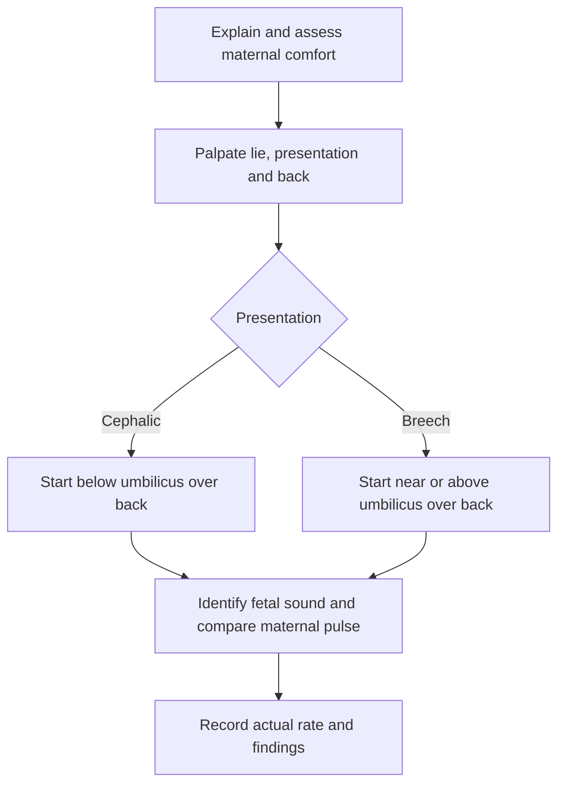
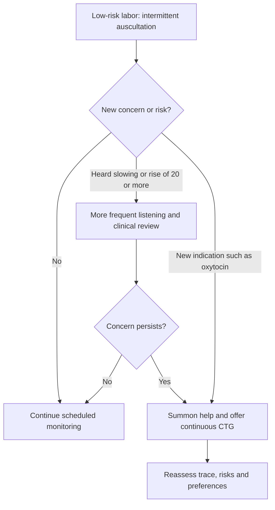

# Fetal heart rate and intermittent auscultation

**Study-ready, not attempted.** Is guide mein hum fetal heart sounds ko locate karna, normal rate samajhna aur labor ke dauran safe surveillance karna seekhenge.

[Chapter](../README.md) · [20 original MCQs](../MCQs/06B-Fetal-Heart-Rate-and-Intermittent-Auscultation-20-MCQs.md) · [Exam evidence](../Previous-Year-Questions/06B-Fetal-Heart-Rate-Reported-Evidence.md)

## 1. Fetal heart rate ka meaning

Fetal heart rate (FHR) ka matlab baby ke heart ki ek minute mein dhadkan ki sankhya hai. Placenta se oxygen milti hai aur autonomic nervous system heart rate ko regulate karta hai. Isliye rate aur uske changes fetal condition ka useful clue dete hain. Lekin ek normal rate se baby ki poori condition prove nahi hoti.

NICE NG229 mein usual baseline 110–160 beats/min hai. Baseline ka matlab CTG ke stable portion ka average hai, jisme accelerations aur decelerations exclude hote hain. Stable 100–109 baseline ka special exception hai jab variability normal ho, variable ya late decelerations na hon aur baseline stable raha ho. Naya fall ya other concerning findings ko is exception se dismiss nahi karna chahiye.

## 2. Fetal back ko locate karke sound sunna

Pehle woman ko procedure samjhao aur comfortable position mein assessment karo. Abdominal palpation se fetal lie, presentation aur back identify karo. Cephalic presentation mein heart sounds usually umbilicus ke neeche fetal back ki taraf milte hain. Breech mein sounds usually umbilicus ke paas ya upar back ki taraf milte hain. Exact site baby ki position aur engagement se change ho sakti hai. Handheld Doppler ya Pinard stethoscope se sound identify karo. Maternal pulse compare karo, especially jab rate ki identity uncertain ho.

Ye original diagram usual search location batata hai, fixed anatomical rule nahi hai. Agar signal weak ho toh fetal position aur equipment reassess karo. Fetal heartbeat confirm na ho toh prompt qualified review aur ultrasound ki zarurat ho sakti hai.

## 3. Intermittent auscultation in labor

Intermittent auscultation ka matlab scheduled intervals par fetal heart sounds sunna hai. Low-risk labor mein ye suitable ho sakta hai. NICE NG229 ke March 2026 updated guidance mein established first stage mein palpated contraction ke turant baad kam se kam ek minute sunna aur har 15 minute ya zyada frequently repeat karna recommend kiya gaya hai. Maternal pulse hourly ya concern hone par more frequently assess karo. Second stage mein same one-minute post-contraction observation kam se kam har five minute karo aur maternal pulse simultaneously palpate karo.

Nurse measured rate, time aur audible accelerations ya decelerations record karti hai. Agar initial rate 125 tha aur ab 147 hai, toh difference 22 beats/min hai. NICE start of labor se 20 ya zyada rise par more frequent listening aur full assessment recommend karta hai. Deceleration sunai de toh consecutive contractions ke baad repeat assessment karo aur risk review karo.

## 4. Kab continuous CTG aur escalation chahiye?

CTG (cardiotocography) fetal heart rate aur contractions ko continuous record karta hai. Persistent auscultation concern ya new risk factor jaise oxytocin use hone par help summon karo aur continuous monitoring offer karo. Fever, irregular rhythm, suspected maternal pulse capture aur abnormal rate ko clinical context ke saath assess karo. Mother hypoxic nahi hai toh routine oxygen ko automatic fetal treatment mat samjho.

Agar CTG sirf intermittent concern ke liye start hua tha aur 20 minute baad normal hai, koi ongoing risk nahi hai, toh NICE intermittent monitoring par return allow karta hai, unless woman continuous CTG prefer kare. Woman ko reason, limitations aur options explain karo.

## 5. Exam aur clinical references

- [NICE NG229 recommendations](https://www.nice.org.uk/guidance/ng229/chapter/Recommendations), updated March 2026. Named intervals and stable low-baseline exception.
- [NICE NG229 guideline PDF](https://www.nice.org.uk/guidance/ng229/resources/fetal-monitoring-in-labour-pdf-66143844065221).
- [OpenStax maternal-newborn nursing — monitoring](https://openstax.org/books/maternal-newborn-nursing/pages/16-2-external-and-internal-monitoring).
- [NHM Dakshata abdominal examination and FHR](https://www.nhm.gov.in/images/pdf/in-focus/Dakshata/Day-1/Abdominal_Examination_Foetal_Lie_n_Pres_FHR.pdf). Indexed Indian skills reference.
- [INC curriculum](https://www.indiannursingcouncil.org/uploads/pdf/16795458571126341723641bd601618e8.pdf). Fetal wellbeing assessment is part of antenatal nursing.
- [Aarogyam Infinity Part 22 MCQ practice — breech auscultation, indexed 52:23](https://www.youtube.com/watch?v=TxkF2D1bqDU&t=3143s). Topic chapter verified from indexed description, not exact playback. Dedicated teaching-only video and other specific practice mappings remain pending.

Historical ESIC reported 120–160 option ko modern 110–160 baseline se confuse mat karo. Named guideline aur exam context dhyan se dekho.
