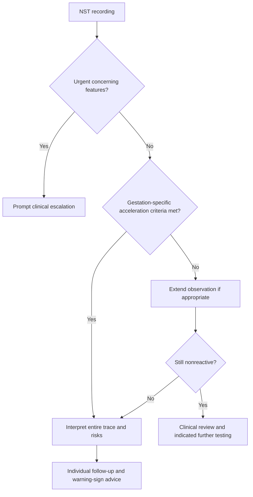

# Nonstress test (NST) — detailed concepts

**Study-ready, not attempted.** Hum NST ka purpose, setup, gestation-specific acceleration criteria aur safe interpretation samjhenge.

[Chapter](../README.md) · [20 original MCQs](../MCQs/06C-Nonstress-Test-NST-20-MCQs.md) · [Exam evidence](../Previous-Year-Questions/06C-NST-Reported-Evidence.md)

## 1. NST kyun karte hain?

Baby jab move karta hai toh normally autonomic nervous system heart rate ko temporarily increase kar sakta hai. Is rise ko acceleration kehte hain. NST externally fetal heart rate record karke reactivity evaluate karta hai, bina deliberately uterine contractions induce kiye. Ye current fetal condition ka indirect clue hai, oxygen level ya blood pH ka direct measurement nahi.

High-risk pregnancy mein surveillance ka start aur frequency individual indication par depend karti hai. Many indications ke liye 32 weeks ke around testing reasonable hoti hai. Maternal disease, fetal growth, earlier symptoms aur gestation ke hisab se clinician different schedule decide kar sakta hai.

## 2. Nurse ka procedure

Woman ko purpose aur expected duration samjhao. Comfortable lateral ya semi-Fowler position arrange karo. Doppler ultrasound sensor fetal cardiac signal record karta hai aur tocodynamometer uterine activity record karta hai. Movement event marker woman ki perceived fetal movement ka time identify karne mein help karta hai. Signal quality verify karo aur mother ki pulse ko fetal signal se distinguish karo. Routine test noninvasive hai.

Agar woman flat position mein dizzy ho toh safe lateral repositioning karo, maternal vitals aur fetal status assess karo aur required escalation arrange karo. Actual interpretable recording aur events document karo.

## 3. Reactive criteria aur numericals

32 weeks ya later usual reactive NST mein 20-minute interval ke andar kam se kam two accelerations chahiye, har ek baseline se at least 15 beats/min upar aur at least 15 seconds long. Before 32 weeks a commonly used preterm criterion is 10 beats/min for at least 10 seconds. Gestation-specific criteria local protocol ke saath apply karo.

| Example | Reasoning |
|---|---|
| Baseline 135, peak 152, duration 17 seconds | Rise 17 bpm hai. At least 32 weeks par ye single qualifying acceleration hai. |
| Baseline 140, peak 152, duration 20 seconds | Rise 12 bpm hai. Term 15-by-15 criterion meet nahi hota. |
| Baseline 130, peak 150, duration 10 seconds | Rise adequate hai, par term duration insufficient hai. |

Agar first 20 minute mein adequate acceleration nahi milti aur urgent concerning finding nahi hai, toh sleep cycle account karne ke liye recording up to 40 minutes extend ho sakti hai. Trained team selected cases mein vibroacoustic stimulation use kar sakti hai. Abnormal slowing ya other clinical concern hone par recording duration poori hone ka wait mat karo.

## 4. Nonreactive result ka meaning

Nonreactive result sufficient accelerations na milne ko describe karta hai. Immaturity, quiet sleep, medications aur fetal compromise possible factors hain. Ye fetal acidemia ka proof nahi hai, aur har nonreactive result immediate cesarean require nahi karta. Further clinical assessment, BPP ya other indicated tests clinician decide karta hai.

Reactivity growth restriction ya structural anomaly exclude nahi karti. Isliye growth ultrasound aur Doppler indications ko NST result se independently consider kiya jata hai.

## 5. Source and learning guide

- [NCBI Antenatal Fetal Surveillance](https://www.ncbi.nlm.nih.gov/sites/books/NBK537123/) — directly retrieved procedure, reactivity and limitations.
- [ACOG outpatient surveillance guidance](https://www.acog.org/clinical/clinical-guidance/committee-opinion/articles/2021/06/Indications-for-outpatient-antenatal-fetal-surveillance) — indexed indications and individualized timing.
- [SOGC antenatal fetal surveillance](https://sogc.org/common/Uploaded%20files/ACSC/ACSC2024/gui441CPG2309E.pdf) — indexed gestational acceleration criteria.
- [INC curriculum](https://www.indiannursingcouncil.org/uploads/pdf/16795458571126341723641bd601618e8.pdf) — antenatal fetal wellbeing including NST.
- Teaching: [NST in Hindi](https://www.youtube.com/watch?v=N9l6pmZK4wA) and [NST explained for OBG nursing officer exam](https://www.youtube.com/watch?v=W5ML4q0xFUk). Indexed titles and descriptions only, playback not independently checked.
- Dedicated practice: [Everything OB fetal monitoring practice quiz, Q16 NST 22:38](https://www.youtube.com/watch?v=6iG6xWJVFCQ&t=1358s). Published chapter label checked, exact individual question coverage and playback pending. No historical exam attribution inferred from this video.
