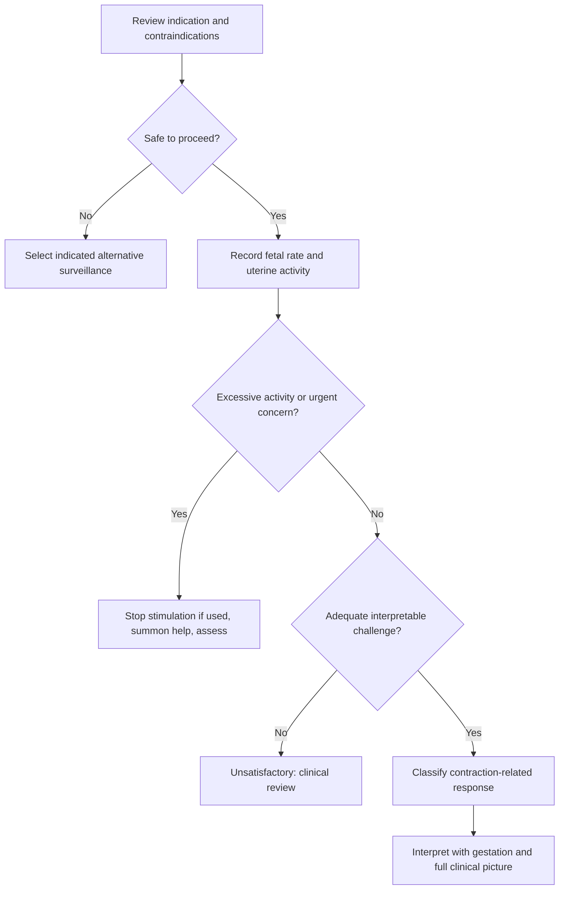

# Contraction stress test (CST) — detailed concepts

**Study-ready, not attempted.** Ye supervised clinical test hai. Isko home par khud contractions induce karne ke liye use nahi karna chahiye.

[Chapter](../README.md) · [20 original MCQs](../MCQs/06D-Contraction-Stress-Test-CST-20-MCQs.md) · [Exam evidence](../Previous-Year-Questions/06D-CST-Exam-Evidence.md)

## 1. CST ka physiological purpose

Contraction ke time uterus ki muscle tight hoti hai aur uteroplacental perfusion temporarily kam ho sakti hai. Agar placenta aur fetus ke paas adequate reserve hai, toh usually fetus contraction ko tolerate kar sakta hai. Limited reserve mein contraction ke baad late decelerations mil sakti hain. CST indirect assessment hai, fetal blood oxygen ya pH ka direct measurement nahi.

NST se difference ye hai ki CST mein uterine contractions ka response assess hota hai. Adequate spontaneous contractions available hon toh unko use kiya ja sakta hai. Otherwise stimulation ka decision trained obstetric team karti hai. Aajkal many settings mein NST aur BPP zyada commonly use hote hain, kyunki CST ke contraindications aur false-positive limitations hain.

## 2. Safety and adequacy

Placenta previa, previous classical uterine incision aur high preterm labor risk mein contraction stimulation unsafe ho sakti hai. Labor ya vaginal delivery contraindicated ho toh CST generally avoid kiya jata hai. Clinician individual history, gestation aur available alternative tests review karta hai.

Woman ko procedure, purpose, risks aur alternatives explain karo. Fetal heart rate aur uterine activity simultaneously monitor karna essential hai. Conventional adequate pattern mein ten minutes ke andar kam se kam three contractions hoti hain aur har contraction at least 40 seconds ki hoti hai. Contractions ka stimulation sirf indicated, supervised clinical protocol ke under hota hai. Dose instructions yahan intentionally nahi diye gaye hain.

## 3. Interpretation

| Result | Meaning |
|---|---|
| Negative | Adequate trace mein late ya significant variable decelerations nahi milti. |
| Positive | At least 50 percent contractions ke saath late decelerations milti hain. |
| Equivocal-suspicious | Intermittent late ya significant variable slowing further review maangti hai. |
| Equivocal-hyperstimulatory | Excessive frequency ya duration of contractions ke saath decelerations milti hain. |
| Unsatisfactory | Adequate contraction pattern ya interpretable trace available nahi hai. |

Example: Four adequate contractions mein three late decelerations hain. Three divided by four = 75 percent, jo positive threshold meet karta hai. One of four = 25 percent, jo intermittent late slowing hai aur suspicious evaluation maangta hai. Positive result fetal acidemia ka direct proof nahi hai.

## 4. Nursing priorities

Excessive uterine activity ke saath fetal slowing ho toh oxytocin use ho raha ho to emergency protocol ke under stop karo, help summon karo aur maternal-fetal assessment continue karo. Test ko finish karne ke liye stimulation increase nahi karni chahiye. Positive ya equivocal finding ko senior obstetric team review karti hai. Gestational age, full tracing aur other test results management guide karte hain. Negative result future wellbeing guarantee nahi karta.

Documentation mein contraction count, duration, fetal response timing, stimulation if used, maternal observations aur actions include karo. NST ka reactive word reassuring hota hai, jabki CST ka positive word generally concerning hota hai.

## 5. Sources and learning links

- [NCBI Antenatal Fetal Surveillance](https://www.ncbi.nlm.nih.gov/sites/books/NBK537123/) — retrieved purpose, adequacy and classification.
- [NICHD antenatal testing workshop](https://pmc.ncbi.nlm.nih.gov/articles/PMC2771454/) — historical classification, limitations and false-positive context.
- [Mayo antenatal testing slides](https://ce.mayo.edu/sites/default/files/media/2023-04/40-Szymanski_Antenatal%20Testing_Mayo%20Arizona.pdf) — indexed contraindications.
- [NICE fetal monitoring](https://www.nice.org.uk/guidance/ng229/chapter/Recommendations) — intrapartum safety principles for excessive uterine activity and oxytocin.
- Teaching lead: [Contraction stress test / oxytocin challenge test](https://www.youtube.com/watch?v=F9yMomfPEhw). Indexed title only, playback pending.
- Practice lead: [Mission High Nursing OBG Diagnostic Procedures MCQ-labelled video](https://www.youtube.com/watch?v=JRGj6qU3yg4). CST named in title, exact question coverage and playback pending.
