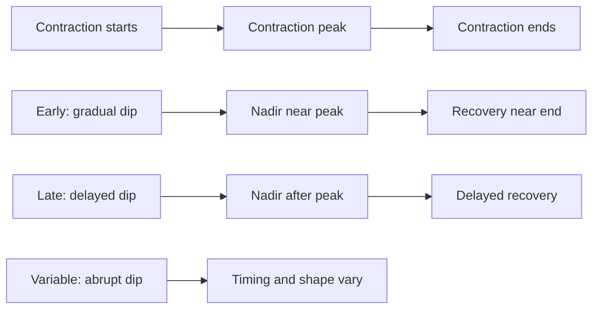
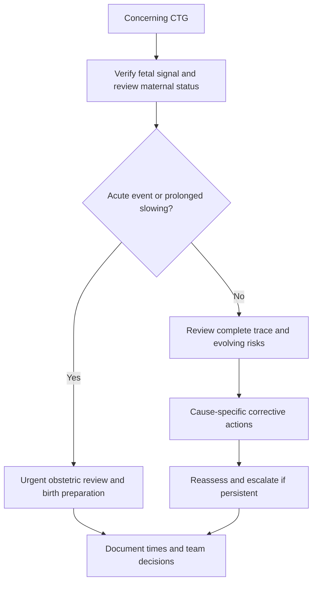

# Cardiotocography (CTG) — detailed concepts

**Study-ready, not attempted.** CTG interpretation mein guideline ka naam important hai. Yahan intrapartum NICE NG229 March 2026 update ko primary framework rakha gaya hai. ACOG category system ko NICE color system ke saath mix nahi karna chahiye.

[Chapter](../README.md) · [20 original MCQs](../MCQs/06E-Cardiotocography-CTG-20-MCQs.md) · [Exam evidence](../Previous-Year-Questions/06E-CTG-Reported-Evidence.md)

## 1. CTG kya record karta hai?

Cardiotocography mein fetal heart rate aur uterine activity time ke saath record hoti hai. Upper channel usually heart rate aur lower channel contraction activity dikhata hai. External tocodynamometer absolute pressure reliably nahi measure karta. Sensor alignment aur maternal pulse identity confirm karna zaroori hai.

Baseline stable ten-minute mean hai, temporary accelerations aur decelerations exclude karke. Variability baseline ke around irregular fluctuations hain. NICE usual 5–25 bpm band ko white kehta hai. ACOG moderate variability 6–25 bpm convention use karta hai. Both frameworks ke thresholds ko named context mein apply karo.

## 2. Pattern recognition

Early deceleration usually contraction mirror karti hai aur head compression se associated ho sakti hai. Variable deceleration abruptly dip karti hai aur cord compression se commonly related hai. Late deceleration ka nadir contraction peak ke baad hota hai aur uteroplacental oxygen reserve ka concern raise karta hai.

Ye timing illustration original schematic hai, clinical tracing nahi. Late deceleration ko current NICE red feature classify karta hai. Concerning variable features mein long duration, slow recovery aur evolving shape include ho sakte hain.

## 3. NICE feature categories

| Feature | White | Amber | Red |
|---|---|---|---|
| Variability | 5–25 bpm | Less than 5 for 30–50 min or more than 25 for up to 10 min | Less than 5 for over 50 min or more than 25 for over 10 min or sinusoidal |
| Decelerations | No, early, or non-evolving variable without concerning characteristics | Selected concerning variable patterns, duration-dependent | Late decelerations, selected prolonged/repetitive concerning variable patterns, acute bradycardia or single prolonged deceleration of at least 3 min |

Baseline and contraction features also need classification from the complete guideline. Overall normal means all assessed features white. One amber with no red is suspicious. Two or more amber or any red is pathological. Clinical risks can change urgency independent of a label.

Otherwise normal CTG mein absent accelerations alone acidosis indicate nahi karti. Ye antenatal NST reactivity criterion se different hai. Sleep aur medications variability reduce kar sakte hain, lekin other findings carefully assess karo.

## 4. Nurse response

Acute bradycardia ya single prolonged deceleration at least three minutes ho toh urgently obstetric review seek karo, underlying cause assess karo aur urgent birth ki preparation karo. Acute event jaise cord prolapse, abruption ya rupture suspect ho toh expedited birth ki need ho sakti hai. NICE persistent acute bradycardia at nine minutes par birth expedite karne ko kehta hai, significant risks mein earlier. Nine minutes help call karne se pehle wait karne ka rule nahi hai.

Excessive contractions with oxytocin mein reduce ya stop according to protocol. Epidural hypotension mein lateral position, indicated IV fluids aur anesthetic review chahiye. Routine oxygen normoxic mother ko solely fetal tracing improve karne ke liye nahi deni chahiye. Maternal hypoxia mein oxygen appropriate ho sakti hai. Clinical team decisions, patient communication aur documentation essential hain.

## 5. Learning references

- [NICE NG229 full guideline, March 2026](https://www.nice.org.uk/guidance/ng229/resources/fetal-monitoring-in-labour-pdf-66143844065221) — retrieved sections 1.4 and 1.5.
- [ACOG 2025 intrapartum monitoring](https://www.acog.org/clinical/clinical-guidance/clinical-practice-guideline/articles/2025/10/intrapartum-fetal-heart-rate-monitoring-interpretation-and-management) — indexed guideline, separate framework.
- [IGNOU nursing interventions during labour](https://egyankosh.ac.in/bitstream/123456789/101694/1/Unit-2.pdf) — indexed Indian teaching.
- Teaching: [RegisteredNurseRN fetal monitoring](https://www.youtube.com/watch?v=4rpmrC1SE50) — description includes oxygen correction, playback pending.
- Practice: [Everything OB 16-question fetal monitoring quiz](https://www.youtube.com/watch?v=6iG6xWJVFCQ) — published chapter labels checked, mapped topic links in question bank. Exact questions and playback pending.
