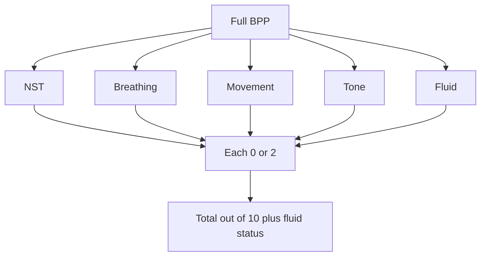
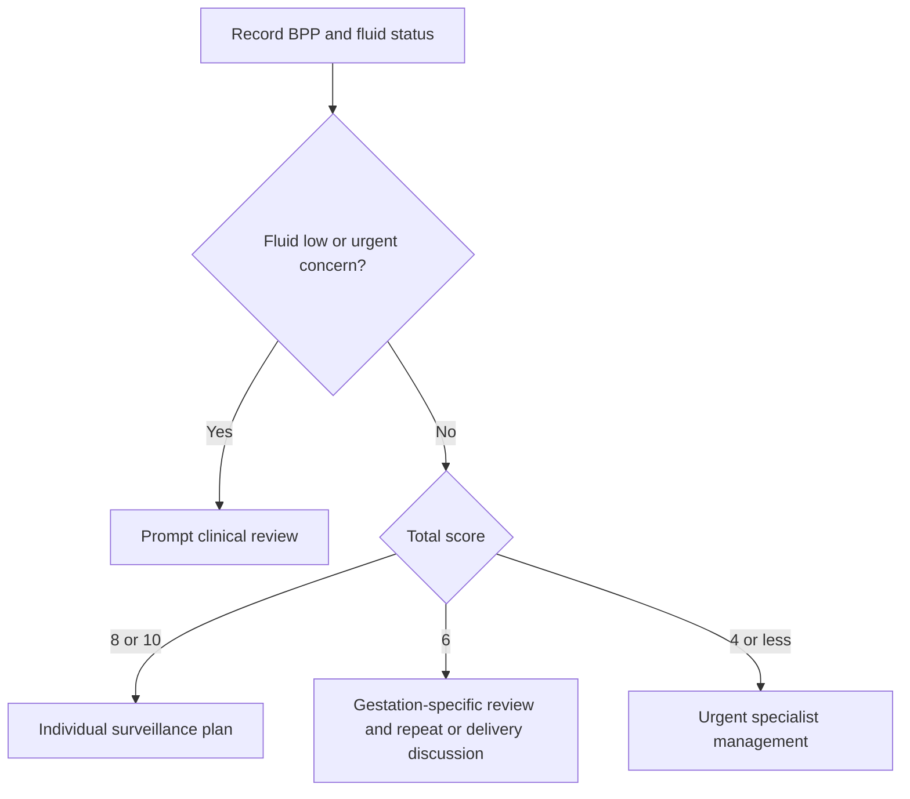

# Biophysical profile (BPP) — detailed concepts

**Study-ready, not attempted.**

[Chapter](../README.md) · [20 original MCQs](../MCQs/06F-Biophysical-Profile-BPP-20-MCQs.md) · [Exam evidence](../Previous-Year-Questions/06F-BPP-Reported-Evidence.md)

## 1. BPP kyun karte hain?

BPP fetal wellbeing assess karne ke liye heart-rate reactivity aur ultrasound behaviors combine karta hai. Oxygen supply disturb ho toh fetal behavior aur kidney perfusion change ho sakte hain. Test indirect hai, fetal blood oxygen ya pH directly measure nahi karta. Aaj ka reassuring score future acute cord accident ya abruption exclude nahi karta.

## 2. Five components and scoring

Har observed variable normal criterion meet kare toh 2 points, otherwise 0. Intermediate 1 point nahi. Full score 10 hai. Conventional observation period ultrasound behaviors ke liye 30 minutes hai.

| Component | Qualifying observation |
|---|---|
| NST | Reactive according to gestational criteria |
| Breathing | At least one rhythmic episode lasting 30 seconds |
| Gross movement | At least three body or limb movements |
| Tone | Active extension then flexion or opening and closing hand |
| Fluid | Adequate cord-free vertical pocket according to local protocol |

Pocket criteria sources mein exact 2 cm boundary ki wording differ kar sakti hai. Is bank mein clearly normal 3 cm aur abnormal 1 cm use kiya gaya hai. Fluid low ho toh score reassuring dikhne par bhi evaluation zaroori hai. Membrane rupture aur other causes consider karo.

## 3. Interpretation and nursing priorities

8/10 ya 10/10 with normal fluid generally reassuring hai. 6/10 equivocal hai. Before 37 weeks stable case mein repeat within 24 hours commonly advised hai, at term delivery strongly consider hoti hai. 4/10 abnormal hai. At least 32 weeks par delivery usually recommended hai, earlier gestation mein specialist extended assessment consider kar sakta hai. 2/10 very abnormal hai aur most cases mein delivery recommended hoti hai. Ye nurse ko independently delivery decide karne ke instructions nahi hain. Acute symptoms ya concerning findings mein scheduled repeat ka wait mat karo.

## 4. Modified BPP

Modified BPP mein NST aur fluid measurement combine hote hain. Dono normal hon toh generally reassuring hai. Either abnormal ho toh further evaluation indicated hai. Ultrasound-only 8/8 score ko full 10-point score se mix mat karo. Document actual observed components, duration, score, fluid, symptoms aur clinical action.

## Sources and video practice

- [ACOG patient guidance](https://www.acog.org/womens-health/faqs/special-tests-for-monitoring-fetal-well-being) — score interpretation and low fluid exception.
- [NCBI Antenatal Fetal Surveillance](https://www.ncbi.nlm.nih.gov/sites/books/NBK537123/) — criteria and gestation-specific management directly retrieved.
- [Mission High Nursing Classes OBG diagnostic procedures](https://www.youtube.com/watch?v=JRGj6qU3yg4) — published description explicitly includes BPP and MCQ-oriented teaching. Exact item mapping and playback pending.
- [Separate BPP teaching candidate](https://www.youtube.com/watch?v=VUZZWcURNHY) — direct retrieval failed, not verified.
