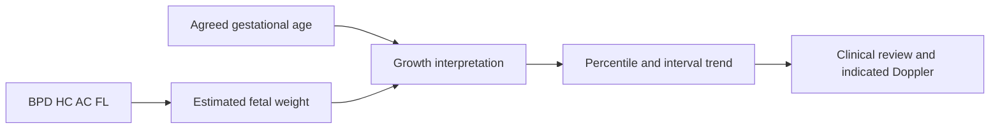
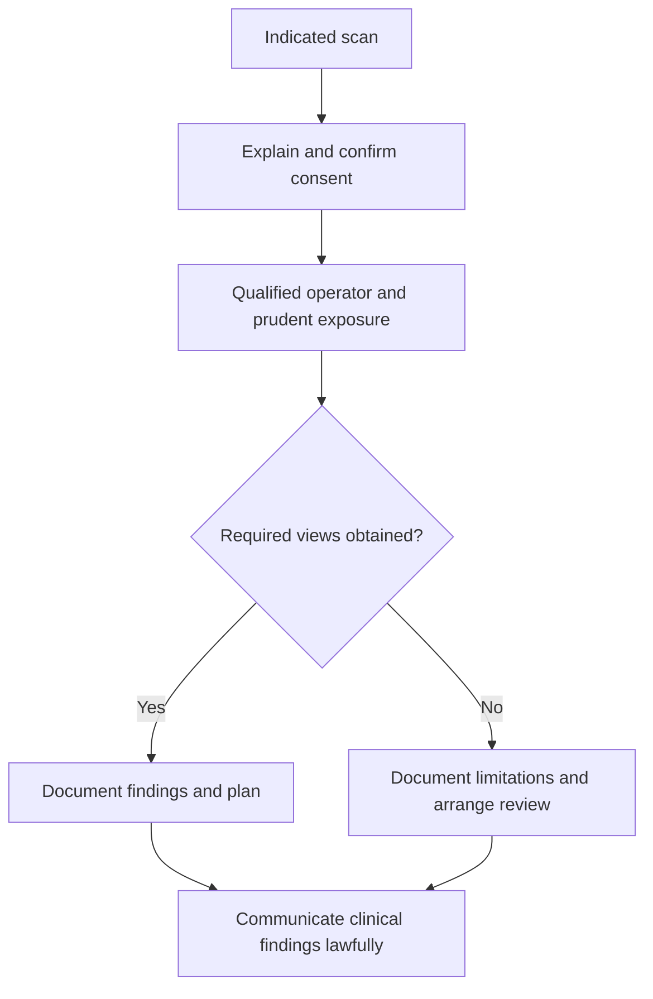

# Obstetric ultrasound and fetal biometry — detailed concepts

**Study-ready, not attempted.**

[Chapter](../README.md) · [20 original MCQs](../MCQs/06G-Obstetric-Ultrasound-and-Fetal-Biometry-20-MCQs.md) · [Exam evidence](../Previous-Year-Questions/06G-Ultrasound-Reported-Evidence.md)

## Timing and purpose

WHO recommends at least one routine ultrasound before 24 weeks. Early scan dating, viability, pregnancy location and multiple pregnancy assessment support karta hai. Mid-trimester scan fetal structures systematically evaluate karta hai. ISUOG describes approximately 18–24 weeks depending on local practice. The common exam answer 18–20 weeks is not the only clinically valid timing. Normal scan every congenital or genetic condition exclude nahi karta. Poor fetal position se views incomplete hon toh limitation document karo and follow-up arrange karo.

## Biometry and growth

BPD biparietal diameter, HC head circumference, AC abdominal circumference and FL femur length hain. EFW measured dimensions se formula-based calculated estimate hai, actual weighed mass nahi. Reliable early dating preserve karna important hai, otherwise small size ko younger gestation label karke growth restriction miss ho sakti hai. Serial growth trajectory meaningful interval par evaluate karte hain, individual plan ke according. SMFM uses EFW or AC below tenth percentile as sonographic FGR criterion. Small size alone se cause confirm nahi hota. Growth trend, Doppler aur maternal conditions assess karte hain.

## Safety, communication and legal responsibility

Ultrasound sound waves use karta hai, ionizing radiation nahi. ALARA principle means diagnostic information ke liye reasonably minimum acoustic exposure use karo. Nonmedical prolonged keepsake scans discourage kiye jate hain. Transvaginal assessment when indicated requires explanation, consent, privacy and approved probe hygiene. Maternal dizziness ya pain ko ignore nahi karo. India mein PCPNDT Act section 5(2) prohibits communicating fetal sex to the pregnant woman, relatives or any person by words, signs or other means. Medical indication, authorized facility, records and local legal protocol follow karo.

## Sources and learning links

- [WHO recommendation](https://www.ncbi.nlm.nih.gov/sites/books/NBK579610/) — early ultrasound before 24 weeks.
- [ISUOG mid-trimester scan](https://www.isuog.org/static/4e2ed89e-fa8a-42c2-9c0929cd89cb58ff/ISUOG-Practice-Guidelines-routine-mid-trimester-fetal-ultrasound.pdf) and [biometry/growth](https://www.isuog.org/static/d0d105b5-65b1-47f1-b4aa8b5e99afa1a6/ISUOG-Practice-Guidelines-ultrasound-fetal-biometry-growth.pdf) — indexed professional guidelines.
- [SMFM FGR consult](https://publications.smfm.org/publications/289-society-for-maternal-fetal-medicine-consult-series-52/) — definition and clinical follow-up.
- [AIUM prudent ultrasound use](https://www.aium.org/resources/official-statements/view/prudent-use-and-safety-of-diagnostic-ultrasound-in-pregnancy).
- [India Code PCPNDT Act](https://www.indiacode.nic.in/bitstream/123456789/5752/1/pcpndt-act-1994.pdf) — section 5.
- Teaching: [Basic fetal ultrasound examination](https://www.youtube.com/watch?v=CqM7S4PxP_E), indexed description includes biometry. Playback pending.
- MCQ practice: [Aarogyam Infinity Part 19](https://www.youtube.com/watch?v=7uaDMc0ewqY), indexed description includes level-2/anomaly scan. Exact question mapping and playback pending.
