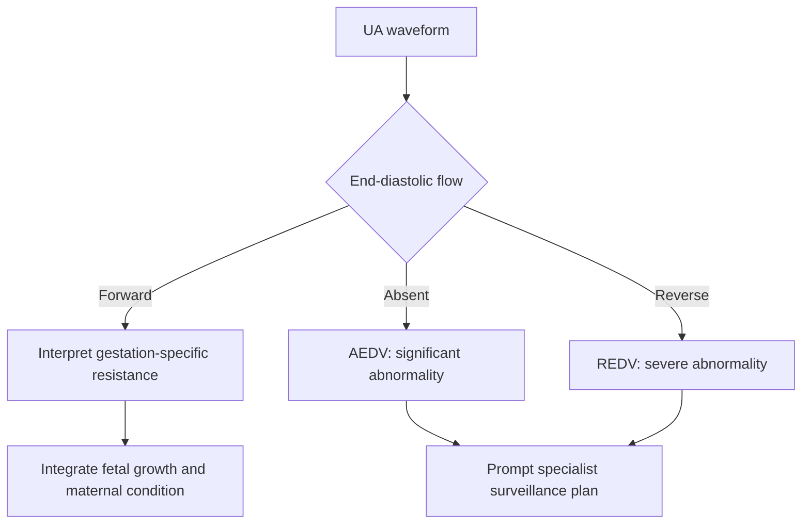
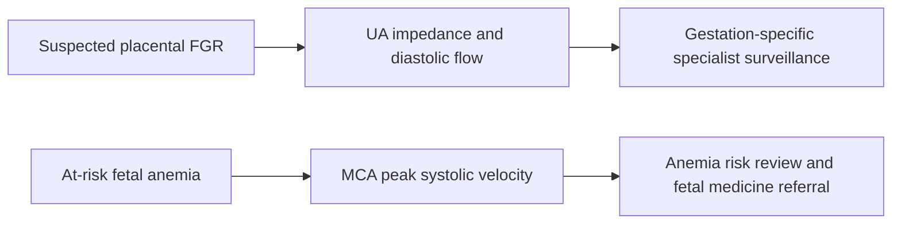

# Fetal Doppler studies — detailed concepts

**Study-ready, not attempted.**

[Chapter](../README.md) · [20 original MCQs](../MCQs/06H-Fetal-Doppler-Studies-20-MCQs.md) · [Evidence and research gaps](../Previous-Year-Questions/06H-Doppler-Evidence-and-Research-Gaps.md)

## Principle and vessels

Doppler moving blood cells se reflected ultrasound frequency change use karta hai. Spectral waveform cardiac cycle mein velocity show karta hai. Umbilical artery (UA) fetal blood ko placenta tak le jati hai. Its impedance placental vascular bed ka clue deta hai. Uterine artery maternal-side supply assess karti hai. Middle cerebral artery (MCA) fetal brain flow evaluate karti hai. Ductus venosus selected specialist assessments mein fetal venous/cardiac condition ka clue de sakta hai. Ye tests oxygen saturation ya blood pH directly measure nahi karte.

## Indices and calculation

Let S be peak systolic velocity, D end-diastolic velocity, and M time-averaged maximum velocity. S/D ratio = S ÷ D. RI = (S − D) ÷ S. PI = (S − D) ÷ M. Example S 60, D 20, M 40 cm/s: S/D 3, RI 0.67, PI 1.0. D zero ho toh S/D finite number nahi hota. Waveform pattern report karo. Consistent sampling site, gestational reference, quality waveform aur suitable angle important hain. Absolute velocity measurement ideally near-zero insonation angle par hoti hai.

## FGR and anemia: distinct questions

SMFM Consult 52 recommends UA Doppler every 1–2 weeks initially after FGR diagnosis, weekly with elevated resistance or severe FGR, up to 2–3 times weekly for AEDV. REDV calls for hospitalization, indicated steroids, heightened CTG and individualized delivery consideration. Clinical team gestation, other risks and results together assess karti hai. SMFM routine use of MCA, uterine artery or ductus venosus Doppler for FGR management advise nahi karta. ISUOG specialist protocols differ kar sakte hain. MCA PI reduction can reflect brain-sparing redistribution. CPR = MCA PI / UA PI. Isko universal delivery trigger mat samjho.

Anemia screening separate indication hai. MCA-PSV >1.5 MoM at-risk fetus mein significant anemia ka concern raise karta hai. Fetal medicine referral required hai. Doppler exact hemoglobin confirm nahi karta. MCA-PI and MCA-PSV different parameters hain.

## Clinical sources and video leads

- [SMFM FGR Consult 52](https://publications.smfm.org/publications/289-society-for-maternal-fetal-medicine-consult-series-52/) — frequency and escalation.
- [ISUOG Doppler technique](https://www.isuog.org/static/d1d7096b-fc0d-4efd-902fdb057c324f3c/ISUOG-Practice-Guidelines-updated-Doppler-velocimetry-obstetrics.pdf) — indices and technique.
- [ISUOG FGR guideline](https://obgyn.onlinelibrary.wiley.com/doi/10.1002/uog.22134) — redistribution and specialist context.
- [SMFM fetal anemia guideline](https://publications.smfm.org/publications/586-society-for-maternal-fetal-medicine-clinical-guideline-8/) — MCA-PSV screening.
- [WHO ANC](https://www.ncbi.nlm.nih.gov/sites/books/NBK409099/?report=reader) — routine Doppler not recommended universally.
- Teaching candidate: [Fetal measurements and Doppler](https://www.youtube.com/watch?v=qGu_5YY-FC0), indexed description only, playback pending.
- Supplementary MCQ discussion: [PrepLadder NEET PG 2020 OBG](https://www.youtube.com/watch?v=BQW6YXfm97c), description mentions MCA Doppler. Medical-exam practice lead, not nursing-specific. Exact playback and nursing exam-specific video verification pending.
