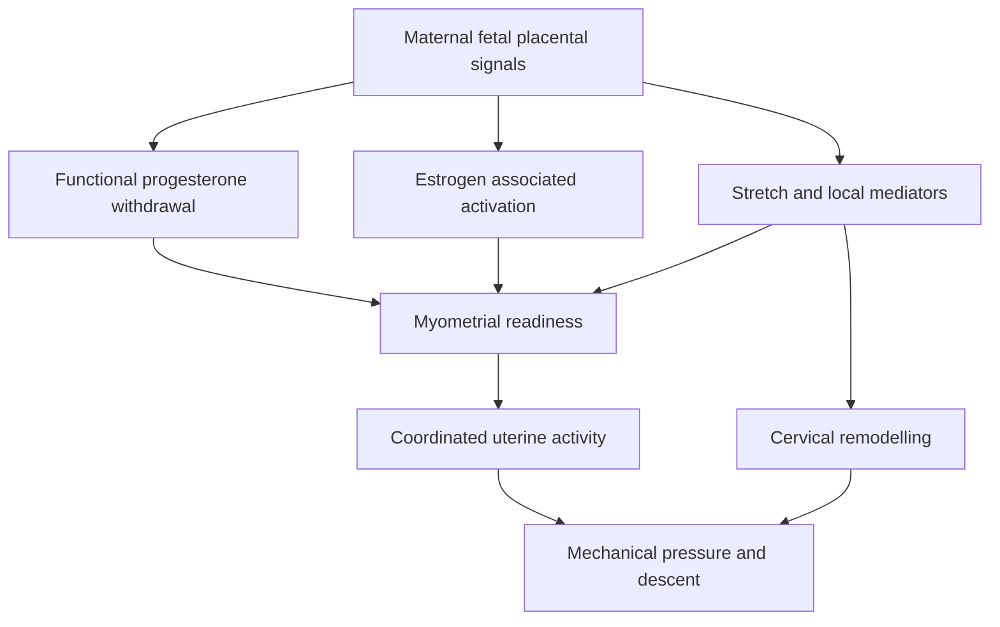
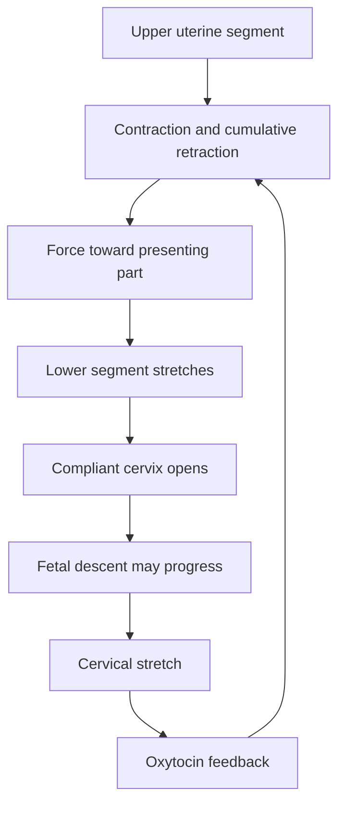

# Normal labour physiology — detailed Roman Hinglish concepts

**Study-ready, not studied.** Yeh physiological explanation hai, medication ya intervention protocol nahi. Clinical care qualified maternity team aur local guidance ke according hogi.

[Chapter](../README.md) · [20 original MCQs](../MCQs/07A-Normal-Labour-Physiology-20-MCQs.md) · [Evidence gaps](../Previous-Year-Questions/07A-Labour-Physiology-Evidence-and-Research-Gaps.md)

## 1. Uterine preparation

Pregnancy mein uterus relatively relaxed rehta hai. Term ke paas maternal, fetal aur placental signals milkar myometrium (uterine smooth muscle) ko contract karne ke liye prepare karte hain. Kisi ek hormone ko universal labour switch mat samjho. Human pregnancy mein circulating progesterone necessarily sharply fall nahi hota. Local receptor aur signalling changes progesterone ke relaxation-promoting effect ko reduce kar sakte hain. Isi ko functional progesterone withdrawal bolte hain.

Estrogen-associated changes contraction-associated proteins, oxytocin responsiveness aur gap junctions ko support karte hain. Gap junctions adjacent cells ke beech electrical communication allow karte hain. Uterine stretch, placental CRH-related pathways aur local inflammatory signalling bhi readiness influence kar sakte hain. Physiological inflammation infection prove nahi karti; fever, maternal illness ya fetal concern ko separately assess aur escalate karo.

Original conceptual diagram hai, guaranteed causal sequence ya delivery time predictor nahi.

## 2. Contraction aur relaxation

Intracellular calcium rise hone par calcium calmodulin se bind karta hai. Myosin light-chain kinase activate hoti hai, myosin phosphorylation increase hota hai aur actin-myosin interaction force generate karta hai. Calcium level aur contractile activation reduce hone par relaxation possible hoti hai. Rhythmic contractions ke beech relaxation important hai. Skeletal muscle ka troponin pathway smooth muscle se confuse mat karo.

Oxytocin contractions reinforce karta hai. Cervical stretch neural signals ke through further oxytocin release support kar sakta hai. Ye Ferguson positive-feedback reflex hai. Physiological hormone role aur oxytocin infusion ka clinical indication different concepts hain.

## 3. Cervix aur uterine segments

Cervical ripening mein collagen network aur extracellular matrix reorganise hote hain, hydration aur compliance change hoti hai. PGE2 jaise local mediators ripening aur uterine activity mein contribute kar sakte hain. Softening, effacement (shortening/thinning) aur dilatation (opening) related lekin identical findings nahi hain.

Classical fundal dominance ka matlab upper uterus ki relatively stronger action hai. Retraction mein muscle relaxation ke baad kuch shortening retain karti hai. Upper segment thicker aur lower segment stretch/thin hota hai. Physiological internal junction ko obstructed labour mein possible exaggerated pathological retraction ring se confuse mat karo. Suspected obstruction urgently escalate karo.

Forewaters pressure transmit kar sakte hain. Fetal axial pressure uterine force ka fetal axis ke along transmission describe karta hai. Membranes rupture ho jane par bhi presenting part se force transmit ho sakta hai. Descent guarantee nahi hota.

## 4. Pain aur nursing interpretation

First-stage pain largely visceral uterine contractions aur cervical/lower-segment distension se related hai. Pain intensity individual hai aur cervical dilatation ka exact substitute nahi. Respectful support, consent, individualized pain relief, maternal observations aur fetal assessment important hain.

WHO active first stage ko 5 cm se describe karta hai. Slower-than-1 cm/hour alone routine intervention ka indication nahi. ACOG 2024 active phase ke liye 6 cm threshold use karta hai. Guideline-specific definitions ko mix mat karo. Individual progress aur maternal-fetal wellbeing jointly assess karna chahiye.

## 5. Quick revision

| Concept | Yaad rakho |
|---|---|
| Functional progesterone withdrawal | Local effect kam, blood-level fall necessary nahi |
| Gap junctions | Electrical coordination |
| Calcium-calmodulin | Smooth muscle activation |
| Ferguson reflex | Positive feedback |
| Ripening | Connective tissue remodelling |
| Retraction | Cumulative shortening |
| Fundal dominance | Stronger upper-segment action |
| Progress | Individual assessment, 1 cm/hour alone nahi |

## Sources and teaching leads

- [Endotext endocrinology of pregnancy](https://www.ncbi.nlm.nih.gov/sites/books/NBK278962/) — direct clinical text reviewed.
- [StatPearls uterine contraction](https://www.ncbi.nlm.nih.gov/sites/books/NBK532927/) — direct clinical text reviewed.
- [Cervical dilation physiology](https://www.ncbi.nlm.nih.gov/sites/books/NBK557582/) — indexed clinical source.
- [IGNOU nursing management in maternal health](https://egyankosh.ac.in/bitstream/123456789/101543/1/Unit-4.pdf) — indexed uterine segment/retraction content; full PDF not examined.
- [WHO intrapartum recommendations](https://www.who.int/publications/i/item/9789241550215) — indexed guidance.
- [ACOG 2024 labour management](https://www.acog.org/clinical/clinical-guidance/clinical-practice-guideline/articles/2024/01/first-and-second-stage-labor-management) — indexed guidance.
- [Labor Part 1 teaching candidate](https://www.youtube.com/watch?v=3M_oaluYTMQ) — description indexed, playback pending.
- [Additional teaching candidate](https://www.youtube.com/watch?v=2OWJ037b1Sg) — indexed chapter markers 14:35 physiology and 29:47 onset, not playback verified.

Independent clinical review, full cross-chapter semantic review and rendered diagram testing pending.
