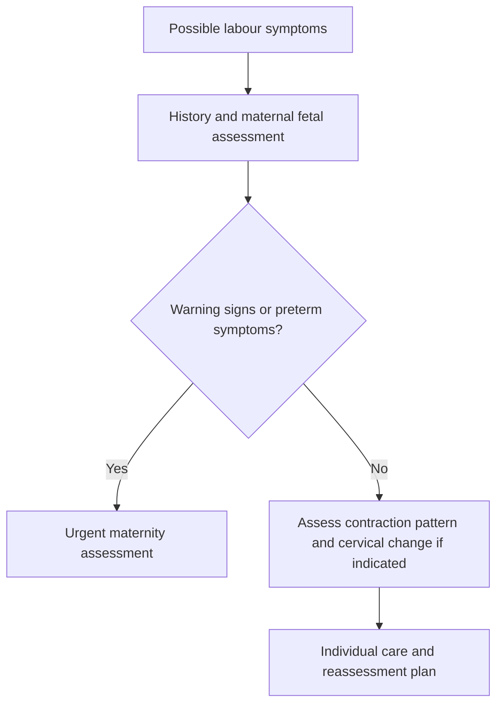
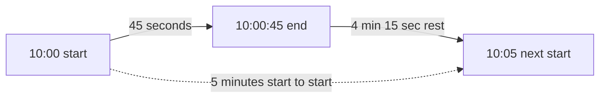

# Signs and onset of labour — detailed Roman Hinglish concepts

**Study-ready, not studied.** [Chapter](../README.md) · [20 original MCQs](../MCQs/07B-Signs-and-Onset-of-Labour-20-MCQs.md) · [Evidence](../Previous-Year-Questions/07B-Signs-and-Onset-of-Labour-Evidence.md)

## Preparatory signs

Jab pregnancy term ke paas aati hai, uterus aur cervix delivery ke liye ready hone lagte hain. Baby ka presenting part neeche aa sakta hai. Isse ribs ke neeche pressure kam aur pelvis mein pressure zyada feel ho sakta hai. Is change ko lightening kehte hain. Yeh exact delivery time nahi batata.

Cervix mein pregnancy ke dauran mucus plug hota hai. Jab cervix soften aur open hone lagta hai, toh sticky mucus thode blood ke saath nikal sakta hai. Isko show kehte hain. Har woman mein show dikhna zaroori nahi hai. Agar fresh bleeding mucus ke halkay streak se zyada ho, toh routine show samajhkar wait nahi karna chahiye.

## True labour aur preparatory contractions

Braxton Hicks contractions irregular tightening ki tarah feel ho sakti hain aur rest se settle ho sakti hain. Yeh kabhi uncomfortable bhi hoti hain. Sirf ek finding se labour exclude nahi kar sakte. Jab labour progress karta hai, contractions aam taur par stronger, longer aur closer hoti jaati hain. Cervix thin hone ko effacement aur khulne ko dilatation kehte hain. Dard real ho sakta hai even jab progressive cervical change establish na hui ho. Nurse symptoms ko respect karti hai, pain relief aur reassessment arrange karti hai.

## Contraction timing

Contraction ke start se end tak ka time duration hai. Ek contraction ke start se next contraction ke start tak ka time start-to-start interval hai. Maan lo tightening 10:00 par shuru hui aur 45 seconds baad relax hui. Agli tightening 10:05 par shuru hui. Toh duration 45 seconds aur start-to-start interval 5 minutes hai. Relaxation gap 4 minutes 15 seconds hai. Nurse pattern ke saath maternal aur fetal condition bhi assess karti hai.

## Waters breaking

Amniotic sac se fluid slow trickle ya sudden gush ki tarah leak ho sakta hai. Kabhi urine se difference karna difficult hota hai. Nurse clean external pad use karne aur maternity team ko promptly contact karne ko kehti hai. Tampon aur self vaginal examination avoid karna chahiye.

Membranes labour se pehle rupture ho sakti hain aur contractions intact membranes ke saath bhi progress kar sakti hain. Term rupture ke baad plan individual assessment, infection risk, time aur GBS status par depend karta hai. NICE current pregnancy mein GBS-positive term prelabour rupture ke liye immediate induction ya previously planned caesarean offer karne ko kehta hai. Trained team indicated antibiotic prophylaxis aur delivery plan decide karti hai.

## Triage aur respectful care

Nurse gestational age, contraction pattern, vaginal fluid, bleeding, fetal movements aur obstetric history poochti hai. Fresh bleeding, reduced movements, suspected rupture, fever ya foul-smelling fluid aur 37 weeks se pehle possible labour mein urgent maternity assessment chahiye. Persistent severe pain bhi concerning hai. Imminent birth aur strong involuntary pushing urge mein local emergency assistance activate karni chahiye.

Indicated vaginal examination trained clinician karega. Patient ko purpose samjhana, consent lena aur privacy maintain karna important hai. Low-risk woman ko individualized home plan diya jaaye toh comfort, rest, suitable fluids aur movement ke saath return precautions samjhaate hain. Teach-back mein patient apne words mein batati hai ki kis symptom par help leni hai.

## Sources and practice

- [NHS signs that labour has begun](https://www.nhs.uk/pregnancy/labour-and-birth/signs-that-labour-has-begun/) — direct HTML reviewed.
- [NICE NG235 intrapartum care](https://www.nice.org.uk/guidance/ng235/chapter/Recommendations) — indexed recommendations reviewed, direct retrieval blocked.
- [WHO intrapartum recommendations](https://www.ncbi.nlm.nih.gov/sites/books/NBK513805/) — indexed text reviewed.
- [Dedicated MCQ practice — Nursing With S. s](https://www.youtube.com/watch?v=hnCukRJUf-E) — description lists true versus false labour, actual playback pending.
- Specific teaching video verification remains pending. [Evidence and item-level gaps](../Previous-Year-Questions/07B-Signs-and-Onset-of-Labour-Evidence.md).
