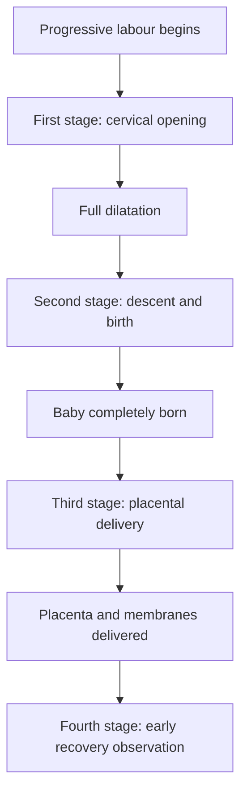
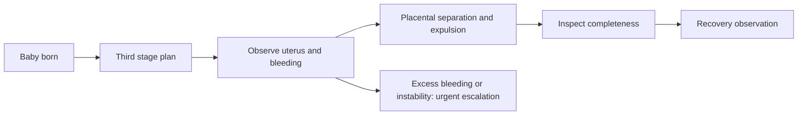

# Stages of labour — detailed Roman Hinglish concepts

**Study-ready, not studied.** [Chapter](../README.md) · [20 original MCQs](../MCQs/07C-Stages-of-Labour-20-MCQs.md) · [Evidence](../Previous-Year-Questions/07C-Stages-of-Labour-Evidence.md)

## 1. Labour ko stages mein kyun divide karte hain?

Labour mein uterus contractions se cervix ko open karta hai aur baby birth canal se descend karta hai. Baby born hone ke baad placenta bhi deliver hona hota hai. Nurse har stage mein alag findings assess karti hai, isliye stage boundaries samajhna important hai. Fourth stage nursing teaching mein immediate recovery observation ko describe karta hai, jabki obstetric guidelines aksar first three labour stages describe karti hain. Recovery observation ka exact duration local protocol par depend karta hai.

## 2. First stage — effacement aur dilatation

Cervix thin hone ko effacement aur opening badhne ko dilatation kehte hain. Early labour mein progression variable ho sakti hai. Patient ko reassurance, consent-based assessment, pain relief aur hydration support chahiye. Full dilatation aam taur par 10 cm ke around describe ki jaati hai.

Guideline ka naam exam mein dhyan se padho. WHO active first stage ko 5 cm se define karta hai. NICE established first stage regular contractions aur progressive cervical dilatation from 4 cm ke context mein use karta hai. ACOG 2024 active phase ke liye 6 cm threshold use karta hai. Ye definitions interchangeable nahi hain. Old textbooks ki latent, active aur transition divisions memory aids ho sakti hain, lekin clinical decisions current local protocol aur complete assessment par depend karte hain.

ACOG active-phase arrest mein at least 6 cm dilatation, ruptured membranes aur no progress despite 4 hours adequate uterine activity ya 6 hours inadequate activity with oxytocin augmentation ka combination dekhta hai. Iska matlab nahi ki nurse deterioration ko timer khatam hone tak ignore kare. WHO universal 1 cm/hour rate ko automatic intervention trigger nahi maanta.

## 3. Second stage — descent aur baby ka birth

Full dilatation ke baad second stage shuru hota hai. Head ki position, station, rotation aur descent se progress assess karte hain. Caput scalp swelling hai aur moulding skull bones ke overlap ko kehte hain. In findings ko mother aur baby ki wellbeing ke saath interpret karte hain.

NICE passive second stage ko full dilatation ke baad aur active ya involuntary pushing se pehle ka phase describe karta hai. Active phase mein baby visible ho sakta hai ya full dilatation ke saath pushing start hoti hai. Epidural, parity aur clinical condition pushing plan influence karte hain. ACOG aur NICE pushing recommendations ko ek universal rule na samjhein.

Nurse woman ko safe comfortable birth position choose karne mein support karti hai. Without epidural, upright positions suitable ho sakti hain. Flat supine position se blood pressure kam ho sakta hai. Pushing ineffective ho toh hydration, position, bladder status aur progress assess karke senior team involve karte hain. NICE nulliparous woman without epidural mein one hour active pushing par progress aur wellbeing reassessment recommend karta hai. Lack of progress ya fetal concern mein earlier review zaroori ho sakta hai. Routine episiotomy ya fundal pressure standard requirement nahi hai. Warm perineal compress offer karte waqt temperature aur preference check karte hain.

## 4. Third stage — placenta aur membranes

Baby born hone ke baad uterus contract karta hai, placental bed chhota hota hai aur placenta detach hokar deliver hota hai. Uterine muscle fibers placental site ki blood vessels compress karti hain, isliye effective uterine tone bleeding control ke liye important hai.

Placental separation ke classical signs mein firm globular uterus, uterus ka rise hona, cord lengthening aur kabhi small gush of blood shamil hain. In signs ko total clinical findings ke saath interpret karna chahiye. Heavy bleeding ko normal separation sign maan kar wait nahi karte.

Active management mein prescribed prophylactic uterotonic aur trained controlled cord traction jaisi interventions local guidance ke hisaab se hoti hain. Cord clamping ka timing newborn aur maternal condition par depend karta hai. NICE traction ko oxytocin, cord clamping aur cutting aur separation signs ke baad describe karta hai. Bina separation forceful traction dangerous ho sakti hai. Physiological management mein natural placental expulsion ka support hota hai, lekin excessive bleeding ya delayed delivery par team reassessment karti hai.

NICE active management mein undelivered placenta at 30 minutes aur physiological management mein at 60 minutes ko prolonged third stage define karta hai. Ye thresholds waiting permission nahi hain. Bleeding ya instability mein immediately escalate karte hain. Placenta deliver hone ke baad maternal surface, fetal surface, membranes aur vessels examine karke missing tissue report karte hain.

## 5. Fourth stage — maternal aur newborn observation

Baby aur placenta born hone ke baad nurse ka kaam khatam nahi hota. Early recovery mein bleeding, uterine tone, fundal assessment, pulse, blood pressure, bladder, pain aur general condition observe ki jaati hai. Baby ki breathing, temperature aur feeding support bhi important hain. Skin-to-skin aur breastfeeding clinically suitable situation mein support karte hain.

WHO 2025 PPH guidance mein prophylactic oxytocin ke baad routine sustained uterine massage ko preventive intervention ke roop mein recommend nahi kiya gaya. Frequent tone assessment phir bhi important hai. Atony ya active haemorrhage mein treatment response alag hai. Increasing blood loss, tachycardia, dizziness ya instability mein emergency postpartum assessment aur protocol-based response activate karte hain. Full PPH treatment separate topic mein cover hogi.

## Sources and practice

- [WHO 2025 first-stage definitions](https://www.ncbi.nlm.nih.gov/books/NBK615641/table/part1.tab42/) and [WHO intrapartum recommendations](https://www.ncbi.nlm.nih.gov/books/NBK513805/).
- [NICE intrapartum care, NCBI text](https://www.ncbi.nlm.nih.gov/books/NBK596341/?report=reader) and [current NICE recommendations](https://www.nice.org.uk/guidance/ng235/chapter/Recommendations).
- [ACOG 2024](https://www.acog.org/clinical/clinical-guidance/clinical-practice-guideline/articles/2024/01/first-and-second-stage-labor-management) indexed guidance.
- [NHS stages](https://www.nhs.uk/pregnancy/labour-and-birth/the-stages-of-labour-and-birth/) and [WHO 2025 PPH prevention](https://www.ncbi.nlm.nih.gov/books/NBK619233/table/ch3.tab24/) / [first-response treatment](https://www.ncbi.nlm.nih.gov/books/NBK619233/table/ch3.tab33/).
- [VS Nursing Academy dedicated MCQ session](https://www.youtube.com/watch?v=6mavPKjclvg) — published description lists stages and AMTSL, exact item coverage pending. Separate teaching video verification pending.
