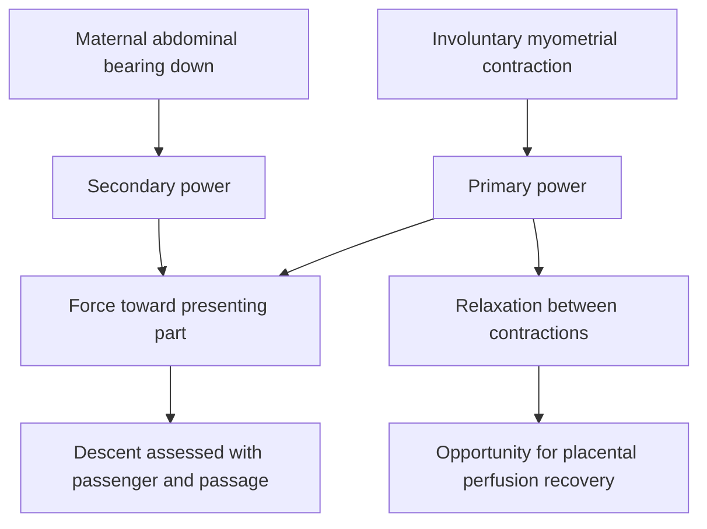
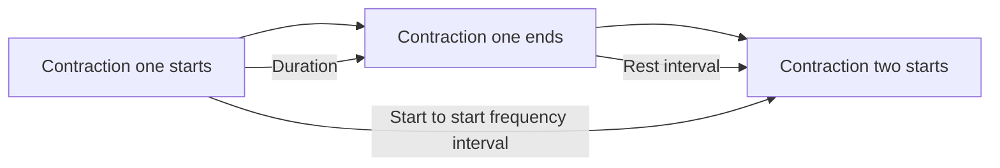

# Powers of labour — detailed Roman Hinglish concepts

**Study-ready, not studied.** Is topic ko padhkar tum samjhoge ki labour mein force kahan se aati hai, nurse us force ka assessment kaise karti hai aur abnormal activity ko kaise recognize karti hai. Yeh independent drug administration ya invasive procedure ka protocol nahi hai.

[Chapter](../README.md) · [20 original MCQs](../MCQs/07D-Powers-of-Labour-20-MCQs.md) · [Exam and video evidence](../Previous-Year-Questions/07D-Powers-of-Labour-Evidence.md)

## 1. Primary aur secondary powers

Labour ko samajhne ke liye imagine karo ki uterus ek muscular organ hai jo rhythmic force produce karta hai. Myometrium ki involuntary contractions primary power hoti hain. First stage mein ye contractions cervix par pressure apply karti hain aur cervical change aur fetal descent mein contribute karti hain. Har contraction ke baad relaxation bhi important hai, kyunki isse placental circulation ko recover karne ka opportunity milta hai.

Second stage mein woman ka abdominal bearing-down effort additional force generate kar sakta hai. Isko secondary power kehte hain. Jab abdominal muscles contract hoti hain, toh intra-abdominal pressure badhta hai. Uterine force ke saath ye pressure baby ke descent mein help kar sakta hai. Lekin force hone se vaginal birth guarantee nahi hoti. Fetal position, pelvis aur overall condition bhi important hain.

## 2. Uterine activity ko measure kaise karte hain?

Nurse frequency, duration, strength aur resting tone ko alag-alag assess karti hai. Frequency ka matlab contraction kitni baar hoti hai. Start-to-start time bhi record kiya ja sakta hai, aur ten-minute count common clinical format hai. Duration ek contraction ke start se end tak ka time hai. Rest interval ek contraction ke end se next contraction ke start tak ka samay hai. In teen time measurements ko mix mat karo.

Palpation se contraction ki approximate strength aur uterus ki relaxation ka idea milta hai. External tocodynamometer timing aur relative pattern show karta hai, lekin graph ki height se absolute intrauterine pressure reliably nahi nikal sakte. Agar sensor loose ho, toh tracing mein gap aa sakta hai. Missing trace ko absent contraction mat samjho. Woman ki permission aur comfort ke saath sensor adjust karo aur palpation se correlate karo.

## 3. IUPC aur Montevideo units

Intrauterine pressure catheter (IUPC) internal pressure measure karta hai. Iska placement invasive hai aur ruptured membranes aur suitable clinical indication chahiye. Nurse qualified team ke instructions aur infection prevention protocol follow karti hai. IUPC se resting pressure aur contraction peak ko measure karke ten-minute net activity calculate ki ja sakti hai.

MVU = ten-minute window ke har contraction ka peak pressure minus resting pressure, phir sab amplitudes ka sum.

Example: baseline 10 mmHg aur peaks 50, 60, 55 aur 65 mmHg hain. Net values 40, 50, 45 aur 55 hain. Total 190 MVU hai. Agar baseline missing ho, toh calculation complete nahi kar sakte. Approximately 200 MVU commonly referenced adequacy benchmark hai, lekin pressure value alone arrest ya caesarean ka diagnosis nahi hai. ACOG criteria mein phase, ruptured membranes, time aur cervical change bhi matter karte hain. Is detail ko clinical reasoning enrichment samjho.

## 4. Bahut frequent ya prolonged contractions

Tachysystole ki commonly used definition more than five contractions per ten minutes averaged over thirty minutes hai. NICE mein five ya more contractions with reduced resting time bhi concerning feature ho sakti hain, aur two minutes se longer contraction intrapartum risk feature hai. Different guideline thresholds ko interchangeable mat samjho. Fetal heart pattern aur maternal condition ke saath uterine activity assess karna hai.

Jab oxytocin prescribed ho, toh nurse baseline assessment, drug concentration, pump rate aur monitoring plan verify karti hai. Agar uterine activity ya fetal status concerning ho, toh local emergency protocol ke according oxytocin reduction ya stopping aur urgent team review indicated ho sakta hai. Routine maternal oxygen sirf abnormal tracing ke liye nahi dena chahiye jab maternal oxygenation normal ho. New headache, nausea ya confusion ke saath prolonged infusion mein fluid balance aur hyponatraemia concern ko urgently assess karna chahiye.

## 5. Pushing ke waqt nursing support

Woman ko apni body ki urge samajhne mein support karo. Agar cervical status unknown ho aur strong urge to push develop ho, toh qualified assessment arrange karo. Fully dilated low-risk woman without epidural apni spontaneous urge follow kar sakti hai. Epidural aur clinical circumstances pushing plan change kar sakte hain. Woman ki preference, positioning, fatigue, progress aur fetal wellbeing ko saath assess karo. Har patient ko ek fixed prolonged breath-hold impose mat karo. WHO routine manual fundal pressure recommend nahi karta. Suspected ineffective progress ya exhaustion ko timely assess aur escalate karo.

## Clinical and curriculum sources

| Source | Use and limitations |
|---|---|
| [OpenStax maternal-newborn nursing](https://openstax.org/books/maternal-newborn-nursing/pages/16-2-external-and-internal-monitoring) | Direct HTML read for pressure measurement and contraction parameters. Older oxygen intervention text is not adopted as current routine practice. |
| [NICE fetal monitoring NG229](https://www.nice.org.uk/guidance/ng229/chapter/Recommendations) | Indexed recommendations on excessive activity and reduced rest. |
| [NICE intrapartum NG235](https://www.nice.org.uk/guidance/ng235/chapter/Recommendations) | Indexed recommendations on pushing and contraction assessment. Direct retrieval returned 403. |
| [AHRQ oxytocin safety](https://www.ahrq.gov/patient-safety/settings/labor-delivery/perinatal-care/modules/strategies/medication/tool-safe-oxytocin.html) | Direct HTML read for medication monitoring and fluid safety. Local protocols and updated fetal resuscitation guidance take precedence over older intervention details. |
| [ACOG labour management](https://doi.org/10.1097/aog.0000000000005447) | Indexed 2024 guidance on pressure adequacy and arrest. Full publisher retrieval paywalled. |
| [WHO intrapartum care](https://www.ncbi.nlm.nih.gov/sites/books/NBK513805/) | Indexed recommendations. Direct retrieval unavailable in this run. |
| [INC curriculum reproduction](https://www.legitquest.com/act/indian-nursing-council-revised-regulations-and-curriculum-for-bsc-nursing-program-regulations-2020/cbd2) | Indexed normal labour, monitoring and uterine disorders scope. Detailed recruitment-exam depth remains pending. |

## Teaching and MCQ practice

[Monitoring uterine contractions, TOCO, IUPC and MVUs](https://www.youtube.com/watch?v=IQ1oUawfpVQ) indexed teaching description supports contraction measurements. [Everything OB fetal assessment](https://www.youtube.com/watch?v=WrN3M_fIZsE) lists contraction teaching at 13:33 and a general NCLEX MCQ at 21:25. Exact item coverage and playback not verified. See the evidence register for pending mappings.

Independent clinical review, exhaustive semantic comparison and rendered diagram validation remain pending.
