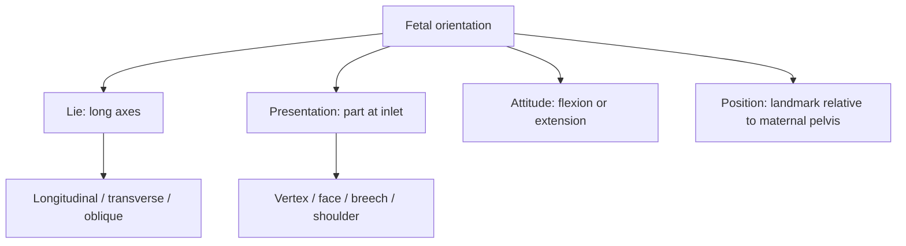
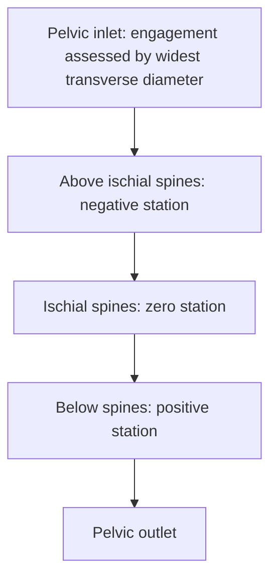

# Passenger — fetal factors in labour

**Study-ready, not studied.** [Chapter](../README.md) · [20 original MCQs](../MCQs/07E-Passenger-Fetal-Factors-20-MCQs.md) · [Evidence](../Previous-Year-Questions/07E-Passenger-Fetal-Factors-Evidence.md)

## 1. Passenger ka matlab

Labour ke three Ps mein passenger baby aur uske presenting dimensions ko represent karta hai. Baby ka size, head attitude, presentation, position aur maternal pelvis ke saath fit delivery ko influence karte hain. Ek single finding se delivery route decide nahi karte. Mother aur baby ki condition, contractions aur progress ko saath assess karna hota hai.

## 2. Lie, presentation, attitude aur position

Lie baby ke long axis aur mother ke long axis ka relationship hai. Parallel axes longitudinal lie, across axes transverse lie aur angled axes oblique lie kehlate hain. Presentation ka matlab pelvic inlet ke nearest fetal part se hai. Longitudinal lie mein head ya breech present ho sakta hai. Transverse lie mein shoulder present ho sakta hai.

Attitude baby ke parts ka aapas ka relationship hai. General flexion mein chin chest ke paas aur limbs body ke close rehte hain. Position presenting part ke reference landmark yani denominator ki maternal pelvis ke relative direction hai. Vertex mein occiput, face mein mentum aur breech mein sacrum denominator hote hain. LOA ka matlab occiput maternal left anterior quadrant mein hai. Maternal left aur right ko examiner ki left aur right se confuse nahi karna chahiye.

## 3. Head attitude aur skull dimensions

Flexed vertex mein chin chest ke close hota hai aur suboccipitobregmatic diameter approximately 9.5 cm hota hai. Biparietal diameter bhi term skull ka approximately 9.5 cm transverse diameter hai, lekin dono different planes mein measure hote hain. Partial extension mein brow aur larger mentovertical diameter approximately 13.5 cm present ho sakta hai. Persistent brow usually vaginal passage ko obstruct karta hai. Full extension mein face present hota hai aur chin direction delivery feasibility ke liye important hai. Persistent mentum posterior mein vaginal birth generally possible nahi hota unless rotation occurs. Actual fetal measurements vary karte hain.

Anterior fontanelle diamond-shaped hoti hai aur posterior fontanelle usually triangular hoti hai. Sutures aur fontanelles skull bones ko limited adjustment allow karte hain. Moulding mein bones overlap kar sakti hain, jabki caput scalp tissue swelling hai. Marked moulding ya swelling ko progress aur fetal condition se relate karna chahiye.

## 4. Breech aur transverse presentation

Frank breech mein hips flexed aur knees extended hote hain. Complete breech mein hips aur knees dono flexed hote hain. Footling breech mein ek ya dono feet lead kar sakte hain. Term malpresentation ko promptly confirm karna chahiye. Persistent transverse lie ke saath shoulder presentation mein routine vaginal birth generally feasible nahi hota. Obstetric team safe delivery plan banati hai. Nurse independent forceful rotation ya manipulation nahi karti.

## 5. Engagement aur station

Vertex engagement tab hoti hai jab biparietal diameter pelvic inlet cross kar chuka ho. Station ischial spines ke relative bony presenting part ka level hai. Spines ke level par zero, upar negative aur neeche positive station record karte hain. Caput ko bony landmark samajhne se descent overestimate ho sakta hai. Engagement aur zero station commonly related hain, lekin identical definitions nahi hain.

## 6. Leopold manoeuvres aur nursing role

Consent aur explanation ke baad trained clinician gentle abdominal palpation karta hai. First grip fundus mein fetal pole identify karta hai. Second grip back aur limbs ka relation assess karta hai. Third grip symphysis ke upar presenting part aur mobility estimate karta hai. Fourth grip dono hands se lower abdomen assess karta hai aur descent aur head attitude ke baare mein additional information de sakta hai. Patient comfort maintain karte hain aur supine hypotension symptoms mein position adjust karte hain.

Agar palpation uncertain ho, toh ultrasound confirmation arrange karna important hai. Fetal weight estimate exact nahi hota. Nurse documentation mein uncertainty, maternal-fetal observations aur referral clearly record karti hai.

## Sources and practice

- [StatPearls — Leopold Maneuvers](https://www.ncbi.nlm.nih.gov/books/NBK560814/) — direct text reviewed.
- [MSD — Fetal Presentation, Position and Lie](https://www.msdmanuals.com/professional/gynecology-and-obstetrics/intrapartum-complications/fetal-presentation-position-and-lie-including-breech-presentation) — indexed clinical text, direct retrieval failed.
- [StatPearls — Face and Brow Presentation](https://www.ncbi.nlm.nih.gov/books/NBK567727/), [Normal Labor](https://www.ncbi.nlm.nih.gov/books/NBK544290/), [NCBI labour and delivery nursing care](https://www.ncbi.nlm.nih.gov/sites/books/NBK615337/) — indexed sources.
- [Nursing Odyssey — Leopold Maneuvers + 25 MCQs](https://www.youtube.com/watch?v=tWM6bji1sNU) — topic description checked, exact playback pending.
- [Nursing Lecture — Fetus in Utero](https://www.youtube.com/watch?v=zCHRH1JSV2o) — prior teaching-video lead, playback pending.
