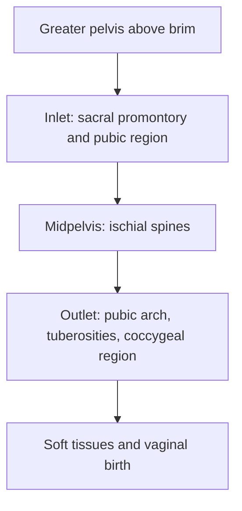
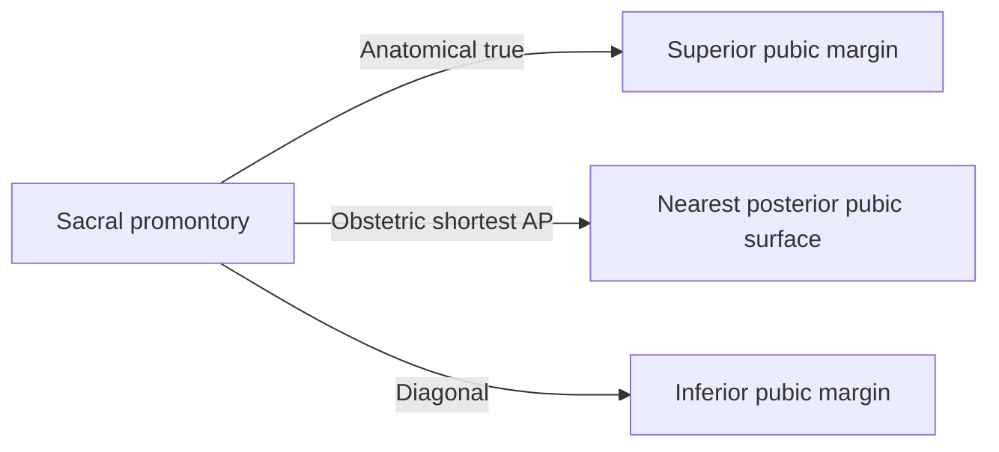

# Passage — maternal pelvis and soft birth canal

**Study-ready, not studied.** [Chapter](../README.md) · [20 original MCQs](../MCQs/07F-Passage-Maternal-Pelvis-20-MCQs.md) · [Evidence](../Previous-Year-Questions/07F-Passage-Maternal-Pelvis-Evidence.md)

## 1. Passage kya hota hai?

Labour ke three Ps mein passage mother ke bony pelvis aur soft birth canal ko represent karta hai. Baby ko uterine contractions aur maternal efforts ki help se isi passage se descend karna hota hai. Pelvic bones ke saath cervix, vagina, pelvic floor aur perineal tissues bhi important hain. Fetal size aur position ko maternal passage se compare karke actual progress samajhte hain.

Pelvic ring mein do hip bones, sacrum aur coccyx hote hain. Har hip bone ilium, ischium aur pubis ke fusion se banti hai. Pelvic brim sacral promontory, arcuate aur pectineal lines aur pubic region se related bony boundary hai. Brim ke upar greater ya false pelvis hai. Brim ke neeche lesser ya true pelvis hai jo fetal passage ka main bony canal banati hai.

## 2. Three pelvic planes

Inlet true pelvis ka upper opening hai. Fetal head ka widest transverse diameter inlet cross kare toh vertex engagement hoti hai. Midpelvis mein ischial spines important landmarks hain. Spines ke beech ki space fetal rotation aur descent ko influence kar sakti hai. Outlet lower exit hai jisme pubic arch, ischial tuberosities aur coccygeal region important hain.

## 3. Pelvic inlet conjugates

Conjugates inlet ke anteroposterior measurements hain. Posterior endpoint sacral promontory hai. Anterior endpoint change hone se conjugate ka naam aur clinical meaning change hota hai.

| Diameter | Endpoints and teaching approximation |
|---|---|
| Anatomical true conjugate | Promontory se pubic symphysis ke superior margin tak measure hota hai, approximately 11 cm. |
| Obstetric conjugate | Promontory se posterior symphysis ke nearest point tak shortest AP clearance hota hai, approximately 10.5 cm. |
| Diagonal conjugate | Promontory se inferior pubic margin tak ka distance hota hai, approximately 12.5 cm. |
| Transverse inlet | Inlet ka greatest side-to-side diameter commonly approximately 13 cm ke around describe hota hai. |
| Oblique inlet | Ek sacroiliac joint se opposite iliopubic eminence tak ka distance commonly approximately 12 cm ke around hota hai. |

Ye approximate adult teaching values hain, exact universal cutoffs nahi hain. Diagonal conjugate clinically indicated internal examination mein estimate ki ja sakti hai. Obstetric conjugate ko direct examination se accurately measure nahi karte. Diagonal se approximately 1.5–2 cm subtract karke estimate mil sakta hai. Agar diagonal 12.5 cm ho toh approximate obstetric conjugate 10.5–11 cm hoga. Is number se akelay birth mode decide nahi karte.

## 4. Midpelvis aur outlet measurements

Interspinous diameter midpelvis mein dono ischial spines ke beech hota hai, commonly about 10 cm ke around. Intertuberous diameter lower outlet mein ischial tuberosities ke beech hota hai. Textbooks mein approximate values aur measurement conventions vary kar sakte hain. Narrow space head rotation ya descent ko affect kar sakti hai. Pelvic joints aur posture mein limited movement available space ko influence kar sakti hai, lekin normal labour mein pelvic ring widely separate nahi hoti.

## 5. Classical pelvic types

Gynecoid type rounded ya mildly transverse oval inlet ke saath traditionally favourable describe hota hai. Android mein heart-shaped outline aur relatively narrow anterior region hota hai. Anthropoid mein AP dimension relatively long hota hai. Platypelloid mein inlet transverse direction mein wide aur AP direction mein flattened hota hai.

Ye traditional morphological categories hain, rigid clinical prediction tool nahi. Real pelves mixed morphology dikha sakti hain. Favourable pelvic shape dystocia ko exclude nahi karti aur unusual shape apne aap caesarean indication nahi hai.

## 6. Soft passage, CPD aur nursing assessment

Cervix ko thin aur open hona hota hai, vagina aur pelvic floor ko descent accommodate karna hota hai. Full bladder pelvic space occupy kar sakta hai, isliye nurse bladder status aur voiding support assess karti hai. Maternal position safe aur comfortable honi chahiye.

Cephalopelvic disproportion yani CPD fetus aur maternal passage ke mismatch ka clinical concern hai. Adequate contractions ke bawajood persistent lack of progress ho toh fetal size, position, pelvic factors aur maternal-fetal wellbeing evaluate karte hain. Maternal height, shoe size ya ek pelvic measurement se CPD confirm nahi karte. Suspected obstruction mein blind oxytocin escalation unsafe hai. Nurse findings report karti hai aur obstetric review arrange karti hai.

## 7. Current guidance — pelvimetry

WHO 2025 ke hisaab se healthy pregnant women mein labour admission par routine clinical pelvimetry recommended nahi hai. Pelvimetry specifically pelvic shape aur size ki adequacy assess karne ki examination hai. Standard indicated vaginal assessment cervix, fetal position aur station jaise clinical findings evaluate karta hai. Dono ko confuse nahi karna chahiye. Har indicated internal assessment se pehle explanation, consent, privacy aur appropriate trained clinician important hain.

## Sources and practice

- [StatPearls: Pelvic Inlet](https://www.ncbi.nlm.nih.gov/books/NBK519068/?report=reader) — direct reader text reviewed.
- [OpenStax maternal-newborn nursing: Labour dystocia](https://openstax.org/books/maternal-newborn-nursing/pages/19-1-labor-dystocia) — direct text reviewed.
- [WHO 2025 maternal health guidance: Clinical pelvimetry](https://www.ncbi.nlm.nih.gov/books/NBK615641/table/part1.tab48/) — direct recommendation reviewed.
- [StatPearls: McRoberts manoeuvre, pelvic anatomy](https://www.ncbi.nlm.nih.gov/sites/books/NBK537280/?report=printable) — indexed text, approximation used in Q07.
- [Female Pelvis important MCQs — Sudesh Sir](https://www.youtube.com/watch?v=5_y-zm7TFdw) — indexed description explicitly mentions maternal pelvis and fetal skull practice, exact playback pending.
- [Female pelvic types and diameters — maternity nursing NCLEX review](https://www.youtube.com/watch?v=i_iVlU6P8kg) — teaching description indexed, separate from dedicated practice.
