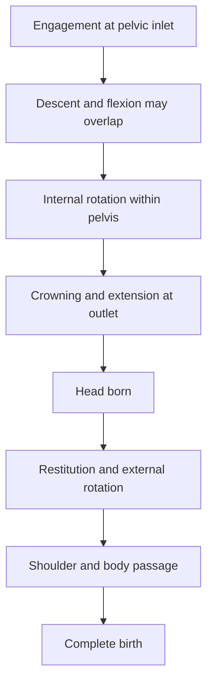
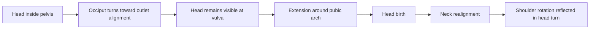

# Mechanism of labour and cardinal movements — detailed Roman Hinglish concepts

**Study-ready, not studied.** Aaj tum samjhoge ki baby ka head aur shoulders birth canal ki changing shape ke saath kaise adjust karte hain. Yeh educational model hai, independent delivery ya manual rotation ki instructions nahi hain.

[Chapter](../README.md) · [20 original MCQs](../MCQs/07G-Mechanism-and-Cardinal-Movements-20-MCQs.md) · [Historical exam evidence](../Previous-Year-Questions/07G-Mechanism-and-Cardinal-Movements-Evidence.md) · [Passenger](07E-Passenger-Fetal-Factors.md) · [Passage](07F-Passage-Maternal-Pelvis.md)

## 1. Cardinal movements ka meaning

Socho baby ka head ek curved passage ke through move kar raha hai. Pelvic inlet, midpelvis aur outlet ki orientation ek jaisi nahi hoti. Uterine contractions aur maternal expulsive efforts force provide karte hain, jabki baby ka head aur shoulders available space ke according alignment change karte hain. In connected adjustments ko cardinal movements kehte hain. Normal vertex birth mein flexion, descent aur rotation ek doosre ke saath overlap kar sakte hain. Har movement rigid fixed time par complete hona necessary nahi hai.

Common seven-movement teaching list engagement, descent, flexion, internal rotation, extension, external rotation/restitution aur expulsion hai. Kuch texts flexion ko descent se pehle list karte hain. Indian obstetric teaching mein crowning, restitution, external rotation aur lateral flexion ko separately describe bhi kiya jata hai. Exam mein named convention aur question wording dhyan se padhna.

Yeh typical anterior vertex mechanism ka simplified original flowchart hai. Clinical movements overlap kar sakte hain aur individual births mein variation hoti hai.

## 2. Engagement, descent aur flexion

Engagement mein vertex head ka biparietal diameter inlet se pass hota hai. First pregnancy mein ye labour onset se pehle bhi ho sakta hai. Isliye engaged head ka matlab established labour ya full dilatation nahi hai. Descent ka matlab presenting bony part ka pelvis mein further neeche move karna hai. Cervical opening aur descent separate measurements hain.

Flexion mein chin chest ke paas aata hai, jisse vertex head ka suitable smaller presenting diameter use ho sakta hai. Head thoda lateral tilt bhi kar sakta hai. Isko asynclitism kehte hain. Anterior asynclitism mein anterior parietal bone lead karti hai aur sagittal suture posterior direction mein displaced ho sakta hai. Posterior type mein opposite relationship hota hai. Persistent marked tilt ya poor progress qualified review maangta hai. Clinical examination uncertain ho toh indicated intrapartum ultrasound trained clinician ko position clarify karne mein help kar sakta hai.

## 3. Internal rotation, crowning aur extension

Head inlet mein often transverse ya oblique orientation se enter karta hai. Descent ke dauran occiput turn kar sakta hai, commonly anterior direction mein, taaki outlet ke available space se align ho. Internal rotation pelvis ke andar hoti hai. Idealized LOA se direct OA turn approximately 45 degrees hai, lekin actual angle aur direction initial position aur clinical findings par depend karte hain. Full dilatation se anterior position assume nahi karni chahiye.

Jab head vulval opening ko distend karke contractions ke beech bhi recede nahi karta, toh crowning kehte hain. Nurse imminent birth ke liye qualified attendant aur newborn support ready rakhti hai. Typical occipitoanterior vertex birth mein head pubic arch ke neeche pivot karta hai aur neck extend hoti hai, jisse forehead, face aur chin emerge karte hain. Normal late outlet extension ko face presentation se confuse mat karo. Face presentation mein marked extension presenting anatomy ko pehle se change karti hai.

## 4. Restitution, external rotation aur expulsion

Head born hone ke baad neck ka twist release ho sakta hai aur head shoulders ke saath apni alignment restore karta hai. Is initial change ko separately teach karne par restitution bolte hain. Shoulders pelvis ke andar rotate karte hain aur head ka external turn us adjustment ko reflect kar sakta hai. Kuch teaching sources restitution aur external rotation ko ek combined movement bolte hain.

Common anterior vertex mechanism mein anterior shoulder pubic arch ke beneath aur posterior shoulder posterior passage se emerge karti hai. Trunk lateral flexion se remaining body adjust ho sakti hai. Maternal position ke according visual direction change hoti hai. Nurse forceful head pulling ya rotation nahi karti. Qualified maternity team birth conduct karti hai aur wellbeing assess karti hai.

Agar head delivery ke baad head perineum ki taraf tightly retract kare aur shoulders normally follow na karein, toh shoulder dystocia suspect karo. Immediate emergency help activate karo, timing document karo aur unit protocol follow karo. Forceful traction ya fundal pressure use mat karo. Emergency maneuvers ka detailed separate topic later cover hoga.

## 5. Clinical observation aur exam revision

Nurse fetal position, bony station, rotation aur descent ko clinically indicated examinations ke documented findings se correlate karti hai. Actual findings record karo, assumed normal position nahi. Head delivery aur complete body birth distinct events hain, isliye unit record ke according accurate timing document karo. Clinical concerns par delay na karke qualified team ko involve karo.

| Term | Exam distinction |
|---|---|
| Engagement | Head inlet mein enter karta hai, labour onset zaroori nahi. |
| Descent | Bony presenting part ka level neeche change hota hai. |
| Flexion | Chin chest ki taraf move karta hai. |
| Internal rotation | Head pelvis ke andar orientation change karta hai. |
| Crowning | Head contraction ke beech bhi vulva par visible rehta hai. |
| Extension | Head outlet par extend hokar birth complete karta hai. |
| Restitution | Delivered head shoulders ke relative untwist hota hai. |
| External rotation | Shoulder adjustment head ke visible turn mein reflect ho sakta hai. |
| Expulsion | Shoulders aur remaining body born hote hain. |

## References and learning media

- [StatPearls normal labour](https://www.ncbi.nlm.nih.gov/sites/books/NBK544290/?report=reader) — directly retrieved clinical text.
- [OpenStax maternal-newborn nursing](https://openstax.org/books/maternal-newborn-nursing/pages/15-2-stages-of-labor) — directly retrieved nursing chapter and figure description, not copied illustration.
- [NCBI nursing labour and delivery care](https://www.ncbi.nlm.nih.gov/books/NBK615337/?report=printable) — indexed supporting text.
- [Asynclitism review](https://pmc.ncbi.nlm.nih.gov/articles/PMC9776610/) and [intrapartum ultrasound expert review](https://pubmed.ncbi.nlm.nih.gov/37278991/) — indexed research.
- [ISUOG intrapartum ultrasound](https://obgyn.onlinelibrary.wiley.com/doi/full/10.1002/uog.19072) — indexed guideline, not a routine scan requirement.
- [StatPearls shoulder dystocia](https://www.ncbi.nlm.nih.gov/sites/books/NBK470427/?report=reader) — indexed updated emergency recognition guidance.
- [INC BSc nursing curriculum reproduction](https://abmamcon.com/wp-content/uploads/2025/06/Indian-Nursing-Council-Revised-Regulations-and-Curriculum-For-B.Sc_.Nursing-Program-Regulations2020.pdf) — indexed second-stage physiology/mechanism section. Full official PDF visual inspection pending.
- [NHM midwifery units guidance](https://nhm.gov.in/images/pdf/programmes/maternal-health/guidelines/Operationalization-of-Midwifery-Units.pdf) — indexed Figure 3 cardinal movements. Full document visual verification pending.
- [Teaching video — mechanism of labour and fetal positions](https://www.youtube.com/watch?v=RtaWXqpnrok) — indexed description marks restitution at 11:41. Actual playback unverified.
- [MCQ practice candidate — NORCET 10 labour manoeuvres, Ritu Mam](https://www.youtube.com/watch?v=y8xwr1NeVzI) — indexed description mentions mechanism. Exact item playback and specific mappings remain pending.

Independent clinical, exhaustive semantic and rendered diagram review remain pending.
