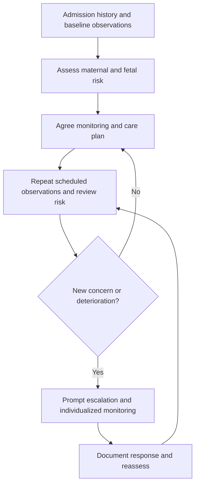
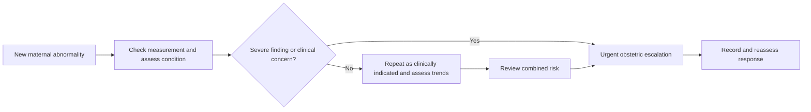

# Maternal-fetal intrapartum assessment — detailed Roman Hinglish concepts

**Study-ready, not studied.** [Chapter](../README.md) · [20 original MCQs](../MCQs/07H-Maternal-Fetal-Intrapartum-Assessment-20-MCQs.md) · [Evidence](../Previous-Year-Questions/07H-Maternal-Fetal-Intrapartum-Assessment-Evidence.md)

## 1. Admission assessment ka purpose

Labour admission par sirf cervix kitna khula hai yeh check karna enough nahi hai. Nurse gestational age, pregnancy aur birth history, existing risk factors, allergies, medications, woman's preferences, contraction pattern, membrane status, fluid colour, bleeding aur fetal movements review karti hai. Baseline maternal pulse, blood pressure, temperature, respiratory rate aur urinalysis ko clinical findings ke saath record karte hain. Abdominal palpation se lie, presentation aur descent ka estimate milta hai. Appropriate fetal heart assessment aur consent-based indicated vaginal examination clinical team ke plan ke hisaab se hoti hai.

## 2. Routine schedule aur dynamic risk

NICE NG235 first-stage routine low-risk observations mein maternal pulse hourly, temperature, BP aur respiratory rate four-hourly aur contraction frequency half-hourly document karne ko kehta hai. Vaginal examination four-hourly offer ki ja sakti hai, lekin clinical concern ya woman's wishes ke hisaab se timing change ho sakti hai. Har examination mein explanation, indication aur consent zaroori hain. These are guideline-specific routine intervals, not a reason to delay care if findings change.

| Parameter | Routine NICE first-stage interval |
|---|---|
| Contraction frequency documentation | 30 minutes |
| Maternal pulse | 1 hour |
| Temperature, BP, respiratory rate | 4 hours |
| Maternal-fetal risk review | 1 hour |
| Offer of vaginal examination | 4 hours, or individualized |
| Bladder-care review | At least every 4 hours |

Traditional partograph charting intervals aur WHO Labour Care Guide ke parameters alag frameworks hain. Exam mein guideline ya chart ka naam padho. Low-risk admission ek permanent category nahi hai. Har hourly review mein maternal aur fetal findings, symptoms, labour progression aur new risk factors ko integrate karte hain.

## 3. Maternal observations — clinically important thresholds

NICE NG235 ke listed escalation criteria mein one severe-range BP (systolic at least 160 mmHg or diastolic at least 110 mmHg), ya systolic at least 140 or diastolic at least 90 on two readings 15–30 minutes apart shamil hain. Raised BP ke saath 2+ urine protein ka combination bhi review ka reason hai. Ye findings definitive pre-eclampsia diagnosis ke substitute nahi hain.

Maternal pulse above 120/min on two measurements 15–30 minutes apart, respiratory rate below 9 or above 21/min on two measurements isi interval mein, aur temperature at least 38°C once ya at least 37.5°C twice one hour apart escalation criteria hain. Nurse measurement quality check karti hai, symptoms aur trend review karti hai aur appropriate obstetric assessment arrange karti hai. Severe symptoms ya instability mein repeat threshold complete hone ka wait nahi karte. Fresh bleeding, blood-stained liquor, new meconium, unusual pain aur other new concerns ko clinical situation ke hisaab se promptly review karte hain.

## 4. Fetal wellbeing ko maternal assessment se link karo

Fetal heart monitoring method admission risk aur labour mein develop hone wale risk factors ke basis par change ho sakta hai. NICE NG229 mein low-risk labour ke liye intermittent auscultation aur indicated situations mein CTG discuss karte hain. Prior monitoring results ko current tracing, maternal observations, labour progress aur uterine activity ke saath interpret karte hain. Continuous CTG mein NICE another clinician ke hourly in-person fresh eyes review ko next assessment se pehle complete karne ko kehta hai. Specific baseline, variability aur deceleration interpretation ke liye existing 06B aur 06E banks dekho. Is topic mein focus whole-person assessment aur decision-making par hai.

## 5. Bladder aur fluid balance

Labour mein bladder sensation altered ho sakti hai, particularly epidural ke saath. NICE at least four-hourly bladder-care review mein voiding frequency aur sensation check karta hai. Altered sensation, inability to pass urine ya IV fluids including oxytocin ki situation mein fluid balance monitor karna relevant hai. Ongoing voiding concern mein trained team catheterization offer kar sakti hai. Intake/output aur symptoms accurately record karne chahiye. Routine catheterization sabke liye necessary nahi hai.

## 6. Documentation, escalation aur handover

Nurse actual observation, measurement time, patient ki symptoms, relevant fetal findings aur action document karti hai. Agar measurement miss hui hai toh fake normal value enter nahi karni. Receiving team ko outstanding assessment aur plan batana chahiye. Multiple less dramatic abnormalities ka cumulative effect urgency badha sakta hai. Maternal illness ya sepsis mein uncomplicated routine interval ko rigidly follow nahi karte. Complication-specific monitoring, local emergency pathways aur clinician review appropriate hote hain.

## Sources and practice

- [NICE NG235 current recommendations](https://www.nice.org.uk/guidance/ng235/chapter/Recommendations) — indexed guidance checked, direct publisher fetch returned 403.
- [NICE NG235 NCBI reader text](https://www.ncbi.nlm.nih.gov/books/NBK596341/?report=reader) — direct text reviewed for admission, routine observations, escalation and bladder care.
- [NICE NG229 fetal monitoring](https://www.nice.org.uk/guidance/ng229/chapter/Recommendations) — indexed hourly assessment, previous traces and fresh eyes review.
- [NICE NG121 complications](https://www.nice.org.uk/guidance/ng121/chapter/Recommendations) — indexed complication-specific monitoring.
- [Ansha hacks MCQs — Labour and Delivery](https://www.youtube.com/watch?v=DQF5JOzgP4g) — dedicated broad labour assessment practice candidate; no question-specific match verified.
- [Nursing Peeth — Partograph teaching session](https://www.youtube.com/watch?v=5SbHXL11A2w) — description covers monitoring and expected MCQs; teaching source, not exact practice.
