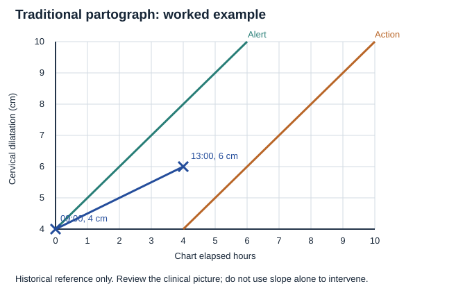
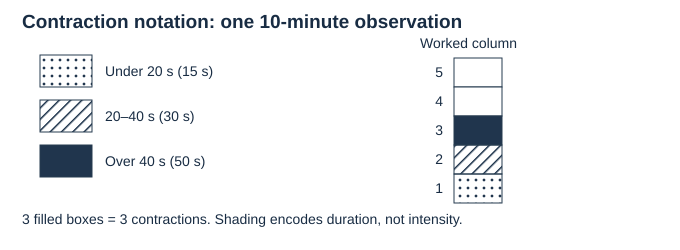

# Traditional and modified partograph — Roman Hinglish theory

**Study-ready, not studied.** [Chapter](../README.md) · [20 original MCQs](../MCQs/07I-Partograph-20-MCQs.md) · [Reported adaptation and evidence](../Previous-Year-Questions/07I-Partograph-Evidence.md)

## 1. Purpose and historical context

Partograph labour progress, fetal condition, maternal observations aur treatment ko time ke against ek structured record mein organise karta hai. Chart team ko changes, communication aur timely reassessment mein help karta hai. Earlier composite WHO chart latent phase ko include karta tha. Traditional modified chart latent plotting section omit karta hai, lekin early labour ki observations case record mein continue karte hain. Indian SBA handbook aur 2024 CEmONC teaching chart traditional 4 cm convention show karte hain. Isse current WHO 5 cm active-phase framework aur Labour Care Guide se confuse nahi karna chahiye.

## 2. Chart layout and initial plotting

Identification mein name, parity, admission time, registration aur membrane rupture time record hote hain. Fetal panel FHR, liquor aur moulding ko record karta hai. Cervical progress X in centimetres aur abdominal head descent O in fifths palpable above brim se represent hoti hai. Descent aur vaginal station alag scales hain. First eligible cervical point traditional chart mein alert line par actual measured value se align hota hai. Agar first assessment 6 cm at 14:00 hai toh 6 cm alert reference column ke neeche actual clock time 14:00 likho. Earlier points invent mat karo.

## 3. Alert/action lines and worked example

Old alert reference 4 cm at hour 0 se 10 cm at hour 6 tak straight line hai. Action line same slope se four hours later start hoti hai. Example: at 09:00 actual cervix 4 cm. At 13:00 actual 6 cm. Chart elapsed time 4 hours hai. Six cm ka alert reference hour 2 aur action reference hour 6 hai. Actual point alert se 2 hours right aur action se 2 hours left hai. Nurse complete condition aur progress review karti hai, referral setting aur current local protocol consider karti hai. Yeh diagram sirf teaching example hai, patient record ya treatment instruction nahi.

## 4. Fetal and contraction panel

Traditional chart ka FHR section actual observed rate ko time se link karta hai. Liquor legend form ke according use karo. NHM 2024 example mein I intact, C clear, M meconium aur A absent liquor hai. Earlier SBA form mein R ruptured bhi use hota hai. Moulding grading: 1+ apposed sutures, 2+ reducible overlap, 3+ irreducible overlap. Normal cervical curve fetal compromise ko exclude nahi karti.

Contraction panel mein count per ten minutes aur duration categories mark hoti hain. Given NHM legend mein under 20 seconds dotted, 20–40 hatched aur above 40 solid. Exactly 20 aur 40 middle category hain. Three contractions at 15, 30, 50 seconds ke liye three differently filled boxes bante hain. Count aur duration ko mix mat karo.

## 5. Maternal panel and treatment record

Traditional chart mein maternal pulse dot, BP upper systolic aur lower diastolic ends wala vertical arrow, temperature aur urine findings separate fields mein hote hain. NHM chart half-hourly pulse recording describe karta hai, jo NICE 07H ke hourly routine schedule se different hai. Traditional chart instructions often half-hourly contraction, FHR aur pulse entries aur four-hourly cervical, BP aur temperature entries show karti hain. Clinical monitoring frequency patient risk, local current standard aur monitoring method par depend karti hai. Medication concentration, rate, time aur fluids actual record ke saath align hone chahiye. Missing value ko normal assume mat karo. Consent aur individualized assessment maintain karo.

## 6. Current safety and WHO Labour Care Guide

WHO says the historic 1 cm/hour cervical dilation threshold is not reliable for identifying risk of adverse outcomes and should not be used for that purpose. Old action-line crossing alone is not an automatic caesarean or oxytocin order. Maternal-fetal wellbeing, cause of poor progress, obstruction risk aur appropriate review important hain. Abnormal fetal ya maternal findings mein line crossing ka wait nahi karte. In a referral facility pathway arrange early when indicated. WHO Labour Care Guide is a different framework with active-phase documentation from 5 cm, parameter-specific alerts, supportive care and shared decisions. 07J mein uska separate detailed bank hoga.

## Sources and practice

- [NHM revised CEmONC 2024 Part 1](https://nhm.gov.in/images/pdf/programmes/maternal-health/guidelines/Revised_CEmONC_curriculum_2024-Part_1.pdf), printed pp. 153–155 chart and instructions.
- [Indian SBA handbook](https://nhm.gov.in/images/pdf/programmes/maternal-health/guidelines/sba_handbook_for_anm_lhv_sn.pdf), traditional plotting and referral instructions.
- [WHO updated recommendation](https://www.ncbi.nlm.nih.gov/books/NBK615641/table/part1.tab44/) and [WHO Labour Care Guide manual](https://www.who.int/publications/i/item/9789240017566).
- [Nursing Odyssey Partograph practice section, publisher chapter 33:06](https://www.youtube.com/watch?v=1lTj4a1lKEY&t=1986s). Specific question content and playback not verified.
