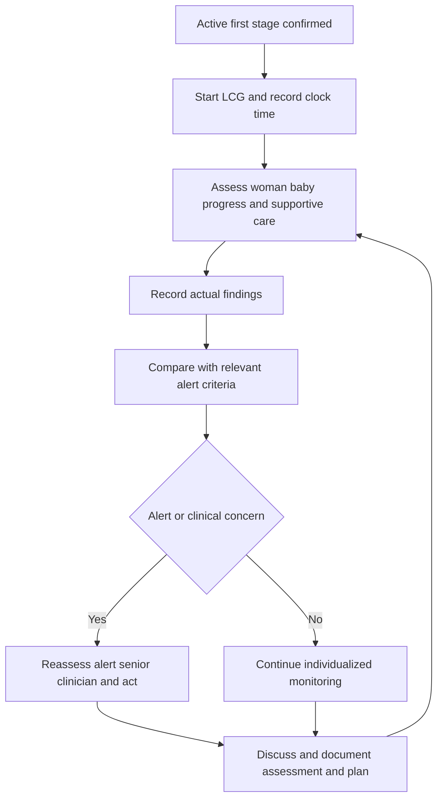
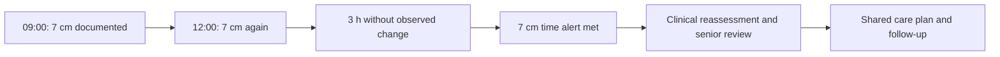

# WHO Labour Care Guide — detailed Roman Hinglish concepts

**Study-ready, not studied.** Is topic mein tum samjhoge ki modern WHO Labour Care Guide (LCG) ko labour monitoring aur respectful maternity care ke liye kaise interpret karte hain. Yeh educational explanation hai, standalone clinical protocol nahi. Facility ki approved guidance, qualified team aur woman ki individual clinical condition ko follow karo.

[Chapter](../README.md) · [20 original MCQs](../MCQs/07J-WHO-Labour-Care-Guide-20-MCQs.md) · [Evidence and video research](../Previous-Year-Questions/07J-WHO-Labour-Care-Guide-Evidence.md) · [Traditional Partograph](07I-Partograph.md)

## 1. Guide kab start hoti hai aur kyun?

Purane partograph mein labour progress ko diagonal reference lines se compare karte the. WHO ne evidence review mein dekha ki har woman ka cervix har hour ek centimetre se open hona zaroori nahi hai. Slow progress alone routine intervention ka reason nahi hona chahiye. LCG mein cervical measurement ke hisaab se alag time reference diya gaya hai. Iske saath maternal wellbeing, fetal wellbeing, medicines, supportive care aur agreed care plan bhi record hote hain.

WHO active first stage mein regular painful contractions, substantial cervical effacement aur dilatation 5 cm ya more hoti hai. Jab active labour confirm ho, tab LCG documentation start hoti hai, chahe membranes intact hon ya ruptured. Agar woman latent phase mein hai, toh use monitoring, comfort aur appropriate documentation phir bhi milni chahiye. High-risk woman ke liye LCG ke beyond additional monitoring aur specialist care required ho sakti hai.

## 2. Seven sections aur clock time

LCG mein identifying information, supportive care, baby ki wellbeing, woman ki wellbeing, labour progress, medication aur shared decision-making ke sections hain. Admission par identity, parity, labour onset, active labour diagnosis date, rupture of membranes ki known date/time aur risk factors accurately document karo. Unknown information guess mat karo.

Time axis par actual clock time use karo. Full dilatation ke baad second-stage section mein recording continue karo. Jab pushing start ho tab P notation record karo. Agar labour 12 hours se beyond continue kare toh new LCG sheet use karo aur earlier clinical course ko linked rakho. Paper change hone se labour duration reset nahi hoti.

Yeh original teaching flowchart hai. Urgent clinical concern ho toh assessment aur escalation ko form complete karne ke liye delay mat karo.

## 3. Supportive care is also clinical care

Jab woman labour pain se cope kar rahi hoti hai, toh emotional support aur practical comfort uske experience ko improve kar sakte hain. LCG mein companion, pain relief, oral fluids aur posture dedicated rows mein aate hain. Support continuously offer aur assess karo, aur standard guide mein hourly documentation maintain karo.

Companion, pain relief aur oral fluid ke liye Y ka matlab yes, N ka matlab no aur D ka matlab woman declines hai. Agar woman companion chahti hai lekin present nahi hai, toh N record karo aur arrangements facilitate karo. Agar usne informed offer decline kiya, toh D record karke choice respect karo. Later uski preference change ho sakti hai. Pain relief ke options clinical circumstances aur woman's preference ke according discuss karo. Oral fluid low-risk labour mein preference aur clinical appropriateness ke according offer karo.

Posture mein SP supine aur MO mobile/non-supine category hai. Left lateral position bhi MO mein aati hai. Agar woman supine hai toh suitable alternative position discuss aur support karo. Medical restriction ho toh individualized plan follow karo, forced movement nahi.

## 4. Baby aur woman ke observations

Baby section mein fetal heart baseline, deceleration, liquor, fetal position, caput aur moulding document hote hain. Woman section mein pulse, BP, temperature aur urine findings record hoti hain. Alert values clinical evaluation trigger karti hain, diagnosis nahi. Fetal heart aur maternal pulse ko distinguish karo. New concern ko circle karke actual value record karo, senior clinician ko inform karo aur action document karo.

Selected standard LCG reference values:

| Observation | Alert boundary on the standard form |
|---|---|
| Fetal heart baseline | Below 110 or 160 and above beats/min |
| Late deceleration | L |
| Liquor | Thick meconium or blood |
| Fetal position | Posterior or transverse |
| Caput or moulding | +++ |
| Maternal pulse | Below 60 or 120 and above beats/min |
| Systolic BP | Below 80 or 140 and above mmHg |
| Diastolic BP | 90 and above mmHg |
| Temperature | Below 35.0 or 37.5 and above °C |
| Urine | Protein ++ or acetone ++ |
| Contractions in 10 minutes | 2 or fewer, or more than 5 |
| Contraction duration | Under 20 or over 60 seconds |

Yeh WHO LCG form ke reference criteria hain. NICE, ACOG aur local emergency guidelines ki diagnostic ya intervention boundaries different ho sakti hain. Isliye actual clinical assessment ko sirf printed alert list tak limit mat karo. Clinical concerns before a threshold bhi urgent review demand kar sakte hain.

Standard WHO routine schedule mein supportive care hourly record hoti hai. Baby ke heart rate ki low-risk routine intermittent assessment first stage mein 30 minutes aur second stage mein 5 minutes hoti hai. Contractions first stage mein 30 minutes aur second stage mein at least 15 minutes assess hoti hain. Routine vaginal assessment low-risk active first stage mein generally four-hourly hota hai, consent aur clinical indication ke according. Clinical concern, changing findings aur local protocol additional assessments demand kar sakte hain. Alert contraction activity ko manual ke according further observation se verify karo unless urgency demands immediate response.

## 5. Cervical progress ke time references

Cervical assessment ke waqt actual measurement ko X aur actual assessment time ke saath plot karo. Abdominal descent ko O se document karte hain, jo head ka palpable fifths above brim represent karta hai. Isko centimetre station relative to ischial spines ke saath mix mat karo. Routine repeated examination sirf chart fill karne ke liye mat karo.

| Current cervical dilatation | Alert when unchanged for at least |
|---|---:|
| 5 cm | 6 hours |
| 6 cm | 5 hours |
| 7 cm | 3 hours |
| 8 cm | 2 hours 30 minutes |
| 9 cm | 2 hours |

Jab same dilatation ke documented observations relevant time threshold tak pahunchte hain, toh alert meet hota hai. Iska matlab nurse ko complete progress, contraction quality, position, descent, fetal condition aur woman ki condition reassess karne ke liye team involve karni hai. Alert automatic oxytocin, artificial rupture ya caesarean order nahi hai. Full dilatation ke baad active second-stage time references parity ke according hain. Manual mein active second-stage start se 3 hours without birth nulliparous woman ke liye aur 2 hours multiparous woman ke liye alert hai. Earlier concern par earlier assessment zaroori hai.

### Worked interpretation

A fictional educational case has 7 cm recorded at 09:00 and again at 12:00 on a clinically indicated assessment. Three hours without observed cervical change meet the 7 cm alert criterion. Woman aur baby ki overall condition assess karo, senior team ko inform karo aur agreed clinical plan record karo. Agar 8 cm at 09:00 and 8 cm at 11:15 ho, toh 2 hours 15 minutes specific 8 cm time threshold se kam hain. Isse reassuring clinical status assume mat karo. Other findings bhi review karo.

Yeh original simplified worked example hai, official chart ka reproduction nahi. Real patient ke care decisions qualified maternity team karti hai.

## 6. Medication and shared decisions

Medication section mein prescribed oxytocin exposure, other medicines aur IV fluid administration accurately document karo. Drug concentration aur rate ke change actual record mein reflect hone chahiye. LCG par medicine ka field hone se drug initiate karne ki authorization nahi milti. Follow approved medication protocol and prescribed orders.

Shared decision-making mein team clinical findings explain karti hai, options aur risks discuss karti hai aur woman's preferences respect karti hai. Assessment aur plan ka clear record handover mein help karta hai. Actual follow-up aur relevant initials maintain karo. Alert circle karna tabhi useful hai jab appropriate response bhi ho.

## 7. Traditional partograph versus WHO LCG

| Feature | Historical modified partograph | Standard WHO LCG |
|---|---|---|
| Active phase chart start | 4 cm in common older modified chart | 5 cm in confirmed active labour |
| Progress reference | Historical diagonal alert and action lines | Current dilatation-specific elapsed time references |
| Contraction display | Traditional fill patterns | Numerical frequency and duration entries |
| Supportive care | Not explicit as in LCG | Dedicated rows |
| Second stage | Limited chart space | Dedicated recording and pushing notation |
| Response | Interpret historical chart in its named context | Assess the individual, review alerts, agree and document actions |

Indian NHM Dakshata training includes plotting and interpreting the traditional partograph. Learn that format for historical questions and local training, while keeping current WHO recommendations separate. Check which approved form and protocol your actual facility uses.

## Sources and learning media

- [WHO LCG user's manual](https://iris.who.int/bitstream/handle/10665/337693/9789240017566-eng.pdf) — official clinical text and worked tables directly inspected.
- [Official standard LCG form](https://cdn.who.int/media/docs/default-source/reproductive-health/maternal-health/who-labour-care-guide.pdf) — text and page image directly inspected.
- [WHO implementation resource package](https://iris.who.int/bitstream/handle/10665/382511/9789240109346-eng.pdf?sequence=1) — 2025 official text inspected, visual page retrieval unsuccessful.
- [NHM Dakshata training](https://nhm.gov.in/index1.php?lang=1&level=4&lid=453&sublinkid=854) — indexed official training listing, traditional partograph module.
- [INC 2020 BSc nursing curriculum reproduction](https://www.legitquest.com/act/indian-nursing-council-revised-regulations-and-curriculum-for-bsc-nursing-program-regulations-2020/cbd2) — indexed Unit IV explicitly includes partograph/LCG, official gazette verification pending.
- [WHO LCG nursing lecture](https://www.youtube.com/watch?v=ohYm0cZukis) — indexed teaching marker 16:10 for supportive care. Playback unverified.
- [Expert Nursing Classes LCG MCQ candidate](https://www.youtube.com/watch?v=eiQFJarzXsU) — indexed description states ten practice MCQs. Direct opening failed, exact item coverage and playback unverified.

Independent clinical review, exhaustive semantic audit, official syllabus document review and rendered Mermaid validation remain pending.
