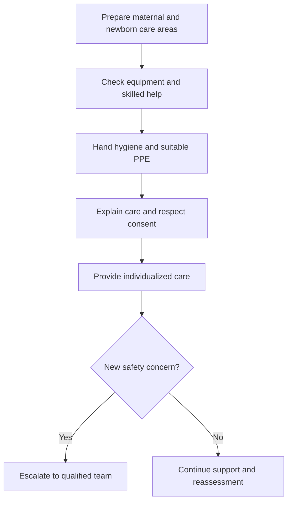
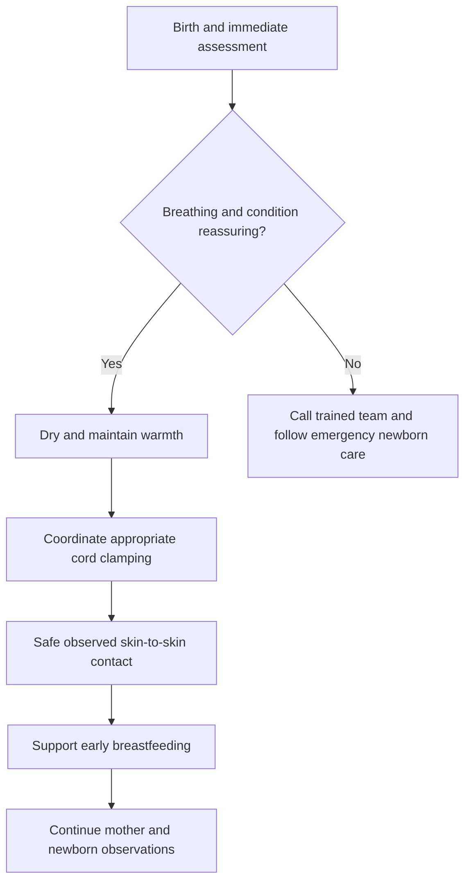

# 07K — Nursing Management in Normal Labour

**Study-ready, not studied.** Is guide mein normal vaginal birth ke bedside decisions samjhenge. Individual assessment, local protocol aur trained maternity team ke scope ko respect karo. Detailed assessment intervals, progress aur charting ke liye 07H–J revise karo.

[Chapter](../README.md) · [20 originals](../MCQs/07K-Nursing-Management-in-Normal-Labour-20-MCQs.md) · [Exam and video evidence](../Previous-Year-Questions/07K-Nursing-Management-in-Normal-Labour-Evidence.md)

## 1. Safe preparation and respectful care

Normal labour mein bhi unexpected complication ho sakti hai. Nurse clean delivery tray, hand hygiene supplies, suitable protective equipment, prescribed medicines aur functioning newborn resuscitation equipment ko birth se pehle check karti hai. Bag aur mask ready hona important hai, saath hi trained help aur referral arrangement available hona chahiye. Reassuring fetal heart rate equipment check ka substitute nahi hai.

Jab nurse contaminated linen handle karti hai, toh organisms gloves par aa sakte hain. Used gloves remove karo, hand hygiene karo aur clean task ke liye required fresh protective equipment aur procedure-specific asepsis follow karo. Clean aur dirty supplies separate rakho. Routine intravaginal chlorhexidine cleansing ko infection prevention ki compulsory step nahi banana chahiye.

Woman ko proposed care samjhao, understanding check karo aur appropriate consent lo. Language barrier ho toh reliable interpretation arrange karo. Capable woman ki consent family member automatically replace nahi karta. Intimate care mein screens, draping aur agreed observers dignity protect karte hain. Necessary observation aur emergency safety maintain rehni chahiye.

## 2. First-stage comfort and selective interventions

WHO low-risk labour mein oral food aur fluids support karta hai. NICE established labour mein light diet ka option deta hai agar woman chahe aur opioid exposure ya operative-birth risk ka exception present na ho. Risk change hone par pehle ki advice dobara review karo. IV fluids genuine clinical indication mein useful ho sakte hain, lekin sirf labour shorten karne ke liye routine infusion recommend nahi hai.

Breathing, relaxation, massage aur comfortable warm pack labour pain cope karne mein help kar sakte hain. Woman ki preference, feedback aur safe temperature assess karo. In measures ka success sirf labour duration se judge nahi karte. Epidural requested ho toh trained anaesthetic care ka timely access facilitate karo. Medicines aur invasive procedures qualified team ke scope aur local protocol ke according honi chahiye.

| Practice | Nursing principle |
|---|---|
| Pubic shaving | Uncomplicated vaginal birth ke liye routine shaving required nahi hai. |
| Enema | Labour augmentation prevent karne ke purpose se routine enema recommend nahi hai. |
| Intravaginal chlorhexidine | Routine infection-prevention cleansing recommend nahi hai. Standard hygiene continue rakho. |
| Amniotomy | Future delay prevent karne ke liye routine artificial rupture recommend nahi hai. Actual indication separately assess karo. |
| IV fluids | Sirf labour duration shorten karne ke liye routine infusion recommend nahi hai. Genuine clinical need ko ignore mat karo. |

## 3. Second stage and perineal care

Birth position, spontaneous pushing, descent aur fetal wellbeing ki detailed padhai 07C–H mein hai. Bedside nurse dignity, appropriate assistance, clean equipment aur timely escalation maintain karti hai. Episiotomy perineum mein surgical incision hai. First vaginal birth alone iska indication nahi hai. WHO routine episiotomy recommend nahi karta. Clinically necessary procedure mein qualified clinician ko support karo aur explanation, consent aur effective analgesia ensure karo. NICE acute fetal compromise wali emergency ko pre-incision analgesia recommendation ka exception maanta hai. Actual emergency management trained team ke scope mein hai.

## 4. Immediate mother-newborn care

Baby ki breathing aur condition birth par assess hoti hai. Clear amniotic fluid ke baad spontaneously breathing vigorous baby mein routine oral ya nasal suction ki need nahi hoti. Baby ko dry karke warmth maintain karo. Stable maternal-neonatal situation mein WHO cord clamping at least one minute delay recommend karta hai. Emergency resuscitation ya maternal instability mein clinical team timely action decide karti hai.

Skin-to-skin contact mein baby mother ke chest par safely rehta hai. Isse warmth aur feeding support milti hai. Airway clear aur breathing observable rakho. Mother sleepy ho ya safe position maintain na kar pa rahi ho toh close supervision arrange karo. Safe contact possible na ho toh suitable alternative care use karo. Stable pair ready ho toh first hour mein breastfeeding support karo. Healthy term newborn ka first bath at least 24 hours delay karo. Mother ki bleeding, uterine tone, vital signs aur comfort bhi simultaneously assess karte raho.

## 5. Worked nursing decisions

**Example 1:** Low-risk woman light food le rahi thi aur ab opioid analgesia mili hai. Nurse earlier diet advice automatically continue nahi karti. Woh current alertness, aspiration risk aur care plan review karti hai.

**Example 2:** Clear liquor ke baad baby cry kar raha hai aur breathing effective hai. Nurse routine suction avoid karti hai aur drying, warmth aur observation support karti hai. Breathing concern develop ho toh trained neonatal team ko involve karo.

## 6. References and video practice

| Topic | Clinical source | Teaching video | Dedicated MCQ practice |
|---|---|---|---|
| Preparation and infection prevention | [NHM labour room](https://nhm.gov.in/images/pdf/programmes/maternal-health/guidelines/Labor_Room%20Guideline.pdf) · [NSSK](https://nhm.gov.in/images/pdf/programmes/child-health/guidelines/NSSK/NSSK-Resource-Manual.pdf) | Specific teaching verification pending | [VS Nursing Academy labour MCQ candidate](https://www.youtube.com/watch?v=6mavPKjclvg), broad only |
| Respect, comfort and selective interventions | [WHO](https://www.ncbi.nlm.nih.gov/books/NBK513802/) · [NICE](https://www.nice.org.uk/guidance/ng235/chapter/Recommendations) | Specific teaching verification pending | Same broad candidate, specific coverage pending |
| Essential newborn care | [WHO newborn care](https://www.who.int/teams/maternal-newborn-child-adolescent-health-and-ageing/newborn-health/essential-newborn-care) · [Breastfeeding](https://www.who.int/tools/elena/interventions/early-breastfeeding) · [WHO postnatal guidance](https://www.who.int/publications/i/item/9789240045989) | Specific teaching verification pending | Same broad candidate, exact playback pending |

WHO executive summary directly retrieved. NICE and NHM indexed extracts reviewed, direct access failed. Newborn guidance indexed. These are original teaching diagrams, not official reproduced charts. Full independent clinical and exhaustive semantic review, rendered diagram checks and specific video mapping remain pending.
