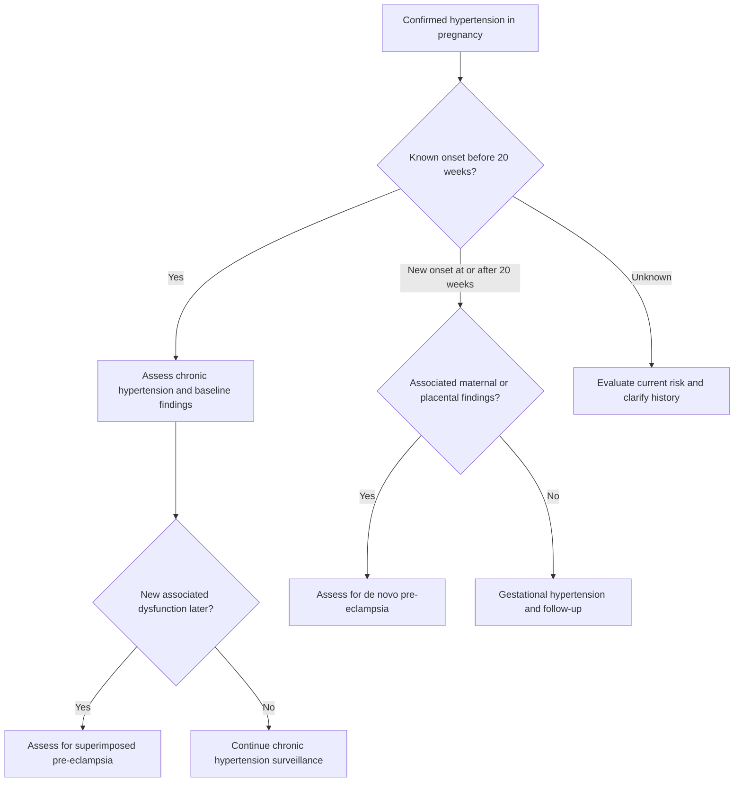
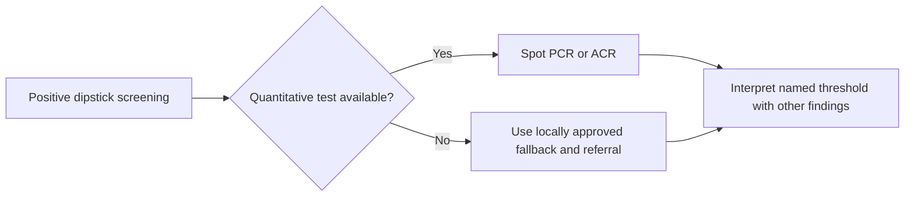

# 08A — Hypertensive disorders of pregnancy: classification and recognition

**Study-ready, not studied.** Jab pregnancy mein BP badhta hai, toh nurse ko sirf number nahi dekhna chahiye. Pehle accurate measurement, pregnancy ka week, purana BP history aur associated maternal-fetal findings ko samajhna hai. Is guide mein classification aur recognition padhenge. Detailed pre-eclampsia pathophysiology, eclampsia emergency treatment, HELLP aur antihypertensive management alag topics mein cover honge. Local protocol aur qualified team ke scope ko follow karo.

[Chapter](../README.md) · [20 original questions](../MCQs/08A-Hypertensive-Disorders-Classification-and-Recognition-20-MCQs.md) · [Exam and video evidence](../Previous-Year-Questions/08A-Hypertensive-Disorders-Classification-and-Recognition-Evidence.md)

## 1. Pregnancy BP ko kaise samjhein?

BP blood vessels ke andar pressure ko represent karta hai. Systolic pressure heart ke contraction aur diastolic pressure relaxation ke dauran measure hota hai. Pregnancy mein blood circulation aur vascular resistance naturally change hote hain. Lekin elevated BP ko normal physiological change bolkar ignore nahi karna chahiye.

ISSHP 2021 recommendations mein pregnancy hypertension ka clinic threshold systolic 140 mmHg ya above OR diastolic 90 mmHg ya above hai. Standardized repeat measurement chahiye. Severe BP systolic 160 ya above OR diastolic 110 ya above hai. Severe reading par urgent clinical action arrange karo aur named ISSHP recommendation ke mutabik 15 minutes ke andar repeat karo. Non-severe elevation mein confirmatory measurement at least four hours baad ya two consecutive visits par ho sakta hai, unless clinical concern demands earlier action. Ye diagnostic confirmation rule hai, emergency care delay karne ka instruction nahi.

General adult ACC/AHA categories ko pregnancy diagnostic threshold ke saath mix mat karo. Named guideline aur local protocol mention karna exam mein important hai.

## 2. Correct BP measurement

Woman ko suitable seated position mein rest do, feet floor par supported rakho aur arm ko heart level par support karo. Correct cuff arm circumference ke hisaab se choose karo. Pregnancy aur pre-eclampsia ke liye validated monitor use karna chahiye. Initial assessment mein both arms measure karte hain. Consistent higher-reading arm ko subsequent measurements mein use karte hain. Agar vascular access ya other contraindication ho toh individual clinical plan follow karo.

Manual measurement mein usual systolic endpoint Korotkoff phase I aur diastolic endpoint phase V hai. ISSHP visit assessment ke liye at least two readings ka average use karta hai. Agar readings ka difference 10 mmHg se zyada ho toh third reading lo aur second-third readings use karo. Abnormal readings ko lower dikhane ke liye cuff ya values manipulate mat karo.

## 3. Timing and classification

| Pattern | Interpretation |
|---|---|
| Chronic hypertension | Hypertension pregnancy se pehle ya 20 weeks se pehle detected hai. Treatment se normal BP hone par bhi history relevant rehti hai. |
| Essential chronic hypertension | Known secondary cause identify nahi hua hai. |
| Secondary chronic hypertension | Renal disease jaise identified cause se hypertension related hai. |
| White-coat hypertension | Clinic BP raised aur validated home ya ambulatory readings normal hoti hain. Early pregnancy context mein evaluate karo aur monitoring continue rakho. |
| Masked hypertension | Clinic readings normal lekin outside-clinic readings elevated hoti hain. |
| Gestational hypertension | New confirmed hypertension 20 weeks ya baad develop hoti hai, aur pre-eclampsia-associated findings nahi milti hain. |
| Transient gestational hypertension | Later pregnancy mein clinic BP elevation repeated readings par resolve hoti hai. Iske baad bhi follow-up important hai. |
| De novo pre-eclampsia | New gestational hypertension ke saath significant proteinuria, relevant maternal organ dysfunction ya uteroplacental dysfunction develop hoti hai under ISSHP. |
| Superimposed pre-eclampsia | Chronic hypertension ke saath new findings compatible with pre-eclampsia develop hoti hain. BP rise alone sufficient nahi hai. |

Late booking mein agar previous BP history available nahi hai, toh onset guess mat karo. ISSHP initially gestational hypertension ya suspected pre-eclampsia ke framework mein assessment and management support karta hai, jab tak further evidence classification clarify na kare.

Yeh original conceptual flowchart hai. Severe BP ya emergency symptoms kisi bhi branch mein urgent evaluation demand karte hain.

## 4. Proteinuria ka meaning aur interpretation

Kidney ke filtering units normally blood ke important proteins ko retain karte hain. Jab filter ki permeability change hoti hai, toh urine mein protein aa sakta hai. Pregnancy mein proteinuria ka reason pre-eclampsia ke alawa renal disease bhi ho sakta hai. Isliye baseline aur timing important hain.

| Test | Named ISSHP/NICE criterion |
|---|---|
| Spot urine PCR | 30 mg/mmol ya above significant proteinuria ka threshold hai. |
| Spot urine ACR | 8 mg/mmol ya above significant albumin-to-creatinine ratio criterion hai. |
| Complete 24-hour urine protein | ISSHP 0.3 g/day ya above criterion deta hai. NICE routine 24-hour collection recommend nahi karta. |
| Dipstick | NICE positive 1+ screening ke baad available quantitative PCR ya ACR recommend karta hai. ISSHP 2+ ko fallback criterion maanta hai agar confirmatory test available nahi hai. |

Dipstick result urine concentration se influence ho sakta hai. PCR total protein ko urine creatinine ke relative measure karta hai. ACR albumin ko urine creatinine ke relative measure karta hai. Dono ratios ke thresholds aur units ko daily protein excretion ke saath mix mat karo.

## 5. Proteinuria absent hone par bhi assessment

Pre-eclampsia ek multisystem disorder hai. Sirf urine protein ka wait karne se important disease miss ho sakti hai. ISSHP hypertension ke saath new neurological findings, pulmonary oedema, kidney injury, liver involvement, hematological abnormalities ya uteroplacental dysfunction ko relevant associated findings maanta hai. NICE bhi proteinuria ke alawa maternal aur uteroplacental dysfunction ko recognize karta hai. Different guideline definitions aur specific laboratory thresholds ko named framework mein padho.

Chronic hypertension mein early baseline urine protein, platelet count, creatinine aur liver enzymes later comparison mein useful hote hain. New significant proteinuria ya new organ findings par superimposed disease evaluate karo. BP rise alone se diagnosis confirm mat karo, lekin deterioration par prompt clinical review arrange karo. Severe headache, persistent visual disturbance, breathlessness, severe upper abdominal pain, convulsions ya severe BP par urgent maternity assessment chahiye. Treatment ko protein test ya chart completion ke liye delay mat karo.

## 6. Worked examples

**Case 1:** A woman at 13 weeks has documented pre-pregnancy hypertension and currently controlled BP on prescribed treatment. Nurse chronic hypertension history retain karti hai. Normal current reading medicine effect show kar sakti hai.

**Case 2:** A woman at 31 weeks has repeated new BP elevation and no associated maternal or placental findings. Gestational hypertension current classification ho sakti hai. Nurse continued surveillance facilitate karti hai, kyunki associated findings baad mein develop ho sakti hain.

**Case 3:** Chronic hypertension wali woman ka baseline PCR normal tha aur 30 weeks mein significant new proteinuria milti hai. Nurse baseline compare karke superimposed pre-eclampsia ke suspicion ko clinical team tak communicate karti hai.

## 7. References and study resources

| Topic | Clinical reference | Teaching video | MCQ practice |
|---|---|---|---|
| BP technique and classification | [ISSHP 2021](https://www.isshp.org/wp-content/uploads/2023/09/ISSHP-2021-guidelines.pdf) | Specific teaching verification pending | [HDP MCQ candidate](https://www.youtube.com/watch?v=B2q_G0Hx4Yw) broad description only |
| Proteinuria and recognition | [NICE NG133](https://www.nice.org.uk/guidance/ng133/chapter/Recommendations) | Specific teaching verification pending | Same candidate, exact item pending |
| Indian nursing scope | [NHM CEmONC 2024](https://nhm.gov.in/images/pdf/programmes/maternal-health/guidelines/Revised_CEmONC_curriculum_2024-Part_1.pdf) · [INC 2020 gazette](https://thc.nic.in/Central%20Governmental%20Regulations/Indian%20Nursing%20Council%20%28Revised%20Regulations%20and%20Curriculum%20For%20B.Sc.%28Nursing%29%20%28Program%29%20Regulations%2C2020..pdf) | Teaching verification pending | India-wide recruitment question mapping pending |

INC OBG Nursing II Unit I explicitly includes PIH/pre-eclampsia and eclampsia, assessment, initial management and referral. NHM CEmONC 2024 module classifies chronic, gestational, pre-eclampsia, eclampsia and superadded disease. Some older training wording uses different inequality symbols or dipstick thresholds. For numerical questions use the explicitly named current reference rather than merging them into one universal rule.

The ISSHP table, recommendations, NHM extracted module and INC gazette text were directly reviewed. PDF screenshot requests failed. NICE indexed recommendations were reviewed but direct publisher access returned 403. Original flowchart source is authored for teaching, not an official chart reproduction. Independent expert validation, full semantic and rendered UI audit remain pending.
