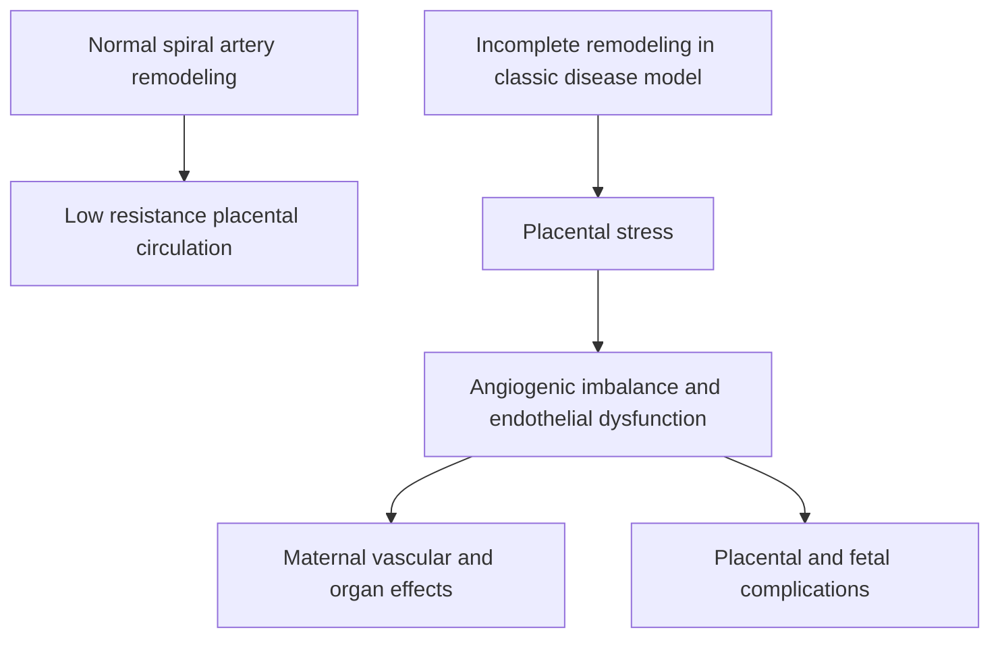
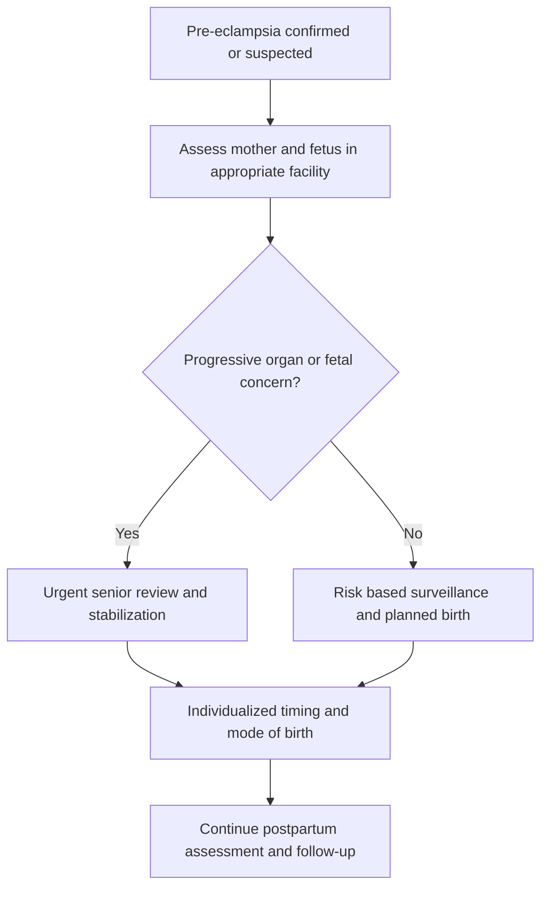

# 08B — Pre-eclampsia: mechanism, prevention, complications and nursing care

**Study-ready, not studied.** Is guide mein hum samjhenge ki placenta se shuru hone wali changes mother ke different organs ko kaise affect kar sakti hain. BP technique aur diagnostic classification ke liye [08A](08A-Hypertensive-Disorders-Classification-and-Recognition.md) revise karo. Eclampsia, HELLP aur drug administration ke detailed packages alag honge.

[Chapter](../README.md) · [20 original MCQs](../MCQs/08B-Pre-eclampsia-20-MCQs.md) · [Historical adaptation and evidence](../Previous-Year-Questions/08B-Pre-eclampsia-Evidence.md)

## 1. Normal placenta aur disease mechanism

Placenta mother aur baby ke beech oxygen aur nutrients ka exchange support karta hai. Normal pregnancy mein trophoblast cells maternal spiral arteries ko remodel karte hain. Iska matlab hai ki relatively narrow vessels wider, low-resistance blood channels banne lagti hain. Jab resistance kam hoti hai, toh placenta ko maternal blood relatively easily mil sakta hai.

Pre-eclampsia ek heterogeneous multisystem pregnancy disorder hai. Classic placental model mein spiral artery remodeling incomplete reh sakti hai. Isse placental perfusion aur oxygen supply mein stress develop ho sakta hai. Placenta soluble fms-like tyrosine kinase-1 (sFlt-1) jaise antiangiogenic factors release kar sakta hai. Ye factors VEGF aur placental growth factor (PlGF) ko bind karke blood vessel lining ki healthy signaling disturb karte hain. Endothelium blood vessels ki inner lining ko kehte hain. Jab ye lining dysfunctional ho jati hai, toh vascular resistance, permeability aur clotting-related abnormalities develop ho sakti hain. Har case mein exact pathway identical nahi hota.

Ye original teaching diagram classic mechanism simplify karta hai. Isse har pre-eclampsia case ka single cause prove nahi hota.

Kidney mein glomerulus blood filter karta hai. Endothelial swelling aur injury ko glomerular endotheliosis kehte hain. Filtering barrier disturb hone se urine mein protein aa sakta hai. Vascular leakage aur pressure changes se oedema ho sakti hai. Lekin normal pregnancy mein dependent ankle swelling bhi common hai, isliye swelling alone diagnostic nahi hai. Liver involvement upper abdominal pain, renal involvement oliguria ya rising creatinine, aur cerebral involvement severe headache ya visual disturbance se present ho sakta hai. Pulmonary oedema aur seizures serious complications hain. Fetal growth restriction aur placental abruption bhi associated complications ho sakte hain. Nurse ek normal observation ke basis par baaki organ findings ignore nahi karti.

## 2. Risk assessment and prevention

Booking par previous pregnancy history, chronic conditions aur relevant risk factors record karo. NICE NG133 mein prior hypertensive pregnancy, chronic kidney disease, autoimmune disease jaise SLE ya APS, type 1 or type 2 diabetes aur chronic hypertension high-risk factors hain. Moderate-risk factors mein first pregnancy, age 40 years ya above, pregnancy interval over 10 years, booking BMI 35 kg/m² ya above, family history aur multifetal pregnancy include hote hain. Other guidelines ke risk category aur thresholds different ho sakte hain.

NICE high-risk woman ya more than one moderate-risk factor wali woman ke liye prescribed low-dose aspirin 75–150 mg daily from 12 weeks until birth recommend karta hai. ISSHP preferably 16 weeks se pehle start, bedtime dosing aur 36 weeks tak stop recommend karta hai. Clinical risk/BP screening ke baad ISSHP 100–162 mg daily aur multivariable screening ke baad 150 mg nightly describe karta hai. Inko universal combined regimen mat banao. Aspirin allergy, bleeding risk aur actual prescription qualified clinician review karta hai. Aspirin preventive measure hai, established severe hypertension ka rescue treatment nahi hai.

WHO maternal-health guidance low dietary calcium intake wali populations mein 1.5–2.0 g elemental calcium daily recommend karti hai. ISSHP low calcium intake mein at least 500 mg daily supplementation describe karta hai. Named recommendations aur approved Indian programme ko separately samjho. Patient ko self-prescribe karne ya dose badalne ki advice mat do. Calcium aur iron administration ki timing local instructions ke according coordinate karo.

NICE solely prevention ke liye salt restriction recommend nahi karta. ISSHP exercise ko eligible women without contraindications mein support karta hai, lekin established pre-eclampsia mein activity advice individualized hoti hai. Routine vitamin C/E ya LMWH solely prevention ke liye recommended nahi hain. APS thromboprophylaxis jaise genuine separate indication ko ignore mat karo. Folic acid neural tube defect prevention ke liye prescribed ho sakti hai, isliye pre-eclampsia-specific recommendation ka matlab routine antenatal folate stop karna nahi hai.

## 3. Assessment, complications and safe escalation

BP aur urine protein ke saath symptoms, platelet count, liver enzymes, serum creatinine, fetal assessment aur clinical trend dekho. Pre-eclampsia mein normal urine protein serious organ dysfunction exclude nahi karti. Nurse sample collection, actual measurement time aur results document karti hai. Persistent upper abdominal pain, visual changes, severe headache, breathlessness, seizure, severe BP aur worsening labs par urgent maternity review chahiye.

PlGF-based testing approved suspected preterm pre-eclampsia diagnostic pathways mein additional information de sakti hai. NICE current indexed recommendation 20 weeks se 36 weeks plus 6 days tak relevant testing offer karti hai. Assay-specific cutoff aur availability local pathway par depend karte hain. Negative result emergency symptoms ko ignore karne ka reason nahi hai. FullPIERS adverse maternal outcomes ka risk estimate karta hai. Ye fetal outcomes predict nahi karta. Fetal growth, liquor, Doppler aur CTG clinically indicated schedule ke according alag assess karo.

ISSHP initially hospital assessment aur management recommend karta hai, phir carefully selected stable cases outpatient surveillance ke liye consider kiye ja sakte hain. Reliable follow-up, regular monitoring, warning-sign understanding aur timely transport essential hain. Agar remote clinic mein urgent obstetric aur neonatal support available nahi hai, toh risk-based referral coordinate karo. Indian NHM CEmONC 2024 module danger signs, strict monitoring, FRU referral aur hospital stabilization emphasize karta hai. Named threshold differences ko merge mat karo.

Fluid balance important hai, kyunki endothelial leakage aur renal dysfunction ke context mein overload pulmonary oedema ka risk badha sakta hai. NICE severe pre-eclampsia mein maintenance fluid generally 80 mL/hour tak limit karta hai unless ongoing losses require a different plan. NHM 2024 training text 75 mL/hour describes. Actual prescription, losses, renal status aur emergency context ke according individualized management chahiye. Nurse intake-output, respiratory condition aur urine trend report karti hai. Routine bolus ya independent fluid restriction mat karo.

## 4. Timing of birth and newborn coordination

Placenta delivery underlying pregnancy-related disease process ko end karne ka central step hai, lekin recovery immediate nahi hoti. Preterm case mein team mother ke worsening disease risk aur premature infant ke risks balance karti hai. NICE before 34 weeks and 34–36+6 weeks surveillance consider karta hai unless maternal ya fetal indications early birth demand karein. From 37 weeks birth initiate karne ka recommendation 24–48 hours hai. ISSHP 34–36+6 par planned birth discussion recommend karta hai aur 37 weeks se birth recommend karta hai. Maternal progressive renal/liver dysfunction, severe neurological findings, refractory hypertension, placental abruption ya concerning fetal assessment earlier intervention demand kar sakte hain. Mode of birth individualized obstetric decision hai.

Preterm birth likely ho toh qualified team antenatal corticosteroids aur magnesium sulfate when indicated prescribe kar sakti hai. Corticosteroids fetal lung maturation support karte hain. Urgently indicated birth ko steroid course complete karne ke liye delay mat karo. Neonatal aur anaesthetic teams ko timely involve karo. Magnesium toxicity ka original legacy question preserved hai aur specific treatment monitoring 08C/08E mein alag cover hoga.

## 5. Postpartum recovery and future health

Birth ke baad maternal BP aur organ dysfunction turant resolve hona necessary nahi hai. Postpartum fluid redistribution ke saath BP days 3–7 mein peak kar sakta hai. ISSHP at least one check is period mein recommend karta hai. NICE untreated pre-eclampsia group mein inpatient at least four daily BP checks aur days 3–5 par at least one check recommend karta hai. Treated women ke liye separate follow-up schedule hai. New severe headache, visual disturbance, breathlessness, upper abdominal pain ya seizure par immediate evaluation chahiye.

NICE community transfer tab consider karta hai jab symptoms absent hon, BP 150/100 mmHg ya less ho aur labs stable ya improving hon. Care plan mein monitoring, medicines, follow-up provider aur urgent warning signs clear hone chahiye. NICE all pre-eclampsia women ke liye 6–8 weeks medical review aur persistent proteinuria par 3 months renal review describe karta hai. ISSHP 3 months par BP, urine aur laboratory normalization check aur persistent abnormalities par further referral recommend karta hai.

Pre-eclampsia history future hypertension aur cardiovascular disease ka risk marker hai. Risk counselling ka matlab disease guaranteed hona nahi hai. Healthy lifestyle, regular BP review aur future pregnancy se pehle medical risk review support karo.

## 6. Worked nursing cases

**Case 1:** First pregnancy mein woman ki age 41 years hai aur BMI 24 hai. NICE framework mein first pregnancy aur age at least 40 two moderate risk factors hain. Nurse clinician ko aspirin eligibility review ke liye inform karti hai. Medicine independently prescribe nahi karti.

**Case 2:** Thirty-two weeks par pre-eclampsia wali woman ka BP treatment ke baad improve hua, lekin creatinine rise aur platelets fall ho rahe hain. Nurse actual trend report karti hai. Improved BP se progressive organ damage exclude nahi hota.

**Case 3:** Stable 37-week woman mein NICE 24–48 hours ke andar birth initiate karne ka plan support karta hai. Agar urgent maternal ya fetal concern develop ho, toh earlier assessment aur intervention required ho sakti hai.

## 7. Resources and clinical evidence

| Subtopic | Clinical source | Teaching video | MCQ practice |
|---|---|---|---|
| Placental and endothelial mechanism | [JACC review](https://www.jacc.org/doi/full/10.1016/j.jacc.2020.08.014) | [Lecturio pathophysiology](https://www.youtube.com/watch?v=TCZfqc5tgWU) indexed 0:00 placental development, playback pending | [Pre-eclampsia MCQ candidate](https://www.youtube.com/watch?v=7CnANIghE2g) indexed title only |
| Prevention and risk | [ISSHP](https://www.isshp.org/wp-content/uploads/2023/09/ISSHP-2021-guidelines.pdf) · [WHO calcium](https://www.ncbi.nlm.nih.gov/books/NBK615641/table/part1.tab212/) · [NICE](https://www.nice.org.uk/guidance/ng133/chapter/Recommendations) | Specific teaching verification pending | Specific practice verification pending |
| Assessment and birth | [NHM CEmONC](https://nhm.gov.in/pdf/2024/Revised_CEmONC_Curriculum-2024-Part-1.pdf) · [NICE](https://www.nice.org.uk/guidance/ng133/chapter/Recommendations) | Specific teaching verification pending | Broad candidate, exact item pending |
| Postpartum and counselling | [ISSHP](https://www.isshp.org/wp-content/uploads/2023/09/ISSHP-2021-guidelines.pdf) · [RCOG](https://www.rcog.org.uk/for-the-public/browse-our-patient-information/pre-eclampsia/) | Specific teaching verification pending | Specific practice verification pending |

Direct ISSHP extracted recommendations, NHM CEmONC 2024 text, NICE NCBI copy and RCOG patient information retrieved. PDF screenshots failed. JACC review indexed, publisher direct open returned 403. Independent clinical review by a separate reviewer and full cross-chapter semantic/diagram rendering audits remain pending.

[Original MCQs](../MCQs/08B-Pre-eclampsia-20-MCQs.md) · [Evidence](../Previous-Year-Questions/08B-Pre-eclampsia-Evidence.md)
