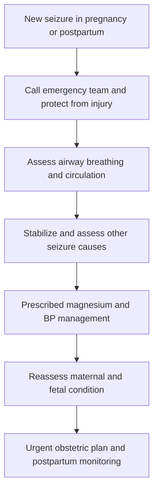
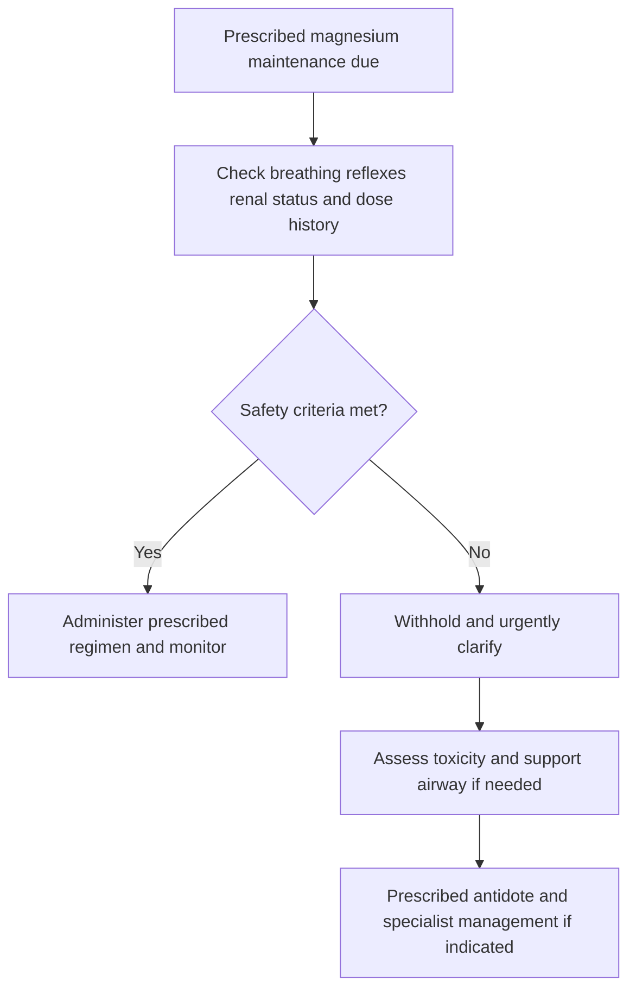

# 08C — Eclampsia: emergency response, magnesium sulfate and postpartum safety

**Study-ready, not studied.** Is topic mein hum seizure ko recognize karna, mother ko safe rakhna, magnesium sulfate ke different regimens ko samajhna aur repeat seizures se protection kaise monitor karna hai, ye padhenge. Ye professional nursing exam preparation hai, self-treatment guide nahi.

[Chapter](../README.md) · [20 originals](../MCQs/08C-Eclampsia-20-MCQs.md) · [Historical research](../Previous-Year-Questions/08C-Eclampsia-Evidence.md) · [08B Pre-eclampsia](08B-Pre-eclampsia.md)

## 1. Seizure aur eclampsia ka meaning

Eclampsia mein pregnancy ya postpartum period mein new seizure develop hota hai jo hypertensive pregnancy disorder ke context mein hota hai aur kisi other neurological cause se better explain nahi hota. Seizure mein brain ki electrical activity suddenly abnormal ho jaati hai. Generalized tonic-clonic seizure mein body stiff ho sakti hai, phir rhythmic jerking develop ho sakti hai. Seizure ke baad postictal phase mein woman confused ya drowsy ho sakti hai.

Pre-eclampsia mein vascular endothelial dysfunction aur cerebral autoregulation disturb ho sakte hain. Brain normally blood flow ko regulate karta hai. Jab regulation fail hota hai, toh vascular leakage aur vasogenic oedema develop ho sakti hai. Posterior reversible encephalopathy syndrome (PRES) ek associated clinical-radiological pattern hai, lekin har eclampsia case mein PRES establish hona necessary nahi hai. Severe headache, visual disturbance aur clonus warning findings ho sakte hain. Seizure prior recognized hypertension ya proteinuria ke bina bhi ho sakta hai.

Hypoglycaemia, epilepsy, intracranial hemorrhage, stroke, cerebral venous thrombosis, infection aur other metabolic causes differential diagnosis mein aate hain. Persistent altered consciousness, focal neurological signs ya atypical seizures prompt senior neurological assessment aur appropriate imaging demand karte hain. Seizure ko investigate karte hue emergency stabilization delay nahi karte.

## 2. Emergency nursing response

Emergency team ko immediately call karo. Woman ko fall aur surrounding hard objects se protect karo. Head support do aur safe ho toh lateral position support karo. Active seizure mein forceful restraint ya teeth ke beech object insert mat karo. Jaw ko force se open karna dangerous hai. NHM 2024 training text mein tongue-blade/pad ka historical wording milta hai, lekin wahi text active convulsion ke dauran insertion se mana karta hai. [AHA/Red Cross 2024 first aid guidance](https://cpr.heart.org/en/resuscitation-science/2024-first-aid-guidelines) ke according active seizure ya reduced responsiveness mein mouth mein koi object insert nahi karna chahiye. [MedlinePlus seizure first aid](https://www.medlineplus.gov/ency/article/003200.htm) forceful restraint aur oral intake avoid karne ko bhi support karta hai.

Airway, breathing aur circulation assess karo. Hypoxaemia ya inadequate ventilation mein trained team oxygen aur assisted ventilation provide karti hai. Agar seizure rukne ke baad cardiac arrest identify ho, toh resuscitation protocol ke according CPR initiate karo. Suction jab safely possible aur indicated ho tab use karo. Unresponsive woman ko oral medicine, food ya water mat do. Seizure duration, onset, movements, recovery aur observations record karo. Appropriate vascular access, bedside glucose, blood tests, BP management aur fetal monitoring emergency team ke saath coordinate karo. Mother ki stabilization fetus ki oxygenation ke liye bhi important hai. Maternal seizure ke time temporary fetal bradycardia ho sakti hai. Stabilization ke baad fetal tracing reassess karo aur persistent abnormality urgently report karo.

Ye original simplified diagram priority show karta hai. Actual emergency mein trained team multiple actions parallel mein karti hai.

## 3. Magnesium sulfate: named protocols

Magnesium sulfate recurrent eclamptic seizures prevent karne ke liye preferred anticonvulsant hai. Severe hypertension ke liye separate antihypertensive therapy chahiye. Magnesium ko routine BP rescue medicine samajhna incorrect hai. WHO full IV ya combined IV/IM regimen support karta hai. Agar full regimen safely provide nahi ho sakta, toh indicated loading dose ke baad immediate higher-level referral recommend kiya gaya hai.

| Named source | Loading | Maintenance | Duration |
|---|---|---|---|
| NICE NG133 1.8.4 | 4 g IV over 5–15 min | 1 g/hour IV | 24 hours, and 24 hours after last fit if eclampsia |
| ISSHP 2021 Table 9 IV | 4 g IV in 100 mL normal saline over 20 min | 1 g/hour IV | 24 hours after last seizure or birth, whichever is later |
| ISSHP combined IV/IM | 4 g IV over 20 min plus 5 g IM each buttock | 5 g IM one buttock every 4 hours | Same later-event rule |
| NHM CEmONC 2024 combined | 4 g slow IV over 5 min plus 5 g deep IM each buttock | 5 g IM every 4 hours, alternating buttock, with prescribed local preparation | 24 hours after birth or last convulsion, whichever is later |

Ye doses named professional protocols ke educational comparison hain. Hospital ke approved prescription, compatible preparation, route, renal function aur independent dose check follow karo. Different sources ke loading times ko mix karke universal regimen mat banao. NHM combined loading total 14 g hai, lekin total mass ka matlab poori dose IV dena nahi hai.

**Worked preparation:** 50% w/v means 50 g per 100 mL, yani 500 mg/mL. Four grams equals 4000 mg. Stock volume 4000/500 = 8 mL. NHM final 20 mL preparation ke liye 12 mL compatible diluent chahiye. Final concentration 200 mg/mL ya 20% w/v hoti hai. Concentrated stock ko rapid IV push nahi karte. Ye calculation trained staff ke prescription verification ke liye hai.

**Worked infusion:** Agar pharmacy label 10 g in final 100 mL hai, concentration 0.1 g/mL hai. Prescribed 1 g/hour rate ke liye 10 mL/hour pump rate chahiye. Bag concentration change ho toh pump rate bhi recalculate karna hoga.

ISSHP combined-to-IV conversion mein next scheduled IM dose ke time 1 g/hour IV maintenance start karne ka option hai without another routine loading dose. Recurrent fit mein NICE additional 2–4 g over 5–15 min recommend karta hai. NHM after 15 minutes recurrence ke liye additional 2 g slow IV aur specialist consultation/referral describe karta hai. Persistent seizures mein emergency airway, refractory seizure protocol aur alternative causes reassess karna important hai. Routine diazepam ya phenytoin magnesium ka substitute nahi hai. Contraindications, for example myasthenia gravis, aur refractory events specialist-directed alternatives demand kar sakte hain.

## 4. Safety monitoring and toxicity

Magnesium kidneys se clear hota hai. Jab renal function reduce hota hai toh drug accumulation ka risk badh sakta hai. Nurse respiratory rate, oxygen saturation, consciousness, reflexes, BP, pulse aur urine output document karti hai. Serum magnesium routine normal renal function mein necessarily required nahi hota under ISSHP, lekin renal impairment ya suspected toxicity mein relevant hai.

NHM Chapter 4 mein pre-maintenance criteria urine output more than 100 mL in four hours, present knee jerk aur respiratory rate more than 16/min diye hain. Creatinine more than 1 mg/dL par maintenance withhold karne ka instruction bhi hai. ISSHP Table 9 different surveillance thresholds list karta hai, including urine output below 30 mL/hour for four hours and RR below 12/min for 15 minutes as toxicity concern. In thresholds ka purpose aur context alag hai. Deteriorating breathing par threshold duration complete hone ka wait nahi karo. Local protocol stricter ho sakta hai.

Mild warmth/flushing recognized side effect ho sakti hai. Decreased reflexes, excessive weakness, worsening drowsiness aur respiratory compromise concerning hain. Suspected toxicity mein magnesium stop/withhold karo under emergency protocol, urgently escalate karo, airway and ventilation support karo aur ordered magnesium level obtain karo. Severe toxicity ke liye calcium gluconate antidote ready hona chahiye. NHM describes 1 g IV (10 mL of 10% solution) over 10 minutes, ISSHP Table 9 describes dilution in 100 mL normal saline over 10 minutes. Actual administration authorized order aur local emergency protocol se hoti hai. Legacy starter already tests absent reflexes and respiratory depression, isliye new bank prevention, clearance, calculations aur antidote readiness test karta hai.

## 5. Birth, transfer and postpartum surveillance

Eclampsia antepartum ho toh maternal stabilization ke baad prompt delivery planning indicated hoti hai. Mode of birth clinical situation aur obstetric assessment se decide hota hai. Seizure alone automatic caesarean rule nahi hai. Transfer mein previous dose time, route, mass, observations, urine output, IV access aur next dose plan clearly communicate karo. Patient ko appropriate trained escort aur emergency monitoring chahiye.

Placenta deliver hone ke baad bhi seizure recur ya first time develop ho sakta hai. New postpartum headache, visual disturbance, seizure ya breathlessness emergency symptoms hain. Standard ISSHP duration birth ya last seizure, whichever later, ke 24 hours baad tak hai. For example Monday 08:00 birth aur Monday 14:00 last seizure mein standard endpoint Tuesday 14:00 hoga, assuming treatment clinically indicated and tolerated. Nurse scheduled monitoring aur senior review continue karti hai.

## 6. Video and source map

| Topic | Clinical source | Teaching | Dedicated MCQ practice |
|---|---|---|---|
| Recognition and emergency | [Clinical review](https://www.ncbi.nlm.nih.gov/sites/books/NBK554392/) | Specific teaching playback pending | [Eclampsia Top 10 MCQs](https://www.youtube.com/watch?v=n3QvNGipO8Y) description lists emergency management |
| Regimens and calculations | [NHM](https://nhm.gov.in/pdf/2024/Revised_CEmONC_Curriculum-2024-Part-1.pdf) · [ISSHP](https://www.isshp.org/wp-content/uploads/2023/09/ISSHP-2021-guidelines.pdf) · [NICE](https://www.ncbi.nlm.nih.gov/books/NBK546004/?report=printable) | [Nursing Peeth Pritchard short](https://www.youtube.com/watch?v=3YHHryIZcoc) indexed teaching description | [Pre-eclampsia and eclampsia MCQs](https://www.youtube.com/watch?v=7CnANIghE2g) indexed magnesium topic |
| Toxicity and postpartum | [ISSHP](https://www.isshp.org/wp-content/uploads/2023/09/ISSHP-2021-guidelines.pdf) · [WHO](https://www.ncbi.nlm.nih.gov/books/NBK140560/) | Specific teaching verification pending | Same broad dedicated practice lead, specific items pending |

Direct NHM and ISSHP extracted text, NICE NCBI copy, WHO recommendations and StatPearls retrieved. PDF screenshot retrieval failed. Exact practice playback and separate independent clinical/semantic review pending. 

[Chapter](../README.md) · [MCQs](../MCQs/08C-Eclampsia-20-MCQs.md) · [Evidence](../Previous-Year-Questions/08C-Eclampsia-Evidence.md)
