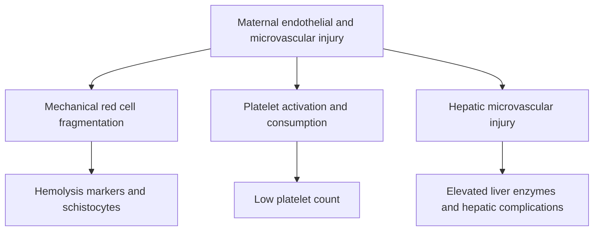
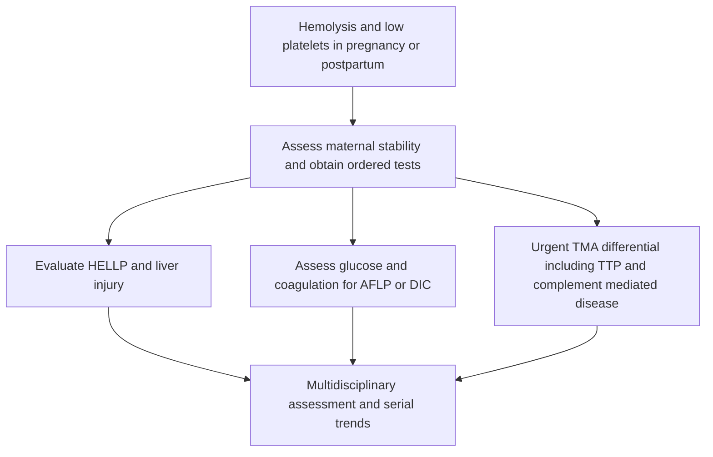

# 08D — HELLP syndrome: mechanism, laboratory recognition, differential diagnosis and nursing care

**Study-ready, not studied.** Dekho, HELLP pregnancy ka serious multisystem disorder hai. Is guide mein hum red cells, liver aur platelets ki abnormalities ko connect karenge. Ye nursing exam preparation hai, self-diagnosis ya self-treatment protocol nahi.

[Chapter](../README.md) · [20 original MCQs](../MCQs/08D-HELLP-Syndrome-20-MCQs.md) · [Reported adaptation and evidence](../Previous-Year-Questions/08D-HELLP-Syndrome-Evidence.md) · [08B Pre-eclampsia](08B-Pre-eclampsia.md) · [08C Eclampsia](08C-Eclampsia.md)

## 1. HELLP ka meaning aur mechanism

H ka matlab hemolysis, EL ka matlab elevated liver enzymes aur LP ka matlab low platelet count hai. Hemolysis mein red blood cells tootne lagte hain. Liver enzymes rise hone se liver cell injury ka clue milta hai. Platelets blood clot formation ke early phase mein help karte hain. Jab circulating platelets kam hote hain, toh bleeding aur procedure-related risk badh sakta hai.

Normal blood vessel ki inner lining ko endothelium kehte hain. Ye lining blood flow aur clotting ko regulate karne mein help karti hai. HELLP mein endothelial dysfunction aur small-vessel injury develop ho sakti hai. Platelets activate aur consume hote hain. Red cells narrow injured channels se guzarte waqt fragment ho sakte hain. Isi mechanical breakdown ko microangiopathic hemolysis kehte hain. Liver microcirculation affect hone par tissue injury, elevated enzymes aur kabhi hepatic bleeding ho sakti hai. Syndrome commonly pre-eclampsia se associated hai, lekin kuch women mein obvious hypertension ya proteinuria initially absent ho sakte hain. Isliye full assessment zaroori hai.

Yeh original simplified teaching diagram hai. Har individual case mein mechanism aur severity identical nahi hoti.

## 2. Laboratory results ko samjho

| Investigation | Meaning |
|---|---|
| Peripheral smear | Schistocytes fragmented red cells hain. Ye microangiopathic hemolysis ko support karte hain, lekin HELLP ke liye exclusive nahi hain. |
| LDH | Lactate dehydrogenase tissue injury aur hemolysis mein rise kar sakta hai. Isolated LDH alone cause establish nahi karta. |
| Haptoglobin | Ye free hemoglobin bind karta hai. Intravascular hemolysis mein clearance ki wajah se level low ho sakta hai. |
| Bilirubin | Heme breakdown se unconjugated bilirubin rise ho sakta hai. Liver dysfunction bhi bilirubin pattern affect kar sakti hai. |
| AST and ALT | Ye liver cell injury ke markers hain. AST other tissues mein bhi milta hai, isliye complete context dekho. |
| Platelets | Low count platelet consumption ka clue ho sakta hai. Trend aur bleeding signs important hain. |
| Creatinine and urine output | Ye renal involvement ko assess karne mein help karte hain. Pregnancy-specific reference aur trend consider karo. |
| PT, aPTT and fibrinogen | Ye clotting factor abnormalities ko identify karne mein help karte hain. HELLP mein initially normal ho sakte hain. New prolongation aur falling fibrinogen DIC ka concern raise karte hain. |

**Classic Tennessee framework:** INASL–FOGSI 2019 position statement aur other reviews complete syndrome mein hemolysis, platelet count below 100,000/µL, AST above 70 U/L aur LDH above 600 U/L jaise named thresholds describe karte hain. Kuch descriptions boundary par greater-than ke bajay greater-than-or-equal use karti hain, aur modern criteria enzyme rise ko laboratory upper limit ke relative define kar sakti hain. Isliye named source aur exact inequalities use karo. Borderline values ko clinically reassuring assume mat karo.

| Mississippi classic class | Platelet count | Associated enzyme framework |
|---|---|---|
| I | ≤50 × 10⁹/L | AST or ALT around 70 U/L or greater and LDH around 600 U/L or greater |
| II | >50 to ≤100 × 10⁹/L | Similar enzyme framework to class I |
| III | >100 to ≤150 × 10⁹/L | AST or ALT around 40 U/L or greater and LDH around 600 U/L or greater |

Class definitions source-specific hain. 1 × 10⁹/L equals 1,000/µL. Example mein platelets 42 × 10⁹/L, AST 112 aur LDH 900 ho toh classic Mississippi Class I fit karta hai. Classification se automatic procedure ya transfusion order nahi milta. Partial HELLP mein kuch components present ho sakte hain aur syndrome progress kar sakta hai. Nurse complete criteria ka wait karke concerning findings ki escalation delay nahi karti.

## 3. Important competing diagnoses

Thrombotic microangiopathy (TMA) ka matlab small blood vessels ke andar injury aur thrombosis se red cells fragment hona, platelets consume hona aur organs affect hona hai. HELLP TMA-like presentation de sakta hai. Har low platelet count HELLP nahi hota.

| Differential | Important recognition clue |
|---|---|
| Acute fatty liver of pregnancy (AFLP) | Hypoglycemia, impaired liver synthetic function, coagulopathy, jaundice aur sometimes encephalopathy prominent ho sakte hain. HELLP se overlap possible hai. FIGO 2025 multidisciplinary assessment, correction of metabolic/coagulation abnormalities and prompt delivery support karta hai. |
| TTP | Severe ADAMTS13 deficiency typically below 10% TTP support karti hai. Neurological signs aur severe thrombocytopenia important clues ho sakte hain. Suspected TTP mein emergency hematology review aur treatment assessment result ka wait karke delay nahi karte. |
| Complement-mediated TMA / aHUS | Severe renal injury especially postpartum prominent ho sakti hai. Persistent severe abnormalities beyond roughly 72 hours after delivery alternate TMA ka concern raise karti hain. Is diagnosis ko specialist evaluate karta hai. |
| ITP | Longstanding isolated platelet reduction with absent hemolysis and liver injury ITP se fit ho sakti hai. New organ findings par additional causes evaluate karo. |
| DIC | Widespread clotting activation se clotting factors aur platelets consume hote hain. Oozing, prolonged clotting times aur falling fibrinogen concerning findings hain. DIC HELLP ke saath coexist kar sakta hai. |

Koi single lab result in disorders ko perfectly separate nahi karta. Clinical history, timing, blood film, serial labs, specialist testing aur response after birth ko saath mein interpret karo. TTP aur complement-mediated disease ke treatment pathways HELLP se different hain. Nurse urgent specialist review facilitate karti hai, independent treatment prescribe nahi karti.

Original diagram simultaneous differential assessment dikhata hai. Isse rigid diagnostic algorithm ya diagnosis delay ka instruction mat samjho.

## 4. Symptoms, hepatic complications and nursing action

Upper abdominal ya right upper quadrant pain, nausea, vomiting, malaise aur headache possible symptoms hain. Woman ka BP normal lagne par bhi abnormal liver, hematology ya other organ findings assess karni hain. Nurse pain ki onset, severity, location, bleeding, mental status, BP, oxygen saturation aur urine output document karti hai. Sudden severe hepatic pain, hypotension, pallor ya collapse possible subcapsular liver hematoma/rupture aur concealed hemorrhage ke warning signs hain. Vaginal bleeding absent hone se internal hemorrhage exclude nahi hota. Emergency team ko immediately involve karo, circulation support karo aur appropriate imaging or intervention coordinate karo. Stable patient mein specialist-directed ultrasound ya cross-sectional imaging useful ho sakti hai. Unstable patient mein resuscitation delay mat karo.

Thrombocytopenia aur DIC ke context mein IV sites, mucosal bleeding aur surgical bleeding observe karo. Unnecessary invasive procedures avoid karo. Blood group testing, crossmatch aur prescribed component availability coordinate karo. Platelets, red cells, plasma ya cryoprecipitate ki actual need bleeding, lab profile, underlying diagnosis aur procedure par depend karti hai. Transfusion independently prescribe mat karo. TTP mein platelet transfusion ke risks different ho sakte hain, isliye uncertain diagnosis mein specialist advice important hai.

Neuraxial anesthesia mein low platelets ke saath bleeding risk assess karte hain. SOAP 2021 consensus selected obstetric thrombocytopenia cases mein low risk estimates discuss karta hai, lekin HELLP mein count rapidly fall kar sakta hai. Neuraxial procedure ya catheter removal se pehle six hours ke andar platelet result verify karna reasonable ho sakta hai. Anaesthesiologist etiology, bleeding risk, trend aur urgency evaluate karke decision leta hai. Nurse updated count aur relevant orders communicate karti hai.

## 5. Treatment, delivery and postpartum safety

Maternal stabilization aur prompt birth planning HELLP care ke central components hain. Preterm stable situation mein management qualified obstetric team individualized risk review se decide karti hai. Active hemorrhage, worsening coagulopathy, organ failure ya fetal compromise mein fixed gestational age achieve karne ke liye urgent intervention delay nahi karte. Mode of birth bhi individualized decision hai. Severe hypertension aur seizure prophylaxis ka management 08C aur next 08E mein separately padho.

NICE specifically dexamethasone ya betamethasone ko maternal HELLP syndrome treatment ke liye recommend nahi karta. Fetal lung maturation ke prescribed antenatal corticosteroids separate indication hain. Maternal or fetal emergency mein urgent delivery ko course complete karne ke liye delay mat karo.

Delivery ke baad platelet count aur liver findings turant normal hona necessary nahi. Pehle 24–48 hours mein worsening possible hai. Clinical status, CBC, hemolysis markers, hepatic enzymes, coagulation aur creatinine ko ordered schedule ke according monitor karo. Severe ongoing hemolysis, thrombocytopenia ya AKI especially beyond 72 hours par alternate TMA evaluation zaroori hai. Yeh time marker earlier deterioration ignore karne ka rule nahi hai. Discharge ke baad new severe abdominal pain, bleeding, headache, breathlessness ya reduced urine output par urgent assessment chahiye. Future pregnancy aur long-term maternal health ke liye risk-based follow-up discuss karo.

## 6. Worked cases and exam revision

**Case A:** Platelets 85,000/µL, AST 115 U/L, LDH 820 U/L aur smear par schistocytes. Classic Tennessee framework mein ye complete HELLP support karta hai. Nurse findings urgently report karti hai aur maternal-fetal condition assess karti hai.

**Case B:** Thirty-five weeks ki woman ko jaundice, vomiting, hypoglycemia aur coagulopathy hai. AFLP ko differential mein strongly consider karo, even if HELLP features overlap. Metabolic abnormalities ko correct karna aur prompt multidisciplinary care important hai.

**Case C:** Birth ke chaar din baad severe renal injury aur hemolysis persist karte hain. Is pattern ko physiological recovery mat samjho. TTP ya complement-mediated TMA ke liye urgent specialist review chahiye.

**Yaad rakho:** Schistocytes hemolysis ka clue hain, low haptoglobin supportive hai, raised AST liver injury ka clue hai aur low platelets consumption se related ho sakte hain. HELLP alone normal PT ko allow kar sakta hai, jabki coexisting DIC clotting factors consume kar sakta hai. AFLP, TTP aur complement-mediated TMA ko serious competing diagnoses samjho.

## 7. References and learning media

| Topic | Clinical source | Teaching video | MCQ practice |
|---|---|---|---|
| Mechanism and lab recognition | [StatPearls](https://www.ncbi.nlm.nih.gov/books/NBK560615/) · [Classic review](https://pmc.ncbi.nlm.nih.gov/articles/PMC2654858/) · [INASL–FOGSI](https://pmc.ncbi.nlm.nih.gov/articles/PMC6637074/) | [Level Up RN maternity complications](https://www.youtube.com/watch?v=1B17eRAQ0lM), indexed description | Specific question practice pending |
| AFLP, TTP and complement-mediated disease | [FIGO 2025](https://obgyn.onlinelibrary.wiley.com/doi/10.1002/ijgo.70161) · [2024 TMA review](https://pmc.ncbi.nlm.nih.gov/articles/PMC11328568/) | Specific teaching verification pending | Specific practice verification pending |
| Hepatic bleeding, DIC and anesthesia | [StatPearls](https://www.ncbi.nlm.nih.gov/books/NBK560615/) · [SOAP](https://www.soap.org/assets/COE/SOAP%20Consensus%20Statement%20Thrombocytopenia%202021.pdf) · [NHM CEmONC](https://nhm.gov.in/pdf/2024/Revised_CEmONC_Curriculum-2024-Part-1.pdf) | Specific teaching verification pending | [HELLP nursing assessment MCQ candidate](https://www.youtube.com/watch?v=djrd5ppw1BE), indexed title only |
| Birth and recovery | [NICE NG133](https://www.ncbi.nlm.nih.gov/books/NBK546004/?report=printable) · [TMA review](https://pmc.ncbi.nlm.nih.gov/articles/PMC11328568/) | Specific teaching verification pending | Specific practice verification pending |

Direct StatPearls, NICE NCBI copy and NHM extracted text reviewed. Other specialty sources were indexed. Direct PMC/publisher access and PDF screenshots failed for some sources. No separate clinician certification or full rendering review has been performed. Refer to the evidence register for verification status.

[Chapter](../README.md) · [MCQs](../MCQs/08D-HELLP-Syndrome-20-MCQs.md) · [Evidence](../Previous-Year-Questions/08D-HELLP-Syndrome-Evidence.md)
