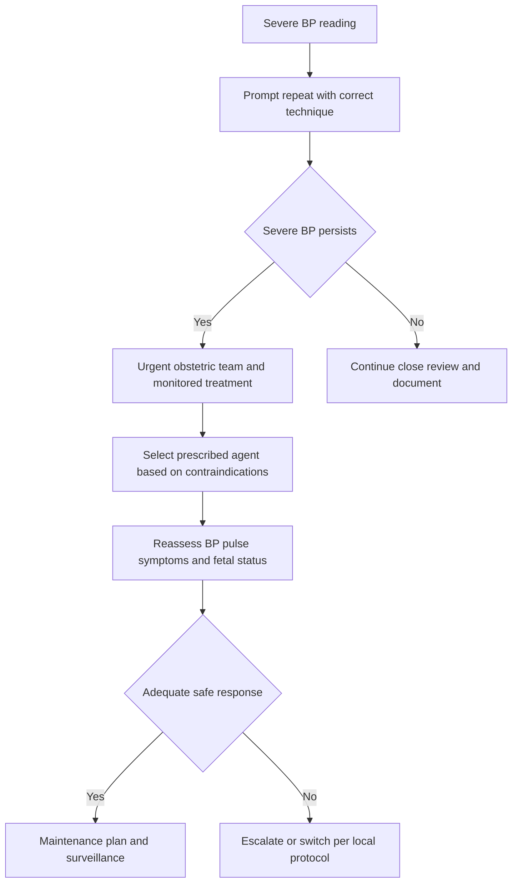
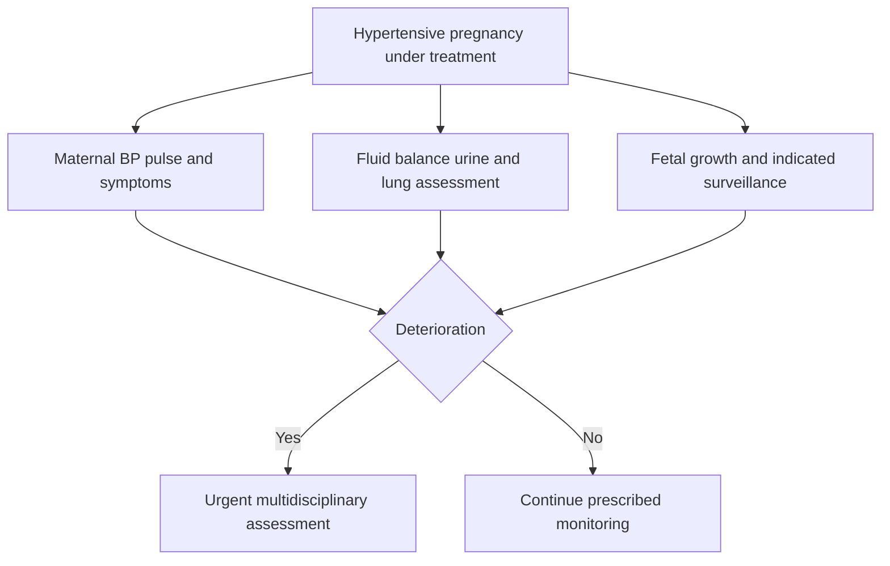

# 08E — Hypertensive treatment and nursing management

**Study-ready draft candidate. Unattempted. Clinical review by an independent reviewer is pending.** Yeh nursing exam preparation hai, individual prescription ya independent dose adjustment ka protocol nahi hai.

[20 original MCQs](../MCQs/08E-Hypertensive-Treatment-and-Nursing-Management-20-MCQs.md) · [Evidence and review register](../Previous-Year-Questions/08E-Hypertensive-Treatment-Evidence.md)

## Treatment ka purpose

Blood pressure woh force hai jo blood vessels ki wall par lagata hai. Jab BP bahut high ho jaata hai, toh maa ke brain, heart aur kidneys ko injury ho sakti hai. Antihypertensive medicine ka kaam BP ko safe range mein lana hai. Lekin pre-eclampsia mein placenta aur blood vessel lining ki problem sirf BP normal hone se khatam nahi hoti. Isliye nurse medicine dene ke baad bhi symptoms, blood tests aur baby ki condition check karti hai.

NICE NG133 mein chronic hypertension ka treatment sustained BP 140 systolic ya 90 diastolic se consider hota hai. Gestational hypertension aur pre-eclampsia mein persistent BP 140/90 se upar ho toh treatment ki recommendation hai. NICE ka routine treatment aim 135/85 mmHg hai. Indian NHM CEmONC 2024 ke specific non-severe pre-eclampsia hospital pathway mein diastolic 100 aur systolic 160 se neeche ka treatment context diya gaya hai, aur target 140–150 systolic aur 90–100 diastolic bataya gaya hai. Dono documents ko ek universal numerical target samajhkar mix mat karo. WHO non-severe hypertension treatment ke saath regular follow-up par zor deta hai.

## Acute severe BP and escalation

Agar systolic BP 160 ya zyada hai, ya diastolic 110 ya zyada hai, toh dono numbers badhne ka wait nahi karte. Severe reading ko correct technique ke saath jaldi repeat karte hain, aam taur par 15 minute ke andar. Persistent severe BP emergency treatment maangta hai. Nurse obstetric emergency team ko alert karti hai, IV access aur assessment prepare karti hai, aur local order ke mutabik medicine deti hai. ACOG-based pathways treatment ko confirmed severe BP ke baad 30–60 minute ke andar shuru karne par zor dete hain. Treatment ke baad BP ko protocol ke interval par repeat karte hain. Dose ko bina recheck ke automatic repeat nahi karte.

Agar sahi interval par prescribed emergency doses dene ke baad bhi BP severe range mein hai aur protocol ki dose limit poori ho gayi hai, toh nurse apne aap extra dose nahi deti hai. ACOG Committee Opinion 767 ke mutabik urgent specialist consultation chahiye taaki next suitable medicine ya intervention decide ho sake. Nurse pehle di gayi medicines ki timing aur response batati hai aur maternal aur indicated fetal monitoring jaari rakhti hai.

## Pregnancy-compatible medicines

| Medicine | Kaise kaam karti hai | Nursing precaution |
|---|---|---|
| Labetalol | Yeh alpha aur beta receptors block karke resistance aur heart rate ko kam kar sakti hai. | Asthma, symptomatic bradycardia, heart block aur decompensated heart failure mein order clarify karo. BP aur pulse monitor karo. |
| Hydralazine | Yeh arterioles ki muscle relax karke vascular resistance kam karti hai. | Hypotension, headache aur reflex tachycardia ke liye reassess karo. |
| Nifedipine | Yeh calcium channel block karke arteries ko relax karti hai. | Acute protocol mein oral immediate-release aur maintenance mein suitable modified-release preparation ka difference samjho. Capsule ko puncture karke sublingual mat do. |
| Methyldopa | Yeh brain se aane wale sympathetic signals kam karti hai. | Slow onset ki wajah se rapid rescue ke liye routine first choice nahi hai. Drowsiness, mood aur liver-related symptoms ko review karo. |

ISSHP aur NHM mein monitored acute options ke roop mein IV labetalol, oral nifedipine aur IV hydralazine milte hain. NHM ki chapter 4 dose schedules aur ISSHP Table 8 ki schedules alag ho sakti hain. Isliye ek institution-approved algorithm use karo, alag guidelines ke doses ko jodkar mat do. Nifedipine aur magnesium sulfate ek saath indicated ho sakte hain, par BP, pulse, breathing aur relevant toxicity monitoring zaroori hai. Magnesium sulfate seizure prevention ya treatment ke liye hota hai, BP medicine ka substitute nahi.

Agar patient ko asthma ke saath bronchospasm hai toh labetalol beta blockade se breathing ko worsen kar sakta hai. Oral nifedipine ya IV hydralazine suitable alternative ho sakti hai, patient aur protocol ke hisaab se. Agar pulse bahut slow hai aur dizziness bhi hai, toh next labetalol dose se pehle urgent review chahiye.

ACE inhibitors aur ARBs pregnancy mein avoid kiye jaate hain, khaaskar later pregnancy mein fetal kidney damage aur low amniotic fluid ka risk hota hai. Agar woman in medicines par pregnant ho jaaye, toh prescribing team ko jaldi inform karke pregnancy-compatible alternative arrange karna chahiye.

## Monitoring and fluid management

Pre-eclampsia mein vessels ki lining damage hone par fluid blood vessel se tissues mein leak kar sakta hai. Isliye swelling dikhne ke bawajood effective circulation kam ho sakti hai. Agar nurse sirf urine kam dekhkar baar-baar fluid bolus de, toh fluid lungs mein jaa sakta hai. NICE severe pre-eclampsia mein maintenance IV fluids 80 mL/hour tak restrict karta hai jab additional ongoing losses na ho. ISSHP labour mein total fluid intake ko aam taur par isi range mein limit karne ki baat karta hai. Actual order mein oral intake, medication carriers, IV fluid aur active blood loss ka context clear hona chahiye. Hemorrhage ya shock mein separate resuscitation plan chahiye.

Example mein total prescribed limit 80 mL/hour hai aur medicine carrier 30 mL/hour chal raha hai. Agar aur intake nahi hai toh crystalloid allowance 50 mL/hour bachta hai. Nurse order verify karti hai aur har input aur output chart karti hai. Yeh arithmetic example universal prescription nahi hai.

Nurse BP aur pulse ke saath consciousness, respiratory rate, oxygen saturation, lung sounds, urine output, symptoms aur indicated labs check karti hai. Agar saans phool rahi hai, saturation gir rahi hai aur crackles aa rahe hain, toh pulmonary oedema ka urgent assessment chahiye. Fetal growth scan, amniotic fluid, indicated Doppler aur CTG ka timing disease category aur clinical status ke mutabik decide hota hai. Normal maternal BP fetal growth problem ko exclude nahi karta.

## Postpartum medicines and breastfeeding

Delivery ke baad BP turant normal hona zaroori nahi hai. Fluid shifts aur disease ke remaining effects se pehle kuch dino mein BP badh sakta hai. NICE methyldopa ko delivery ke do din ke andar stop karke zaroorat par alternative use karne ki salah deta hai. Enalapril postpartum option ho sakta hai, jab kidney function aur potassium monitor kiye jaayein. Nifedipine aur selected beta blockers bhi clinical context mein use ho sakte hain. Breastfeeding ko automatically band karna zaroori nahi hai. Baby premature ho toh medicine effects ke liye extra caution chahiye. Poor feeding, unusual drowsiness, pallor ya cold extremities report karni chahiye.

NICE postpartum untreated gestational hypertension ya pre-eclampsia mein BP 150/100 ya upar hone par treatment start karne ki recommendation deta hai. Severe range BP phir bhi emergency hai. Dose taper ya combination selection clinician ke plan ke mutabik hota hai. ARBs aur diuretics ko breastfeeding mein jahan possible ho avoid karte hain, lekin pulmonary oedema jaise emergency indication ka separate medical treatment ho sakta hai.

Postpartum pre-eclampsia ke treatment mein BP kam hone par dose ka review bhi zaroori hai. NICE ke mutabik BP 140/90 se neeche aaye toh treatment kam karne par vichar karte hain, aur BP 130/80 se neeche ho toh treatment reduce karte hain. Nurse BP trend aur symptoms record karke prescribed adjustment confirm karti hai. Medicine apne aap band nahi karti hai aur BP monitoring continue karti hai.

Agar ek suitable medicine se BP control nahi ho raha hai, toh NICE nifedipine ya amlodipine ke saath enalapril ka combination consider karta hai. Dono medicines alag mechanism se blood pressure kam karti hain. Enalapril ke saath maternal renal function aur serum potassium check karna zaroori hai. Agar mother breastfeeding kar rahi hai, toh infant ki age aur symptoms ko bhi treatment review mein dhyan mein rakhte hain.

Newborn care ke beech baar-baar medicine lena mushkil ho sakta hai. NICE jahan clinically possible ho once-daily antihypertensives prefer karta hai. Nurse mother ki routine samajhkar practical reminders aur written schedule plan kar sakti hai. Missed dose ko double karne ke bajay medicine-specific instructions follow karni chahiye.

## Discharge and follow-up

Pre-eclampsia ke baad NICE community transfer tab consider karta hai jab symptoms na ho, BP 150/100 ya kam ho aur blood test results stable ya improve ho rahe ho. Written plan mein BP monitoring, medicine dose, review date aur urgent contact clear hona chahiye. Day 3–5 BP review aur treatment par rehne wali women ke liye appropriate earlier review plan important hai. Six-to-eight-week visit mein BP, remaining treatment aur future cardiovascular risk discuss karte hain. Severe headache, vision change, upper abdominal pain, breathlessness ya severe BP reading par urgent assessment chahiye, routine appointment ka wait nahi karna chahiye.

## Sources and learning resources

- [ISSHP 2021 sections 6.3–6.4, Table 8](https://www.isshp.org/wp-content/uploads/2023/09/ISSHP-2021-guidelines.pdf)
- [NHM CEmONC 2024, chapter 4 — official PDF directly retrieved](https://nhm.gov.in/pdf/2024/Revised_CEmONC_Curriculum-2024-Part-1.pdf)
- [NICE NG133 recommendations](https://www.nice.org.uk/guidance/ng133/chapter/recommendations) · [NCBI recommendation text, directly retrieved](https://www.ncbi.nlm.nih.gov/books/NBK546004/)
- [ACOG Committee Opinion 767: urgent severe hypertension treatment](https://pubmed.ncbi.nlm.nih.gov/30575639/)
- [WHO non-severe hypertension 2020](https://www.who.int/publications-detail-redirect/9789240008793) · [WHO severe hypertension 2018](https://www.who.int/publications/i/item/9789241550437)
- [Teaching candidate — management of hypertension in pregnancy](https://www.youtube.com/watch?v=XtFVYIuSdos). Search-index description only.
- [Dedicated nursing MCQ candidate — Hypertension in Pregnancy, OSSSC Nursing Officer](https://www.youtube.com/watch?v=B2q_G0Hx4Yw). Search-index description only. Exact playback and question coverage pending.

Diagrams original hain, lekin renderer test abhi pending hai.
