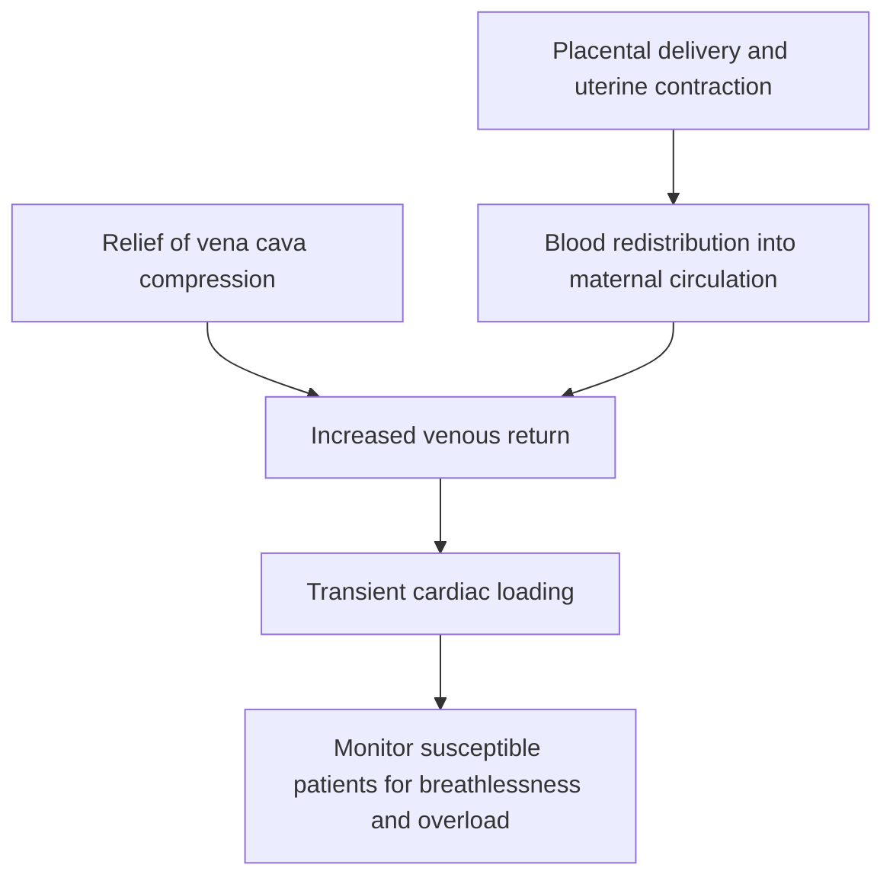

# Maternal Cardiovascular and Hematological Changes During Pregnancy — 30 Original MCQs

**Advance-preparation, unattempted.** Dekho, is bank mein normal maternal circulation aur blood changes ko clinical nursing decisions ke saath practise karenge. Yeh naye original questions hain, official PYQs nahi hain. Named guidelines ka context dhyan se padho.

[Chapter](../README.md) · [Maternal physiology overview MCQs](03-Physiological-Changes-During-Pregnancy-20-MCQs.md) · [Previous Year Questions](../Previous-Year-Questions/Obstetric-and-Midwifery-Nursing-Past-Paper-Research-Register.md)

## Part 1 — Q1–Q5 (Cardiovascular)

### Q1. A healthy pregnant woman at 10 weeks has increased stroke volume compared with her prepregnancy measurements. Which adaptation best contributes to this rise?

**Difficulty:** 🟡 Medium · **Priority:** 🟠 HIGH YIELD · **Evidence:** Original practice · **Exam focus:** NORCET / Staff Nurse / CHO

- **A.** Loss of most circulating blood volume
- **B.** Permanent closure of the aortic valve
- **C.** Increased ventricular filling and circulating blood volume
- **D.** A major reduction in myocardial contractility

✅ Answer aur detailed A–D Hinglish explanation

**Correct: C. Increased ventricular filling and circulating blood volume**

- **A kyun galat hai:** Agar blood volume kaafi kam ho jaaye, toh heart tak blood return kam hota hai. Isse stroke volume gir sakta hai, badhta nahi hai.
- **B kyun galat hai:** Aortic valve left ventricle se blood aorta mein jaane deta hai. Iska permanent closure normal adaptation nahi, balki circulation ke liye dangerous hoga.
- **C kyun sahi hai:** Jab circulating blood volume badhta hai, toh heart ke ventricles mein filling bhi badh sakti hai. Heart har beat mein zyada blood pump kar paata hai. Isi volume ko stroke volume kehte hain, aur early pregnancy mein iska increase cardiac output badhane mein help karta hai.
- **D kyun galat hai:** Contractility heart muscle ki pumping strength hai. Ismein major reduction se effective pumping kam ho sakti hai. Yeh healthy pregnancy mein stroke volume badhne ka expected mechanism nahi hai.

**Exam clue:** Early pregnancy mein increased ventricular filling stroke volume badhane mein help karti hai.

**Clinical reference:** [Physiological changes in pregnancy](https://pmc.ncbi.nlm.nih.gov/articles/PMC4928162/)

**YouTube MCQ practice:** Specific question-solving video verification pending. [NORCET 10 countdown — physiological changes](https://www.youtube.com/watch?v=1rUuZ7EtVFE&t=6290s) ka published chapter marker 01:44:50 hematological aur cardiovascular changes cover karta hai. Yeh topic-level study lead hai, exact MCQ discussion ya playback confirm nahi hua.

### Q2. A healthy woman at 26 weeks asks why her resting pulse is 12 beats/min faster than it was before pregnancy. She has no symptoms and other observations are reassuring. Which interpretation is most appropriate?

**Difficulty:** 🟡 Medium · **Priority:** 🟠 HIGH YIELD · **Evidence:** Original practice · **Exam focus:** NORCET / Staff Nurse / CHO

- **A.** A modest rise can be physiological, but persistent or symptomatic tachycardia needs assessment
- **B.** Every pulse rise proves an arrhythmia requiring cardioversion
- **C.** A healthy pregnancy normally produces profound resting bradycardia
- **D.** The rise proves fetal tachycardia

✅ Answer aur detailed A–D Hinglish explanation

**Correct: A. A modest rise can be physiological, but persistent or symptomatic tachycardia needs assessment**

- **A kyun sahi hai:** Pregnancy mein uterus, placenta aur maternal tissues ko zyada blood chahiye hota hai. Isliye maternal heart rate thoda badh sakta hai. Lekin persistently very fast pulse, chest pain, fainting ya breathing difficulty ho toh nurse ko cause assess karna chahiye.
- **B kyun galat hai:** Har increased pulse abnormal rhythm nahi hota. Cardioversion specific arrhythmias aur clinical conditions mein use hoti hai. Pulse rise alone iska indication nahi hai.
- **C kyun galat hai:** Normal maternal heart rate usually mildly rise karta hai. Profound bradycardia ko routine pregnancy adaptation nahi maana jaata.
- **D kyun galat hai:** Maternal pulse aur fetal heart rate alag measurements hain. Mother ke pulse se baby ki tachycardia establish nahi hoti.

**Exam clue:** Mild maternal pulse rise aur concerning persistent tachycardia ko alag samjho.

**Clinical reference:** [Physiological changes in pregnancy](https://pmc.ncbi.nlm.nih.gov/articles/PMC4928162/)

**YouTube MCQ practice:** Specific question-solving video verification pending. [NORCET 10 countdown — physiological changes](https://www.youtube.com/watch?v=1rUuZ7EtVFE&t=6290s) ka published chapter marker 01:44:50 hematological aur cardiovascular changes cover karta hai. Yeh topic-level study lead hai, exact MCQ discussion ya playback confirm nahi hua.

### Q3. At 24 weeks, a well woman has a newly detected soft ejection systolic murmur and no other concerning findings. Which mechanism can account for a physiological flow murmur?

**Difficulty:** 🟡 Medium · **Priority:** 🟠 HIGH YIELD · **Evidence:** Original practice · **Exam focus:** NORCET / Staff Nurse / CHO

- **A.** Complete interruption of blood flow through the heart
- **B.** Rupture of a heart valve in every pregnancy
- **C.** Severe pulmonary edema by definition
- **D.** Increased blood flow across cardiac valves

✅ Answer aur detailed A–D Hinglish explanation

**Correct: D. Increased blood flow across cardiac valves**

- **A kyun galat hai:** Agar heart ka blood flow completely ruk jaaye, toh effective circulation maintain nahi ho paayegi. Yeh benign flow murmur ka mechanism nahi hai.
- **B kyun galat hai:** Valve rupture serious structural problem hai. Pregnancy ka har systolic murmur rupture ki wajah se nahi hota.
- **C kyun galat hai:** Pulmonary edema mein fluid lungs ke air spaces ya interstitium mein jama ho sakta hai. Murmur alone se pulmonary edema diagnose nahi karte.
- **D kyun sahi hai:** Murmur blood ke turbulent flow se sunai dene wali sound hai. Pregnancy mein circulating volume aur cardiac output badhne se normal valves ke across flow zyada ho sakta hai, isliye soft systolic flow murmur sunai de sakta hai. New murmur ko clinical context mein assess karna phir bhi zaroori hai.

**Exam clue:** High-flow systolic murmur can be physiological, but assess associated symptoms.

**Clinical reference:** [Physiological changes in pregnancy](https://pmc.ncbi.nlm.nih.gov/articles/PMC4928162/)

**YouTube MCQ practice:** Specific question-solving video verification pending. [NORCET 10 countdown — physiological changes](https://www.youtube.com/watch?v=1rUuZ7EtVFE&t=6290s) ka published chapter marker 01:44:50 hematological aur cardiovascular changes cover karta hai. Yeh topic-level study lead hai, exact MCQ discussion ya playback confirm nahi hua.

### Q4. A pregnant woman has a new diastolic murmur on auscultation. Which response is most appropriate?

**Difficulty:** 🔴 Difficult · **Priority:** 🔴 MOST IMPORTANT · **Evidence:** Original practice · **Exam focus:** NORCET / Staff Nurse / CHO

- **A.** Record every diastolic murmur as normal pregnancy physiology
- **B.** Arrange clinical evaluation for possible structural cardiac disease
- **C.** Wait until the next pregnancy without documenting it
- **D.** Treat it as proof of iron deficiency without assessment

✅ Answer aur detailed A–D Hinglish explanation

**Correct: B. Arrange clinical evaluation for possible structural cardiac disease**

- **A kyun galat hai:** Pregnancy-related benign flow murmurs generally systolic hote hain. Diastolic murmur ka assessment zaroori hai.
- **B kyun sahi hai:** Diastole woh phase hai jab ventricles relax hokar fill hote hain. Diastolic murmur ko routine flow-related pregnancy change maan lena safe nahi hai. Nurse finding document kare aur provider se appropriate cardiac evaluation arrange kare.
- **C kyun galat hai:** New potentially important cardiac finding ko ignore karne se disease detection delay ho sakti hai.
- **D kyun galat hai:** Anemia high-flow systolic murmur se associated ho sakti hai, lekin diastolic murmur se iron deficiency prove nahi hoti.

**Exam clue:** Diastolic murmur ko normal pregnancy kehkar dismiss nahi karna chahiye.

**Clinical reference:** [Merck Manual — Physiology of pregnancy](https://www.merckmanuals.com/professional/gynecology-and-obstetrics/approach-to-the-pregnant-woman-and-prenatal-care/physiology-of-pregnancy)

**YouTube MCQ practice:** Specific question-solving video verification pending. [NORCET 10 countdown — physiological changes](https://www.youtube.com/watch?v=1rUuZ7EtVFE&t=6290s) ka published chapter marker 01:44:50 hematological aur cardiovascular changes cover karta hai. Yeh topic-level study lead hai, exact MCQ discussion ya playback confirm nahi hua.

### Q5. During a routine visit at 30 weeks, a stable woman reports mild symmetrical ankle swelling that increases in the evening. Which mechanism may contribute?

**Difficulty:** 🟡 Medium · **Priority:** 🟠 HIGH YIELD · **Evidence:** Original practice · **Exam focus:** NORCET / Staff Nurse / CHO

- **A.** Increased lower-limb venous pressure and fluid retention
- **B.** Complete loss of all maternal plasma volume
- **C.** Sudden arterial occlusion in both legs as the usual mechanism
- **D.** Complete cessation of kidney filtration

✅ Answer aur detailed A–D Hinglish explanation

**Correct: A. Increased lower-limb venous pressure and fluid retention**

- **A kyun sahi hai:** Enlarged uterus pelvic veins par pressure daal sakta hai, jisse legs se heart tak venous return slow ho sakta hai. Pregnancy mein fluid retention bhi hoti hai, toh evening mein dependent ankle swelling ho sakti hai. Sudden swelling, one-sided pain, high BP ya other warning signs ko separately assess karna hai.
- **B kyun galat hai:** Plasma volume normal pregnancy mein generally expand hota hai. Complete loss se severe hypovolemia hogi, routine ankle edema nahi.
- **C kyun galat hai:** Arterial occlusion mein limb ki blood supply compromise ho sakti hai. Pain, coldness aur color change jaise findings urgent assessment maangte hain. Mild symmetrical dependent edema ka expected mechanism nahi hai.
- **D kyun galat hai:** Kidney filtration ka complete stop serious renal failure ka concern hai. Normal pregnancy mein GFR generally increase hota hai.

**Exam clue:** Dependent edema ka mechanism venous pressure aur fluid balance se related hai, but red flags matter.

**Clinical reference:** [Physiological changes in pregnancy](https://pmc.ncbi.nlm.nih.gov/articles/PMC4928162/)

**YouTube MCQ practice:** Specific question-solving video verification pending. [NORCET 10 countdown — physiological changes](https://www.youtube.com/watch?v=1rUuZ7EtVFE&t=6290s) ka published chapter marker 01:44:50 hematological aur cardiovascular changes cover karta hai. Yeh topic-level study lead hai, exact MCQ discussion ya playback confirm nahi hua.

## Part 2 — Q6–Q10 (Cardiovascular)

### Q6. A pregnant woman with a modest physiological fall in vascular resistance feels light-headed briefly when she rises rapidly from a chair. Which explanation and preventive advice fit this presentation when urgent causes have been excluded?

**Difficulty:** 🟡 Medium · **Priority:** 🟠 HIGH YIELD · **Evidence:** Original practice · **Exam focus:** NORCET / Staff Nurse / CHO

- **A.** Transient venous pooling can reduce cerebral perfusion, so rise gradually and report recurrent or severe symptoms
- **B.** Standing immediately always increases venous return without exception
- **C.** Prolonged standing is the only treatment for faintness
- **D.** The symptom confirms a fetal arrhythmia

✅ Answer aur detailed A–D Hinglish explanation

**Correct: A. Transient venous pooling can reduce cerebral perfusion, so rise gradually and report recurrent or severe symptoms**

- **A kyun sahi hai:** Jab woman suddenly khadi hoti hai, toh gravity ki wajah se kuch blood temporarily legs mein pool ho sakta hai. Pregnancy mein vasodilation ke saath yeh venous return aur brain tak blood flow ko briefly reduce kar sakta hai. Dheere se position change karna helpful ho sakta hai. Persistent dizziness, fainting ya other warning signs par clinical assessment zaroori hai.
- **B kyun galat hai:** Standing ke baad gravity blood ko lower body ki taraf shift kar sakti hai. Body normally compensate karti hai, lekin venous return har situation mein instantly increase ho, aisa nahi hai.
- **C kyun galat hai:** Agar dizziness ho rahi hai toh prolonged standing symptoms worsen kar sakti hai aur fall ka risk badha sakti hai. Patient ko safely bithana aur assessment karna better hai.
- **D kyun galat hai:** Maternal light-headedness se fetal rhythm diagnose nahi hota. Mother ki circulation aur possible causes assess karna pehle important hai.

**Exam clue:** Position-related dizziness on standing differs from supine vena cava compression. Recurrent or severe symptoms need assessment.

**Clinical reference:** [Maternal physiological changes](https://pmc.ncbi.nlm.nih.gov/articles/PMC4928162/)

**YouTube MCQ practice:** Specific question-solving video verification pending.

### Q7. During a contraction in active labour, what is meant by maternal autotransfusion?

**Difficulty:** 🟡 Medium · **Priority:** 🟠 HIGH YIELD · **Evidence:** Original practice · **Exam focus:** NORCET / Staff Nurse / CHO

- **A.** Fetal blood is routinely infused into the mother's veins
- **B.** Some blood from the contracting uterine circulation returns to the maternal systemic circulation
- **C.** The mother receives donor blood with every contraction
- **D.** Maternal kidneys stop producing urine to replace blood

✅ Answer aur detailed A–D Hinglish explanation

**Correct: B. Some blood from the contracting uterine circulation returns to the maternal systemic circulation**

- **A kyun galat hai:** Normally fetal aur maternal circulations distinct rehti hain. Autotransfusion ka matlab routine fetal-to-maternal blood infusion nahi hai.
- **B kyun sahi hai:** Jab uterus contract karta hai, toh uterine vessels se kuch blood maternal circulation ki taraf wapas shift hota hai. Is natural redistribution ko autotransfusion kehte hain, aur isse venous return aur cardiac output temporarily badh sakte hain.
- **C kyun galat hai:** Donor blood transfusion alag clinical treatment hai. Labour contractions mein natural blood redistribution hota hai.
- **D kyun galat hai:** Urine formation ka stop autotransfusion ki definition nahi hai. Yeh primarily circulating blood redistribution hai.

**Exam clue:** Autotransfusion mein mother ka apna blood circulation mein redistribute hota hai.

**Clinical reference:** [Physiological changes in pregnancy](https://pmc.ncbi.nlm.nih.gov/articles/PMC4928162/)

**YouTube MCQ practice:** Specific question-solving video verification pending. [NORCET 10 countdown — physiological changes](https://www.youtube.com/watch?v=1rUuZ7EtVFE&t=6290s) ka published chapter marker 01:44:50 hematological aur cardiovascular changes cover karta hai. Yeh topic-level study lead hai, exact MCQ discussion ya playback confirm nahi hua.

### Q8. A woman with known significant cardiac disease has just delivered. Which immediate physiological change particularly warrants close monitoring for fluid overload?

**Difficulty:** 🔴 Difficult · **Priority:** 🔴 MOST IMPORTANT · **Evidence:** Original practice · **Exam focus:** NORCET / Staff Nurse / CHO

- **A.** Permanent disappearance of venous return
- **B.** Abrupt cessation of maternal circulation after placental delivery
- **C.** Guaranteed elimination of pulmonary edema risk
- **D.** Relief of caval compression and return of blood from the contracting uterus

✅ Answer aur detailed A–D Hinglish explanation

**Correct: D. Relief of caval compression and return of blood from the contracting uterus**

- **A kyun galat hai:** Venous return circulation maintain karne ke liye zaroori hai. Delivery ke baad yeh disappear nahi hota, balki transiently badh sakta hai.
- **B kyun galat hai:** Placenta deliver hone ke baad maternal circulation continue rehti hai. Placental circulation ke changes ko complete maternal circulatory stop se confuse nahi karna chahiye.
- **C kyun galat hai:** Immediate postpartum fluid shifts susceptible cardiac patients mein pulmonary edema ka risk badha sakti hain. Isliye risk automatically khatam nahi hota.
- **D kyun sahi hai:** Delivery ke baad uterus chhota aur contract hota hai, aur vena cava par pressure kam hota hai. Isse heart tak blood return badh sakta hai. Cardiac reserve kam ho toh sudden load tolerate karna difficult ho sakta hai, isliye respiratory status aur circulation monitor karna important hai.

**Exam clue:** Immediate postpartum hemodynamic shifts are important in cardiac disease.

**Original visual revision:**

Dekho, delivery ke baad heart par load immediately khatam nahi hota. Isliye cardiac disease wali patient ko close observation chahiye.

**Clinical reference:** [Physiological changes in pregnancy](https://pmc.ncbi.nlm.nih.gov/articles/PMC4928162/)

**YouTube MCQ practice:** Specific question-solving video verification pending. [NORCET 10 countdown — physiological changes](https://www.youtube.com/watch?v=1rUuZ7EtVFE&t=6290s) ka published chapter marker 01:44:50 hematological aur cardiovascular changes cover karta hai. Yeh topic-level study lead hai, exact MCQ discussion ya playback confirm nahi hua.

### Q9. A woman with preeclampsia receives prescribed intravenous fluids. Which physiological feature of pregnancy contributes to concern about pulmonary edema when fluid loading is excessive?

**Difficulty:** 🔴 Difficult · **Priority:** 🔴 MOST IMPORTANT · **Evidence:** Original practice · **Exam focus:** NORCET / Staff Nurse / CHO

- **A.** A permanent rise in plasma protein concentration that prevents all edema
- **B.** Complete absence of pulmonary blood flow
- **C.** Reduced plasma colloid osmotic pressure together with disease-related capillary changes
- **D.** A guarantee that any infused fluid remains inside the uterus

✅ Answer aur detailed A–D Hinglish explanation

**Correct: C. Reduced plasma colloid osmotic pressure together with disease-related capillary changes**

- **A kyun galat hai:** Pregnancy mein plasma proteins dilution ki wajah se kam ho sakte hain. Protein concentration ki permanent rise aur guaranteed protection wala statement correct nahi hai.
- **B kyun galat hai:** Pulmonary circulation normal oxygen exchange ke liye essential hai. Iska complete absence pregnancy adaptation nahi hai.
- **C kyun sahi hai:** Blood proteins, especially albumin, blood vessels ke andar fluid retain karne mein help karte hain. Pregnancy mein colloid osmotic pressure kam ho sakta hai. Preeclampsia mein capillary leakage bhi concern hoti hai, toh excessive fluid se lung edema ka risk badh sakta hai. Nurse prescribed fluid balance aur breathing assess kare.
- **D kyun galat hai:** IV fluid systemic circulation mein jaata hai. Woh uterus mein hi confined nahi rehta.

**Exam clue:** Low oncotic pressure and fluid loading can promote pulmonary edema.

**Clinical reference:** [Physiological changes in pregnancy](https://pmc.ncbi.nlm.nih.gov/articles/PMC4928162/)

**YouTube MCQ practice:** Specific question-solving video verification pending. [NORCET 10 countdown — physiological changes](https://www.youtube.com/watch?v=1rUuZ7EtVFE&t=6290s) ka published chapter marker 01:44:50 hematological aur cardiovascular changes cover karta hai. Yeh topic-level study lead hai, exact MCQ discussion ya playback confirm nahi hua.

### Q10. Two days after delivery, a woman develops new severe breathlessness when lying down and cannot speak comfortably in full sentences. Which nursing response is safest?

**Difficulty:** 🔴 Difficult · **Priority:** 🔴 MOST IMPORTANT · **Evidence:** Original practice · **Exam focus:** NORCET / Staff Nurse / CHO

- **A.** Routine reassurance that all postpartum breathlessness is normal
- **B.** Urgent emergency assessment for cardiopulmonary complications
- **C.** Recommend unrestricted fluid intake and bed rest alone
- **D.** Wait for the six-week postnatal visit

✅ Answer aur detailed A–D Hinglish explanation

**Correct: B. Urgent emergency assessment for cardiopulmonary complications**

- **A kyun galat hai:** Mild breathlessness ka context alag ho sakta hai, lekin severe breathlessness aur speaking difficulty urgent maternal warning signs hain.
- **B kyun sahi hai:** Rest par severe breathlessness aur flat letne par worsening ko orthopnea kehte hain. Postpartum period mein pulmonary edema, cardiomyopathy ya pulmonary embolism jaise causes possible hain. Nurse emergency assessment activate kare aur respiratory status monitor kare.
- **C kyun galat hai:** Bina assessment extra fluids possible overload ko worsen kar sakte hain. Bed rest alone serious cardiopulmonary condition treat nahi karta.
- **D kyun galat hai:** Six-week appointment tak wait karna dangerous delay hoga. Acute respiratory symptoms ko immediately assess karna chahiye.

**Exam clue:** Postpartum orthopnea or severe breathlessness is a red flag.

**Clinical reference:** [CDC — urgent maternal warning signs](https://www.cdc.gov/hearher/maternal-warning-signs/index.html)

**YouTube MCQ practice:** Specific question-solving video verification pending. [NORCET 10 countdown — physiological changes](https://www.youtube.com/watch?v=1rUuZ7EtVFE&t=6290s) ka published chapter marker 01:44:50 hematological aur cardiovascular changes cover karta hai. Yeh topic-level study lead hai, exact MCQ discussion ya playback confirm nahi hua.

## Part 3 — Q11–Q15 (Cardiovascular)

### Q11. A woman asks why systemic blood volume generally expands during twin pregnancy more than during a singleton pregnancy. Which explanation is best?

**Difficulty:** 🟡 Medium · **Priority:** 🟠 HIGH YIELD · **Evidence:** Original practice · **Exam focus:** NORCET / Staff Nurse / CHO

- **A.** Greater fetoplacental demands require additional maternal circulatory adaptation
- **B.** Twins cause complete mixing of fetal and maternal blood
- **C.** Twin pregnancy normally stops red blood cell production
- **D.** Maternal blood volume is unchanged because each fetus supplies its own maternal circulation

✅ Answer aur detailed A–D Hinglish explanation

**Correct: A. Greater fetoplacental demands require additional maternal circulatory adaptation**

- **A kyun sahi hai:** Do fetuses aur unke placental demands ke liye maternal circulation ko additional blood supply support karni pad sakti hai. Isliye twin pregnancy mein total blood volume expansion often greater hoti hai, though exact increase individual hota hai.
- **B kyun galat hai:** Placental exchange ke bawajood maternal aur fetal blood normally separate circulations mein rehte hain. Twins complete blood mixing cause nahi karte.
- **C kyun galat hai:** Maternal red cell mass bhi pregnancy mein badhti hai. Production ruk jaana physiological twin adaptation nahi hai.
- **D kyun galat hai:** Baby ki apni circulation mother ki tissue perfusion replace nahi karti. Maternal heart aur blood volume ko bhi adapt karna padta hai.

**Exam clue:** Multiple pregnancy can increase the demand for maternal volume expansion.

**Clinical reference:** [Merck Manual — Physiology of pregnancy](https://www.merckmanuals.com/professional/gynecology-and-obstetrics/approach-to-the-pregnant-woman-and-prenatal-care/physiology-of-pregnancy)

**YouTube MCQ practice:** Specific question-solving video verification pending. [NORCET 10 countdown — physiological changes](https://www.youtube.com/watch?v=1rUuZ7EtVFE&t=6290s) ka published chapter marker 01:44:50 hematological aur cardiovascular changes cover karta hai. Yeh topic-level study lead hai, exact MCQ discussion ya playback confirm nahi hua.

### Q12. A healthy pregnant woman's cardiac output increases but resting pulmonary arterial pressures do not rise proportionately. Which adaptation helps explain this?

**Difficulty:** 🔴 Difficult · **Priority:** 🔴 MOST IMPORTANT · **Evidence:** Original practice · **Exam focus:** NORCET / Staff Nurse / CHO

- **A.** Complete closure of pulmonary arteries
- **B.** Progressive physiological pulmonary valve obstruction
- **C.** Absence of pulmonary blood flow during pregnancy
- **D.** Reduced pulmonary vascular resistance

✅ Answer aur detailed A–D Hinglish explanation

**Correct: D. Reduced pulmonary vascular resistance**

- **A kyun galat hai:** Pulmonary arteries lungs tak blood le jaati hain. Complete closure oxygen exchange ke liye dangerous hogi, normal adaptation nahi.
- **B kyun galat hai:** Valve obstruction flow resistance badha sakti hai aur pressure changes produce kar sakti hai. Yeh expected healthy pregnancy adaptation nahi hai.
- **C kyun galat hai:** Pulmonary blood flow oxygenation ke liye essential hai. Pregnancy mein iska absence possible normal change nahi hai.
- **D kyun sahi hai:** Pulmonary vascular resistance lungs ki blood vessels mein flow ke against resistance hai. Pregnancy mein yeh kam ho sakta hai, jisse increased cardiac output ko accommodate karne mein help milti hai without a proportionate rise in pressure.

**Exam clue:** Pulmonary vascular resistance normally falls during pregnancy.

**Clinical reference:** [Physiological changes in pregnancy](https://pmc.ncbi.nlm.nih.gov/articles/PMC4928162/)

**YouTube MCQ practice:** Specific question-solving video verification pending. [NORCET 10 countdown — physiological changes](https://www.youtube.com/watch?v=1rUuZ7EtVFE&t=6290s) ka published chapter marker 01:44:50 hematological aur cardiovascular changes cover karta hai. Yeh topic-level study lead hai, exact MCQ discussion ya playback confirm nahi hua.

### Q13. Why can a pregnant woman lose a considerable amount of blood before a fall in blood pressure becomes apparent?

**Difficulty:** 🔴 Difficult · **Priority:** 🔴 MOST IMPORTANT · **Evidence:** Original practice · **Exam focus:** NORCET / Staff Nurse / CHO

- **A.** Pregnancy prevents all clinically important blood loss
- **B.** Expanded circulating volume and compensatory cardiovascular responses can initially mask hemorrhage
- **C.** Blood pressure always falls before any bleeding occurs
- **D.** Maternal heart rate cannot respond to blood loss

✅ Answer aur detailed A–D Hinglish explanation

**Correct: B. Expanded circulating volume and compensatory cardiovascular responses can initially mask hemorrhage**

- **A kyun galat hai:** Pregnancy hemorrhage se protect karne ki guarantee nahi deti. Antepartum aur postpartum bleeding life-threatening ho sakti hai.
- **B kyun sahi hai:** Pregnancy mein circulating volume expand hota hai aur body heart rate aur vessel tone adjust karke BP temporarily maintain kar sakti hai. Isliye normal BP alone severe bleeding exclude nahi karta. Nurse bleeding amount, pulse, mental status, perfusion aur trend assess kare.
- **C kyun galat hai:** BP fall compensation fail hone ke baad appear ho sakta hai. Bleeding pehle bhi significant ho sakti hai.
- **D kyun galat hai:** Heart rate blood loss par rise kar sakta hai, though medicines aur other factors response affect karte hain. Isliye complete clinical assessment important hai.

**Exam clue:** Normal BP does not exclude evolving obstetric hemorrhage.

**Clinical reference:** [Merck Manual — Physiology of pregnancy](https://www.merckmanuals.com/professional/gynecology-and-obstetrics/approach-to-the-pregnant-woman-and-prenatal-care/physiology-of-pregnancy)

**YouTube MCQ practice:** Specific question-solving video verification pending. [NORCET 10 countdown — physiological changes](https://www.youtube.com/watch?v=1rUuZ7EtVFE&t=6290s) ka published chapter marker 01:44:50 hematological aur cardiovascular changes cover karta hai. Yeh topic-level study lead hai, exact MCQ discussion ya playback confirm nahi hua.

### Q14. A woman with a reassuring examination has a bounding peripheral pulse in mid-pregnancy. Which explanation is compatible with normal circulatory adaptation?

**Difficulty:** 🟡 Medium · **Priority:** 🟠 HIGH YIELD · **Evidence:** Original practice · **Exam focus:** NORCET / Staff Nurse / CHO

- **A.** The heart has stopped pumping during diastole permanently
- **B.** All arterial flow is obstructed
- **C.** Higher stroke volume and a hyperdynamic circulation can strengthen the pulse
- **D.** The finding always proves acute aortic valve rupture

✅ Answer aur detailed A–D Hinglish explanation

**Correct: C. Higher stroke volume and a hyperdynamic circulation can strengthen the pulse**

- **A kyun galat hai:** Diastole mein heart fill hota hai, lekin heart ka normal pumping cycle continue rehta hai. Permanent cessation physiological adaptation nahi hai.
- **B kyun galat hai:** Arterial obstruction downstream pulse reduce kar sakti hai, increase nahi.
- **C kyun sahi hai:** Hyperdynamic circulation ka matlab heart zyada blood circulate kar raha hai. Stroke volume badhne aur vascular resistance change hone se peripheral pulse more prominent feel ho sakta hai. Nurse other symptoms aur examination findings ke saath interpret kare.
- **D kyun galat hai:** Bounding pulse pathological conditions mein bhi ho sakta hai, but pregnancy mein physiological high flow possible hai. Finding alone rupture prove nahi karti.

**Exam clue:** A bounding pulse can reflect increased flow, but interpretation depends on the full examination.

**Clinical reference:** [Physiological changes in pregnancy](https://pmc.ncbi.nlm.nih.gov/articles/PMC4928162/)

**YouTube MCQ practice:** Specific question-solving video verification pending. [NORCET 10 countdown — physiological changes](https://www.youtube.com/watch?v=1rUuZ7EtVFE&t=6290s) ka published chapter marker 01:44:50 hematological aur cardiovascular changes cover karta hai. Yeh topic-level study lead hai, exact MCQ discussion ya playback confirm nahi hua.

### Q15. A midwife explains the role of plasma volume expansion in supporting placental perfusion. Which statement best describes its physiological benefit?

**Difficulty:** 🟡 Medium · **Priority:** 🟠 HIGH YIELD · **Evidence:** Original practice · **Exam focus:** NORCET / Staff Nurse / CHO

- **A.** It helps maintain maternal circulating volume as vascular capacity and uteroplacental blood flow increase
- **B.** It eliminates the need for maternal cardiac pumping
- **C.** It closes uterine vessels to prevent placental exchange
- **D.** It makes severe anemia harmless

✅ Answer aur detailed A–D Hinglish explanation

**Correct: A. It helps maintain maternal circulating volume as vascular capacity and uteroplacental blood flow increase**

- **A kyun sahi hai:** Pregnancy mein blood vessels aur uteroplacental circulation ki demands badhti hain. Plasma volume expand hone se effective circulating volume maintain karne mein help milti hai. Isse mother aur placenta ki blood supply support ho sakti hai.
- **B kyun galat hai:** Cardiac pumping ke bina blood tissues tak nahi pahunch paayega. Volume expansion heart ka substitute nahi hai.
- **C kyun galat hai:** Placental exchange ke liye uterine blood supply important hai. Vessels close hona physiological benefit nahi hai.
- **D kyun galat hai:** Severe anemia oxygen-carrying capacity ko compromise karti hai. Plasma expansion usko harmless nahi banati.

**Exam clue:** Volume expansion supports circulation but does not replace adequate oxygen-carrying capacity.

**Clinical reference:** [Merck Manual — Physiology of pregnancy](https://www.merckmanuals.com/professional/gynecology-and-obstetrics/approach-to-the-pregnant-woman-and-prenatal-care/physiology-of-pregnancy)

**YouTube MCQ practice:** Specific question-solving video verification pending. [NORCET 10 countdown — physiological changes](https://www.youtube.com/watch?v=1rUuZ7EtVFE&t=6290s) ka published chapter marker 01:44:50 hematological aur cardiovascular changes cover karta hai. Yeh topic-level study lead hai, exact MCQ discussion ya playback confirm nahi hua.

## Part 4 — Q16–Q20 (Hematological)

### Q16. How does physiological hemodilution during normal pregnancy affect blood viscosity, assuming no additional pathological condition?

**Difficulty:** 🔴 Difficult · **Priority:** 🔴 MOST IMPORTANT · **Evidence:** Original practice · **Exam focus:** NORCET / Staff Nurse / CHO

- **A.** It always makes blood markedly more viscous
- **B.** It has no relationship to blood concentration
- **C.** It tends to decrease blood viscosity
- **D.** It converts plasma into a solid clot

✅ Answer aur detailed A–D Hinglish explanation

**Correct: C. It tends to decrease blood viscosity**

- **A kyun galat hai:** Blood ki red cell concentration kam hone par viscosity generally kam hoti hai. Physiological dilution ko marked increase in viscosity se confuse nahi karna chahiye.
- **B kyun galat hai:** Red cell concentration blood viscosity ko influence karti hai. Isliye plasma expansion aur hematocrit ka relationship clinically relevant hai.
- **C kyun sahi hai:** Viscosity ka matlab fluid ke flow ka resistance hai. Pregnancy mein plasma red cell mass se proportionately zyada expand ho sakta hai, jisse blood ki viscosity kam ho sakti hai. Lekin iska matlab clotting risk zero nahi hai, kyunki coagulation factors aur venous stasis alag mechanisms se VTE risk badhate hain.
- **D kyun galat hai:** Normal circulating plasma liquid hota hai. Hemodilution plasma ko solid clot mein convert nahi karti. Clot formation coagulation activation par depend karti hai.

**Exam clue:** Lower blood viscosity and increased clotting tendency can coexist in pregnancy.

**Clinical reference:** [Maternal physiological changes](https://www.merckmanuals.com/professional/gynecology-and-obstetrics/approach-to-the-pregnant-woman-and-prenatal-care/physiology-of-pregnancy)

**YouTube MCQ practice:** Specific question-solving video verification pending.

### Q17. A pregnant woman has a low hemoglobin result with clearly reduced mean corpuscular volume. Which interpretation is safest?

**Difficulty:** 🔴 Difficult · **Priority:** 🔴 MOST IMPORTANT · **Evidence:** Original practice · **Exam focus:** NORCET / Staff Nurse / CHO

- **A.** Assume physiological dilution always causes severe microcytosis
- **B.** Diagnose vitamin B12 deficiency from low MCV alone
- **C.** Assess for iron deficiency or another cause of microcytosis rather than attributing all findings to dilution
- **D.** Conclude that no further assessment can ever be useful

✅ Answer aur detailed A–D Hinglish explanation

**Correct: C. Assess for iron deficiency or another cause of microcytosis rather than attributing all findings to dilution**

- **A kyun galat hai:** Physiological dilution ka main effect concentration par hota hai. Severe microcytosis ko automatically normal nahi maana chahiye.
- **B kyun galat hai:** Vitamin B12 deficiency typically macrocytosis se associated ho sakti hai. Low MCV alone B12 deficiency establish nahi karta, mixed deficiencies possible hain.
- **C kyun sahi hai:** MCV ek red cell ka average size batata hai. Hemodilution se concentration kam ho sakti hai, lekin marked microcytosis yani small red cells iron deficiency ya thalassemia jaise causes ki taraf point kar sakti hai. Nurse provider se appropriate iron studies aur further assessment arrange kare.
- **D kyun galat hai:** Low Hb aur abnormal indices ka cause jaanana treatment planning ke liye useful hai. Further assessment ko blanket way mein reject nahi karna chahiye.

**Exam clue:** Microcytosis is not adequately explained by simple hemodilution alone.

**Clinical reference:** [Physiological changes in pregnancy](https://pmc.ncbi.nlm.nih.gov/articles/PMC4928162/)

**YouTube MCQ practice:** Specific question-solving video verification pending. [NORCET 10 countdown — physiological changes](https://www.youtube.com/watch?v=1rUuZ7EtVFE&t=6290s) ka published chapter marker 01:44:50 hematological aur cardiovascular changes cover karta hai. Yeh topic-level study lead hai, exact MCQ discussion ya playback confirm nahi hua.

### Q18. A woman with low hemoglobin and low serum ferritin during pregnancy asks what ferritin measures. Which explanation is correct?

**Difficulty:** 🟡 Medium · **Priority:** 🟠 HIGH YIELD · **Evidence:** Original practice · **Exam focus:** NORCET / Staff Nurse / CHO

- **A.** It directly measures fetal cardiac output
- **B.** It reflects stored iron, although inflammation can affect interpretation
- **C.** It is a pregnancy-specific hormone that confirms placental location
- **D.** It measures the number of circulating platelets

✅ Answer aur detailed A–D Hinglish explanation

**Correct: B. It reflects stored iron, although inflammation can affect interpretation**

- **A kyun galat hai:** Fetal cardiac output blood flow measurement se related hai. Maternal ferritin iska direct test nahi hai.
- **B kyun sahi hai:** Ferritin body mein iron store karne wali protein hai. Low serum ferritin depleted iron stores ko support karta hai. Inflammation ferritin ko raise kar sakti hai, isliye result ko history aur blood count ke saath interpret karte hain.
- **C kyun galat hai:** Placental location ultrasound se assess hoti hai. Ferritin pregnancy hormone nahi hai.
- **D kyun galat hai:** Platelets ki number complete blood count mein measure hoti hai. Ferritin stored iron se related marker hai.

**Exam clue:** Ferritin iron stores ko reflect karta hai, not hemoglobin concentration itself.

**Clinical reference:** [FIGO good practice recommendations for anemia in pregnancy](https://doi.org/10.1002/ijgo.70529)

**YouTube MCQ practice:** Specific question-solving video verification pending. [NORCET 10 countdown — physiological changes](https://www.youtube.com/watch?v=1rUuZ7EtVFE&t=6290s) ka published chapter marker 01:44:50 hematological aur cardiovascular changes cover karta hai. Yeh topic-level study lead hai, exact MCQ discussion ya playback confirm nahi hua.

### Q19. Which normal fetal and maternal demands explain the increased iron requirement in pregnancy?

**Difficulty:** 🟡 Medium · **Priority:** 🟠 HIGH YIELD · **Evidence:** Original practice · **Exam focus:** NORCET / Staff Nurse / CHO

- **A.** Cessation of maternal hemoglobin synthesis
- **B.** Loss of fetal demand for oxygen-carrying blood
- **C.** Routine suppression of intestinal absorption to zero
- **D.** Expansion of maternal red cell mass and iron transfer to the fetus and placenta

✅ Answer aur detailed A–D Hinglish explanation

**Correct: D. Expansion of maternal red cell mass and iron transfer to the fetus and placenta**

- **A kyun galat hai:** Hemoglobin synthesis rukna normal pregnancy adaptation nahi hai. New red cells banane ke liye synthesis ongoing rehti hai.
- **B kyun galat hai:** Fetal growth ke liye oxygen transport important hai. Fetal iron need disappear nahi hoti.
- **C kyun galat hai:** Iron absorption zero ho jaaye toh body stores par excessive dependence hogi. Normal pregnancy mein adequate iron intake aur absorption important hain.
- **D kyun sahi hai:** Red cells mein hemoglobin oxygen carry karta hai, aur uske synthesis ke liye iron chahiye. Pregnancy mein maternal red cell mass badhti hai. Placenta aur fetus ko bhi iron chahiye hota hai, isliye maternal iron requirement badh jaati hai.

**Exam clue:** Iron supports maternal erythropoiesis and fetoplacental needs.

**Clinical reference:** [Merck Manual — Physiology of pregnancy](https://www.merckmanuals.com/professional/gynecology-and-obstetrics/approach-to-the-pregnant-woman-and-prenatal-care/physiology-of-pregnancy)

**YouTube MCQ practice:** Specific question-solving video verification pending. [NORCET 10 countdown — physiological changes](https://www.youtube.com/watch?v=1rUuZ7EtVFE&t=6290s) ka published chapter marker 01:44:50 hematological aur cardiovascular changes cover karta hai. Yeh topic-level study lead hai, exact MCQ discussion ya playback confirm nahi hua.

### Q20. A woman in the second trimester has Hb 10.7 g/dL. The local training discussion compares WHO 2024 and FIGO recommendations. Which statement accurately distinguishes the named thresholds?

**Difficulty:** 🔴 Difficult · **Priority:** 🔴 MOST IMPORTANT · **Evidence:** Original practice · **Exam focus:** NORCET / Staff Nurse / CHO

- **A.** WHO 2024 uses 10.5 g/dL for the second trimester, whereas FIGO recommends 11 g/dL in every trimester
- **B.** Both use 8 g/dL as the universal cutoff
- **C.** WHO uses 14 g/dL and FIGO uses 15 g/dL
- **D.** Neither uses hemoglobin for anemia classification

✅ Answer aur detailed A–D Hinglish explanation

**Correct: A. WHO 2024 uses 10.5 g/dL for the second trimester, whereas FIGO recommends 11 g/dL in every trimester**

- **A kyun sahi hai:** WHO 2024 ka second-trimester cutoff 10.5 g/dL hai, jabki FIGO good practice recommendation 11 g/dL sab trimesters ke liye use karti hai. Isliye 10.7 ko classify karne se pehle named guideline aur local protocol identify karo. Clinical symptoms aur iron stores ko ignore nahi karna hai.
- **B kyun galat hai:** 8 g/dL dono guidelines ka universal anemia diagnosis cutoff nahi hai. Itni low value clinically important anemia represent kar sakti hai.
- **C kyun galat hai:** 14 aur 15 g/dL cited pregnancy anemia cutoffs nahi hain. Values ko source aur units ke saath yaad karo.
- **D kyun galat hai:** Dono hemoglobin concentration use karte hain. Cause establish karne ke liye other tests bhi useful ho sakte hain.

**Exam clue:** Cutoff questions mein guideline aur trimester explicitly identify karo.

**Clinical reference:** [FIGO good practice recommendations for anemia in pregnancy](https://doi.org/10.1002/ijgo.70529)

**YouTube MCQ practice:** Specific question-solving video verification pending. [NORCET 10 countdown — physiological changes](https://www.youtube.com/watch?v=1rUuZ7EtVFE&t=6290s) ka published chapter marker 01:44:50 hematological aur cardiovascular changes cover karta hai. Yeh topic-level study lead hai, exact MCQ discussion ya playback confirm nahi hua.

## Part 5 — Q21–Q25 (Hematological)

### Q21. A clinically well woman in active labour has an increased white blood cell count but no fever or localizing symptoms. Which interpretation is appropriate?

**Difficulty:** 🟡 Medium · **Priority:** 🟠 HIGH YIELD · **Evidence:** Original practice · **Exam focus:** NORCET / Staff Nurse / CHO

- **A.** Any leukocytosis automatically confirms sepsis
- **B.** White blood cell counts must fall to zero in labour
- **C.** Physiological leukocytosis is possible, but infection assessment depends on the whole clinical picture
- **D.** A raised white count proves iron deficiency

✅ Answer aur detailed A–D Hinglish explanation

**Correct: C. Physiological leukocytosis is possible, but infection assessment depends on the whole clinical picture**

- **A kyun galat hai:** Sepsis clinical condition hai jisme infection ke saath organ dysfunction ka concern hota hai. Raised WBC alone se sepsis establish nahi hoti.
- **B kyun galat hai:** White cells immune defence mein important hain. Labour mein unka zero ho jaana normal change nahi.
- **C kyun sahi hai:** Labour aur early postpartum period mein stress response ke saath WBC count rise kar sakta hai. Leukocytosis ka matlab white cells ki count badhna hai. Temperature, pulse, uterine tenderness, membranes aur other clinical findings se infection ka suspicion assess karo.
- **D kyun galat hai:** Iron deficiency red cell production aur iron stores se related hai. WBC rise uska diagnostic proof nahi.

**Exam clue:** Labour leukocytosis alone does not establish infection.

**Clinical reference:** [Merck Manual — Physiology of pregnancy](https://www.merckmanuals.com/professional/gynecology-and-obstetrics/approach-to-the-pregnant-woman-and-prenatal-care/physiology-of-pregnancy)

**YouTube MCQ practice:** Specific question-solving video verification pending. [NORCET 10 countdown — physiological changes](https://www.youtube.com/watch?v=1rUuZ7EtVFE&t=6290s) ka published chapter marker 01:44:50 hematological aur cardiovascular changes cover karta hai. Yeh topic-level study lead hai, exact MCQ discussion ya playback confirm nahi hua.

### Q22. Which clotting protein normally rises substantially during pregnancy and helps prepare the body for hemostasis at delivery?

**Difficulty:** 🟡 Medium · **Priority:** 🟠 HIGH YIELD · **Evidence:** Original practice · **Exam focus:** NORCET / Staff Nurse / CHO

- **A.** Fibrinogen
- **B.** Hemoglobin as a coagulation factor
- **C.** Insulin
- **D.** Thyroxine

✅ Answer aur detailed A–D Hinglish explanation

**Correct: A. Fibrinogen**

- **A kyun sahi hai:** Fibrinogen liver mein banne wali clotting protein hai. Jab clotting activate hoti hai, toh fibrinogen fibrin mein convert hoti hai aur clot ka mesh banane mein help karti hai. Pregnancy mein fibrinogen level badh sakta hai, jo delivery ke time hemostasis support karta hai.
- **B kyun galat hai:** Hemoglobin red cells mein oxygen carry karta hai. Yeh fibrin clot banane wala coagulation factor nahi hai.
- **C kyun galat hai:** Insulin blood glucose regulate karta hai. Clotting protein fibrinogen ka role different hai.
- **D kyun galat hai:** Thyroxine metabolism regulate karta hai. Yeh fibrin clot ka precursor nahi hai.

**Exam clue:** Fibrinogen increases as part of pregnancy's hemostatic adaptation.

**Clinical reference:** [Physiological changes in pregnancy](https://pmc.ncbi.nlm.nih.gov/articles/PMC4928162/)

**YouTube MCQ practice:** Specific question-solving video verification pending. [NORCET 10 countdown — physiological changes](https://www.youtube.com/watch?v=1rUuZ7EtVFE&t=6290s) ka published chapter marker 01:44:50 hematological aur cardiovascular changes cover karta hai. Yeh topic-level study lead hai, exact MCQ discussion ya playback confirm nahi hua.

### Q23. A woman with postpartum hemorrhage has ongoing bleeding and a rapidly falling fibrinogen concentration. Why is this trend concerning?

**Difficulty:** 🔴 Difficult · **Priority:** 🔴 MOST IMPORTANT · **Evidence:** Original practice · **Exam focus:** NORCET / Staff Nurse / CHO

- **A.** It proves healthy clot formation regardless of bleeding
- **B.** It may reflect consumption or depletion of clotting substrate in evolving coagulopathy
- **C.** It is expected to fall rapidly in every uncomplicated pregnancy before delivery
- **D.** It measures only the mother's blood group

✅ Answer aur detailed A–D Hinglish explanation

**Correct: B. It may reflect consumption or depletion of clotting substrate in evolving coagulopathy**

- **A kyun galat hai:** Ongoing bleeding ke saath falling fibrinogen adequate clotting guarantee nahi karta. Yeh impaired hemostasis ka warning sign ho sakta hai.
- **B kyun sahi hai:** Fibrinogen fibrin clot banane ke liye important hai. Ongoing severe bleeding mein clotting factors consume ya dilute ho sakte hain. Falling fibrinogen ko clinical bleeding ke saath urgent team ko report karna chahiye aur hemorrhage protocol follow karna chahiye.
- **C kyun galat hai:** Healthy pregnancy mein fibrinogen generally rise karta hai. Rapid fall with hemorrhage ko routine physiological change nahi kehna chahiye.
- **D kyun galat hai:** Blood group red cell antigens se identify hota hai. Fibrinogen coagulation assessment ka part hai.

**Exam clue:** In obstetric bleeding, a falling fibrinogen trend can be clinically important.

**Clinical reference:** [Physiological changes in pregnancy](https://pmc.ncbi.nlm.nih.gov/articles/PMC4928162/)

**YouTube MCQ practice:** Specific question-solving video verification pending. [NORCET 10 countdown — physiological changes](https://www.youtube.com/watch?v=1rUuZ7EtVFE&t=6290s) ka published chapter marker 01:44:50 hematological aur cardiovascular changes cover karta hai. Yeh topic-level study lead hai, exact MCQ discussion ya playback confirm nahi hua.

### Q24. Which change in fibrinolysis contributes to the normal prothrombotic adaptation of pregnancy?

**Difficulty:** 🟡 Medium · **Priority:** 🟠 HIGH YIELD · **Evidence:** Original practice · **Exam focus:** NORCET / Staff Nurse / CHO

- **A.** Complete absence of clot formation
- **B.** Continuous breakdown of every new fibrin clot at an increased rate
- **C.** A permanent disappearance of all coagulation factors
- **D.** Reduced fibrinolytic activity

✅ Answer aur detailed A–D Hinglish explanation

**Correct: D. Reduced fibrinolytic activity**

- **A kyun galat hai:** Clot formation delivery ke time bleeding control mein useful hai. Complete absence serious bleeding tendency produce karega.
- **B kyun galat hai:** Every clot ka accelerated breakdown prothrombotic adaptation ko explain nahi karta. Pregnancy mein fibrinolysis generally reduced hoti hai.
- **C kyun galat hai:** Coagulation factors pregnancy mein kai cases mein rise karte hain. Unka permanent disappearance normal change nahi.
- **D kyun sahi hai:** Fibrinolysis body ka formed fibrin clot break karne ka process hai. Pregnancy mein fibrinolytic activity kam ho sakti hai, isliye clotting balance clot formation aur persistence ki taraf shift hota hai. Is adaptation se thrombosis risk bhi badhta hai.

**Exam clue:** Pregnancy promotes coagulation partly by reducing clot breakdown.

**Clinical reference:** [Physiological changes in pregnancy](https://pmc.ncbi.nlm.nih.gov/articles/PMC4928162/)

**YouTube MCQ practice:** Specific question-solving video verification pending. [NORCET 10 countdown — physiological changes](https://www.youtube.com/watch?v=1rUuZ7EtVFE&t=6290s) ka published chapter marker 01:44:50 hematological aur cardiovascular changes cover karta hai. Yeh topic-level study lead hai, exact MCQ discussion ya playback confirm nahi hua.

### Q25. A woman asks whether normal routine PT and aPTT results rule out the increased physiological clot risk of pregnancy. Which reply is accurate?

**Difficulty:** 🔴 Difficult · **Priority:** 🔴 MOST IMPORTANT · **Evidence:** Original practice · **Exam focus:** NORCET / Staff Nurse / CHO

- **A.** No. Routine clotting times can remain normal despite pregnancy-related hypercoagulability
- **B.** Yes. Normal results guarantee no future thrombosis
- **C.** Yes. PT directly measures all venous blood flow
- **D.** No. Every pregnant woman must have a prolonged aPTT

✅ Answer aur detailed A–D Hinglish explanation

**Correct: A. No. Routine clotting times can remain normal despite pregnancy-related hypercoagulability**

- **A kyun sahi hai:** PT aur aPTT laboratory mein clot banne ke selected pathways ki timing assess karte hain. Normal pregnancy mein fibrinogen aur other clotting factors change ho sakte hain even when routine times remain normal. Normal result future thrombosis exclude nahi karta.
- **B kyun galat hai:** Normal clotting times VTE risk factors, stasis aur clinical symptoms ko replace nahi karte.
- **C kyun galat hai:** PT coagulation timing measure karta hai, venous blood flow directly measure nahi karta.
- **D kyun galat hai:** Healthy pregnancy mein aPTT necessarily prolonged nahi hota. Abnormal result ko individual context mein evaluate karna hota hai.

**Exam clue:** Normal PT/aPTT does not mean absence of VTE risk.

**Clinical reference:** [Physiological changes in pregnancy](https://pmc.ncbi.nlm.nih.gov/articles/PMC4928162/)

**YouTube MCQ practice:** Specific question-solving video verification pending. [NORCET 10 countdown — physiological changes](https://www.youtube.com/watch?v=1rUuZ7EtVFE&t=6290s) ka published chapter marker 01:44:50 hematological aur cardiovascular changes cover karta hai. Yeh topic-level study lead hai, exact MCQ discussion ya playback confirm nahi hua.

## Part 6 — Q26–Q30 (Hematological)

### Q26. A woman with no prior clotting disorder asks why the first weeks after childbirth still deserve attention to venous thromboembolism risk. Which explanation is best?

**Difficulty:** 🟡 Medium · **Priority:** 🟠 HIGH YIELD · **Evidence:** Original practice · **Exam focus:** NORCET / Staff Nurse / CHO

- **A.** Placental delivery instantly abolishes every clotting risk
- **B.** All postpartum women necessarily have a venous clot
- **C.** Prothrombotic changes and other postpartum risk factors may persist after delivery
- **D.** Postpartum clot risk is unrelated to immobility or surgical birth

✅ Answer aur detailed A–D Hinglish explanation

**Correct: C. Prothrombotic changes and other postpartum risk factors may persist after delivery**

- **A kyun galat hai:** Placenta deliver hone se risk instantly zero nahi hota. Postpartum thrombosis risk clinically important hai.
- **B kyun galat hai:** Increased risk ka matlab every woman ko clot ho, aisa nahi hai. Prevention aur monitoring individual risk par depend karte hain.
- **C kyun sahi hai:** Delivery ke baad body immediately prepregnancy state mein nahi aati. Clotting balance kuch time tak prothrombotic reh sakta hai, aur surgery ya immobility jaise factors additional risk badha sakte hain. Isliye symptoms aur individualized risk assessment important hain.
- **D kyun galat hai:** Immobility venous stasis badha sakti hai aur surgical birth tissue injury aur other risk factors se associated hai. Inko risk assessment mein consider kiya jaata hai.

**Exam clue:** VTE risk persists postpartum, so counsel and assess according to protocol.

**Clinical reference:** [Physiological changes in pregnancy](https://pmc.ncbi.nlm.nih.gov/articles/PMC4928162/)

**YouTube MCQ practice:** Specific question-solving video verification pending. [NORCET 10 countdown — physiological changes](https://www.youtube.com/watch?v=1rUuZ7EtVFE&t=6290s) ka published chapter marker 01:44:50 hematological aur cardiovascular changes cover karta hai. Yeh topic-level study lead hai, exact MCQ discussion ya playback confirm nahi hua.

### Q27. Which change in the natural anticoagulant system contributes to pregnancy's physiological shift toward coagulation?

**Difficulty:** 🔴 Difficult · **Priority:** 🔴 MOST IMPORTANT · **Evidence:** Original practice · **Exam focus:** NORCET / Staff Nurse / CHO

- **A.** Complete disappearance of all maternal platelets
- **B.** Reduced protein S concentration or activity
- **C.** A permanent increase in every natural anticoagulant that abolishes clotting
- **D.** A complete absence of circulating fibrinogen

✅ Answer aur detailed A–D Hinglish explanation

**Correct: B. Reduced protein S concentration or activity**

- **A kyun galat hai:** Platelets clot formation mein help karte hain. Unka complete disappearance severe bleeding risk create karega aur normal pregnancy adaptation nahi hai.
- **B kyun sahi hai:** Protein S ek natural anticoagulant cofactor hai. Yeh activated protein C ke saath clotting ko regulate karne mein help karta hai. Pregnancy mein protein S ka level ya activity decrease ho sakti hai, jo increased coagulation tendency mein contribute karti hai. Pregnancy-specific interpretation zaroori hai, kyunki low protein S alone se inherited deficiency confirm nahi hoti.
- **C kyun galat hai:** Natural anticoagulants clotting balance maintain karte hain. Pregnancy mein kuch anticoagulant activity kam hoti hai, na ki har factor permanently increase hokar clotting abolish karta hai.
- **D kyun galat hai:** Fibrinogen generally pregnancy mein badhta hai. Complete absence se clot formation compromise ho sakti hai, aur yeh normal change nahi hai.

**Exam clue:** Protein S may decrease in pregnancy. A pregnancy result alone is not proof of hereditary deficiency.

**Clinical reference:** [Maternal physiological changes](https://pmc.ncbi.nlm.nih.gov/articles/PMC4928162/)

**YouTube MCQ practice:** Specific question-solving video verification pending.

### Q28. According to the NHM Anaemia Mukt Bharat programme overview, what is the routine duration of preventive daily iron-folic acid supplementation after childbirth?

**Difficulty:** 🟡 Medium · **Priority:** 🟠 HIGH YIELD · **Evidence:** Original practice · **Exam focus:** NORCET / Staff Nurse / CHO

- **A.** One day postpartum only
- **B.** 180 days postpartum
- **C.** Only until the placenta is delivered
- **D.** Only after a woman develops severe symptoms

✅ Answer aur detailed A–D Hinglish explanation

**Correct: B. 180 days postpartum**

- **A kyun galat hai:** Ek din postpartum supplementation prescribed programme duration complete nahi karta.
- **B kyun sahi hai:** NHM programme overview preventive IFA pregnancy mein minimum 180 days aur delivery ke baad bhi 180 days continue karne ko batata hai. Maternal iron stores aur recovery support karna iska purpose hai. Anemia treatment regimen individual Hb aur latest programme protocol se decide hota hai.
- **C kyun galat hai:** Placenta deliver hone ke baad bhi mother ko recovery aur iron stores ke liye support chahiye ho sakta hai.
- **D kyun galat hai:** Preventive IFA anemia develop hone ka wait nahi karti. Severe symptoms ho toh treatment aur urgent assessment alag se required ho sakte hain.

**Exam clue:** NHM preventive programme: 180 days postpartum, distinct from treatment dosing.

**Clinical reference:** [NHM — Anaemia Mukt Bharat programme](https://nhm.gov.in/images/pdf/programmes/maternalhealth/guidelines/index1.php?lang=1&level=3&lid=797&sublinkid=1448)

**YouTube MCQ practice:** Specific question-solving video verification pending. [NORCET 10 countdown — physiological changes](https://www.youtube.com/watch?v=1rUuZ7EtVFE&t=6290s) ka published chapter marker 01:44:50 hematological aur cardiovascular changes cover karta hai. Yeh topic-level study lead hai, exact MCQ discussion ya playback confirm nahi hua.

### Q29. A pregnant woman with diagnosed iron-deficiency anemia says she will take her prescribed iron only on days when she feels tired. Which counseling is best?

**Difficulty:** 🟡 Medium · **Priority:** 🟠 HIGH YIELD · **Evidence:** Original practice · **Exam focus:** NORCET / Staff Nurse / CHO

- **A.** Stop supplementation whenever fatigue improves
- **B.** Double every missed dose without professional advice
- **C.** Take iron according to the prescribed schedule and attend follow-up to assess response
- **D.** Use a normal blood pressure reading as proof of anemia correction

✅ Answer aur detailed A–D Hinglish explanation

**Correct: C. Take iron according to the prescribed schedule and attend follow-up to assess response**

- **A kyun galat hai:** Symptoms improve ho sakte hain before iron stores adequately recover. Duration clinician decide karta hai.
- **B kyun galat hai:** Missed dose handling product aur clinical instructions par depend karti hai. Bina advice double dose unnecessary side effects cause kar sakti hai.
- **C kyun sahi hai:** Iron stores rebuild hone aur new red cells banne mein time lagta hai. Sirf fatigue ke basis par doses lena treatment inconsistent bana sakta hai. Nurse prescribed schedule, side effects aur follow-up blood testing samjhaye aur barriers discuss kare.
- **D kyun galat hai:** BP circulatory pressure batata hai, hemoglobin ya iron stores nahi. Normal BP anemia correction prove nahi karta.

**Exam clue:** Adherence and laboratory follow-up help assess treatment response.

**Clinical reference:** [FIGO good practice recommendations for anemia in pregnancy](https://doi.org/10.1002/ijgo.70529)

**YouTube MCQ practice:** Specific question-solving video verification pending. [NORCET 10 countdown — physiological changes](https://www.youtube.com/watch?v=1rUuZ7EtVFE&t=6290s) ka published chapter marker 01:44:50 hematological aur cardiovascular changes cover karta hai. Yeh topic-level study lead hai, exact MCQ discussion ya playback confirm nahi hua.

### Q30. A pregnant patient with low Hb has a dietary history suggesting folate deficiency. Which red cell pattern can support further assessment for folate or vitamin B12 deficiency?

**Difficulty:** 🔴 Difficult · **Priority:** 🔴 MOST IMPORTANT · **Evidence:** Original practice · **Exam focus:** NORCET / Staff Nurse / CHO

- **A.** Macrocytosis, with a raised mean corpuscular volume
- **B.** Low platelet count alone as a specific folate test
- **C.** A normal fetal heart rate as the diagnostic marker
- **D.** A prolonged gestational age measurement

✅ Answer aur detailed A–D Hinglish explanation

**Correct: A. Macrocytosis, with a raised mean corpuscular volume**

- **A kyun sahi hai:** Macrocytosis ka matlab red cells average se bade hote hain. Folate aur B12 DNA synthesis mein role play karte hain, isliye deficiency megaloblastic changes se associated ho sakti hai. Other causes aur mixed deficiencies bhi evaluate karne chahiye.
- **B kyun galat hai:** Platelet count low hone ke multiple causes hain. Is finding alone se folate deficiency confirm nahi hoti.
- **C kyun galat hai:** Fetal heart rate baby ki cardiac activity batata hai, maternal nutrient stores ka diagnostic test nahi hai.
- **D kyun galat hai:** Gestational age pregnancy ki duration batati hai. Isse folate ya B12 deficiency directly diagnose nahi hoti.

**Exam clue:** Raised MCV can suggest macrocytic anemia, but confirm the cause.

**Clinical reference:** [FIGO good practice recommendations for anemia in pregnancy](https://doi.org/10.1002/ijgo.70529)

**YouTube MCQ practice:** Specific question-solving video verification pending. [NORCET 10 countdown — physiological changes](https://www.youtube.com/watch?v=1rUuZ7EtVFE&t=6290s) ka published chapter marker 01:44:50 hematological aur cardiovascular changes cover karta hai. Yeh topic-level study lead hai, exact MCQ discussion ya playback confirm nahi hua.

## Evidence and coverage notes

Merck Manual and pregnancy physiology review were directly retrieved. CDC maternal warning signs, FIGO anemia guidance and NHM programme overview were checked through retrieved/indexed text. The 2026 AMB operational guidelines are listed on the NHM site but the full document was not reviewed. Do not assume the overview supersedes newer local protocols. The video marker is indexed topic evidence only, not item-level MCQ verification. This combined bank adds 15 cardiovascular and 15 hematological questions. Individual-topic targets, full semantic and clinical audit, and Mermaid rendering remain pending.

**Same-run quality correction:** Q6 and Q16 were rewritten before this bank was marked study-ready because their initial learning tasks overlapped earlier ANC warning-sign practice and the HPSSC hemodilution adaptation respectively. Q27 was refocused from gingival changes to a hematological mechanism. No extra question count is claimed. The initial commit remains in Git history. Prior published banks and historical practice files are unchanged.
