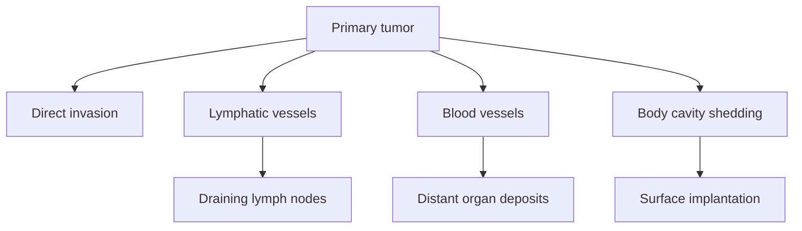

# Cancer Cell Biology — growth, spread and patient education

**Study-ready candidate.** Yeh guide [pehle 20 MCQs](../MCQs/01A-Cancer-Cell-Biology-20-MCQs.md), [supplemental 10](../MCQs/01A-Cancer-Cell-Biology-Supplement-10-MCQs.md) aur [application 10](../MCQs/01A-Cancer-Cell-Biology-Application-10-MCQs.md) ke saath padho. Ab combined 40 original practice questions candidate branch par hain.

## Growth survival and metabolism

**🟠 HIGH YIELD**

Chromosomes ke ends par telomeres hote hain. Yeh protective ends cell division ke dauran chhote ho sakte hain. Telomerase ek enzyme hai jo chromosome ends mein DNA add karta hai. Kai cancer cells mein telomerase activity zyada hoti hai, isliye unki repeated division ki capacity maintain ho sakti hai. Yeh saare cancer mutations ko theek karne wala enzyme nahi hai.

Tumor ko growth ke liye nutrients aur oxygen chahiye. Cancer cells glucose use kar sakti hain, lekin body ki healthy cells bhi glucose use karti hain. Carbohydrates band karne se cancer cure hota hai, iska proof nahi hai. Agar patient ka weight bina koshish ke kam ho raha hai, toh nurse dietary intake, weight trend aur swallowing ya nausea ki problems assess karegi. Oncology dietitian se individualized nutrition plan lena important hai.

Tumor ke kuch regions ko sufficient blood supply nahi mil sakti hai. Oxygen supply kam hone ko local hypoxia kehte hain. Peripheral SpO2 normal hone par bhi tumor ka koi region hypoxic ho sakta hai. Agar tissue mar jaaye, toh use necrosis kehte hain. Hypoxia aur necrosis same finding nahi hain. Tumor ke center mein necrosis hone se poora tumor khatam hua hai, aisa conclusion nahi nikalna chahiye.

[Telomerase — NCI](https://www.cancer.gov/publications/dictionaries/cancer-terms/def/telomerase) · [Cancer myths and nutrition — NCI](https://www.cancer.gov/about-cancer/causes-prevention/risk/myths) · [Hypoxia — NCI](https://www.cancer.gov/publications/dictionaries/cancer-terms/def/hypoxia) · [Necrosis — NCI](https://www.cancer.gov/publications/dictionaries/cancer-terms/def/necrosis)

## Routes of spread

**🔴 MOST IMPORTANT**

Cancer cells nearby tissue mein continuous growth karke invade kar sakti hain. Isse direct extension kehte hain. Doosre routes mein blood vessels, lymphatic vessels aur body cavity mein tumor cells ka shedding aur implantation shamil hain.

| Route | Example aur meaning |
|---|---|
| Hematogenous | Agar renal tumor ki cells vein mein enter karke lung tak pahunchti hain, toh blood-borne spread ka evidence mil sakta hai. |
| Lymphatic | Primary tumor ki cells lymph vessels ke through nodes tak pahunch sakti hain. Sentinel node woh first node ya nodes hain jahan drainage aur spread likely hai. |
| Transcoelomic | Ovarian malignancy ki cells peritoneal cavity mein shed hokar omentum ki surface par implant kar sakti hain. |
| Direct extension | Tumor adjacent tissue mein continuously grow karke invade karta hai. |

Yeh original schematic possible routes dikhata hai. Har tumor in sabhi routes se spread nahi karta hai. Sentinel node identify karne se node positive prove nahi hota. Histopathology aur clinical staging findings ko saath mein interpret karte hain. Cancer-specific staging mein regional aur distant spread ki definitions vary karti hain.

[SEER routes of distant spread](https://training.seer.cancer.gov/ss2k/descriptions/distant.html) · [NCI sentinel node biopsy](https://www.cancer.gov/about-cancer/diagnosis-staging/staging/sentinel-node-biopsy-fact-sheet) · [NCI ovarian cancer treatment](https://www.cancer.gov/types/ovarian/hp/ovarian-epithelial-treatment-pdq)

## Terminology and patient education

**🟠 HIGH YIELD**

Lipoma, osteoma aur adenoma generally benign tumors ke examples hain. Lekin melanoma aur lymphoma malignant hain. Sirf naam ke end mein oma dekhkar nurse ko benign behavior assume nahi karna chahiye. Exact pathology report important hoti hai.

Kuch tumors substances release karte hain ya immune responses trigger karte hain jo body mein doosre organs ka function disturb kar sakte hain. In remote effects ko paraneoplastic syndromes kaha ja sakta hai. Yeh direct pressure ya local invasion se different mechanism hai. Nurse ko abnormal symptoms aur lab findings assess karke timely report karni chahiye.

Cancer ordinary social contact, jaise haath pakadne ya saath baithne, se transmit nahi hota. Kuch transmissible infections cancer risk increase kar sakti hain, lekin cancer aur infection transmission alag concepts hain. Patient ko unnecessary isolation aur stigma se bachana important hai. Nurse standard precautions aur zarurat ke hisaab se infection-specific precautions follow karegi.

[SEER cancer terminology](https://training.seer.cancer.gov/disease/cancer/terms.html) · [NCI paraneoplastic syndrome](https://www.cancer.gov/publications/dictionaries/cancer-terms/def/paraneoplastic-syndrome) · [NCI cancer myths](https://www.cancer.gov/about-cancer/causes-prevention/risk/myths)

## Study resources and gaps

- [Oncology teaching session, AIIMS NORCET 6 preparation](https://www.youtube.com/watch?v=_4qSgC7WOX8). Indexed description mein cancer biology aur classification mentioned hain. Exact playback pending hai.
- [Oncology Cancer Related FAQs PYQs MCQs Class 853](https://www.youtube.com/watch?v=7VfbaCm10Yk). Yeh indexed dedicated practice candidate hai. Exact question coverage, channel verification aur timestamps pending hain.
- [Oncology Nursing MCQs with Answer](https://www.youtube.com/watch?v=HNV8IlEtJfY). Indexed description mein cancer biology, tumor classification aur metastasis mentioned hain. Exact question match verify nahi hua hai.
- [Historical evidence and verification gaps](../Previous-Year-Questions/01A-Cancer-Biology-Evidence-Gaps.md).

[Practice application Q1–10](../MCQs/01A-Cancer-Cell-Biology-Application-10-MCQs.md) · [Chapter](../README.md)
