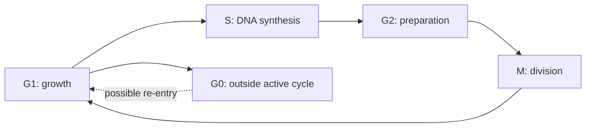

# Cancer Cell Biology — extended theory and clinical application

**Study-ready candidate.** Pehle [20 original questions](../MCQs/01A-Cancer-Cell-Biology-20-MCQs.md) aur [basic theory](01A-Cancer-Cell-Biology.md) padho. Phir [10 supplemental questions](../MCQs/01A-Cancer-Cell-Biology-Supplement-10-MCQs.md) practice karo. Yeh original practice hai, official previous-year questions nahi.

## Metaplasia

**🟠 HIGH YIELD**

Jab tissue ko baar-baar irritation milti hai, toh kabhi-kabhi ek mature cell type ki jagah doosra mature cell type develop hota hai. Is change ko metaplasia kehte hain. Misaal ke liye chronic tobacco smoke exposure mein bronchial lining ki ciliated columnar cells ki jagah squamous-type lining develop ho sakti hai. Cilia normally mucus aur trapped particles ko airway se bahar le jaane mein help karti hain. Lining change hone se yeh protective function affect ho sakta hai.

Metaplasia ko hyperplasia, dysplasia aur carcinoma in situ se alag samjho. Hyperplasia mein cell number badhta hai. Dysplasia mein cells ki appearance aur organisation abnormal ho sakti hai. Carcinoma in situ mein neoplastic epithelial cells boundary ke andar confined hoti hain. Metaplasia alone invasive cancer ka proof nahi hai aur iska progression inevitable nahi hai. Nurse tobacco cessation support aur prescribed follow-up ki importance samjhayegi.

[Clinical reference: SEER Cancer Terms](https://training.seer.cancer.gov/disease/cancer/terms.html) · [Supplement Q1](../MCQs/01A-Cancer-Cell-Biology-Supplement-10-MCQs.md)

## Cell cycle and treatment effects

**🔴 MOST IMPORTANT**

Ek cell ko divide hone se pehle apni genetic information copy karni padti hai. Cell cycle woh process hai jisme cell growth, DNA copying aur division ke stages se guzarti hai. Har cell har waqt divide nahi karti hai.

| Phase | Easy Roman Hinglish explanation |
|---|---|
| G1 | Cell grow karti hai aur DNA copying ke liye zaruri molecules prepare karti hai. |
| S | Cell apna DNA duplicate karti hai, taaki daughter cells ko genetic material mil sake. |
| G2 | DNA copying ke baad cell division ki preparation karti hai. |
| M | Duplicated chromosomes separate hote hain aur cell division complete ho sakti hai. |
| G0 | Cell active division cycle ke bahar hoti hai. Kuch cells dobara cycle mein enter kar sakti hain, jabki doosri cells long-term nondividing reh sakti hain. |

Mitosis mein prophase ke dauran chromosomes condense hote hain. Metaphase mein woh middle plane par align karte hain. Anaphase mein sister chromatids opposite poles ki taraf separate hoti hain. Telophase mein naye nuclei form hone lagte hain. Cytokinesis mein cytoplasm divide hota hai.

Ab clinical link samjho. Kai cytotoxic chemotherapy medicines dividing cells ko damage karti hain. Healthy mouth lining bhi rapidly renew hoti hai. Jab renewal disturb hoti hai, toh mouth sores aur painful swallowing ho sakti hai. Har sore ko metastasis nahi maanenge. Nurse oral cavity, pain, hydration, nutritional intake aur infection signs assess karegi, prescribed oral care follow karegi aur significant symptoms escalate karegi. Drug-specific mechanisms aur dose management chemotherapy section mein separately cover honge.

[SEER Cell Cycle](https://training.seer.cancer.gov/disease/cancer/biology/cycle.html) · [NCI Chemotherapy](https://www.cancer.gov/about-cancer/treatment/types/chemotherapy) · [NCI oral complications](https://www.cancer.gov/about-cancer/treatment/side-effects/mouth-throat/oral-complications-pdq) · [Supplement Q2–5](../MCQs/01A-Cancer-Cell-Biology-Supplement-10-MCQs.md)

## Gene regulation and molecular findings

**🟠 HIGH YIELD**

DNA ki sequence change hona mutation ka ek type hai. Epigenetic change mein gene ki activity change ho sakti hai bina DNA letters badle. Socho ek hi instruction book hai, lekin kuch pages tightly band ho gaye hain aur kuch pages easily readable hain. Cell mein DNA packaging aur chemical marks gene expression ko influence kar sakte hain. Yeh analogy sirf concept samjhane ke liye hai.

Inherited cancer-predisposing variant ka matlab cancer guaranteed hona nahi hai. Risk gene aur individual circumstances ke according change hota hai. Patient ko blame nahi karna chahiye aur false certainty nahi deni chahiye. Confirmed inherited susceptibility mein appropriate genetic counseling aur clinical surveillance discuss karna important hai.

Biomarker cancer ke genes, proteins ya doosri measurable characteristics ke baare mein information de sakta hai. Do patients ki histological diagnosis same hone par bhi unke actionable biomarkers different ho sakte hain. Is wajah se treatment options different ho sakte hain. Biomarker result alone successful treatment guarantee nahi karta. Clinical team cancer type, disease extent, treatment availability aur patient ki overall condition ko saath mein dekhti hai.

[NCI Genetics](https://www.cancer.gov/about-cancer/causes-prevention/genetics) · [NCI Biomarker Testing](https://www.cancer.gov/about-cancer/treatment/types/biomarker-testing-cancer-treatment) · [Supplement Q6–8](../MCQs/01A-Cancer-Cell-Biology-Supplement-10-MCQs.md)

## Residual disease and remission

**🔴 MOST IMPORTANT**

Jab treatment ke baad disease ke signs kam hote hain, toh usse remission kaha ja sakta hai. Complete remission mein currently assessed signs disappear ho jaate hain. Lekin available tests ki detection limit hoti hai. Isliye no detectable disease ka matlab har case mein permanent cure guaranteed nahi hai.

Measurable residual disease, ya MRD, bahut small remaining malignant cell population ko sensitive laboratory methods se identify karne ka concept hai. Yeh particularly blood cancers mein useful ho sakta hai. Har leukemia patient ke liye same test, threshold ya timing apply nahi hoti hai. Nurse report ko independently reinterpret nahi karegi, balki specialist ke plan ke according follow-up support karegi.

Patient ko balanced information do. Achhi response encouraging hai, lekin follow-up visits recurrence aur late treatment effects monitor karne mein important hain. Har negative scan ke baad surveillance band karna sahi nahi hai.

[NCI Prognosis](https://www.cancer.gov/about-cancer/diagnosis-staging/prognosis) · [NCI MRD definition](https://www.cancer.gov/publications/dictionaries/cancer-terms/def/mrd) · [Supplement Q9–10](../MCQs/01A-Cancer-Cell-Biology-Supplement-10-MCQs.md)

## Practice and evidence

[General oncology nursing MCQ video candidate](https://www.youtube.com/watch?v=HNV8IlEtJfY) search index mein oncology quiz ke roop mein mila. Direct video retrieval failed. Channel, exact question coverage, timestamps aur playback verify nahi hue hain. [Cancer biology teaching candidate](https://www.youtube.com/watch?v=82GcOQ_fJ8I) ka indexed title relevant hai, full playback pending hai. In links ko exact PYQ evidence mat samjho.

[Historical evidence and gaps](../Previous-Year-Questions/01A-Cancer-Biology-Evidence-Gaps.md) · [First 20 MCQs](../MCQs/01A-Cancer-Cell-Biology-20-MCQs.md) · [Supplement 10 MCQs](../MCQs/01A-Cancer-Cell-Biology-Supplement-10-MCQs.md) · [Chapter](../README.md)
