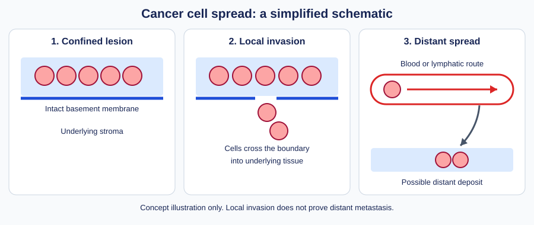

# Cancer Cell Biology — normal growth, malignant behavior and classification

**Study-ready candidate.** Abhi learner ne is topic ko complete nahi kiya hai. Yeh INC Adult Health Nursing II, Unit VIII ka foundation hai.

[Chapter](../README.md) · [20 original MCQs](../MCQs/01A-Cancer-Cell-Biology-20-MCQs.md) · [Historical evidence](../Previous-Year-Questions/01A-Cancer-Biology-Evidence-Gaps.md) · [Mock plan](../Mock-Tests/Oncology-and-Palliative-Care-Mock-Test-Plan.md)

## Is topic mein kya padhenge?

- [Normal growth and genetic control](#normal-growth-and-genetic-control)
- [Invasion, metastasis and tumor survival](#invasion-metastasis-and-tumor-survival)
- [Classification and cell appearance](#classification-and-cell-appearance)
- [Microenvironment and inherited risk](#microenvironment-and-inherited-risk)

## Normal growth and genetic control

**🟠 HIGH YIELD | INC Unit VIII | NORCET-style foundation**

Hamare body ke tissues bahut saari chhoti cells se milkar bante hain. Jab skin par chot lagti hai, toh kuch cells divide karti hain taaki nayi skin ban sake. Jab repair ho jaati hai, toh normal cells ko signals milte hain ki ab extra growth ki zarurat nahi hai. Is tarah body growth aur cell removal ke beech balance maintain karti hai.

Cell ke andar DNA hota hai. DNA ko instructions ki ek kitab samjho, jisme cell ke grow karne aur kaam karne ki information hoti hai. DNA ki instruction mein change ko mutation kehte hain. Har mutation cancer nahi banati hai. Lekin kuch changes cell growth, damage repair aur cell death ke important control ko disturb kar sakte hain. Agar abnormal cells survive karke divide karti rehti hain, toh additional changes accumulate ho sakte hain.

Apoptosis ek controlled process hai jisme cell apne andar death pathway activate karti hai. Agar cell bahut damaged ho jaaye aur uski repair possible na ho, toh apoptosis abnormal cell ko remove karne mein madad kar sakti hai. Cancer cell is process se bach sakti hai. Iska matlab yeh nahi ki har cancer cell immortal hoti hai ya har damaged cell cancer ban jaati hai.

| Genetic control | Simple meaning | Cancer mein kya badal sakta hai? |
|---|---|---|
| Proto-oncogene | Yeh normal cell growth ko signal dene mein madad karta hai. | Kuch activating changes ke baad gene ko oncogene kehte hain. Cell ko growth signal zarurat se zyada mil sakta hai. |
| Tumor suppressor gene | Yeh growth ki brake ya damaged cell ke control ka hissa hota hai. | Iska protective function kam ho jaaye toh abnormal growth par rok kam ho sakti hai. |
| DNA repair gene | Yeh DNA copy karte waqt ya damage ke baad hui galti ko theek karne mein madad karta hai. | Repair kam ho toh additional genetic errors accumulate ho sakte hain. |

Example samjho. Car ka accelerator normal condition mein useful hai. Brake bhi useful hai. Mechanic damage ko identify aur repair karta hai. Accelerator stuck ho jaaye, brake kamzor ho jaaye ya repair system fail ho jaaye, toh risk badhta hai. Cell ki biology mein actual molecular mechanisms is analogy se zyada complex hain, lekin teen genetic control groups ko differentiate karne ke liye yeh useful hai.

**Exam clue:** Agar stem mein growth-promoting gene ki excessive activity ho, toh oncogene socho. Agar growth restrain karne wali protection lost ho, toh tumor suppressor gene socho. DNA copying errors correct na ho rahe hon, toh DNA repair defect socho.

[Practice Q1–5](../MCQs/01A-Cancer-Cell-Biology-20-MCQs.md)

## Invasion, metastasis and tumor survival

**🔴 MOST IMPORTANT | Clinical application**

Neoplasm abnormal growth ke liye use hone wala term hai. Neoplasm benign ya malignant ho sakta hai. Benign tumor distant organs mein metastasize nahi karta. Lekin agar mass brain, spinal cord ya kisi important passage par pressure daale, toh benign hone ke bawajood patient ko serious symptoms ho sakte hain. Nurse ko histology ka label dekhkar new neurological signs, breathing problem ya obstruction ko ignore nahi karna chahiye.

Malignant cells paas ke tissue ki boundary cross kar sakti hain. Isse invasion kehte hain. Epithelium ke neeche ek patli support boundary hoti hai jise basement membrane kehte hain. Jab malignant epithelial cells is boundary ko cross karke stroma, yaani neeche ka supporting tissue, mein ghus jaati hain, toh invasion ka evidence milta hai.

Metastasis mein primary cancer ki cells door ke tissue tak pahunchkar naya malignant deposit bana sakti hain. Blood vessels aur lymphatic vessels is spread ke routes ho sakte hain. Har malignant tumor metastasize nahi karta aur har case ka route ya organ pattern ek jaisa nahi hota. Local invasion aur distant spread alag findings hain.

Diagram mein pehla panel noninvasive epithelial lesion dikhata hai. Doosre panel mein malignant cells boundary cross karti hain. Teesre panel mein ek cell vessel ke through remote tissue tak pahunch sakti hai. Yeh simplified concept diagram hai, har patient mein mandatory sequence ya guaranteed outcome nahi hai.

Agar colorectal cancer ki cells liver mein deposit banaati hain, toh disease ki original identity colorectal cancer hi rehti hai. Nurse documentation mein primary diagnosis aur metastatic site ko confuse nahi karegi. Pathology aur imaging reports se team disease ka extent assess karti hai.

Tumor ko grow karne ke liye oxygen aur nutrients chahiye. Angiogenesis ka matlab naye blood vessels develop hona hai. Tumor ke surrounding signals vessels ki formation ko encourage kar sakte hain. Kuch cancer cells immune attack se bhi bach sakti hain. Ek hi tumor ke andar sab cells exactly same nahi hoti hain. Is difference ko heterogeneity kehte hain. Treatment ke baad kuch less sensitive cells survive kar sakti hain, isliye initial response ka matlab har case mein permanent cure nahi hota.

Nursing care mein report ko samajhna, patient ki symptoms assess karna aur concerning changes timely escalate karna important hai. Agar benign brain tumor wale patient mein sudden confusion ya weakness aaye, toh nurse ko urgent assessment aur local neurological escalation pathway follow karna chahiye. Nurse imaging ya biopsy ka diagnosis khud assume nahi karegi.

[Practice Q6–11](../MCQs/01A-Cancer-Cell-Biology-20-MCQs.md)

## Classification and cell appearance

**🟠 HIGH YIELD | Nursing pathology vocabulary**

Cancer ka naam sirf us organ ke naam se decide nahi hota jahan lump dikhta hai. Cancer kis type ki cell se start hua, yeh bhi important hai.

| Term | Simple explanation |
|---|---|
| Carcinoma | Yeh epithelial cells ki malignancy hai. Epithelium body surface aur internal organs ki lining ya glands mein milta hai. |
| Adenocarcinoma | Yeh glandular epithelial differentiation wali malignancy hai. |
| Sarcoma | Yeh supporting ya mesenchymal tissues, jaise bone ya soft tissue, se arise karne wali malignancy ho sakti hai. |
| Leukemia | Yeh blood-forming tissues ki malignancy hai. Ismein discrete solid lump hona zaruri nahi hai. |
| Lymphoma | Yeh lymphocytes se arise hone wali malignancy hai. |
| Melanoma | Yeh melanocytes, yaani pigment banane wali cells, se arise hone wali malignancy hai. |

Normal tissue mein cells ka arrangement aur maturation organised hota hai. Hyperplasia mein cell number badhta hai. Yeh physiological stimulus se bhi ho sakti hai aur har hyperplasia cancer nahi hoti. Dysplasia mein cells ki appearance aur organisation abnormal ho sakti hai. Iske significance ko organ aur pathology report ke context mein assess karte hain.

Carcinoma in situ mein abnormal neoplastic epithelial cells apni original epithelial boundary mein confined hoti hain. Is sample mein stromal invasion demonstrate nahi hui hoti. Invasive epithelial carcinoma mein malignant cells underlying tissue mein ghus jaati hain. Har dysplastic lesion cancer nahi banta aur har cancer isi sequence se develop nahi hota. In situ result ko ignore nahi karna chahiye. Suitable specialist management aur follow-up important hai.

Differentiation se pata chalta hai ki tumor cells original tissue ki mature cells se kitni milti hain. Poorly differentiated cells aksar normal tissue se kam resemble karti hain. Grade microscopic features aur tumor-specific grading criteria ko describe karta hai. Anatomical stage disease ka extent batata hai. Kuch cancers ki prognostic staging mein grade aur biomarkers bhi include ho sakte hain. Nurse grade aur stage ko interchangeable nahi samjhegi.

[Practice Q12–18](../MCQs/01A-Cancer-Cell-Biology-20-MCQs.md)

## Microenvironment and inherited risk

**🟠 HIGH YIELD | Patient education**

Tumor ke aas-paas sirf malignant cells nahi hoti hain. Fibroblasts supporting tissue banane mein help karte hain, immune cells response deti hain aur vessels blood supply deti hain. In surrounding components aur unke signals ko tumor microenvironment kehte hain. Yeh surrounding environment tumor ke grow karne aur therapy ke response par effect daal sakta hai.

Har cancer genetic changes se related ho sakta hai, lekin har cancer hereditary nahi hota. Genetic changes life ke dauran develop ho sakte hain. Inherited susceptibility tab ho sakti hai jab risk badhane wala genetic variant reproductive cells ke through pass hua ho. Tumor sample mein mutation milne se automatically yeh prove nahi hota ki patient ke children ne mutation inherit kiya hai.

Agar patient family risk ko lekar worried hai, toh nurse family history aur concerns ko respectfully document karegi. Appropriate genetic counseling aur confirmatory testing ke liye clinical team se referral discuss karegi. Patient ko certainty ka false promise nahi dena chahiye.

[Practice Q19–20](../MCQs/01A-Cancer-Cell-Biology-20-MCQs.md)

## Teaching and question-solving resources

| Topic | Teaching resource | MCQ practice resource and status |
|---|---|---|
| Growth regulation, genetic control, invasion, differentiation | [Juf Danielle — Oncology: from Cell to Disease](https://www.youtube.com/watch?v=82GcOQ_fJ8I). Indexed description mein in concepts ka coverage diya gaya hai. | [Oncology Nursing MCQs with Answer](https://www.youtube.com/watch?v=HNV8IlEtJfY). Indexed oncology quiz lead hai. Exact question timestamps aur playback abhi pending hain. |
| Cancer fundamentals and prevention overview | [Concept RNA Nursing Coaching — Oncology One Shot Revision](https://www.youtube.com/watch?v=LRfNzoiQhpU). Indexed description mein benign versus malignant aur carcinogenesis included hain. | [Study With Anam — Oncology Nursing MCQ](https://www.youtube.com/watch?v=28tgWXx-KlU). General oncology quiz candidate hai, exact cell-biology question coverage abhi confirmed nahi hai. |

## Clinical and curriculum references

- [Indian Nursing Council, revised B.Sc Nursing curriculum, Adult Health Nursing II Unit VIII, printed page 323](https://thc.nic.in/Central%20Governmental%20Regulations/Indian%20Nursing%20Council%20%28Revised%20Regulations%20and%20Curriculum%20For%20B.Sc.%28Nursing%29%20%28Program%29%20Regulations%2C2020..pdf)
- [National Cancer Institute — What Is Cancer?](https://www.cancer.gov/about-cancer/understanding/what-is-cancer/)
- [National Cancer Institute — The Genetics of Cancer](https://www.cancer.gov/about-cancer/causes-prevention/genetics)
- [National Cancer Institute — Tumor Grade](https://www.cancer.gov/about-cancer/diagnosis-staging/diagnosis/tumor-grade)
- [National Cancer Institute — Cancer Staging](https://www.cancer.gov/about-cancer/diagnosis-staging/staging)
- [WHO — Cancer](https://www.who.int/news-room/fact-sheets/detail/cancer)

**Next:** Cancer cell biology ko pehle 30–40 distinct original questions tak expand karna hai. Uske baad risk factors, prevention aur screening ko separate meaningful topics mein padhenge. Abhi independent clinical review aur comprehensive semantic audit pending hain.
