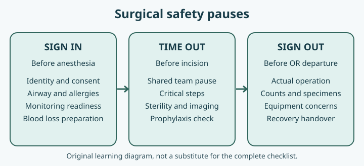

# Surgical Safety Checklist — Perioperative Nursing

Yeh guide advance preparation ke liye hai. Jab patient operation theatre mein aata hai, toh nurse ke paas patient safety ki responsibility hoti hai. Anesthesia aur surgery ki wajah se patient khud apni baat hamesha nahi bata sakta. Isliye surgical team important information ko teen alag safety pauses mein verify karti hai.

## Sign in: anesthesia se pehle

Sign in mein team patient ki identity, planned procedure, consent aur applicable site marking ko confirm karti hai. Anesthesia provider ke saath machine, medicines, oxygenation monitoring aur airway readiness ko verify karna zaroori hai. Agar allergy ya difficult airway ki history mile, toh nurse usse sirf record mein nahi likhti. Woh team ko batati hai, taaki actual anesthesia plan mein concern address ho. Blood loss screen mein adult ke liye 500 mL se zyada aur child ke liye 7 mL/kg se zyada expected loss ko preparation signal maana jata hai. Yeh transfusion prescription nahi hai.

## Time out: incision se pehle

Is pause mein team milkar actual planned operation aur key concerns discuss karti hai. Surgeon expected critical events batata hai, anesthesia provider patient-specific concerns batata hai aur nursing staff instrument readiness aur sterility se judi information share karta hai. Jab prophylaxis indicated aur prescribed ho, toh team drug-specific timing confirm karti hai. Agar imaging procedure ke liye essential hai, toh required images available honi chahiye. Silent tick marking se shared understanding establish nahi hoti.

## Sign out: theatre chhodne se pehle

Operation ke baad team actual procedure, counts, specimen labels, equipment problems aur recovery concerns review karti hai. Count discrepancy ko chhupana nahi chahiye. Nurse immediate team communication aur local retained-item protocol follow karti hai. Specimen ka correct patient aur source label pathology result ko sahi clinical location se jodne mein madad karta hai. Recovery handover mein bleeding jaise important risks aur agreed monitoring plan clear hone chahiye.

## Nursing responsibility

Checklist coordinator aksar circulating nurse hoti hai, lekin team ka koi designated clinician bhi yeh process lead kar sakta hai. Woh individual tasks ko appropriate team members se confirm karti hai. Emergency mein feasible checks complete karna aur unresolved risk team ko batana important hai. Life-saving care ko mechanical checklist rule se delay nahi karna chahiye. Actual situation, local policy aur team decision ko dhyan mein rakha jata hai.

[20 original MCQs](../MCQs/01-Surgical-Safety-Checklist-20-MCQs.md) · [WHO implementation manual](https://www.who.int/publications/i/item/9789241598590) · [OpenStax nursing](https://openstax.org/books/fundamentals-nursing/pages/31-3-intraoperative-phase)
