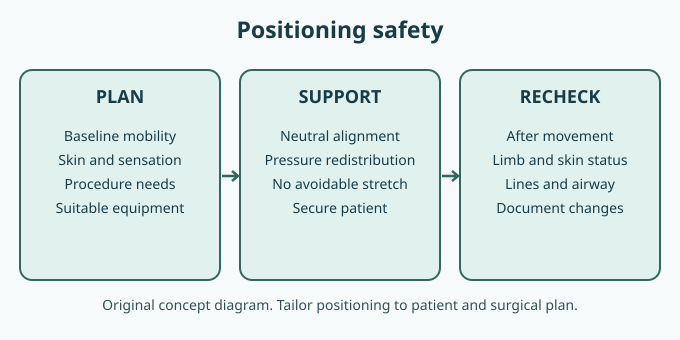

# Intraoperative Positioning and Injury Prevention

Jab anesthesia ke dauran patient move ya discomfort report nahi kar pata, toh surgical team ko uski joints, nerves, skin aur circulation protect karni hoti hai. Position ka purpose surgeon ko access dena hai, lekin safe alignment bhi equally important hai. Preoperative assessment mein mobility limits, previous weakness, sensation aur existing skin problems note karo.

## Position aur pressure

Supine mein patient back par hota hai. Armboard use karte waqt excessive arm abduction aur compression avoid karo. Tucked arm mein neutral alignment, elbow support aur sheet tension check karo. Prone position mein head support aur eye pressure ko assess karo. Lateral position mein upper arm ko unsupported mat chhodo. Trendelenburg mein patient slide kar sakta hai, isliye suitable anti-slide support use karna important hai. Shoulder par direct rigid brace compression se brachial plexus injury ka risk ho sakta hai.

## Pressure injury risk

Long operation, immobility, sensory loss aur previous prolonged pressure exposure risk badha sakte hain. Suitable support surface aur risk-based protection use karo. Darkly pigmented skin mein sirf redness na dikhne par normal assume mat karo. Temperature, swelling, firmness aur pain jaise clues bhi assess karo. Prophylactic dressings useful ho sakti hain, par woh pressure redistribution ko replace nahi karti.

## Reassessment aur handover

Table tilt ya patient repositioning ke baad limbs, supports, lines aur airway-related concerns team ke saath check karo. Drapes ke neeche arm shift ho sakti hai, isliye suspicion ho toh safe coordinated assessment karo. Actual position aur changes document karo. PACU mein new numbness ya weakness ko preoperative baseline se compare karke relevant team ko report karo.

[Practice MCQs](../MCQs/03-Intraoperative-Positioning-and-Injury-Prevention-20-MCQs.md) · [OpenStax 26.2](https://openstax.org/books/medical-surgical-nursing/pages/26-2-intraoperative-considerations) · [AORN positioning update](https://www.aorn.org/article/2022-10-10-Protect-Patients-from-Positioning-Injuries)
