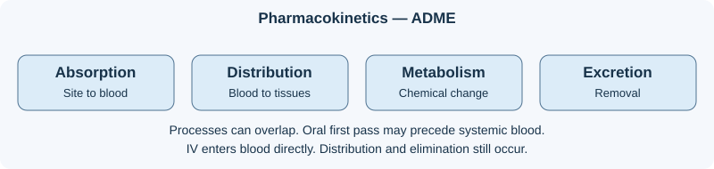

# Pharmacology — Pharmacokinetics foundations

**Study-ready draft, not studied.** Aaj hum samjhenge ki body medicine ko kaise handle karti hai. Isse drug dene ke baad nurse ko effect, monitoring aur safety samajhne mein madad milti hai.

[Chapter](../README.md) · [20 original MCQs](../MCQs/01-Pharmacokinetics-Foundations-20-MCQs.md) · [Reported exam practice](../Previous-Year-Questions/01-Pharmacokinetics-Reported-Evidence.md)

## 1. Body drug ke saath kya karti hai?

Pharmacokinetics ka matlab hai ki medicine body mein enter hone ke baad kahan jaati hai, kaise badalti hai aur kaise bahar nikalti hai. Isko yaad rakhne ke liye ADME use karte hain. Pharmacodynamics alag hai. Woh batati hai ki drug body par kya effect karti hai.

## 2. Absorption aur bioavailability

Absorption mein medicine apni administration site se blood tak pahunchti hai. Jab tablet swallow karte hain, toh drug ko dissolve hona aur intestinal wall cross karna pad sakta hai. Food, formulation, gut function aur local blood flow absorption ko influence kar sakte hain. IV drug blood mein seedhe jaati hai, isliye uski initial systemic bioavailability 100 percent hoti hai.

Bioavailability ka matlab hai di hui dose ka woh fraction jo unchanged drug ke roop mein systemic circulation tak pahunchta hai. Agar 100 mg oral medicine mein se 40 mg unchanged form mein systemic blood tak pahunchti hai, toh bioavailability 40 percent hai. Yeh example calculation samjhane ke liye hai, kisi specific drug ki dose recommendation nahi hai.

Oral medicine intestine se absorb hokar portal blood ke through liver ja sakti hai. Intestinal wall aur liver ke enzymes systemic blood tak pahunchne se pehle drug ka kuch hissa metabolize kar sakte hain. Isko first-pass metabolism kehte hain. Isliye absorption achhi hone par bhi bioavailability kam ho sakti hai. Kuch sublingual products oral mucosa se absorb hote hain aur initial hepatic first pass ko largely bypass karte hain. Swallowed portion ka behavior alag ho sakta hai.

Shock mein muscle perfusion kam ho sakti hai, isliye IM absorption unpredictable ho sakti hai. Nurse route ko khud change nahi karti. Woh prescribed plan urgently clinical team se clarify karti hai.

## 3. Distribution

Blood mein pahunchne ke baad drug tissues tak distribute hoti hai. Albumin ek carrier protein hai jo kuch drugs ko bind karta hai. Free drug tissues aur receptors tak pahunch sakti hai. Albumin kam hone par free fraction badh sakta hai, lekin actual free concentration clearance aur distribution par bhi depend karti hai. Isliye total level ko hamesha free level ke barabar nahi samajhna chahiye.

Apparent volume of distribution ek calculated parameter hai. Yeh body mein drug ki amount aur measured plasma concentration ke relation ko describe karta hai. Bada value suggest kar sakta hai ki drug plasma ke bahar tissues mein zyada distribute hui hai. Yeh actual anatomical fluid volume nahi hota. Brain ki blood-brain barrier kuch drugs ko enter karne se restrict karti hai.

## 4. Metabolism aur excretion

Liver ke enzymes drug ko chemically change kar sakte hain. Is process ko metabolism kehte hain. Har metabolite inactive nahi hota. Kuch prodrugs metabolism ke baad active banti hain. Enzyme inhibition ya liver dysfunction se kuch active drugs ka clearance kam ho sakta hai aur adverse effect ka risk badh sakta hai.

Excretion mein drug ya metabolites body se bahar nikalte hain. Kidney urine ke through kai drugs ko remove karti hai. Bile aur doosre routes bhi drug-specific role play karte hain. Agar kidney function deteriorate ho, toh primarily renally cleared medicines ke liye dose ya interval review ki zaroorat ho sakti hai. Nurse latest renal function, actual order aur drug-specific recommendations check karti hai.

## 5. Half-life, clearance aur monitoring

First-order elimination mein equal time interval mein remaining drug ka equal fraction remove hota hai. Half-life woh time hai jisme concentration half ho jaati hai. Agar concentration 32 mg/L hai aur half-life 6 hours hai, toh 6 hours baad 16, 12 hours baad 8 aur 18 hours baad 4 mg/L bachegi, assuming further dose nahi di gayi aur kinetics stable hai. Zero-order interval mein roughly constant amount per time remove hota hai, isliye is halving rule ko blindly apply nahi karte.

Clearance apparent plasma volume per time hai. Linear kinetics mein half-life roughly 0.693 times volume of distribution divided by clearance hoti hai. Agar volume same ho aur clearance kam ho, toh half-life lamba hota hai. Repeated fixed maintenance doses par stable linear kinetics mein near steady state usually chaar se paanch half-lives mein aata hai. Loading dose target concentration jaldi approach karne ke liye di ja sakti hai. Har drug ke liye loading dose appropriate nahi hoti.

Kuch drugs mein therapeutic drug monitoring zaroori hoti hai. Trough sample usually next dose se just pehle drug-specific protocol ke hisaab se liya jaata hai. Nurse actual dose time aur sample time document karti hai. Agar patient dose ke baad vomit kare ya modified-release tablet swallow na kar paaye, toh nurse formulation aur specific instructions check karke team se clarification leti hai. Automatic redosing ya crushing safe nahi maana jaata.

## Videos and evidence

- Teaching lead: [Level Up RN — Pharmacokinetics ADME](https://www.youtube.com/watch?v=HhlT8RJaQEY). Indexed title and channel only, playback pending.
- Dedicated practice lead: [Foundations of Pharmacology MCQs](https://www.youtube.com/watch?v=wwytgeHKVAQ). Indexed description includes pharmacokinetics and ADME. Exact item mapping, channel verification and playback pending.
- Historical source is separate. [Reported RRB item](../Previous-Year-Questions/01-Pharmacokinetics-Reported-Evidence.md).

## Clinical references

- [OpenStax Pharmacology for Nurses, 2.2](https://openstax.org/books/pharmacology/pages/2-2-pharmacokinetics-and-pharmacodynamics) — opened text.
- [Open RN Nursing Pharmacology, Chapter 1](https://www.ncbi.nlm.nih.gov/books/NBK595006/) — opened text.
- [MSD Manual pharmacokinetic parameters](https://www.msdmanuals.com/professional/multimedia/table/formulas-defining-basic-pharmacokinetic-parameters) — indexed formula evidence, direct review pending.
- [INC 2020 curriculum copy](https://abmamcon.com/wp-content/uploads/2025/06/Indian-Nursing-Council-Revised-Regulations-and-Curriculum-For-B.Sc_.Nursing-Program-Regulations2020.pdf) — extracted Unit I text, visual verification pending.
