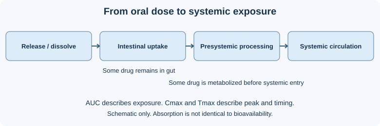

# Pharmacology — Absorption and bioavailability

**Study-ready candidate, not studied.** Jab nurse medicine administer karti hai, toh uska effect sirf dose par depend nahi karta. Medicine ko body mein kis raaste se diya gaya, uski formulation kya hai aur patient ki condition kaisi hai, yeh sab matter karte hain.

[Chapter](../README.md) · [20 original MCQs](../MCQs/02-Absorption-and-Bioavailability-20-MCQs.md) · [Evidence](../Previous-Year-Questions/02-Absorption-and-Bioavailability-Evidence.md)

## Absorption ka mechanism

Absorption ka matlab hai administration site se systemic blood ki taraf drug ka movement. Oral tablet ko pehle release aur dissolve hona pad sakta hai. Uske baad dissolved medicine intestine ki epithelial barrier ko cross karti hai. Passive diffusion mein molecules concentration gradient ke along move karte hain. Carrier-mediated transport mein proteins drug movement mein help kar sakte hain. Kuch efflux transporters drug ko cell se wapas gut lumen ki taraf bhejte hain.

Chhoti aant ka surface area bahut bada hota hai. Isi wajah se kai oral drugs ka major absorption yahin hota hai. Stomach ka pH weak acid aur weak base ki ionization ko influence karta hai, lekin pH se alone major absorption site decide nahi kar sakte. Drug solubility, formulation, mucosal surface, local perfusion, transit aur transporters bhi matter karte hain.

Gastric emptying slow ho jaaye toh medicine ko intestine tak pahunchne mein der ho sakti hai. Peak concentration ka time badal sakta hai, par total absorbed amount necessarily change nahi hota. Bowel resection ke baad kuch medicines ki uptake unpredictable ho sakti hai. Nurse response assess karti hai aur formulation aur dose plan review karwati hai.

## Bioavailability aur concentration-time graph

Bioavailability dose ka woh fraction hai jo unchanged form mein systemic circulation tak pahunchta hai. Absorption aur bioavailability related hain, lekin identical nahi hain. Drug intestinal wall cross karne ke baad presystemic metabolism mein lose ho sakti hai. IV route initial systemic bioavailability ka reference hai.

AUC yani area under the concentration-time curve, measured exposure ko represent karta hai. Cmax peak concentration hai aur Tmax peak tak pahunchne ka time hai. Clinical effect peak se pehle start ho sakta hai. Same AUC ka matlab identical peak ya onset nahi hota.

Absolute oral bioavailability ko comparable linear conditions mein dose-normalized oral AUC ko dose-normalized IV AUC se divide karke estimate kar sakte hain. Example mein oral 200 mg se AUC 40 mg·h/L aur IV 100 mg se AUC 50 mg·h/L milti hai. Oral ratio 0.2 aur IV ratio 0.5 hai. Inko divide karke 100 se multiply karne par 40 percent milta hai. Yeh educational example hai, kisi medicine ko prescribe karne ke liye nahi hai.

## Formulation aur route ki nursing safety

Enteric coating drug release ko stomach se aage delay karne ke liye designed hoti hai. Modified-release products bhi release speed change karte hain, lekin dono terms ka meaning same nahi hai. Feeding tube mein medicine dene se pehle formulation, tube position, feed timing aur compatibility verify karni chahiye. Nurse pharmacist aur local protocol ki help leti hai.

Topical aur inhaled products ka purpose local effect ho sakta hai, lekin systemic absorption possible hai. Skin condition, formulation aur application area affect kar sakte hain. Fentanyl patch ki application site par external heat avoid karna chahiye kyunki product label increased absorption aur serious overdose ke risk ke baare mein warn karta hai. Actual care prescribed instructions ke hisaab se hoti hai.

Conventional insulin preparation ko swallow karne se reliable systemic delivery nahi milti. Digestive degradation aur limited epithelial uptake iske important reasons hain. Route independently change nahi karna chahiye.

## Food and medicine interaction

Har drug par food ka same effect nahi hota. Kuch medicines food ke saath better absorb hoti hain aur kuch ki exposure kam ho sakti hai. Fexofenadine fruit juices ke saath lene par intestinal uptake kam ho sakti hai, isliye label paani ke saath lene ko kehta hai. Levothyroxine tablet aur calcium ya iron jaise interfering agents ke beech product labeling ke mutabik kam se kam chaar ghante ka gap rakha jaata hai. Patient ki complete medication list review karna helpful hai.

## Videos

- Teaching: [Nursing School Explained — Pharmacokinetics: Absorption](https://www.youtube.com/watch?v=tNm1fpb3T7A). Indexed channel and description checked, playback pending.
- Topic practice lead: [Bioavailability and Bioequivalence MCQs](https://www.youtube.com/watch?v=jJR1WLxXOAA). Indexed title checked, pharmacy-level scope, channel and exact question coverage pending. Specific nursing MCQ sources for other items remain open.

## Clinical and curriculum sources

- [MSD Manual — Drug Absorption](https://www.msdmanuals.com/professional/clinical-pharmacology/pharmacokinetics/drug-absorption) — opened text, general mechanisms.
- [Open RN — Pharmacokinetics and Pharmacodynamics](https://ncbi.nlm.nih.gov/sites/books/NBK595006/) — indexed nursing text.
- [MSD Manual — Bioavailability](https://www.msdmanuals.com/professional/clinical-pharmacology/pharmacokinetics/drug-bioavailability) — indexed text, direct retrieval pending.
- [FDA — Grapefruit and medicines](https://www.fda.gov/consumers/consumer-updates/grapefruit-juice-and-some-drugs-dont-mix) and [DailyMed fexofenadine label](https://dailymed.nlm.nih.gov/dailymed/drugInfo.cfm?setid=e5a207e4-472b-4bf9-8cd3-a018ef3a82bb) — opened text, Q5.
- [DailyMed levothyroxine label](https://dailymed.nlm.nih.gov/dailymed/drugInfo.cfm?setid=c7d5b71b-e983-4b1a-bfc2-d2343cf8668c) — indexed label, Q6.
- [DailyMed fentanyl patch label](https://dailymed.nlm.nih.gov/dailymed/drugInfo.cfm?setid=bf02ffd0-cc5d-446b-b648-378f6885052f) — indexed label, Q11.
- [INC curriculum Gazette copy, printed page 298](https://abmamcon.com/wp-content/uploads/2025/06/Indian-Nursing-Council-Revised-Regulations-and-Curriculum-For-B.Sc_.Nursing-Program-Regulations2020.pdf) — Unit I text retrieved, screenshot failed.

Clinical examples are for study. Actual medication care follows the applicable prescription, product labeling, local protocol and clinical review.
