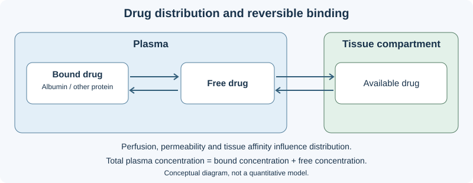

# Pharmacology — Drug distribution and protein binding

**Study-ready candidate, not studied.** Jab medicine blood mein aa jaati hai, toh uska kaam sirf circulation mein rehna nahi hota. Aaj hum dekhenge ki drug blood se tissues tak kaise pahunchti hai aur nurse plasma drug level ko samajhte waqt kya check karti hai.

[Chapter](../README.md) · [20 original MCQs](../MCQs/03-Drug-Distribution-and-Protein-Binding-20-MCQs.md) · [Evidence](../Previous-Year-Questions/03-Drug-Distribution-and-Protein-Binding-Evidence.md)

## Distribution ka meaning aur blood flow

Distribution ka matlab hai blood aur tissues ke beech drug ka movement. Socho blood circulation ek delivery network hai. Jahan blood supply zyada hai, wahan drug jaldi pahunch sakti hai, agar us tissue ki barrier ko cross karna possible ho. Brain, liver aur kidneys mein blood supply rich hoti hai. Resting muscle aur fat tak delivery slower ho sakti hai. Lekin brain ki capillary barrier bahut selective hai. Isliye rich blood supply ka matlab har medicine brain tak easily pahunch jaayegi nahi hai.

Drug pehle capillary se interstitial fluid yani cells ke bahar wale fluid tak pahunch sakti hai. Cell membrane ko cross karna ek separate step hai. Drug ki lipid solubility, size, ionization, tissue affinity aur specific transport proteins decide kar sakte hain ki drug kitni andar jaati hai. Agar patient ke tissue ka blood flow kam hai, toh perfusion-limited medicine ki local delivery slow ho sakti hai.

## Plasma protein binding

Blood ke plasma mein kuch carrier proteins hote hain. Albumin kai acidic drugs ko bind kar sakta hai. Alpha-1 acid glycoprotein kai basic drugs ke binding mein role play karta hai. Binding reversible hoti hai. Free drug generally passive diffusion ke liye available hoti hai, jabki bound drug free fraction ko replenish kar sakti hai. Yeh transport aur elimination ka dynamic balance hai.

Agar total level 20 mg/L hai aur 75 percent bound hai, toh 25 percent free hai. 20 times 0.25 se 5 mg/L free concentration milti hai. Yeh sirf us time ke sample ka calculation hai. Actual later concentration dose, distribution aur clearance se change ho sakti hai.

Low albumin mein free fraction badh sakta hai. Inflammation ke dauraan alpha-1 acid glycoprotein badh sakta hai, jiski wajah se kuch basic drugs ka free fraction same total concentration par kam ho sakta hai. Jab binding sites saturation ke paas pahunchti hain, toh drug concentration badhne ke saath proportionally zyada drug free form mein reh sakti hai.

Drug displacement ko dekhkar har case mein permanent toxicity assume nahi karni chahiye. Free fraction initially badh sakta hai, lekin redistribution aur clearance us exposure ko change kar sakte hain. High-risk drugs ke liye nurse clinical assessment aur drug-specific monitoring plan follow karti hai.

## Apparent volume of distribution (Vd)

Vd ek calculated parameter hai. Yeh body mein drug ki amount ko measured plasma concentration ke relation mein batata hai. Iska formula hai:

`Vd (L) = amount of drug in body (mg) / plasma concentration (mg/L)`

Agar body mein 240 mg drug hai aur plasma level 6 mg/L hai, toh 240/6 se 40 L aata hai. Yeh actual anatomical volume nahi hai. Drug ka plasma level low ho sakta hai kyunki drug tissues mein distribute hui hai. Isliye Vd body ke real fluid volume se bada bhi ho sakta hai.

Critical illness mein extracellular fluid resuscitation aur capillary leak se badh sakta hai. Water-soluble drugs ke liye apparent distribution volume badhne se early plasma exposure kam ho sakti hai. Nurse fluid balance, updated clinical condition aur prescribed monitoring ko team ke saath review karti hai. Obesity aur infancy mein body composition ka effect drug-specific hota hai. Har medication par ek hi weight-based formula apply nahi karte.

## Redistribution aur tissue stores

Thiopental jaise lipid-soluble anesthetic ki single IV dose brain tak jaldi pahunch sakti hai. Uska initial effect brain se drug ke doosre tissues tak redistribute hone se khatam ho sakta hai. Is waqt drug body se poori tarah eliminate hona zaroori nahi hai. Repeated exposure ke baad fat stores drug ko dheere dheere release kar sakte hain. Isliye early recovery aur complete elimination alag cheezein hain.

## Nursing application: free phenytoin, dialysis and pregnancy

Phenytoin ek antiseizure medicine hai. Renal disease, hepatic disease ya low albumin mein free fraction change ho sakta hai. Agar patient ko gait unsteadiness ya nystagmus jaise new symptoms develop hon, toh total level ko akela dekhkar toxicity dismiss nahi karni chahiye. Nurse neurological assessment karti hai aur urgent clinical review ke saath free phenytoin monitoring discuss karti hai. Dose apne aap double ya permanently discontinue nahi karwati.

Dialysis ke through drug removal kai factors par depend karta hai. Small molecule, lower protein binding aur smaller apparent Vd generally blood se removal favor kar sakte hain, lekin actual dialyzer, flow, drug aur patient-specific protocol bhi matter karte hain. Yeh principle dose adjustment ka automatic rule nahi hai.

Placenta har medicine ko completely block nahi karta. Drug ki size, binding, permeability aur transport mechanisms fetal exposure influence karte hain. Pregnancy mein prescribed medication ko independently stop karne ke bajay maternal benefit aur fetal risk clinical team ke saath review karna chahiye.

## Sampling and safety

Drug level collect karte waqt actual dose time, infusion time aur sample time document karna important hai. Kuch drugs ka level distribution ke baad collect karna hota hai. Agar sample too early liya gaya ho, toh plasma result misleading ho sakta hai. Nurse protocol ke according repeat sampling ya interpretation clarify karti hai.

Tacrolimus ki monitoring mein sample type bhi important hai. Yeh medicine blood cells ke saath extensively associate ho sakti hai, isliye prescribed whole-blood trough aur plasma concentration interchangeable nahi hain. Nurse laboratory instructions aur actual dose timing follow karti hai.

- [DailyMed tacrolimus capsule label](https://dailymed.nlm.nih.gov/dailymed/drugInfo.cfm?setid=393cd10e-133c-4d6b-b024-270eb82edbb3) — indexed labeling supports whole-blood trough monitoring and blood/plasma partitioning. Direct text review pending.

## Videos and revision

- Teaching lead: [Pharmacokinetics — Drug Distribution](https://www.youtube.com/watch?v=gD9LiXpq0Tk), indexed chapters list protein binding at 08:00 and volume of distribution at 17:05. These are topic markers, not verified question timestamps. Channel and playback pending.
- Practice lead: [Physics Wallah RRB Pharmacist distribution, binding and metabolism MCQ session](https://www.youtube.com/watch?v=AKpyMguaUAw), indexed description, direct opening failed. Nursing-specific item coverage and playback pending.
- [Solve the 20 original practice questions](../MCQs/03-Drug-Distribution-and-Protein-Binding-20-MCQs.md). Pehle khud option choose karo, phir har option ki explanation padho.

## Clinical and syllabus references

- [MSD Manual — Drug Distribution to Tissues](https://www.msdmanuals.com/professional/clinical-pharmacology/pharmacokinetics/drug-distribution-to-tissues). Opened text. Q1–5, Q7, Q9–10, Q13–14.
- [FDA DILANTIN 2021 label, sections 2.3, 2.5, 5.11 and 10](https://www.accessdata.fda.gov/drugsatfda_docs/label/2021/084349s087lbl.pdf). Opened text and page 4 image. [DailyMed phenytoin current listing lead](https://dailymed.nlm.nih.gov/dailymed/drugInfo.cfm?setid=e33ce05d-9c60-4ede-8b13-e8c41a3de25d), indexed text corroborates unbound monitoring, direct opening failed. Q6, Q15, Q17.
- [Pharmacokinetics in sepsis](https://pmc.ncbi.nlm.nih.gov/articles/PMC7807908/) and [2026 antimicrobial special populations review](https://pmc.ncbi.nlm.nih.gov/articles/PMC12996921/). Indexed abstracts/excerpts, Q4 and Q8, no independent full-text audit.
- [Placental drug transport review](https://pmc.ncbi.nlm.nih.gov/articles/PMC10388746/). Indexed excerpt, Q11.
- [Clinical pharmacokinetics and dialysis](https://www.ashp.org/-/media/store-files/p5365-sample-chapter.ashx) and [CRRT pharmacokinetic principles](https://pubmed.ncbi.nlm.nih.gov/10560800/). Indexed excerpts, Q12. Modality and drug-specific recommendations remain essential.
- [Drug displacement and protein binding](https://pubmed.ncbi.nlm.nih.gov/6705425/) and [clinical significance of Vd](https://www.ncbi.nlm.nih.gov/books/NBK545280/). Indexed abstracts/excerpts, Q15–16.
- [INC 2020 regulations, Pharmacology I Unit I](https://thc.nic.in/Central%20Governmental%20Regulations/Indian%20Nursing%20Council%20%28Revised%20Regulations%20and%20Curriculum%20For%20B.Sc.%28Nursing%29%20%28Program%29%20Regulations%2C2020..pdf). Retrieved syllabus text explicitly includes distribution. PDF screenshot failed. Clinical scenarios are nursing application/enrichment, not claims of exact historical exam depth.

Clinical care follows drug-specific labeling, local policy and clinical orders. These questions are educational practice, not patient-specific prescribing instructions.
