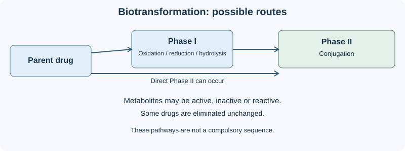

# Pharmacology — Drug metabolism

**Study-ready candidate, not studied.** Aaj hum dekhenge ki body medicine ko chemically kaise change karti hai aur nurse ko interactions aur toxicity ko samajhne mein is knowledge ki kyun zaroorat hoti hai.

[Chapter](../README.md) · [20 original MCQs](../MCQs/04-Drug-Metabolism-20-MCQs.md) · [Reported examination practice](../Previous-Year-Questions/04-Drug-Metabolism-Reported-Evidence.md)

## Metabolism kya hota hai?

Drug metabolism ya biotransformation ka matlab hai enzymes medicine ke chemical structure ko change karte hain. Liver major site hai, lekin intestine aur other tissues bhi contribute kar sakte hain. Metabolism ka result inactive, active ya kabhi reactive metabolite ho sakta hai. Metabolite woh naya compound hai jo original drug ke chemical change se banta hai. Isliye metabolism ko sirf drug ka effect band karne wala process samajhna galat hai.

## Phase I aur Phase II

Phase I mein oxidation, reduction aur hydrolysis jaise reactions hoti hain. Oxidation mein molecule ka oxidation state change hota hai, reduction mein opposite type ka change hota hai aur hydrolysis mein water ki help se chemical bond break ho sakta hai. Kai oxidation reactions CYP enzymes se hoti hain, lekin har Phase I reaction CYP-dependent nahi hoti.

Phase II mein conjugation hoti hai. Iska matlab hai enzyme drug ya uske metabolite ke saath ek chemical group attach karta hai. Glucuronidation, sulfation, acetylation aur methylation is category ke examples hain. Conjugation aksar elimination ko facilitate karti hai, lekin har reaction ka effect identical nahi hota. Phase I pehle aur Phase II baad mein hona compulsory nahi hai. Suitable group pehle se available ho toh direct conjugation possible hai.

## CYP enzymes, induction aur inhibition

Cytochrome P450 enzymes ka ek family group hai. Kai microsomal CYP enzymes liver cells ke smooth endoplasmic reticulum mein present hote hain. Substrate woh molecule hai jise enzyme transform karta hai. Inducer enzyme expression ya activity badha sakta hai. Inhibitor enzyme activity reduce kar sakta hai.

Maan lo active drug A ek main enzyme se inactive form mein convert hoti hai. Agar koi second medicine us enzyme ko induce kare, toh same dose par drug A ka exposure kam ho sakta hai. Agar enzyme inhibit ho, toh exposure badh sakta hai. Lekin agar original drug ko active metabolite banane ke liye wahi enzyme chahiye, toh result different ho sakta hai. Isliye interaction ka direction drug-specific hai. Induction ka effect start aur stop hone mein time lag sakta hai. Adjusted regimen ko inducer band hone ke baad bhi review karna important hai.

## Clinical examples

Rifampicin enzyme induction ke through combined hormonal contraception ki effectiveness kam kar sakti hai. Nurse patient ko interaction samjhati hai aur suitable alternative ya additional contraceptive method ke liye clinical team se review karwati hai. TB treatment apne aap stop nahi karna chahiye.

Clopidogrel ka active metabolite formation CYP2C19 par partly depend karta hai. Omeprazole aur esomeprazole is activation ko reduce kar sakti hain. Nurse medication list mein combination notice kare toh product-specific advice verify karke prescriber ya pharmacist ko batati hai. Antiplatelet treatment bina plan stop karna unsafe ho sakta hai.

Grapefruit kuch sensitive oral medicines ki intestinal CYP3A4 metabolism inhibit kar sakta hai. Har medicine ke saath effect same nahi hota. Codeine ke case mein CYP2D6 genetic variation active morphine exposure affect kar sakta hai. Ultrarapid metabolizers mein serious breathing depression ka risk hota hai. Prescribed drug aur genetic finding ka prompt clinical review chahiye.

Phenytoin metabolism saturation ke paas nonlinear ho sakta hai. Is wajah se chhoti dose increase bhi disproportionate concentration rise la sakti hai. Nurse prescribed monitoring aur neurological signs ko check karti hai aur dose change independently nahi karti.

## Metabolic safety and organ function

Paracetamol ka major hissa usual conditions mein glucuronidation aur sulfation se handle hota hai. Chhota hissa reactive metabolite banata hai jise glutathione detoxify karne mein help karta hai. Agar patient multiple combination products use kar raha ho aur excess exposure possible ho, toh nurse product names, timing aur total dose history collect karti hai aur urgent poisoning assessment arrange karti hai. Patient ka initially theek feel karna liver injury ko exclude nahi karta.

Newborn ke kuch metabolic pathways immature hote hain. Adult dosing rule ko directly apply nahi karte. High hepatic extraction drug ki systemic clearance liver blood flow se influence ho sakti hai. Severe perfusion change mein clinical team ko updated condition batani chahiye. Isoniazid ke dauraan persistent nausea, fatigue aur dark urine possible hepatitis ke warning signs hain. Nurse urgent clinical assessment aur applicable TB program instructions follow karti hai.

Herbal products bhi interactions kar sakte hain. St. John's wort jaise product ke saath prescribed drug list review karni chahiye. Drug monitoring mein parent aur active metabolite ke results ko appropriate ranges, sample timing aur clinical signs ke saath interpret karna chahiye.

## Video resources

- [MedLive By Dr. Priyanka — Drug Metabolism](https://www.youtube.com/watch?v=grmoML7gv68): description verifies Phase I/II, CYP and factors affecting metabolism. Teaching resource, medical-student level, playback pending.
- [Dr. Vishalkumar Modi — MCQs of Drug Metabolism](https://www.youtube.com/watch?v=JlC625EvyaM): description verifies reaction and factors practice scope, pharmacy level. Exact question mapping and nursing-specific practice gaps remain.

## Clinical and curriculum sources

- [MSD Manual, Drug Metabolism](https://www.msdmanuals.com/professional/clinical-pharmacology/pharmacokinetics/drug-metabolism), opened text. Phase classification, enzyme activity, metabolic variation.
- [IUPHAR pharmacology education, Drug metabolism](https://pharmacologyeducation.org/drug-metabolism/), indexed excerpt. Phase ordering and interaction principles.
- [FDA examples of CYP substrates, inhibitors and inducers](https://www.fda.gov/drugs/drug-interactions-labeling/healthcare-professionals-fdas-examples-drugs-interact-cyp-enzymes-and-transporter-systems), opened text. Q5–7, Q19–20.
- [CDC combined hormonal contraceptives guidance](https://www.cdc.gov/contraception/hcp/usmec/combined-hormonal-contraceptives.html), indexed text. Q8, jurisdiction-specific guidance.
- [DailyMed Plavix label](https://dailymed.nlm.nih.gov/dailymed/drugInfo.cfm?setid=de8b0b67-eb25-4684-83b5-7ad785314227), indexed label. Q9.
- [FDA grapefruit interaction guidance](https://www.fda.gov/consumers/consumer-updates/grapefruit-juice-and-some-drugs-dont-mix), indexed text. Q10.
- [FDA pharmacogenetic associations](https://www.fda.gov/medical-devices/precision-medicine/table-pharmacogenetic-associations), indexed table. Q11.
- [DailyMed Dilantin label](https://dailymed.nlm.nih.gov/dailymed/drugInfo.cfm?setid=f1d41925-3be0-42a8-86f8-181569399c5b), indexed label. Q12.
- [NCBI acetaminophen toxicity](https://www.ncbi.nlm.nih.gov/books/NBK441917/) and [PubChem acetaminophen](https://pubchem.ncbi.nlm.nih.gov/compound/1983), indexed texts. Q14–15.
- [CDC adverse reactions to LTBI treatment](https://www.cdc.gov/tb/webcourses/tb101/page16747.html), indexed text. Q18.
- [INC 2020 regulations, Pharmacology I Unit I](https://abmamcon.com/wp-content/uploads/2025/06/Indian-Nursing-Council-Revised-Regulations-and-Curriculum-For-B.Sc_.Nursing-Program-Regulations2020.pdf), retrieved curriculum text on printed page 298. Visual screenshot failed. Metabolism and interactions are core topics. Specific drug cases are nursing applications, not assertions of historical exam appearances.

Drug-specific prescribing, national/local protocols and clinical review govern actual care. Indexed sources require direct label recheck during the independent audit.
