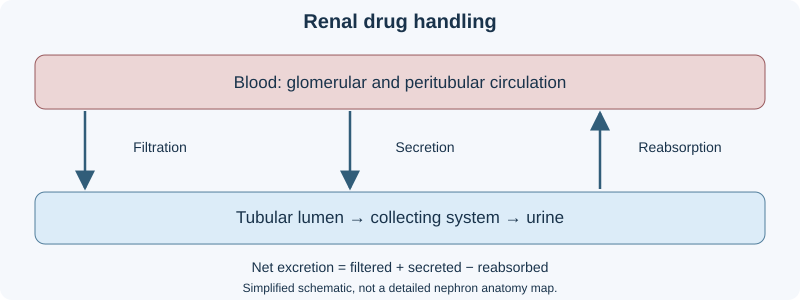

# Pharmacology — Drug excretion

**Study-ready candidate, not studied.** Medicine body mein effect dene ke baad remove bhi hoti hai. Agar body expected speed se drug remove nahi kar paati, toh same dose par exposure change ho sakti hai.

[Chapter](../README.md) · [20 original MCQs](../MCQs/05-Drug-Excretion-20-MCQs.md) · [Evidence](../Previous-Year-Questions/05-Drug-Excretion-Evidence.md)

## Elimination and excretion

Elimination parent drug ka removal metabolism aur excretion se describe karti hai. Excretion mein unchanged drug ya metabolite body se bahar nikalta hai. Kidney many medicines ke liye important hai, lekin drug-specific nonrenal routes bhi hote hain.

## Renal handling

Glomerular filtration mein blood se small freely filterable molecules Bowman's space mein aate hain. Albumin-bound drug normally directly filter nahi hoti. Jab free drug filter hoti hai, toh reversible binding se aur drug free ho sakti hai. Tubular secretion mein transport proteins drug ko peritubular blood se lumen mein transfer karte hain. Probenecid susceptible penicillins ki secretion inhibit kar sakti hai aur plasma exposure prolong kar sakti hai.

Tubular reabsorption mein drug lumen se blood mein wapas aati hai. Un-ionized lipid-soluble forms passive diffusion se return kar sakti hain. Urine pH ionization ko affect kar sakta hai, lekin is theoretical concept ko independently urine pH change karne ka clinical instruction nahi samajhna chahiye.

Net urinary excretion = filtration + secretion − reabsorption, assuming no other renal handling. Ek hour mein 30 mg filter, 20 mg secrete aur 10 mg reabsorb ho toh urine mein 40 mg bachegi. Reabsorbed amount subtract karte hain kyunki woh blood mein return ho gayi hai.

## Renal clearance and calculations

Clearance apparent plasma volume per unit time hai. Urine collection complete aur appropriate plasma concentration available ho toh unchanged urinary drug excretion rate ko plasma concentration se divide karte hain. Example mein two hours mein 36 mg excrete hui aur average concentration 6 mg/L thi. Excretion rate 18 mg/h aur renal clearance 3 L/h hogi.

Filtration-only model mein free fraction times GFR predicted clearance deti hai. Agar GFR 100 mL/min aur free fraction 0.5 hai, toh clearance 50 mL/min hai. Freely filtered unbound drug ka clearance GFR se zyada ho toh net secretion possible hai. Agar secretion aur renal metabolism absent hon aur clearance GFR se kam ho, toh reabsorption possible explanation hai.

## Kidney function and nursing decisions

Serum creatinine normal hone par bhi low muscle mass wale frail patients mein actual kidney function reduced ho sakti hai. AKI mein creatinine rapidly change ho toh steady-state equations inaccurate ho sakti hain. Nurse trend, urine output aur clinical condition check karke drug-specific plan review karwati hai. Har product label mein same estimating equation nahi hoti.

Indexed eGFR standard BSA 1.73 m² ke relative hoti hai. Jab validated drug protocol absolute mL/min maangta hai toh de-indexing relevant ho sakti hai. Example: indexed 60 times actual BSA 2.00 divided by 1.73 approximately 69 mL/min hai. Har drug ke liye automatic conversion ya dose decision nahi karte.

Trimethoprim tubular creatinine secretion inhibit kar sakti hai, lekin true kidney injury aur potassium changes possible hain. Gabapentin primarily unchanged renal excretion se remove hoti hai, isliye advanced kidney disease mein new sedation prompt assessment maangti hai. Kuch critically ill patients mein augmented renal clearance se antimicrobial exposure unexpectedly low bhi ho sakti hai. Drug-specific monitoring aur clinical team ka review important hai.

Dialysis drug removal medicine aur modality par depend karta hai. Agar post-dialysis supplemental dose prescribed hai aur session cancel ho jaata hai, toh extra dose independently administer karne ke bajay schedule clarify karna chahiye.

## Nonrenal routes

Drug bile se intestine tak pahunch sakti hai aur kuch hissa reabsorb ho sakta hai. Isko enterohepatic recirculation kehte hain. Volatile anesthetics lungs ke through exhale ho sakti hain. Breast milk mein transfer drug-specific hai. Nurse reliable lactation guidance se maternal treatment aur infant safety review karwati hai.

## Video resources

- [Drug Excretion and Drug Clearance](https://www.youtube.com/watch?v=BTzjxWoZd70): teaching description lists renal processes at 05:10, playback and channel verification pending.
- [Nursing Learning Hub — Foundations of Pharmacology MCQs](https://www.youtube.com/watch?v=wwytgeHKVAQ): description confirms excretion model-MCQ topic, not exact item verification.

## Clinical and syllabus references

- [MSD Manual — Drug Excretion](https://www.msdmanuals.com/professional/clinical-pharmacology/pharmacokinetics/drug-excretion): opened text and updated indexed summary. Supports renal handling, ionization, nonrenal routes and augmented clearance.
- [NIDDK — Determining Drug Dosing in Adults with CKD](https://www.niddk.nih.gov/research-funding/research-programs/kidney-clinical-research-epidemiology/laboratory/ckd-drug-dosing-providers): opened text, kidney-function estimation and BSA adjustment.
- [FDA renal impairment pharmacokinetics guidance, March 2024](https://www.fda.gov/regulatory-information/search-fda-guidance-documents/pharmacokinetics-patients-impaired-renal-function-study-design-data-analysis-and-impact-dosing): indexed guidance, not a universal dosing protocol.
- [DailyMed probenecid](https://dailymed.nlm.nih.gov/dailymed/drugInfo.cfm?setid=5d552de5-2d18-4464-bcaf-0311fa3f080d) and [Neurontin label](https://dailymed.nlm.nih.gov/dailymed/drugInfo.cfm?setid=97935fd9-1d4a-43b6-a5d9-de994591187b): indexed labels support Q8 and Q17, direct complete label review pending.
- [Trimethoprim and creatinine](https://pubmed.ncbi.nlm.nih.gov/21832843/) and [2022 electrolyte study](https://pubmed.ncbi.nlm.nih.gov/35545234/): indexed abstracts support Q16.
- [INC B.Sc. Nursing regulations, Pharmacology I Unit I](https://thc.nic.in/Central%20Governmental%20Regulations/Indian%20Nursing%20Council%20%28Revised%20Regulations%20and%20Curriculum%20For%20B.Sc.%28Nursing%29%20%28Program%29%20Regulations%2C2020..pdf): retrieved text explicitly lists excretion, screenshot failed. Calculation models are educational applications, exact exam depth unverified.

Actual medication dosing, dialysis schedules and lactation decisions require drug-specific clinical review and applicable protocols.
