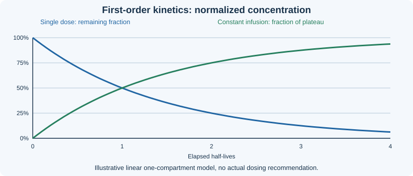

# Pharmacology — Half-life, steady state and therapeutic drug monitoring

**Study-ready candidate, not studied.** Medicine ki concentration time ke saath kaise badalti hai, yeh samajhne se nurse dose timing, sampling aur toxicity ko safely review kar sakti hai.

[Chapter](../README.md) · [20 original MCQs](../MCQs/06-Half-Life-Steady-State-and-Therapeutic-Drug-Monitoring-20-MCQs.md) · [Evidence](../Previous-Year-Questions/06-Half-Life-Steady-State-and-Therapeutic-Drug-Monitoring-Evidence.md)

## Half-life and remaining versus eliminated drug

Half-life woh time hai jisme post-distribution concentration ya amount first-order model mein half ho jaata hai. Jab further drug input nahi hai aur elimination stable hai, toh remaining amount ko har half-life mein do se divide karte hain. Agar initial amount 100 percent hai, toh ek half-life baad 50, do baad 25, teen baad 12.5 aur chaar baad 6.25 percent bachta hai. Eliminated amount ke liye remaining percent ko 100 se subtract karte hain. Half-life fixed amount removed hone ka rule nahi hai.

Reverse calculation bhi important hai. Agar concentration 24 se 6 mg/L ho gayi hai, toh 24 se 12 aur 12 se 6 tak do halvings hui hain. Agar total 10 hours lage, toh half-life five hours hai. Nonlinear kinetics, distribution phase aur changing clearance mein simple halving model apply karne se pehle assumptions check karni chahiye.

## Steady state aur accumulation

Jab drug ka average input rate removal rate ke barabar ho, toh stable conditions mein steady state establish hota hai. Intermittent dosing mein peak aur trough different rehte hue repeating pattern ban sakte hain. Constant IV infusion mein simplified linear model gradual plateau deta hai. Four to five half-lives mein plateau ke kareeb pahunchte hain, exact 100 percent nahi. Infusion rate change karne par ek half-life mein old aur new plateau ke beech difference ka aadha cover ho sakta hai.

Same daily dose ko chhote aur frequent doses mein divide karne se linear model mein average steady-state concentration similar rehti hai, lekin peak-to-trough fluctuations generally kam ho sakti hain. Actual dosing schedule nurse independently change nahi karti. Missed dose ko automatically double karna bhi safe universal rule nahi hai.

## Loading dose, maintenance dose and infusion rate

Loading dose target concentration jaldi approach karne ke liye hoti hai. Maintenance dose elimination se lost drug ko replenish karti hai. Simplified model mein loading amount = target concentration times apparent Vd divided by bioavailability. Agar target 4 mg/L, Vd 25 L aur IV bioavailability 1 hai, toh calculated educational loading amount 100 mg hai.

Maintenance amount per interval = target average concentration times clearance times interval divided by bioavailability. Agar target 2 mg/L, clearance 3 L/h, interval 12 hours aur oral availability 0.5 hai, toh systemic replacement 72 mg aur hypothetical oral amount 144 mg hai. Constant IV infusion rate = target concentration times clearance. Target 5 mg/L aur clearance 2 L/h ke example mein 10 mg/h milta hai. Pump mL/h nikalne ke liye preparation concentration bhi chahiye.

In examples mein stable linear kinetics assume ki gayi hai. Actual treatment mein indication, patient condition, product, drug-specific limits, existing drug amount aur monitoring plan matter karte hain. Transfer ke time pehle administered loading dose ko check karna important hai, taaki dose inadvertently repeat na ho.

## Therapeutic drug monitoring (TDM)

TDM ka matlab selected medicines ki concentration aur clinical response ko use karke individualized treatment review karna hai. Har drug mein routine serum monitoring necessary nahi hai. Sample kab liya gaya, dose kab di gayi, specimen type kya hai aur kidney function kaisi hai, yeh sab interpretation ko affect karte hain. Therapeutic range safety ki absolute guarantee nahi hoti.

Digoxin ka routine timed level generally last dose ke kam se kam six hours baad liya jaata hai. One-hour sample distribution se pehle misleading ho sakta hai. New nausea, bradycardia aur low potassium ko clinical review mein urgently consider karna chahiye, even if prior level reference interval mein tha. Toxicity suspect hone par assessment delay nahi karni chahiye.

Lithium ka standardized routine level commonly 12 hours after dose collect karte hain. Dose 20:00 par hui toh requested 12-hour sample next morning 08:00 par hoga. Diarrhea, dehydration aur interacting medicines ke baad toxicity possible hai. New coarse tremor ya neurological symptoms par urgent clinical review, suspected-toxicity withholding instructions, lithium level aur renal/electrolyte tests important hain.

## Antibiotic monitoring and sample accuracy

Serious MRSA infection ke liye 2020 vancomycin consensus AUC-based monitoring prefer karti hai. AUC 24-hour exposure ko represent karta hai. MIC 1 mg/L assume hone par target AUC approximately 400–600 mg·h/L hai. Har indication mein is target ko automatically apply nahi karte. Actual infusion times aur sample time monitoring team ko accurate report karna chahiye.

Extended-interval gentamicin ke kuch protocols mein first infusion ke start ke 6–14 hours baad sample collect kiya jaata hai. Yeh conventional peak aur trough schedule se different approach hai. Specific patient eligibility aur local protocol verify karna zaroori hai. Recently infused drug ki residual amount se vascular-line sample falsely high ho sakta hai. Nurse patient assess karti hai, contamination possibility promptly communicate karti hai aur valid repeat sample arrange karwati hai.

Units ko bhi dhyan se check karo. Ek microgram/mL ek mg/L ke numerically equal hota hai, lekin har result ko correct drug, specimen, reference interval aur timing se compare karna chahiye.

## Video resources

- [Level Up RN — Therapeutic Index, Half Life, Mode of Action](https://www.youtube.com/watch?v=rpHIeotyuyA): description lists half-life at 02:22 and quiz segment at 04:03. Nursing teaching with quiz segment, exact quiz items and playback unverified.
- [Oleksii Hliebov — Half Life, Drug Calculations Practice Problems](https://www.youtube.com/watch?v=q2Wkqh39EYs): description includes question text fragments and timestamps for graph inference and first-order calculations. Medical exam-level related practice, not exact matches to this bank. Playback unverified.
- Drug-specific TDM nursing MCQ practice remains a documented gap.

## Clinical and syllabus references

- [MSD Manual — overview of pharmacokinetics](https://www.msdmanuals.com/professional/clinical-pharmacology/pharmacokinetics/overview-of-pharmacokinetics?ruleredirectid=741): opened, individualized monitoring principles.
- [NCBI Bookshelf — Steady State Concentration](https://www.ncbi.nlm.nih.gov/sites/books/NBK553132/) and [Loading Dose](https://www.ncbi.nlm.nih.gov/sites/books/NBK557418/): opened, educational linear models and loading/maintenance reconciliation. Q1–11.
- [NHS Specialist Pharmacy Service — digoxin monitoring](https://sps.nhs.uk/monitorings/digoxin-monitoring/): opened, Q12–13.
- [NHS Specialist Pharmacy Service — lithium monitoring](https://sps.nhs.uk/monitorings/lithium-monitoring/): opened, Q14–15. [Pharmaceutical Journal lithium monitoring](https://pharmaceutical-journal.com/article/ld/lithium-monitoring-and-toxicity-management): indexed, interaction and toxicity guidance.
- [ASHP/PIDS/SIDP/IDSA consensus, 2020](https://www.idsociety.org/practice-guideline/vancomycin): opened, Q16–17. Target applies to serious MRSA infection, not all indications.
- [GGC Medicines — gentamicin dosing guidelines age 16 and over](https://handbook.ggcmedicines.org.uk/guidelines/infections/gentamicin-dosing-guidelines-age-16-and-over/): indexed, Q18–19. Local protocol example, not universal.
- [ADLM — collecting blood from patients with vascular lines](https://myadlm.org/science-and-research/clinical-chemistry/clinical-chemistry-trainee-council/pearls-of-laboratory-medicine-in-english/2016/collecting-blood-from-patients-with-vascular-lines): indexed, contamination risk.
- [INC B.Sc. Nursing curriculum, Pharmacology I Unit I, printed page 298](https://svnursing.ac.in/files/INC-Syllabus-for-Nursing.pdf): extracted text includes pharmacokinetics, dose calculations and individualized treatment. Screenshot retrieval failed. Advanced equations are application practice, not an assertion of exact exam depth.

The equations assume simplified linear models. Actual dosing, sample timing, toxicity response and dose adjustments must follow patient-specific clinical orders and applicable protocols.
