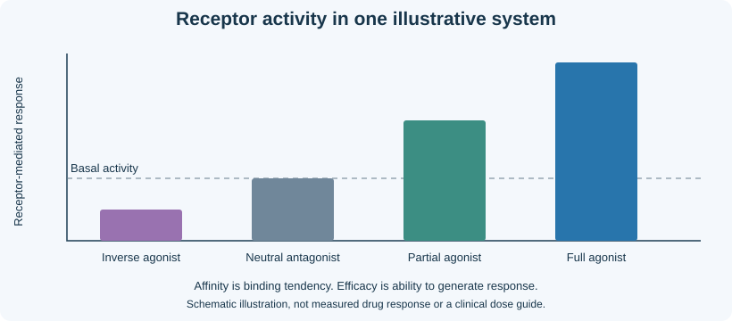

# Pharmacology — Pharmacodynamics and receptors

**Study-ready candidate, not studied.** Aaj hum dekhenge ki drug body ke andar jaakar effect kaise produce karti hai. Jab hum receptor, agonist aur antagonist ko samajh lete hain, toh medicine ki therapeutic action, adverse effects aur interactions samajhna aasaan ho jaata hai.

[Chapter](../README.md) · [20 original MCQs](../MCQs/07-Pharmacodynamics-and-Receptors-20-MCQs.md) · [Evidence](../Previous-Year-Questions/07-Pharmacodynamics-and-Receptors-Evidence.md)

## Pharmacokinetics aur pharmacodynamics

Pharmacokinetics batati hai ki body drug ke saath kya karti hai, jaise absorption, distribution, metabolism aur excretion. Pharmacodynamics batati hai ki drug body ke functions ko kaise change karti hai. Drug ka blood level aur body ka response ek hi baat nahi hain. Kabhi similar concentration par alag patients ka response different ho sakta hai kyunki receptor sensitivity, organ condition ya other medicines change ho sakti hain.

Receptor ek biological target hota hai jo ligand ko recognize kar sakta hai. Ligand natural chemical, hormone, neurotransmitter ya medicine ho sakta hai. Affinity binding ki tendency hai. Efficacy binding ke baad functional response generate karne ki capacity se related hai. Drug receptor se strongly bind kar sakti hai, lekin activation necessarily strong nahi hogi. Enzyme inhibition aur direct chemical interaction jaise nonreceptor mechanisms bhi medicines ke effect mein important hote hain.

## Full agonist, partial agonist, antagonist and inverse agonist

Full agonist reference tissue system ka maximum response achieve kar sakta hai. Partial agonist receptor activate karta hai, lekin same system mein full agonist ke comparison mein lower maximum produce kar sakta hai. Agar partial agonist full agonist ko same receptors se replace kare, toh overall effect kam ho sakta hai, despite partial agonist ka apna positive effect.

Neutral antagonist receptor bind karke agonist activation block kar sakta hai, lekin ideal model mein basal receptor activity khud change nahi karta. Kuch receptors ligand ke bina bhi activity show karte hain, jise constitutive activity kehte hain. Inverse agonist is basal activity ko reduce karta hai. Isliye neutral antagonist aur inverse agonist technically identical nahi hain.

Reversible competitive antagonist agonist ke same binding site par compete karta hai. Ideal equilibrium experiment mein same response ke liye higher agonist concentration chahiye aur concentration-response curve right shift karti hai. Sufficient agonist se original maximum achieve ho sakta hai. Irreversible inactivation functional receptors reduce kar sakti hai. Agar receptor reserve sufficient nahi hai, toh higher agonist se original maximum restore nahi hoga. Yeh laboratory model hai, patient ko dose badhane ki instruction nahi hai.

Spare receptors ka concept batata hai ki signal amplification ke kaaran maximum tissue response sab receptors occupy hone se pehle mil sakta hai. Allosteric modulation mein medicine usual ligand binding site se alag site par bind karke response change karti hai. Positive allosteric modulator agonist response enhance kar sakta hai. Negative modulator response reduce kar sakta hai.

## Receptor families and signaling

Ligand-gated ion channel receptor mein ligand bind hote hi channel conductance change ho sakti hai. Neuromuscular junction ka nicotinic acetylcholine receptor example hai. Is action se membrane potential rapidly change ho sakta hai. Muscarinic acetylcholine receptor iske opposite GPCR family mein aata hai.

G-protein-coupled receptor ya GPCR membrane par located signaling receptor hai. Gs commonly adenylyl cyclase activate karke cAMP increase karta hai. Beta-2 receptor is pathway ka classic example hai aur airway smooth muscle relaxation mein role play karta hai. Gi commonly adenylyl cyclase activity reduce karta hai, jaise alpha-2 receptor ke classical coupling mein. Gq phospholipase C pathway activate kar sakta hai. Alpha-1 receptor mein IP3 aur DAG signaling intracellular calcium mobilization aur vascular smooth muscle contraction mein contribute kar sakti hai. Actual tissue signaling mein multiple pathways involved ho sakte hain.

Enzyme-linked receptors intracellular phosphorylation pathways activate kar sakte hain. Insulin receptor intrinsic tyrosine kinase activity rakhta hai. Binding ke baad downstream signals glucose uptake aur metabolism regulate karte hain. Intracellular receptors, jaise glucocorticoid receptor, gene transcription influence kar sakte hain. Isliye kuch genomic effects ke liye time lag sakta hai.

## Regulation, antagonism and clinical application

Repeated receptor stimulation ke baad signaling response kam ho sakta hai. Desensitization mein coupling efficiency reduce ho sakti hai even if receptor number same ho. Downregulation mein receptor availability ya number reduce ho sakte hain. Chronic antagonism ke baad receptor sensitivity ya number change bhi ho sakte hain. Isliye long-term beta-blocker ko abruptly stop karne se kuch patients mein rebound symptoms ka risk hota hai. Nurse patient ko prescribed discontinuation plan clarify karne mein help karti hai.

Har antagonism same receptor par nahi hota. Chemical antagonism mein two substances directly interact kar sakte hain, jaise protamine unfractionated heparin ko neutralize karne mein use hota hai. Physiological antagonism mein different receptor pathways opposite tissue effects produce karte hain. Histamine contraction aur beta-2-mediated relaxation ek conceptual example hai. Yeh anaphylaxis treatment protocol ka replacement nahi hai.

Pharmacodynamic interaction mein drug levels necessarily change nahi hote, lekin combined effect badh ya kam ho sakta hai. Sedative aur opioid ek saath diye jaane par respiratory depression ka risk increase ho sakta hai. Agar patient excessively drowsy ya breathing depressed ho, toh nurse immediate clinical assessment aur applicable urgent response protocol follow karti hai.

Potency ka matlab specified effect produce karne ke liye required dose ya concentration se related hai, jabki efficacy achievable maximum response describe karti hai. Detailed graded aur quantal response curves, therapeutic index, synergism aur tolerance ko next dedicated topics mein aur practice karenge.

## Video resources

- [Receptors: Agonists & Antagonists](https://www.youtube.com/watch?v=nqmLitfBrz4): indexed description explicitly states beginning nursing students as audience. Channel and playback unverified, teaching lead only.
- [Pharmacy India — Drug Inspector Cracker Series, Part 2](https://www.youtube.com/watch?v=TcWjnGwIU6M): published description lists receptor signaling, partial/inverse agonism, receptor reserve and MCQs. Mixed pharmacy-level teaching and practice, exact question-solving segment and playback unverified.
- Nursing-specific dedicated receptor MCQ practice and drug-specific question-level mappings remain pending.

## Clinical and curriculum references

- [Open RN Nursing Pharmacology, chapter 1](https://www.ncbi.nlm.nih.gov/books/NBK595006/): opened nursing text, receptor binding, agonist and antagonist action, efficacy and dose-response.
- [MSD Manual Professional — Drug–Receptor Interactions](https://www.msdmanuals.com/professional/clinical-pharmacology/pharmacodynamics/drug-receptor-interactions): opened text, partial agonism, antagonism, receptor regulation and affinity.
- [StatPearls — Pharmacodynamics](https://www.ncbi.nlm.nih.gov/books/NBK507791/): opened, receptor mechanisms, signaling, concentration-response and clinical applications.
- [Indian Nursing Council revised B.Sc. Nursing curriculum, 2020, Pharmacology I, Unit I, printed page 298](https://abmamcon.com/wp-content/uploads/2025/06/Indian-Nursing-Council-Revised-Regulations-and-Curriculum-For-B.Sc_.Nursing-Program-Regulations2020.pdf): extracted text explicitly lists drug action, antagonism, synergism, tolerance and receptors. Screenshot retrieval failed. Advanced receptor examples are applications, not a claim about exact exam difficulty.

Clinical examples are educational, not instructions for independently adjusting doses or administering reversal agents. Use prescribed orders, applicable emergency protocols and patient-specific review.
