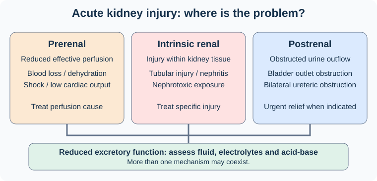

# 📚 Acute Kidney Injury (AKI) — stages, causes and nursing management

[🏠 Chapter](../README.md) · [📝 30 original AKI MCQs](../MCQs/Acute-Kidney-Injury-30-MCQs.md) · [📜 Reported exam questions](../Previous-Year-Questions/Acute-Kidney-Injury-Reported-Exam-Questions.md)

> **Dhyan de:** Study-ready, unattempted. Adult AKI criteria aur clinical nursing priorities par focus hai. Treatment local protocol aur clinical orders ke according hota hai.

## 1. AKI kya hai aur kaise diagnose karte hain

**Priority:** 🔴 MOST IMPORTANT

Dekho, normally kidney blood se waste aur extra fluid remove karti hai. Jab kuch hours ya days ke andar kidney ki excretory function achanak kam ho jaati hai, toh ise acute kidney injury kehte hain. Purane exam papers mein acute renal failure (ARF) term bhi milti hai. AKI mild injury se severe failure tak ka spectrum hai. Har AKI patient mein urine completely band nahi hota.

Adult KDIGO 2012 definition ke according inmein se koi bhi criterion AKI indicate kar sakta hai: serum creatinine 48 hours mein at least 0.3 mg/dL badhna, previous seven days mein baseline ke at least 1.5 times tak badhna, ya urine output below 0.5 mL/kg/hour for at least six hours. Cause aur obstruction evaluate karna zaroori hai.

**Current reference note:** ICMR July 2026 Standard Treatment Workflow bhi isi familiar definition ko use karta hai. KDIGO 2026 AKI/AKD update search mein public-review draft ke roop mein mila. Draft ko final guideline nahi maana gaya hai. Neeche adult exam staging 2012 framework ke naam se di gayi hai.

| Stage | Serum creatinine criterion | Urine output criterion |
|---|---|---|
| 1 | 1.5–1.9 times baseline or rise ≥0.3 mg/dL in 48 h | Below 0.5 mL/kg/h for 6 to under 12 h |
| 2 | 2.0–2.9 times baseline | Below 0.5 mL/kg/h for ≥12 h |
| 3 | At least 3 times baseline, rise to ≥4.0 mg/dL in acute context, or initiation of kidney replacement therapy for AKI | Below 0.3 mL/kg/h for ≥24 h or anuria for ≥12 h |

Dono criteria alag severity batayen toh higher applicable stage consider hota hai. Pediatric criteria alag context mein padhenge. Stable CKD patient ka creatinine 4 mg/dL hone se automatically AKI stage 3 nahi banta.

**Example:** Baseline creatinine 0.8 se 1.8 mg/dL within 3 days ho gaya. Ratio = 1.8 ÷ 0.8 = 2.25. Isliye creatinine criterion se stage 2 hai. Agar urine 12 hours se bilkul nahi bana aur measurement reliable hai, urine criterion stage 3 indicate karta hai. Patient ko urgent evaluation chahiye.

## 2. Prerenal, intrinsic aur postrenal causes

**Priority:** 🔴 MOST IMPORTANT

Kidney ko ek filter aur drainage pipe ke system ki tarah samjho. Agar filter tak blood kam pahunchta hai, toh prerenal problem ho sakti hai. Agar filter ke cells damage ho jaate hain, toh intrinsic problem hoti hai. Agar urine bahar jaane ka rasta block ho jaata hai, toh postrenal problem hoti hai. Multiple causes ek saath bhi ho sakte hain.

| Type | Mechanism | Examples |
|---|---|---|
| Prerenal | Effective renal perfusion kam hoti hai. Starting mein tissue structurally intact ho sakta hai. | Blood loss, vomiting, diarrhea, shock, low cardiac output |
| Intrinsic | Kidney tissue ke cells, tubules, glomeruli, interstitium ya vessels injure ho sakte hain. | Ischemic acute tubular injury, aminoglycoside toxicity, interstitial nephritis, glomerulonephritis |
| Postrenal | Urine outflow obstruction se back pressure filtration ko impair kar sakta hai. | Bladder outlet obstruction, bilateral ureteric blockage, obstruction of a solitary functioning kidney |

Prolonged prerenal hypoperfusion intrinsic tubular injury mein progress kar sakti hai. Heart failure mein total body fluid high hone ke bawajood effective kidney perfusion low ho sakti hai. Isliye har prerenal suspicion par blindly fluid dena safe nahi hai.

### Medicines aur nephrotoxic risks

NSAIDs renal prostaglandin-mediated afferent vasodilation reduce kar sakte hain. Volume depletion mein filtration worsen ho sakti hai. ACE inhibitors/ARBs efferent arteriolar tone reduce karte hain. Ye long-term indicated treatment mein kidney protective bhi ho sakte hain, lekin acute hypoperfusion mein medicine review important hai. Aminoglycosides tubular toxicity cause kar sakte hain. Nurse medication reconciliation, prescribed dose review aur relevant levels/renal labs monitor karegi. Medicine apni taraf se discontinue ya restart nahi karni.

### FENa — exam reasoning, not a standalone diagnosis

Fractional excretion of sodium batata hai ki filtered sodium ka kitna percent urine mein excrete hua. Formula: FENa (%) = (urine sodium × plasma creatinine) ÷ (plasma sodium × urine creatinine) × 100. Matched units use karo.

Example: urine sodium 20 mmol/L, plasma sodium 140 mmol/L, plasma creatinine 2 mg/dL, urine creatinine 100 mg/dL. FENa = (20 × 2) ÷ (140 × 100) × 100 = 0.286%. Classic context mein below 1% sodium conservation aur prerenal physiology suggest kar sakta hai. Diuretics, CKD, sepsis aur several intrinsic conditions results alter kar sakte hain. FENa alone se diagnosis confirm nahi hota. BUN/creatinine ratio bhi context-dependent clue hai.

## 3. Clinical course, investigations aur complications

**Priority:** 🟠 HIGH YIELD

Traditional teaching mein initiation, oliguric/maintenance, diuretic aur recovery phases describe hote hain, especially tubular injury. Ye clinical course hai, KDIGO stage numbers nahi. Har patient sab phases se nahi guzarta.

Initiation mein original insult hota hai. Maintenance phase mein filtration impaired reh sakti hai aur fluid, potassium, acid aur nitrogenous waste accumulate ho sakte hain. Nonoliguric AKI bhi possible hai. Recovery mein tubules ki concentrating ability filtration ke saath same speed par recover nahi hoti. Isliye diuretic phase mein excessive urine, volume depletion aur potassium loss develop ho sakta hai. Serial trends se recovery assess karo.

Urine output aur creatinine trend ke saath electrolytes, bicarbonate, urinalysis, CBC aur ordered tests evaluate hote hain. Suspected obstruction mein renal/bladder imaging helpful hai. Infection, rhabdomyolysis aur glomerular inflammation ke liye specific investigations indicated ho sakti hain. Muddy brown casts tubular injury suggest karte hain. Proteinuria aur hematuria without obvious cause glomerular disease ke liye specialist assessment warrant kar sakte hain.

Complications mein fluid overload/pulmonary edema, hyperkalemia, metabolic acidosis aur symptomatic uremia (waste accumulation se encephalopathy ya pericarditis) include hote hain. New breathlessness, altered mental status, chest pain, ECG changes ya unstable BP emergency warning signs hain.

## 4. Nursing management, emergency care aur recovery

**Priority:** 🔴 MOST IMPORTANT

Nurse pehle patient ka airway, breathing, circulation aur consciousness assess karegi. Vitals, early warning score, accurate intake/output, comparable daily weight aur urine trends record karo. Sudden low output mein drainage patency if present, bladder distension aur perfusion evaluate karo. Severe instability mein routine documentation ke liye emergency response delay mat karo.

Suspected volume deficit mein prescribed isotonic crystalloid resuscitation aur response reassessment appropriate ho sakti hai. Fluid overload mein further unnecessary fluids avoid karo aur prescribed oxygen/diuretic/other management support karo. Loop diuretics AKI ko routinely reverse nahi karte. Inka use selected fluid-overloaded patients mein ho sakta hai. Low-dose dopamine kidney ko protect karne ke liye recommended nahi hai.

### Hyperkalemia emergency concept

Severe potassium elevation heart ki electrical activity ko disturb kar sakti hai. ECG changes, symptoms ya severe hyperkalemia ko urgently escalate karo aur local emergency protocol follow karo. Prescribed IV calcium myocardial membrane stabilization mein help karta hai, lekin potassium concentration directly kam nahi karta. Insulin with glucose potassium ko cells ke andar shift karta hai. Iske baad glucose monitoring hypoglycemia detect karne ke liye zaroori hai. Selected beta-agonist bhi shift support kar sakta hai. Potassium removal alag process hai, jisme dialysis ya other prescribed measures role play kar sakte hain. Existing starter Q1 already tests ECG hyperkalemia emergency activation, isliye same stem naya count nahi kiya gaya hai.

### Dialysis indication mnemonic — AEIOU

| Letter | Indication |
|---|---|
| A | Refractory severe acidosis |
| E | Dangerous electrolyte disturbance, particularly hyperkalemia not controlled medically |
| I | Selected dialyzable intoxications |
| O | Refractory fluid overload, especially pulmonary edema |
| U | Symptomatic uremia such as encephalopathy or pericarditis |

Ye memory aid hai, automatic bedside prescription nahi. Dialysis decision patient ki overall condition, trend aur response par based hota hai. Ek creatinine/BUN number alone se decision nahi hota. Hemodynamically unstable patients mein continuous modality selected ho sakti hai. Full dialysis nursing alag topic mein hai.

### Prevention and discharge

Dehydration, sepsis aur hypotension identify karo. Community mein diarrhea, heat exposure aur unsafe self-medication AKI risk badha sakte hain. Oral hydration advice individual fluid restriction aur condition ke according do. Reduced urine, persistent vomiting, severe weakness, breathlessness ya confusion mein timely evaluation encourage karo. Discharge ke time prescribed medicine plan, repeat creatinine/electrolyte testing aur follow-up samjhao. AKI recovery ke baad bhi CKD risk badh sakta hai. About three months par kidney status review traditional KDIGO follow-up principle hai, earlier monitoring severity aur clinical course ke hisaab se hoti hai.

## ▶️ YouTube teaching and question practice

- Teaching: [RegisteredNurseRN — AKI nursing review](https://www.youtube.com/watch?v=GHshZSCbtOk), indexed description covers causes, course and nursing. Older lecture, current guideline staging ke liye written reference use karo. Playback not verified.
- Dedicated MCQ practice: [Aarogyam Infinity Part 26 — PW Nursing Wallah](https://www.youtube.com/watch?v=HxPTSOYf4o0). Published description lists oliguria at 40:48 and prerenal FENa at 44:03. Topic-level mapping only, not exact-question playback. Oliguria may be an early warning but is not present in every AKI.
- Remaining topic-specific question video coverage pending. [Evidence and gaps](../Previous-Year-Questions/Acute-Kidney-Injury-Reported-Exam-Questions.md).

## References

[ICMR July 2026 nephrology workflow](https://www.icmr.gov.in/icmrobject/uploads/STWs/1793170716_nephrology.pdf) · [UK Kidney Association AKI definition and staging](https://www.ukkidney.org/clinical-resources/aki-guide-resources/background/) · [NICE NG148 recommendations](https://www.nice.org.uk/guidance/ng148/chapter/Recommendations) · [KDIGO AKI guideline and update status](https://kdigo.org/guidelines/acute-kidney-injury/) · [Open RN renal nursing](https://www.ncbi.nlm.nih.gov/sites/books/NBK613065/).

[📝 AKI questions](../MCQs/Acute-Kidney-Injury-30-MCQs.md) · [🏠 Chapter](../README.md)
